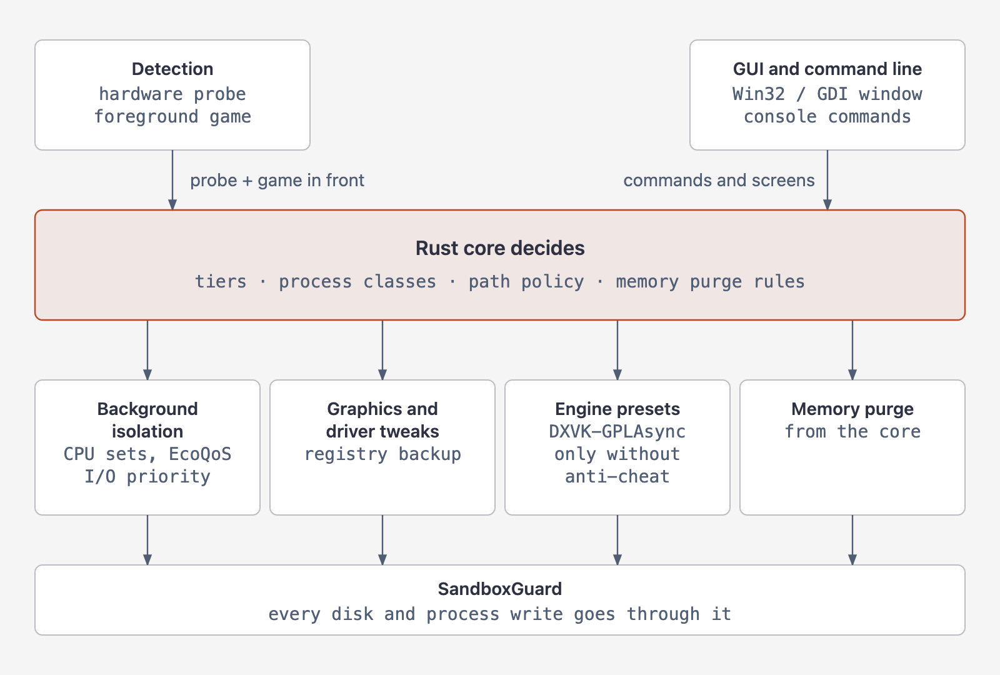

# VegaFlow Universal

A Windows daemon written in C++20, with a hybrid Rust core, that optimizes games on AMD APUs (test bench: Ryzen 5 4600H with Radeon Vega 6). It isolates background processes, applies profiles according to the APU tier, and uses DXVK-GPLAsync. It never injects anything into games that use anti-cheat. Current version: **0.1.0** ([`CHANGELOG.md`](CHANGELOG.md)).

  

**In short:** on a laptop with an AMD APU, the processor and the graphics share the same memory and the same heat budget, so a browser or an updater running in the background steals time from the game. VegaFlow notices when a game is in front, moves the background programs out of its way, and puts everything back when you stop playing. For example, in Octopath Traveler II its memory preset gave +40% average FPS in the overworld (one capture, cause not isolated; see [Measured results](#measured-results)).



## Why it exists

On an APU the CPU and the iGPU share the RAM and the thermal budget, and the system is designed for desktops with a dedicated GPU. VegaFlow acts on five problems:

1. **Shared memory (UMA):** background processes compete with the iGPU for the same DDR4 bus.
2. **The false 512 MB VRAM limit:** BIOSes report it and game engines take it literally.
3. **No GPL in AMD's Vega drivers:** shaders compile on the game's own thread; DXVK-GPLAsync moves them to background threads.
4. **Windowed DWM composition:** the intermediate copy adds latency; Flip mode avoids it.
5. **Shared thermal budget (STAPM):** if the CPU draws too much, the GPU lowers its clock.

## What it does

| Feature | What it means for you |
| --- | --- |
| Background isolation | Background processes are confined (affinity, EcoQoS, I/O priority) so the CPU and the disk stay with the game. |
| Per-tier profiles | `ApuCapabilityGuard` classifies the machine into 4 levels and never applies what was calibrated for one level to another. |
| Anti-cheat safe | If an anti-cheat driver is present, `SandboxGuard` blocks every write and the game's files are not touched. |
| Reversible | Every change keeps a copy (`.vegaflow.bak`, or the original registry value); `--restore-registry` brings them all back. |
| Lightweight | No heavy frameworks; Win32/GDI window and under 15 MB at rest. |

Each feature is described in [Features](docs/guides/usage-and-features/index.md).

## Measured results

The figures come from PresentMon, with their method and limits, in [`docs/measurements/`](docs/measurements/); what is still unmeasured is in [Verification status](docs/measurements/verification-status.md). In Octopath Traveler II the UMA preset in `Engine.ini` gave +40% average FPS in the overworld (one non-interleaved capture, cause not isolated); in Zenless Zone Zero the daemon did not change the FPS (58.57 to 58.89, no effect) and there was no anti-cheat ban.

## Install

The `VegaFlow-0.1.0-win-x64.zip` package holds the daemon and two PowerShell scripts. It is built with `scripts/build/package.sh`. Unzip it and, in PowerShell as administrator, from the unzipped folder:

| Command | What it does |
| --- | --- |
| `.\install.ps1 -DryRun` | Shows the steps without changing anything |
| `.\install.ps1` | Installs into `C:\Program Files\VegaFlow` |
| `.\install.ps1 -Autostart` | Also starts VegaFlow with Windows (off unless you ask) |
| `.\uninstall.ps1` | Gives the system back VegaFlow's changes, then deletes it |

`install.ps1` checks the SHA-256 of every file before copying. The package is not code-signed: check its hash. Full guide: [Install and uninstall](docs/guides/install-and-uninstall.md).

## Build and test

The program runs on Windows only. It is built with MinGW-w64 g++ 13+ and cargo with the `x86_64-pc-windows-gnu` target. From a Mac or Linux you can cross-compile (`scripts/build/build-cross.sh`, needs mingw-w64) and run the `.exe` files on a Windows machine.

| Command | Where | Last real result |
| --- | --- | --- |
| `powershell -ExecutionPolicy Bypass -File .\scripts\build\build.ps1 -RunTests` | Windows | builds the daemon and runs the C++ suite: `TEST RESULTS: 357 PASSED, 0 FAILED` (2026-11-21) |
| `cargo test --manifest-path rust/vegaflow-core/Cargo.toml` | any OS | 270 passed, 0 failed (2026-11-21, macOS) |
| `bash scripts/ci/check_layers.sh` | any OS | `[OK] layers respected (389 includes checked)` |
| `pnpm install && pnpm docs:build` | any OS | builds this documentation as a site |

The C++ suite changes the registry and the power plan for real and restores them at the end: do not stop it halfway. Guide: [Build and test](docs/guides/build-and-test.md).

## Repository layout

```
src/                C++20 daemon code, grouped by function (each .hpp next to its .cpp)
  app/                startup, command line and modes (daemon, window, monitor)
  session/            use cases: screens and buttons without Win32, game session, config.json
  model/              shared types (hardware, game), no logic
  ports/              interfaces the tests replace with fakes (files, clock, registry, power...)
  detect/             hardware and processes
  optimize/           the levers: graphics, memory, CPU, DXVK, Steam engines
  ui/                 Win32/GDI window
  windows/            every call into Windows: privileges, registry, SandboxGuard, memory and the real file system
  bridge/             contract between C++ and Rust
rust/vegaflow-core/ pure rules in Rust (tiers, path policy, anti-cheat signatures, memory purge, process classes)
tests/              the C++ suite (tests/integration/ touches Windows, tests/unit/ uses fake ports), the package test (tests/package/) and the cases shared with Rust (tests/vectors/)
scripts/            build, package, measure and operate the test laptop (see scripts/README.md)
assets/dxvk/        where you put the DXVK DLLs the daemon installs into games (not included; see its README)
config/             daemon defaults
docs/               the documentation site (VitePress)
```

## Documentation

| If you want to understand… | Read |
| --- | --- |
| What VegaFlow is and why it exists | [Vision and principles](docs/guides/vision-and-principles.md) |
| Why background programs hurt games on any CPU | [Universal pattern](docs/guides/universal-pattern.md) |
| APU memory, the 512 MB limit and the 4 tiers | [Hardware and tiers](docs/guides/hardware-and-tiers/index.md) |
| How C++ and Rust split the work | [Rust and C++ core](docs/guides/rust-cpp-core.md) |
| Anti-cheat handling and file isolation | [Security](docs/guides/security.md) |
| Where each file lives and the layer rules | [Modules](docs/guides/modules/index.md) |
| Everything, as a site | `pnpm docs:dev`, or start at [`docs/guides/index.md`](docs/guides/index.md) |

## Safety

DLLs are never injected and the files of games with anti-cheat are never modified. Every disk and process operation goes through `SandboxGuard`, and every function that changes the system accepts `dry_run`. To report a vulnerability, see [SECURITY.md](SECURITY.md); to contribute, [CONTRIBUTING.md](CONTRIBUTING.md).

## License

Free software under the **GNU GPL v3 or later** (see [`LICENSE`](LICENSE)): you may use, study, modify and share it. If you distribute a modified version, you must also publish its source code under the same license.
