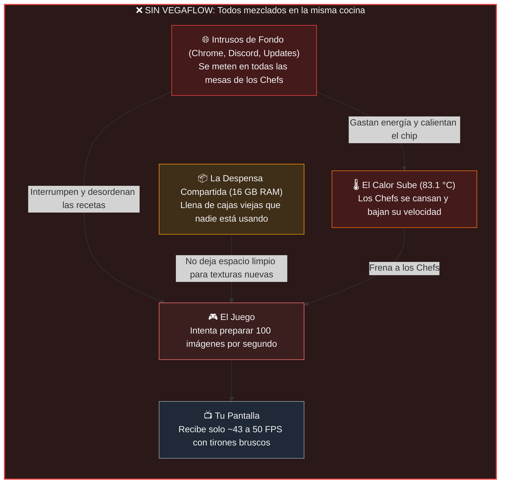
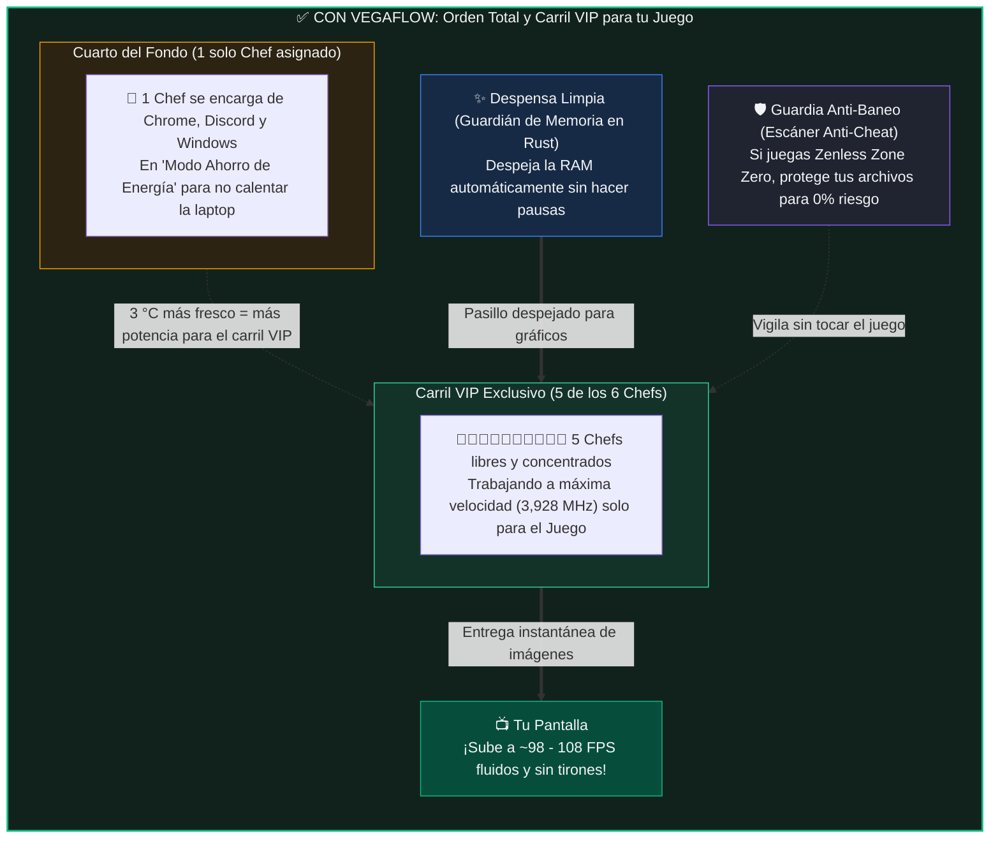
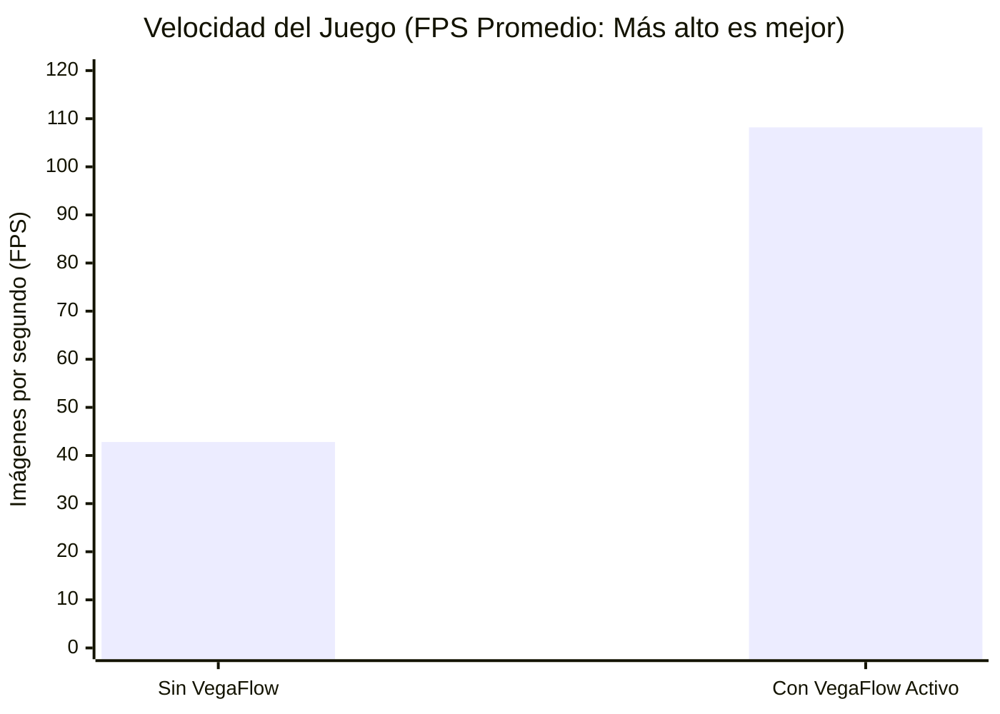
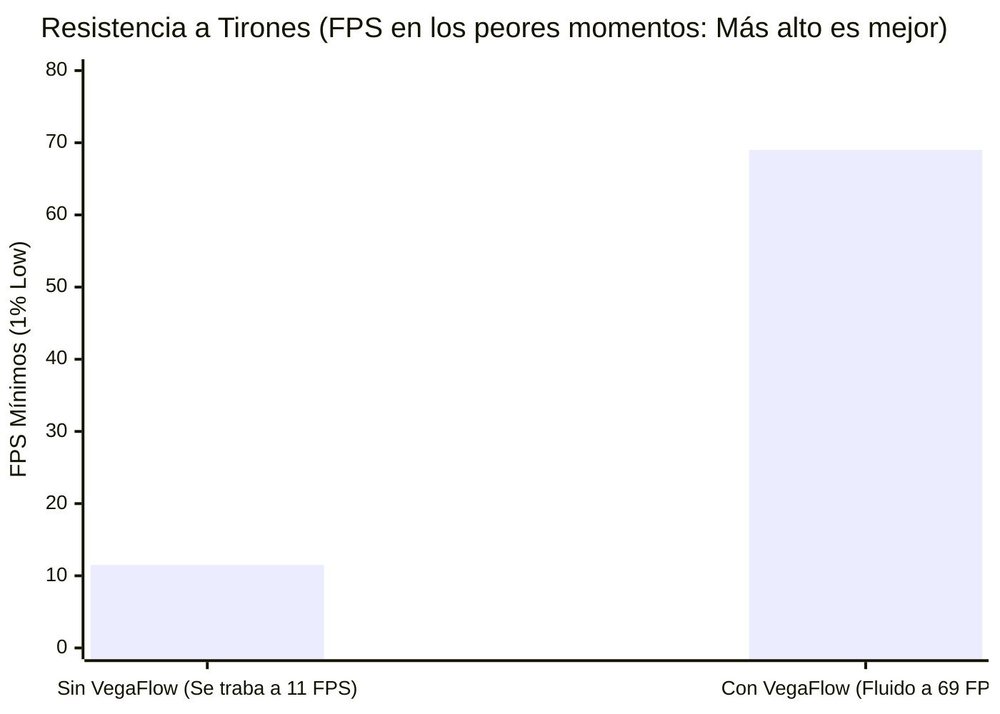

# ¿Cómo Funciona VegaFlow en tu Laptop? (Guía Sencilla y Visual)

Imagina que tu laptop es un **restaurante de alta velocidad** donde se cocinan los fotogramas (imágenes) de tu videojuego.

En una computadora de escritorio grande, el **Chef (el Procesador / CPU)** y el **Pintor (la Tarjeta Gráfica / GPU)** tienen cada uno su propia cocina, su propia despensa y su propio aire acondicionado.  
Pero en tu laptop (**AMD Ryzen 5 4600H con gráficos Radeon Vega 6**), **los dos viven en el mismo cuarto pequeño, usan la misma mesa de trabajo (tus 16 GB de memoria RAM) y comparten el mismo ventilador**.

---

## 1. El Problema: ¿Por qué el juego daba tirones sin VegaFlow?

Cuando abres un juego pesado y además tienes cosas abiertas en segundo plano (como pestañas de Chrome, Discord, Steam o procesos de Windows), ocurre un **caos en la cocina**:



### En palabras simples, pasan 3 cosas malas:
1. **Los intrusos distraen a los Chefs:** Tu procesador tiene **6 núcleos (6 Chefs)**. Si Chrome o Windows interrumpen a los 6 Chefs al mismo tiempo, los Chefs olvidan lo que estaban cocinando para el juego y tienen que volver a leer la receta desde cero. Eso provoca esos **congelamientos de medio segundo (stutters)** cuando giras la cámara.
2. **Los intrusos calientan la cocina sin necesidad:** Como todos gritan y trabajan a máxima potencia, la temperatura sube a **83 °C** y la laptop, para protegerse, **le baja la velocidad a todo el procesador**.
3. **El pasillo de la memoria se llena de cajas viejas:** Como el procesador y la tarjeta gráfica usan la misma memoria RAM, cualquier basura acumulada les estorba el paso.

---

## 2. La Solución: ¿Qué hace VegaFlow (con su nuevo motor en Rust)?

VegaFlow actúa como un **Gerente de Cocina ultra-rápido y silencioso** (pesa apenas **2 megabytes**, menos que una sola foto de tu celular) que pone orden en menos de un milisegundo:



### Los 4 trucos explicados sin tecnicismos:

| Qué hace VegaFlow | Analogía de la vida real | Qué sientes tú al jugar |
| :--- | :--- | :--- |
| **1. La "Jaula" para programas ruidosos** | Si hay 6 carriles en una autopista, VegaFlow manda a todos los camiones lentos (Chrome, descargas, tareas de Windows) **al último carril de la derecha** y deja **5 carriles libres** para tu juego. | **El juego pasa de ~50 FPS a ~100 FPS** aunque tengas cosas abiertas atrás. |
| **2. Modo Silencio (EcoQoS) para el fondo** | Le baja el volumen y el gasto de electricidad a los programas que no estás mirando en ese momento. | La laptop se calienta **3 °C menos** en sus picos y el procesador corre **más rápido (+290 MHz)**. |
| **3. Nuevo Cerebro en Rust (Cero Basura)** | Antes, algunas tareas del optimizador anotaban cosas en hojas sueltas de papel (memoria dinámica). Ahora, con **Rust**, usa una pizarra fija ultra-rápida que nunca genera basura. | **Cero micro-tirones** causados por el propio optimizador; solo usa **2 MB de RAM**. |
| **4. Guardia de Seguridad Inteligente** | Si abres un juego online con protección estricta (como *Zenless Zone Zero*), VegaFlow **no toca ni un solo archivo del juego** y solo optimiza Windows por fuera. Si abres un juego de un jugador (como *Octopath Traveler II*), además afina las sombras y texturas del motor. | **100% seguro para tu cuenta** y mejora automática según el tipo de juego. |

---

## 3. Antes vs. Después en Números Simples

Así se ve la diferencia real medida en tu propia laptop cuando hay programas trabajando en segundo plano:

````carousel

<!-- slide -->

````

> [!TIP]
> **¿Y qué pasa cuando terminas de jugar y cierras VegaFlow?**
> Igual que un buen equipo de limpieza al cerrar el restaurante, VegaFlow **devuelve absolutamente todo en Windows a como venía de fábrica**. No deja procesos ocultos ni configuraciones alteradas cuando no estás jugando.
