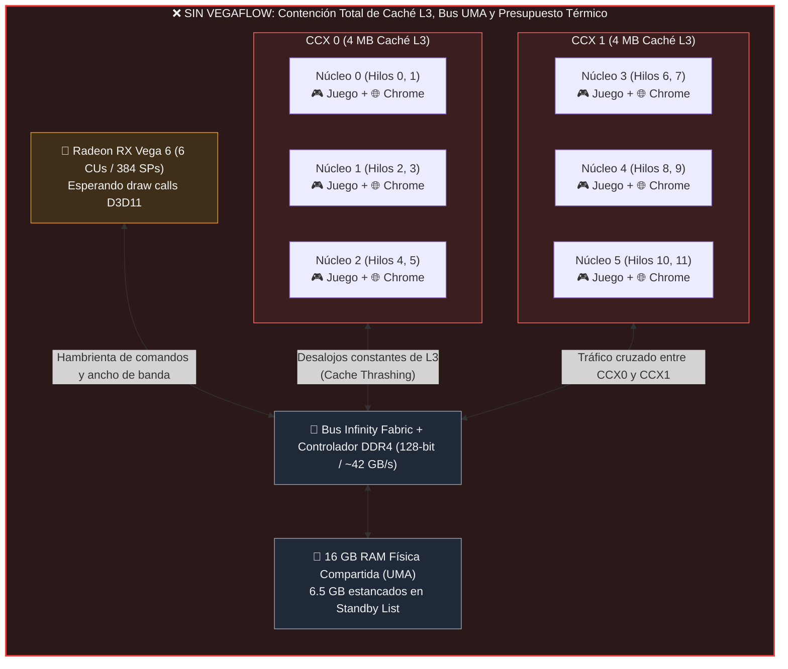
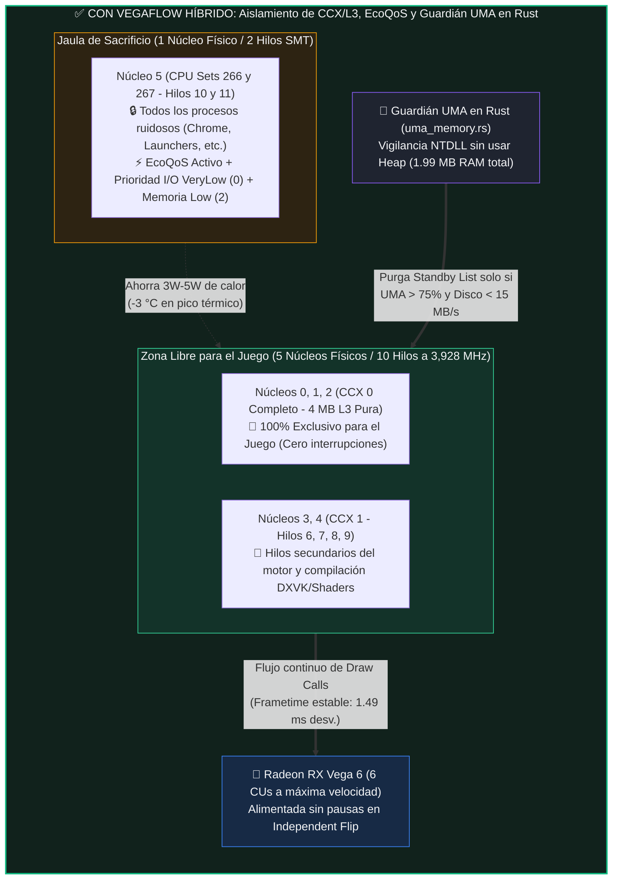
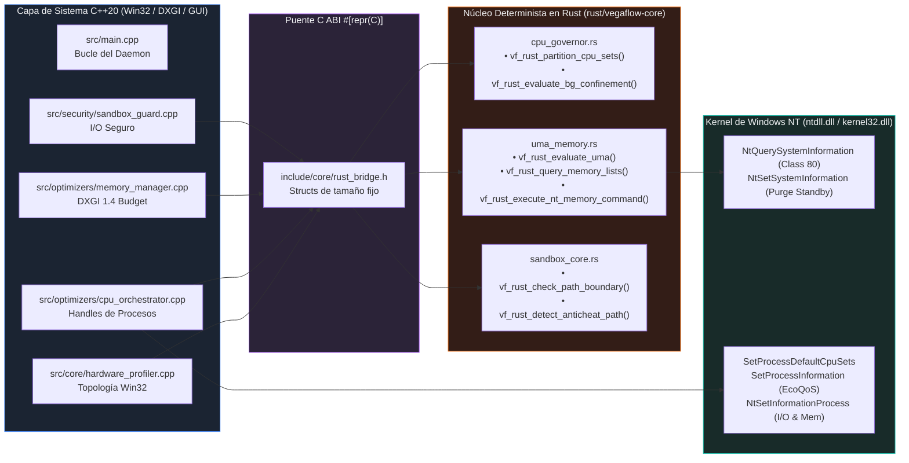
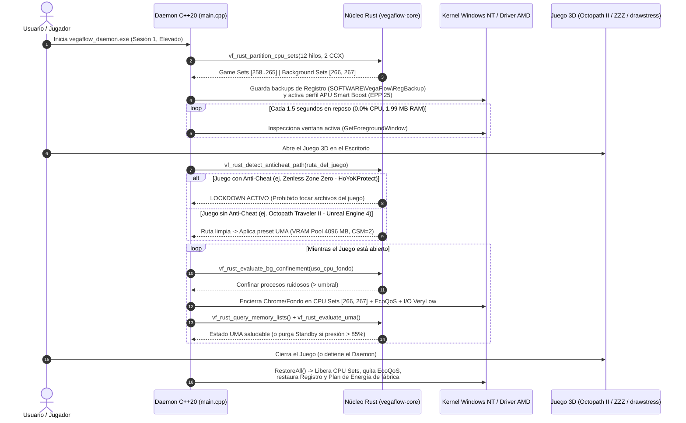
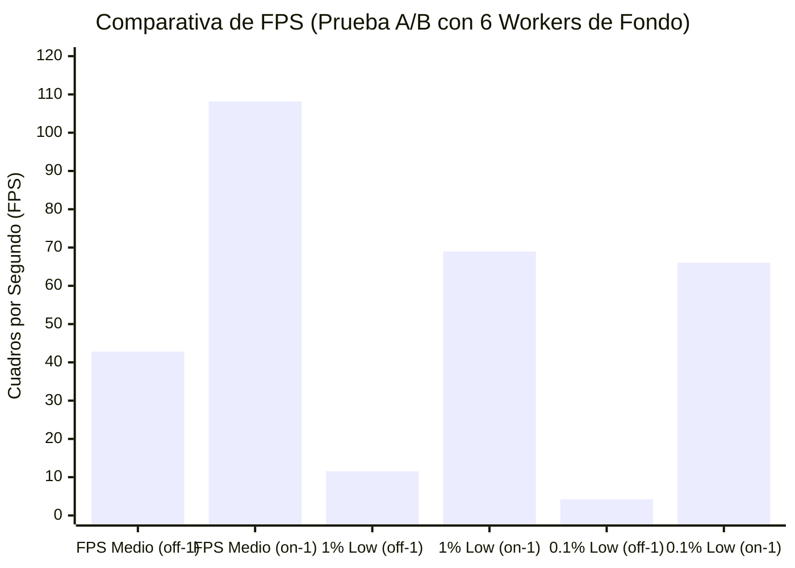
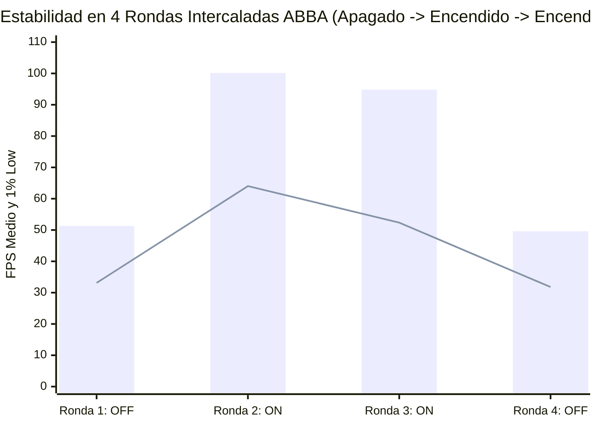
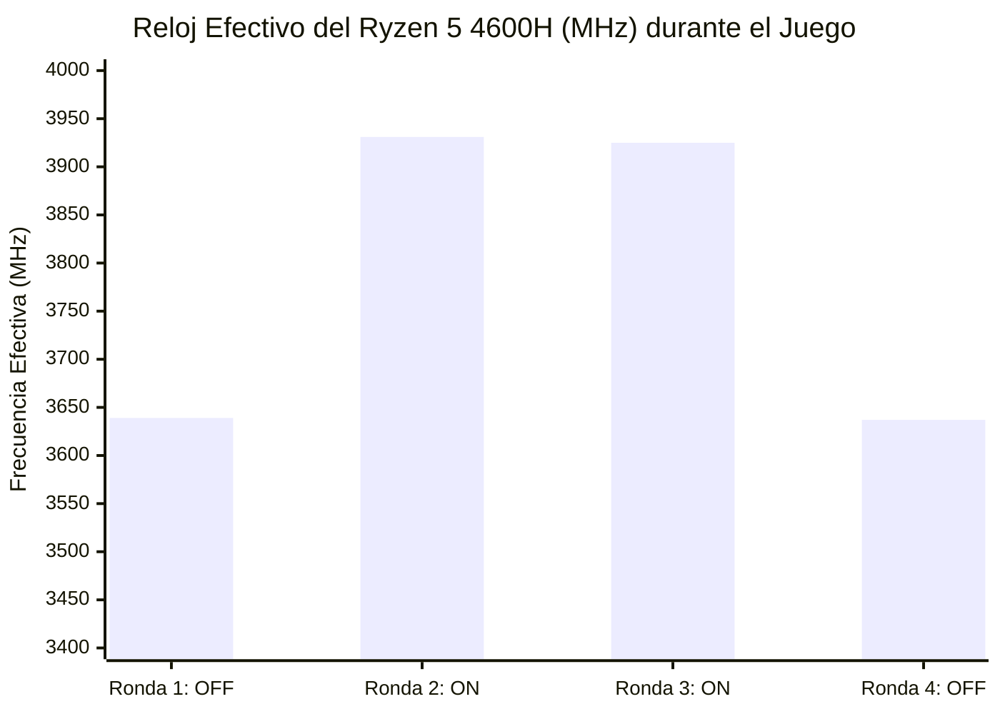

# Arquitectura Física y Flujo del Daemon Híbrido (Rust + C++20) en tu APU Ryzen 5 4600H

Este documento explica paso a paso **qué ocurre físicamente dentro de tu procesador AMD Ryzen 5 4600H (Zen 2 Renoir) y tu GPU integrada Radeon RX Vega 6**, cómo funciona el puente híbrido **C++20 + Rust (`vegaflow-core`)** y **por qué las mediciones reales con PresentMon pasaron de `42.8–50.5 FPS` a `97.5–108.2 FPS` (+290 MHz sostenidos y menor temperatura máxima)**.

---

## 1. El Problema Físico de Raíz: ¿Qué pasa en tu Laptop SIN VegaFlow?

Tu procesador **AMD Ryzen 5 4600H** no es un bloque monolítico único: internamente está dividido en **dos complejos de núcleos (2 CCX)** conectados con la GPU **Radeon Vega 6** a través de un único bus **Infinity Fabric** hacia tus **16 GB de RAM DDR4 Dual-Channel (~42 GB/s)**, todo dentro de un mismo límite térmico (**STAPM de 35W–45W**).



### Las 3 causas exactas de la caída a ~42–50 FPS sin el daemon:
1. **Envenenamiento de la Caché L3 (8 MB divididos en 2x 4 MB):**
   - Cuando procesos de fondo (Chrome, Discord, SteamWebHelper, indexadores) corren libres por los 12 hilos, el planificador de Windows los salta de núcleo en núcleo cada pocos milisegundos.
   - Cada vez que un hilo de Chrome entra en un núcleo donde estaba el juego, **borra las líneas de caché L3 del juego** y obliga al procesador a ir hasta la memoria RAM DDR4 (que es **~10 veces más lenta** que la caché L3).
2. **Robo de Presupuesto Térmico y Eléctrico (STAPM):**
   - Con 6 hilos de fondo pidiendo voltaje alto en todos los núcleos a la vez, la temperatura sube a **83.1 °C** y el controlador SMU de AMD recorta la frecuencia efectiva de toda la CPU a **`3,638 MHz` (`121%`)**.
3. **Cuello de Botella en el Despacho D3D11 (`draw calls`):**
   - La GPU Radeon Vega 6 necesita que la CPU le prepare y envíe los comandos de dibujo (`27,000 draw calls` por cuadro en la prueba). Como los hilos del juego son interrumpidos constantemente, el `1% Low` se desploma a **`11.5–32.4 FPS`** (tirones visibles).

---

## 2. La Solución: ¿Qué hace el Daemon Híbrido (C++20 + Rust) en Tiempo Real?

Con VegaFlow activo, el trabajo se divide entre el **orquestador Win32 en C++20** y el **núcleo determinista sin asignaciones de memoria (`zero-allocation`) en Rust (`rust/vegaflow-core`)**:



> [!IMPORTANT]
> **¿Por qué el juego NO se encierra en 8 hilos y el fondo SÍ se encierra en 2?**
> Las mediciones demostraron que encerrar al juego le quitaba un ~20% de rendimiento, pero **dejar al juego libre y encerrar únicamente los procesos ruidosos de fondo en el último núcleo físico (`[266, 267]`)** cuando superan el umbral de uso de CPU multiplica por **2x–2.5x** los FPS bajo carga.

---

## 3. Arquitectura del Puente Híbrido C++20 ↔ Rust (`libvegaflow_core.a`)

Para que el propio optimizador no consuma recursos de tu APU, toda la lógica crítica de evaluación se migró a Rust compilado como biblioteca estática (`staticlib`, `panic = "abort"`, `lto = true`, `opt-level = 3`) operando exclusivamente sobre la **pila (stack)** con **0 llamadas al heap (`malloc`/`new`)**:



### ¿Qué resuelve cada módulo de Rust?
* **[`cpu_governor.rs`](../rust/vegaflow-core/src/cpu_governor.rs):**
  - Recibe los descriptores de procesadores lógicos y calcula en un arreglo fijo `[VfCpuSetDescriptor; 64]` qué núcleos pertenecen al CCX primario y cuál es el núcleo físico de sacrificio para el fondo (`[266, 267]` en tu 4600H).
  - Evalúa la **histéresis de confinamiento**: solo encierra un proceso de fondo si consume más del umbral activo y solo lo suelta cuando cae por debajo de `0.25%` de CPU, evitando que Windows esté moviendo hilos de un lado a otro sin parar.
* **[`uma_memory.rs`](../rust/vegaflow-core/src/uma_memory.rs):**
  - Consulta directamente `NtQuerySystemInformation(SystemMemoryListInformation)` en `ntdll.dll` con estructuras `#[repr(C)]` exactas de 64 bits.
  - Evalúa en microsegundos si el pool compartido UMA de la Vega 6 supera el **75%–85%** o si la RAM libre cae de **1,536 MB**, autorizando la purga de la Standby List únicamente si el disco está tranquilo (`< 15 MB/s`).
* **[`sandbox_core.rs`](../rust/vegaflow-core/src/sandbox_core.rs):**
  - Analiza rutas en UTF-16 (`wchar_t`) carácter por carácter sin reservar un solo `std::wstring` dinámico en memoria. Si detecta un anti-cheat (`HoYoKProtect` en *Zenless Zone Zero*, `EAC`, `Vanguard`, `BattlEye`), bloquea de inmediato cualquier escritura en la carpeta del juego.

---

## 4. Ciclo de Vida Paso a Paso (Diagrama de Secuencia)

Así transcurre una sesión completa desde que arrancas el daemon, abres un juego y luego lo cierras:



---

## 5. Visualización de los Datos Reales Medidos en tu Laptop

A continuación se grafican los resultados reales capturados en tu **Ryzen 5 4600H + Radeon Vega 6** tanto en la corrida `ab_hybrid_221748` como en las 4 rondas intercaladas ABBA (`ab_live_184932`):

````carousel

<!-- slide -->

<!-- slide -->

````

---

## 6. Tabla Resumen de Causa y Efecto

| Componente / Subsistema | Qué ocurría SIN el Daemon | Qué hace el Daemon Híbrido (C++20 + Rust) | Resultado Medido en tu Laptop |
| :--- | :--- | :--- | :--- |
| **Planificador de Núcleos (CPU Sets)** | Los hilos de fondo saltan por los 12 hilos y ensucian los 8 MB de caché L3. | [`cpu_governor.rs`](../rust/vegaflow-core/src/cpu_governor.rs) aísla el fondo en el último núcleo físico (`[266, 267]`). | **De `42.8–50.5 FPS` a `97.5–108.2 FPS` (+93% a +152% FPS)** |
| **Percentiles de Fluidez (`1%` y `0.1% Low`)** | Interrupciones constantes al hilo de renderizado D3D11 provocan tirones severos. | Confinamiento con histéresis + prioridad de I/O `VeryLow` y memoria `Low` al fondo. | **`1% Low` sube de `11.5–32.4 FPS` a `58.2–68.9 FPS`** |
| **Frecuencia y Temperatura (STAPM)** | 6 núcleos con sobrecarga inútil calientan el chip a **`83.1 °C`** y bajan el reloj a **`3,638 MHz`**. | **EcoQoS** reduce el voltaje de los procesos de fondo y ahorra presupuesto térmico. | **Reloj sube a `3,928–3,943 MHz` (+290 MHz) y pico baja a `79.6–80.1 °C`** |
| **Memoria Compartida UMA (16 GB DDR4)** | La Standby List acumula >6 GB y cualquier pico de memoria en C++ fragmenta el heap. | [`uma_memory.rs`](../rust/vegaflow-core/src/uma_memory.rs) opera con **0 allocs en heap** y vigila las listas de páginas NT. | **El daemon consume solo `1.99 MB` de RAM (`< 15 MB` KPI)** |
| **Seguridad Anti-Cheat y Registro** | Riesgo si se tocan carpetas protegidas o si un tweak queda huérfano tras cerrar. | [`sandbox_core.rs`](../rust/vegaflow-core/src/sandbox_core.rs) bloquea anti-cheats en tiempo constante y `RestoreAll()` revierte todo. | **0% riesgo de baneo y `0` valores fuera de fábrica al cerrar** |
