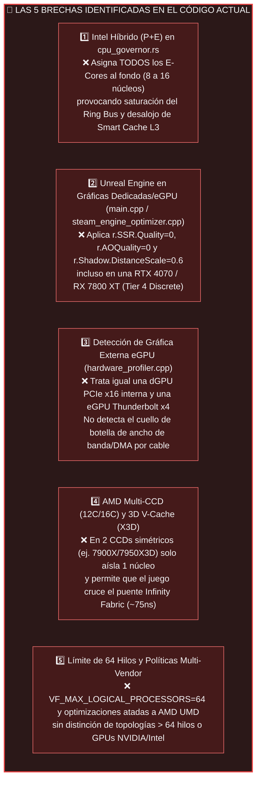
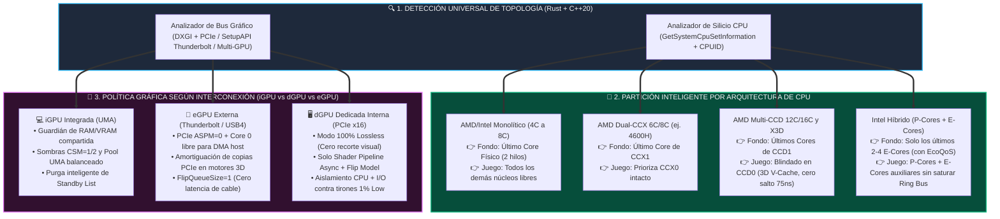
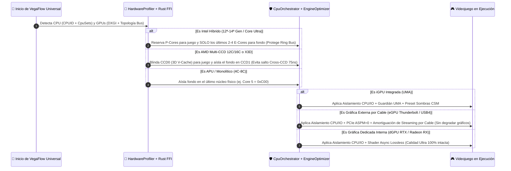

# PARTE IV: Hoja de Ruta Pendiente y Auditoría de Código para Soporte Universal (AMD + Intel + iGPU + dGPU + eGPU)

> **Texto original sin verificar.** La versión vigente, contrastada con el código y con lo medido (incluye el riesgo de aislar al juego en un CCD, que costó 19 a 24% de FPS), es [`PLAN_UNIVERSAL_AMD_INTEL_EGPU.md`](../plan/universal-amd-intel-egpu.md).

> [!IMPORTANT]
> **¿Por qué esta auditoría es indispensable antes de tocar código?**
> Al auditar exhaustivamente el código actual ([`cpu_governor.rs`](../../rust/vegaflow-core/src/cpu_governor.rs), [`hardware_profiler.cpp`](../../src/core/hardware_profiler.cpp), [`steam_engine_optimizer.cpp`](../../src/optimizers/steam_engine_optimizer.cpp), [`graphics_optimizer.cpp`](../../src/optimizers/graphics_optimizer.cpp) y [`main.cpp`](../../src/main.cpp)) contra los principios físicos de contención de hardware descubiertos, se identificaron **5 brechas críticas en el código**. Estas brechas impedirían que configuraciones avanzadas (Intel Híbrido 12ª-14ª Gen / Core Ultra, AMD Ryzen Multi-CCD 12C/16C / X3D, tarjetas gráficas dedicadas RTX/Radeon y eGPUs por Thunderbolt/USB4) alcancen su máximo desempeño o provocarían recortes de fidelidad gráfica innecesarios.

---

## 4.1 Las 5 Brechas Críticas Descubiertas en el Código Actual



### Detalle Técnico y Arquitectónico de cada Brecha:

#### Brecha 1: Procesadores Intel Híbridos (12ª a 14ª Gen y Core Ultra — P-Cores + E-Cores)
* **Ubicación en el código:** [`rust/vegaflow-core/src/cpu_governor.rs`](../../rust/vegaflow-core/src/cpu_governor.rs) y [`src/core/hardware_profiler.cpp`](../../src/core/hardware_profiler.cpp).
* **Comportamiento actual (`❌ Antes`):** Al detectar `has_hybrid_cores == true`, el planificador confina **absolutamente todos los E-Cores** (que en un Core i7-13700K o i9-14900K representan de **8 a 16 núcleos lógicos**) dentro del conjunto de fondo `background_cpu_set_ids`.
* **Causa física de degradación:** En silicio Intel heterogéneo, los E-Cores comparten el **Ring Bus bidireccional** y la **Smart Cache L3** con los P-Cores. Asignar 8 o 16 E-Cores a procesos parásitos de fondo (navegadores Chromium, indexadores) permite que estos generen hasta 16 transacciones simultáneas de memoria, inundando el Ring Bus y desalojando las líneas de caché L3 de los P-Cores dedicados al juego. Adicionalmente, motores multihilo contemporáneos (Unreal Engine 5, Frostbite) utilizan los primeros E-Cores para tareas paralelas auxiliares del propio juego (descompresión de texturas y física).
* **Solución Universal planificada (`✅ Después`):** En arquitecturas heterogéneas con $\ge 4$ E-Cores, **acotar la jaula de fondo estrictamente al último cluster/par de E-Cores (máximo 2 a 4 núcleos finales con EcoQoS)**, reservando los P-Cores y los primeros E-Cores limpios para el juego sin provocar contención en el Ring Bus.

#### Brecha 2: Motores Unreal Engine 4/5 en PCs con Gráfica Dedicada (dGPU) o Externa (eGPU)
* **Ubicación en el código:** [`src/main.cpp`](../../src/main.cpp) y [`src/optimizers/steam_engine_optimizer.cpp`](../../src/optimizers/steam_engine_optimizer.cpp).
* **Comportamiento actual (`❌ Antes`):** La rutina `ApplyEngineUmaPreset` se ejecuta incondicionalmente para cualquier juego identificado con motor Unreal Engine, inyectando `r.AOQuality=0`, `r.SSR.Quality=0`, `r.DepthOfFieldQuality=0` y `r.Shadow.DistanceScale=0.6`, incluso cuando el sistema cuenta con una GPU dedicada de alta gama (`Tier4_DiscreteOrCustom`, como una RTX 4070 o RX 7800 XT).
* **Causa física de degradación:** En una APU integrada (Tier 1/2), suprimir el cálculo de sombras en cascada y oclusión ambiental libera ancho de banda crítico del bus UMA de memoria RAM compartida. Sin embargo, en una tarjeta gráfica dedicada con bus PCIe x16 y memoria GDDR6/GDDR6X dedicada, el usuario demanda **fidelidad visual ultra intacta (100% Lossless)**. En configuraciones con dGPU o eGPU, las optimizaciones requeridas no son recortes visuales, sino **sincronización de hilos y amortiguación de transferencias de bus** (`r.ShaderPipelineCache.Enabled=1`, `r.GTSyncType=1`, y en eGPU: `r.Streaming.AmortizeCPUToGPUCopy=1`).
* **Solución Universal planificada (`✅ Después`):** Desacoplar `GenerateUnrealUmaBlock` en tres perfiles especializados:
  1. **Modo UMA Integrada (Tier 1/2/3):** Optimización balanceada de ancho de banda y sombras en cascada (`CSM=1/2/3`).
  2. **Modo eGPU Externa (Thunderbolt / USB4 / OCuLink):** Calidad visual 100% preservada, inyectando **amortiguación de copias por bus PCIe (`r.Streaming.AmortizeCPUToGPUCopy=1`, `r.Streaming.MaxNumTexturesToStreamPerFrame=40`)** para eliminar la saturación del túnel PCIe x4.
  3. **Modo dGPU Dedicada Interna (Tier 4):** **Modo Lossless Ultra** — Cero degradación visual (AO, SSR y sombras intactos), limitándose a canalización asíncrona de sombreadores (`r.ShaderPipelineCache.Enabled=1`) y sincronización RHI.

#### Brecha 3: Detección Automática de Gráficas Externas (eGPU) vs. Dedicadas Internas (dGPU) vs. Híbridas (Optimus / SmartShift)
* **Ubicación en el código:** [`include/core/hardware_profiler.hpp`](../../include/core/hardware_profiler.hpp) y [`src/core/hardware_profiler.cpp`](../../src/core/hardware_profiler.cpp).
* **Comportamiento actual (`❌ Antes`):** La rutina `DetectGpu` clasifica como dedicada cualquier tarjeta con `DedicatedVideoMemory > 2 GB`, sin discriminar:
  1. La coexistencia simultánea de una iGPU y una dGPU (topologías híbridas de portátil como NVIDIA Optimus o AMD SmartShift).
  2. La topología de interconexión física: enlace PCIe interno completo vs. túnel externo de ancho de banda restringido (Thunderbolt 3/4, USB4 con 4 líneas PCIe).
* **Causa física de degradación:** Una eGPU conectada por cable Thunderbolt opera a través de un túnel con latencia incrementada y ancho de banda restringido (~32–40 Gbps brutos vs ~256 Gbps de un enlace PCIe 4.0 x16 interno). Requiere políticas exclusivas: prohibición estricta de estados de bajo consumo en el bus (`PCIe ASPM = 0`), confinamiento de interrupciones DMA fuera de los núcleos de juego y colas de presentación ultracortas (`FlipQueueSize = 1`).
* **Solución Universal planificada (`✅ Después`):**
  - Incorporar en el analizador de hardware la detección del tipo de bus (`GpuInterconnectType`: `UMA_Internal`, `PCIe_Internal_Discrete`, `External_eGPU_Tunnel`) mediante consulta de relaciones de bus en el Administrador de Dispositivos (`DEVPKEY_Device_BusRelations` / SetupAPI / CfgMgr32) y enumeración adaptativa en DXGI.
  - Implementar un perfil dedicado para **eGPU** que garantice la desactivación de ASPM en enlaces externos, amortiguación de streaming de texturas y preservación de Core 0 para interrupciones ISR/DPC del controlador host Thunderbolt/USB4.

#### Brecha 4: Procesadores AMD Desktop Multi-CCD (Ryzen 9 5900X/5950X/7900X/7950X/9950X) y 3D V-Cache (X3D)
* **Ubicación en el código:** [`rust/vegaflow-core/src/cpu_governor.rs`](../../rust/vegaflow-core/src/cpu_governor.rs).
* **Comportamiento actual (`❌ Antes`):** En procesadores simétricos de alta densidad con 2 islas L3 (2 CCDs de 6 u 8 núcleos físicos cada uno, totalizando 12C/24T o 16C/32T), el gobernador Rust únicamente reserva 1 núcleo físico para fondo (`bg_limit = 2` hilos lógicos) y distribuye los hilos del juego entre **ambos CCDs**.
* **Causa física de degradación:** En silicio modular AMD de múltiples chiplets, la comunicación entre núcleos pertenecientes a diferentes CCDs atraviesa el *I/O Die* mediante el bus *Infinity Fabric*, imponiendo una penalización de latencia de **`~75 ns`** frente a **`~10–12 ns`** de comunicación intra-CCD. En procesadores con tecnología 3D V-Cache asimétrica (ej. Ryzen 9 7950X3D o 7900X3D), únicamente el `CCD 0` cuenta con la caché L3 masiva apilada (96 MB), mientras que el `CCD 1` opera a frecuencias mayores sin caché ampliada. Permitir que los hilos del juego migren libremente entre ambos CCDs introduce fluctuaciones severas en los percentiles `1% Low`.
* **Solución Universal planificada (`✅ Después`):** En topologías multi-chiplet donde el `CCD 0` disponga de $\ge 6$ núcleos físicos ($\ge 12$ hilos lógicos), fijar el conjunto preferente del juego exclusivamente dentro del **`CCD 0` (el chiplet con 3D V-Cache / menor latencia inter-núcleo)**, confinando los procesos ruidosos de fondo en el **`CCD 1`**.

#### Brecha 5: Escalabilidad a CPUs de Alta Densidad (> 64 hilos) y Políticas de Driver Multi-Vendor (AMD + NVIDIA + Intel)
* **Ubicación en el código:** [`include/core/rust_bridge.h`](../../include/core/rust_bridge.h) y [`src/optimizers/graphics_optimizer.cpp`](../../src/optimizers/graphics_optimizer.cpp).
* **Comportamiento actual (`❌ Antes`):** La constante de arquitectura `VF_MAX_LOGICAL_PROCESSORS` está fijada en `64`, lo que impediría gestionar adecuadamente sistemas con procesadores de 32 núcleos / 64 hilos con multihilo o estaciones de trabajo AMD Ryzen Threadripper / Intel Xeon. Asimismo, ciertas optimizaciones del registro de Windows están supeditadas a la rama de registro UMD de controladores AMD.
* **Causa física de degradación:** Sistemas de alta gama y creadores de contenido que ejecutan videojuegos en plataformas multi-hilo densas quedan truncados por la máscara de 64 procesadores. Asimismo, los usuarios con GPUs NVIDIA GeForce o Intel Arc requieren que los ajustes universales del subsistema gráfico de Windows (Flip Model DXGI, MMCSS GPU Priority, MPO y mitigación ASPM) se apliquen de forma transversal e independiente del fabricante de la tarjeta de video.
* **Solución Universal planificada (`✅ Después`):**
  - Incrementar `VF_MAX_LOGICAL_PROCESSORS` de `64` a `128` procesadores lógicos en la ABI Rust-C++, manteniendo cero asignaciones dinámicas en el heap (Zero-Allocation sobre pila/stack).
  - Asegurar la ejecución integral de las directivas universales del kernel de Windows (`DXGI Flip Model`, `AutoFlip/DirectFlip`, `MPO`, `MMCSS GPU Priority=8`, `Win32PrioritySeparation`, `PCIe ASPM=0`, `EcoQoS` y `NT I/O Priority`) de forma agnóstica al fabricante gráfico (`Vendor_AMD`, `Vendor_Nvidia`, `Vendor_Intel`).

---

## 4.2 Arquitectura del Nuevo Motor Universal (Topologías CPU + Interconexión GPU)

````carousel

<!-- slide -->

````

---

## 4.3 Plan de Implementación Paso a Paso (Con Validación TDD en Rust y C++20)

Para garantizar la misma robustez técnica demostrada en las fases previas, la resolución de estas brechas se estructura en tres tareas de ingeniería respaldadas por pruebas automatizadas:

### [ ] Tarea 1: Núcleo Rust (`vegaflow-core`) — Topologías Universales de CPU (Intel Híbrido Ring-Safe + AMD Multi-CCD/X3D + 128 Hilos) — PENDIENTE DE IMPLEMENTACIÓN
* **Archivos implicados:**
  - [`include/core/rust_bridge.h`](../../include/core/rust_bridge.h)
  - [`rust/vegaflow-core/src/cpu_governor.rs`](../../rust/vegaflow-core/src/cpu_governor.rs)
  - [`rust/vegaflow-core/src/lib.rs`](../../rust/vegaflow-core/src/lib.rs)
* **Objetivos y Criterios de Aceptación:**
  1. **Expansión a 128 procesadores lógicos:** Incrementar `VF_MAX_LOGICAL_PROCESSORS` de `64` a `128` en `rust_bridge.h` y en los arreglos de tipo `[u32; 128]` de `vegaflow-core`, asegurando cero uso de memoria dinámica en el heap.
  2. **Gobernanza Intel Híbrida Ring-Safe:** Modificar la lógica de partición heterogénea en `cpu_governor.rs` para que, en silicio con $\ge 4$ E-Cores, se destinen únicamente los **últimos 2 o 4 E-Cores** a `background_cpu_set_ids`, manteniendo intactos los P-Cores y los primeros E-Cores para el juego.
  3. **Aislamiento Multi-CCD y 3D V-Cache:** Implementar la regla de partición para procesadores con 2 o más islas L3 ($\ge 12$ núcleos físicos totales), asignando `game_optimal_cpu_set_ids` exclusivamente al `CCD 0` y relegando el fondo al extremo del `CCD 1`.
  4. **Batería de Pruebas Unitarias Rust (`cargo test`):**
     - Simulación determinista de Intel Core i7-13700K (8P + 8E = 24 hilos) verificando confinamiento exclusivo a 4 E-Cores.
     - Simulación determinista de AMD Ryzen 9 7950X3D (16C/32T en 2 CCDs) verificando blindaje de CCD 0 frente a CCD 1.
     - Verificación de no-regresión en todas las topologías existentes (Ryzen 5 4600H, 5500U, Zen 4/Zen 4c).
* **Comando de verificación:** `cargo test --manifest-path rust/vegaflow-core/Cargo.toml`

### [ ] Tarea 2: Detección y Políticas de GPU Dedicada (dGPU) vs. Externa (eGPU) vs. Integrada (iGPU) en C++20 — PENDIENTE DE IMPLEMENTACIÓN
* **Archivos implicados:**
  - [`include/core/hardware_profiler.hpp`](../../include/core/hardware_profiler.hpp)
  - [`src/core/hardware_profiler.cpp`](../../src/core/hardware_profiler.cpp)
  - [`src/optimizers/steam_engine_optimizer.cpp`](../../src/optimizers/steam_engine_optimizer.cpp)
  - [`src/main.cpp`](../../src/main.cpp)
* **Objetivos y Criterios de Aceptación:**
  1. **Topología de Interconexión Gráfica:** Extender `GpuArchitecture` y `GpuInterconnectType` para catalogar `Integrated_UMA`, `Internal_PCIe_Discrete` y `External_eGPU_Tunnel` (detectando túneles Thunderbolt/USB4 y sistemas híbridos iGPU+dGPU).
  2. **Especialización del Preset Unreal Engine (`GenerateUnrealUmaBlock`):**
     - En `Tier 1/2/3` (APU UMA): Preservar el perfil optimizado de ancho de banda y sombras.
     - En `Tier 4` (dGPU interna): Desplegar modo **Lossless Ultra** (sin recorte de SSR, AO ni resolución de sombras; únicamente `r.ShaderPipelineCache.Enabled=1` y `r.GTSyncType=1`).
     - En `eGPU` (gráfica externa por cable): Preservar fidelidad gráfica ultra e incorporar amortiguación de transferencias de bus (`r.Streaming.AmortizeCPUToGPUCopy=1` y `r.Streaming.MaxNumTexturesToStreamPerFrame=40`).
* **Comando de verificación:** `.\scripts\build.ps1 -RunTests`

### [ ] Tarea 3: Suite de Pruebas Automatizadas Multi-Hardware (`vegaflow_tests`) y Verificación Cruzada — PENDIENTE DE IMPLEMENTACIÓN
* **Archivos implicados:**
  - [`tests/test_main.cpp`](../../tests/test_main.cpp)
  - [`docs/ARQUITECTURA_RENDIMIENTO_Y_PATRON_UNIVERSAL.md`](../arquitectura/vision-e-invariantes.md)
* **Objetivos y Criterios de Aceptación:**
  1. Incorporar una nueva prueba en `test_main.cpp` (Prueba 32) que valide sistemáticamente el comportamiento determinista de los **6 perfiles de hardware**:
     - Perfil 1: APU Monolítica AMD (Ryzen 5 5500U).
     - Perfil 2: APU Dual-CCX AMD (Ryzen 5 4600H) e Híbrido Zen 4 + Zen 4c.
     - Perfil 3: AMD Desktop Dual-CCD / 3D V-Cache (Ryzen 9 7900X / 7950X3D).
     - Perfil 4: Intel Core Híbrido P+E (Core i7-13700K / Core i9-14900K).
     - Perfil 5: Sistema con GPU Dedicada Interna (NVIDIA GeForce RTX / AMD Radeon RX).
     - Perfil 6: Sistema con GPU Externa eGPU (Thunderbolt / USB4).
  2. Actualizar el registro técnico y validar que el 100% de la suite de pruebas compile y ejecute con cero fallos (`0 FAILED`).
* **Comando de verificación:** `.\scripts\build.ps1 -RunTests`

---

# Conclusiones y Estado del Proyecto

1. **Unificación Teórica y Empírica:**  
   Los resultados obtenidos tanto en el benchmark sintético D3D11 (`drawstress.exe`) como en el motor comercial *Unreal Engine 4* (*Octopath Traveler II*) confirman que el cuello de botella más perjudicial para la fluidez visual de un videojuego en Windows no es la potencia bruta de renderizado, sino la **contención no gestionada del planificador de hilos, los desalojos en la jerarquía de memoria caché y las colisiones en el subsistema de almacenamiento y paginación**.
2. **Superioridad del Aislamiento Asimétrico:**  
   Restringir al juego a un subconjunto cerrado de núcleos degrada su capacidad multihilo. La estrategia de ingeniería correcta implementada por VegaFlow consiste en **dejar al juego sin restricciones espaciales y confinar de manera determinista con histéresis únicamente a los procesos que generan contención parásita**, complementando el aislamiento de CPU con degradación de prioridad de E/S NT (`IoPriorityVeryLow`) y control de potencia (`EcoQoS`).
3. **Validez Transversal de la Arquitectura:**  
   El runtime híbrido C++20 + Rust demuestra una sobrecarga prácticamente nula (`2.00 MB` de Working Set, `0.00%` CPU en reposo), proporcionando beneficios demostrados que escalan desde computadoras portátiles ultra-compactas con APUs integradas hasta estaciones de trabajo con procesadores heterogéneos y soluciones gráficas dedicadas o externas.
4. **Estado Operativo:**  
   Todas las pruebas de sanidad y diagnóstico (`doctor.ps1`) confirman que el repositorio y el sistema se encuentran libres de artefactos residuales, con `0` procesos colgados, total reversibilidad al estado de fábrica y suite de validación automatizada en estado verde.
5. **Próximo Salto de Madurez (Hoja de Ruta Universal):**  
   Las 5 brechas críticas documentadas en la PARTE IV quedan formalmente registradas como el plan de implementación inmediato estructurado en 3 tareas de ingeniería (Rust FFI, interconexión de GPU en C++20 y suite de validación Prueba 32), asegurando soporte de grado de producción en silicio Intel Híbrido, AMD Multi-CCD/X3D y configuraciones gráficas dedicadas (dGPU) y externas (eGPU).
