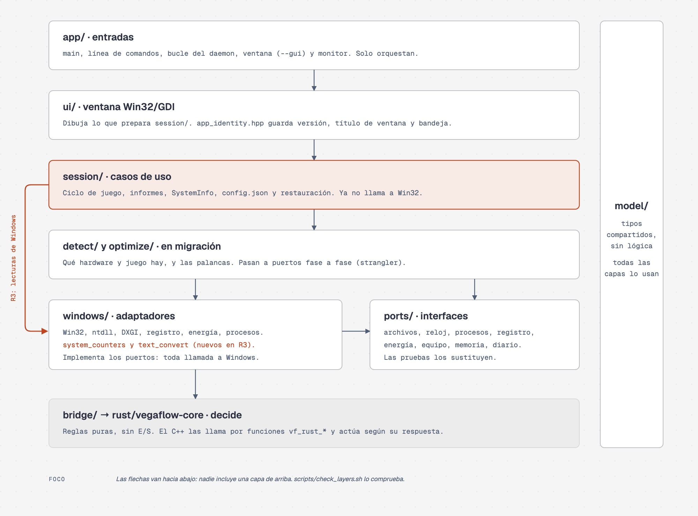

# Módulos y estructura del repositorio

**Lector:** personas

## Capas del código (estado tras la fase R3, 2026-11-14)

**Lo esencial:** cada carpeta de `src/` solo puede incluir a las que están debajo de ella. Desde R3, los casos de uso de `session/` no llaman a funciones de Win32: piden esas lecturas a `windows/`.

**Ejemplo.** `--status` muestra cuántos procesos tienen el modo de ahorro (EcoQoS). Antes, `session/` hacía ese recorrido de procesos con llamadas de Windows. Ahora `session/reports.cpp` llama a `CountEcoQoSProcesses()` y quien habla con Windows es [`src/windows/system_counters.cpp`](../../src/windows/system_counters.cpp). Así el código de `session/` se lee sin saber nada de Win32.



[Ver el diagrama a pantalla completa](../diagrams/capas-del-codigo.html)

Términos: un **puerto** es una interfaz pequeña (por ejemplo, «leer y escribir el registro») que las pruebas pueden sustituir por una versión falsa; un **adaptador** es la versión real, que llama a Windows.

| Qué se movió en R3 | A dónde |
| --- | --- |
| Conteo de procesos en EcoQoS y de juegos con Direct Flip configurado | `windows/system_counters.*` |
| Tamaño de la caché L3 (topología de caché; si no sirve, CPUID, hoja `0x80000006`; 0 si ninguna responde) | `windows/system_counters.*` |
| Ranuras de RAM ocupadas por SMBIOS, con recorrido acotado: se detiene ante una entrada truncada en vez de leer más allá del final | `windows/system_counters.*` (la parte pura, `CountDimmsInSmbiosTable`, se prueba con tablas inventadas) |
| Comprobar una ventana y su hilo | `windows/system_counters.*` |
| Conversión UTF-8 ↔ UTF-16 (`text_convert`) | de `session/` a `windows/text_convert.*` |
| Versión (0.1.0), clase y título de ventana, id del comando de la bandeja y la línea «procesador \| gráfica» | `ui/app_identity.hpp` |

Lo que comprueba el repositorio:
- `scripts/check_layers.sh` revisa cada `#include` de `src/` contra la tabla de capas del [plan maestro](../plan/maestro/arquitectura.md): 272 includes comprobados, capas respetadas (2026-11-14). Corre en el CI.
- `session/` todavía incluye cabeceras de `windows/`, `detect/` y `optimize/`. El script las permite como **migración** (están marcadas así en su tabla) hasta que cada pieza pase detrás de un puerto; lo que ya no hay en `session/` son las llamadas a Win32.
- Las pruebas que tocan el registro real están solo en `tests/integration/`; `tests/unit/` usa puertos falsos. Suite de C++ en el laptop de pruebas, 2026-11-14: `57 PASSED, 0 FAILED`.

### 3.2. Subsistema `SystemInfo`: Telemetría Desacoplada y Detección de Hardware
Implementado en [`src/session/system_info.hpp`](../../src/session/system_info.hpp) y [`src/session/system_info.cpp`](../../src/session/system_info.cpp), este módulo aísla toda la lógica de recopilación de hardware y sistema operativo en una biblioteca reutilizable. Las lecturas que necesitan Windows (L3, ranuras DIMM, conteos) están en [`src/windows/system_counters.cpp`](../../src/windows/system_counters.cpp):
- **Detección de CPU**:
  - Lectura de marca mediante la instrucción x86 `CPUID` (registros EAX, EBX, ECX, EDX) reportando el procesador completo (e.g. *AMD Ryzen 5 4600H with Radeon Graphics*).
  - Conteo riguroso de núcleos físicos (6) y procesadores lógicos (12) mediante `GetLogicalProcessorInformationEx`.
  - Microarquitectura identificada: *Zen 2 Renoir 7nm*.
  - Tamaño de memoria caché L3 (8 MB / 8,388,608 bytes).
  - Frecuencia objetivo de boost a **4.0 GHz**, sin tope STAPM (`cpu_stapm_cap_mhz = 0`).
  - Máscaras y CPU Sets activos para juegos y procesos de fondo.
- **Gráficos & Memoria UMA (Vega 6)**:
  - Enumeración de adaptadores DirectX mediante `IDXGIFactory4` / `IDXGIAdapter3`.
  - Diferenciación explícita entre la falsa "VRAM Dedicada" reportada por BIOS (512 MB) y la memoria UMA compartida real del sistema disponible para la iGPU (~7.7 GB).
  - Consulta en tiempo real de presupuestos de memoria de vídeo local y no local con `QueryVideoMemoryInfo`.
- **Topología de Canales de Memoria RAM (SMBIOS Type 17)**:
  - Lectura directa de las tablas de firmware del sistema mediante `GetSystemFirmwareTable('RSMB', 0, ...)` para inspeccionar los registros SMBIOS Type 17 (Memory Device).
  - Detecta la presencia de 2 ranuras DIMM pobladas en configuración **Dual-Channel con bus de 128 bits** (~42 GB/s de ancho de banda).
  - Desglose instantáneo de páginas físicas: memoria en uso, memoria libre real (Free + Zeroed), Standby List en caché y páginas modificadas.
- **Kernel NT & Sistema Operativo**:
  - Lectura de versión de Windows (e.g. *Windows 11 Build 26300* con Update Build Revision UBR).
  - Estado del perfil MMCSS para juegos (`SystemResponsiveness`, `Priority`, `Scheduling Category`, `SFIO Priority`; sin `GPU Priority`, retirado en la fase 8) y compresión de memoria (MMAgent).
- **Serialización Estándar a JSON**:
  - Función `SystemInfo::ToJson()` que exporta toda la telemetría en un esquema estructurado para interoperabilidad con scripts, frontends web o herramientas CLI externas (`--system-info`).

### 3.3. Arquitectura y Rediseño Visual de la GUI (Clean Slate / Nordic Dark Mode)
Implementado en [`src/ui/gui_window.hpp`](../../src/ui/gui_window.hpp) y [`src/ui/gui_window.cpp`](../../src/ui/gui_window.cpp):
- **Cero Dependencias & Ultra Bajo Consumo**: GUI construida enteramente sobre la API pura de Win32/GDI con doble búfer (`BitBlt`), sin marcos pesados (Qt, WPF, Electron). Consume menos de **15 MB de RAM privada** y **0.0% de CPU** en reposo. Al detectar un juego en primer plano, la interfaz suspende sus llamadas gráficas de telemetría para ceder el 100% de los ciclos a la GPU.
- **Identidad de la ventana (R3):** [`src/ui/app_identity.hpp`](../../src/ui/app_identity.hpp) guarda en un solo sitio la versión, la clase y el título de la ventana (`VegaFlowUniversalWindow`, «VegaFlow Universal») y la línea «procesador | gráfica» (`FormatHardwareLine`). Esa línea nunca toma el nombre de otro equipo: lo que no se pudo leer sale como «Procesador no identificado» o «Gráfica no identificada», y una línea de más de 65 bytes se corta con «...» sin partir un carácter UTF-8. La GUI ya no promete mejoras en sus textos. Los textos de las pantallas nuevas están en un solo archivo, [`src/ui/texts.hpp`](../../src/ui/texts.hpp).
- **Pantallas (fase G, versión 0.2.0):** el menú lateral tiene ocho entradas y una novena pantalla cuelga de Configuración. Las pantallas nuevas son Inicio, Ajustes del sistema, Juegos, Historial, Configuración, Programas, Tu equipo y Requisitos y advertencias (esta última sin entrada propia: se abre desde Configuración). **La tercera, «Memoria UMA & Núcleos CPU», sigue en el dibujo antiguo (GDI) de `gui_tabs.cpp`.** Cada pantalla nueva tiene su `src/ui/<nombre>_view.*` (dibuja y crea los controles) y su modelo en `src/session/<nombre>_screen.*` (decide qué se muestra). Qué hace cada una, para quien usa el programa: [guía de uso](../guias/uso-y-funciones.md), sección 2.8.
- **Controles nativos:** los botones, interruptores y campos son controles `BUTTON` y `EDIT` de Windows dibujados por el programa (owner-draw), así que tienen foco, orden de Tab y nombre accesible; las tarjetas, barras y etiquetas siguen siendo GDI. Un botón dibujado así se activa con la barra espaciadora, no con Intro. Las piezas comunes (crear el control, colocarlo dentro del área con desplazamiento, el marco con el anillo de foco) están en `src/ui/native_controls.*`.
- **Sin escalado por DPI propio:** la ventana pide a Windows el modo «sin reconocer DPI, GDI escalado» (el diseño usa píxeles fijos) y Windows la amplía con texto nítido. La ventana se ajusta al área de trabajo. Se vio a 125 % y 150 % (ver [estado de verificación](../mediciones/estado-de-verificacion.md)).
- **Paleta Slate / Zinc Neutra ("Clean Slate / Nordic Dark Mode")**:
  - Fondo principal: `#111317` (`RGB(17, 19, 23)`).
  - Barra lateral: `#16191E` (`RGB(22, 25, 30)`).
  - Tarjetas de contenido: `#1B1E24` (`RGB(27, 30, 36)`).
  - Bordes sutiles: `#2B303C` (`RGB(43, 48, 60)`, trazo fino de 1px).
  - Cabeceras de panel: `#20242C` (`RGB(32, 36, 44)`).
  - Jerarquía tipográfica: Títulos `#F3F4F6`, texto de cuerpo `#D1D5DB`, texto atenuado `#9CA3AF`, notas técnicas `#6B7280`.
  - Acentos funcionales sobrios: Azul acero `#3B82F6` (activo), Verde esmeralda `#10B981` (óptimo), Ámbar `#F59E0B` (advertencia), Rojo suave `#EF4444` (crítico), Púrpura/Índigo `#8B5CF6`.
- **Geometría y Espaciados Simétricos**:
  - Márgenes perimetrales de 16px (`padX = 16`, `padY = 16`).
  - Separación entre tarjetas con gutters simétricos de 12px.
  - Divisores horizontales internos de 1px (`CLR_CARD_BORDER`).
- **Subtítulos Técnicos Educativos**:
  - Cada tarjeta y control dispone de descripciones breves que instruyen al usuario sobre el impacto físico de la optimización (aislamiento de CCX para evitar contención de caché L3, supresión del límite de 512 MB de UMA en AMD para evitar texturas borrosas en UE4/UE5, y nota explícita en `OverlayTestMode`/MPO indicando que no está documentado por Microsoft y permanece apagado por defecto).
- **Qué pantalla es cuál** (índice del menú; la descripción de cada una está en la [guía de uso](../guias/uso-y-funciones.md), sección 2.8): 0 Inicio (`home_view`), 1 Ajustes del sistema (`settings_view`), 2 Memoria UMA & Núcleos CPU (GDI antiguo, `gui_tabs.cpp`), 3 Juegos (`games_view`), 4 Historial (`history_view`), 5 Configuración (`config_view`), 6 Programas (`programs_view`), 7 Tu equipo (`equipment_view`) y 8 Requisitos (`requirements_view`, colgada de Configuración). El «Dashboard Central» de 0.1.0 (pestaña 0) ya no existe.
- **Ajustes del sistema** muestra solo las familias que sirven en el equipo detectado (`AmdDriverTweaks` solo en GPUs AMD sin bloqueo de driver; `PowerModeTweaks` solo cuando aplica la política de energía). La lista sale del catálogo `src/session/settings_catalog.*`, que decide qué fila existe, si es experimental y qué evidencia tiene.

### 3.3b. La capa `session/` y las pantallas

**Lo esencial.** Una pantalla se reparte en tres piezas: `ui/<x>_view` dibuja y crea los controles; `session/<x>_screen` es un **modelo puro** (datos listos para mostrar, sin llamadas a Windows) y `session/*_actions` hace lo que hacen los botones. `ui/` solo lee el modelo, así que no decide nada.

**Ejemplo.** En «Juegos», pulsar «Aplicar perfil» hace que la vista llame a `on_ApplyGameEnginePreset(app_id)`; eso entra en `GameActions::Apply`, que escribe los archivos del juego a través de las clases de `optimize/` y devuelve la frase que sale en la barra de estado. Una prueba arma `GameActions` con archivos falsos y comprueba esa frase sin abrir ninguna ventana.

| Pieza de `session/` | Qué contiene |
| --- | --- |
| `*_screen.*` (`home`, `settings`, `games`, `history`, `config`, `programs`, `equipment`, `requirements`) | Modelos de pantalla: filas, textos, estados vacíos y qué botón está activo |
| `GameActions` (`game_actions.*`) | Los botones de Juegos: aplicar o devolver el perfil de un juego, excluirlo («Me fue mal») o incluirlo, instalar o quitar DXVK y releer la biblioteca de Steam. Las dos lecturas que tocan Windows (escanear Steam, releer una carpeta) se le pasan como funciones |
| `SettingsActions` (`settings_actions.*`) | Los interruptores de Ajustes del sistema, uno por fila del catálogo (cambia solo si el estado actual es distinto, así un segundo clic nunca deshace por error) y «volver todo al valor de Windows» (`ResetAll`) |
| `ConfigActions` (`config_actions.*`) | Las ediciones de Configuración y Programas: cada una se aplica a una copia, la valida la misma regla con la que el daemon lee `config.json`, y la configuración en memoria solo cambia si el archivo se escribió. Una edición rechazada deja archivo y pantalla como estaban |
| `RestoreAllMessage` (`restore.*`) | La frase tras «Devolver todo»: el resumen del diario si había entradas; si no, cuántos valores guardados del registro se devolvieron; si no, que no había nada que cambiar. Es una función pura con su prueba |

**Reglas de capas** (las comprueba [`scripts/check_layers.sh`](../../scripts/check_layers.sh), que corre en el CI): `ui/` solo puede incluir `session/` y `model/`; `session/` incluye `model/`, `ports/` y `bridge/` y, mientras dure la migración, `windows/`, `detect/` y `optimize/`; `app/` puede incluir todo para armar las piezas.

**Lo que sigue en `src/app/gui_mode.cpp`, y por qué.** `gui_mode.cpp` arma los objetos, los conecta a los botones y guarda el estado de la sesión. Siguen ahí, a propósito:
- El **sondeo de telemetría** (`on_PollTelemetry`): devuelve un `GuiDashboardData`, una estructura que vive en `ui/`, y `session/` no puede incluir `ui/`.
- **Purgar memoria, aislar procesos de fondo, restaurar la afinidad y el sondeo del historial:** llaman directamente a clases que tocan Windows y para las que no hay versión falsa; moverlas a `session/` no permitiría probarlas sin Windows.

### 3.4. Suite Moderna para Juegos 3D (EcoQoS, Jerarquía I/O NT y DirectFlip)
Implementada de forma coordinada en [`src/optimize/cpu_orchestrator.cpp`](../../src/optimize/cpu_orchestrator.cpp), [`src/optimize/graphics/`](../../src/optimize/graphics/), [`src/app/main.cpp`](../../src/app/main.cpp) y [`src/ui/gui_window.cpp`](../../src/ui/gui_window.cpp):

1. **Background EcoQoS (Power Throttling en Procesos de Fondo)**:
   - **Explicación técnica y física:** En procesadores con arquitectura APU como el Ryzen 5 4600H, el presupuesto térmico STAPM (Skin Temperature Aware Power Management) está limitado dinámicamente entre 35W y 45W para todo el encapsulado. Cuando procesos secundarios (navegadores web, launchers, Discord, tareas de indexación) ejecutan ráfagas de cómputo en núcleos Zen 2 a voltajes altos, sustraen entre 3W y 5W de este presupuesto unificado. La unidad SMU de AMD se ve forzada a reducir la frecuencia de la GPU Vega 6 a 1100–1200 MHz para mantenerse dentro del umbral térmico.
   - **Mecanismo NT:** VegaFlow utiliza la API `SetProcessInformation` con la estructura `PROCESS_POWER_THROTTLING_STATE` fijando el flag `PROCESS_POWER_THROTTLING_EXECUTION_SPEED`:
     ```cpp
     PROCESS_POWER_THROTTLING_STATE powerThrottling{};
     powerThrottling.Version = PROCESS_POWER_THROTTLING_CURRENT_VERSION;
     powerThrottling.ControlMask = PROCESS_POWER_THROTTLING_EXECUTION_SPEED;
     powerThrottling.StateMask = PROCESS_POWER_THROTTLING_EXECUTION_SPEED;
     SetProcessInformation(hBg, ProcessPowerThrottling, &powerThrottling, sizeof(powerThrottling));
     ```
   - Al confinar las tareas de fondo a estados de ultra-baja disipación energética, se recuperan entre 3W y 5W del presupuesto STAPM, permitiendo a la iGPU sostener sus **1500 MHz continuos** sin estrangulamiento térmico ni caídas súbitas de framerate. Al cerrar el juego, `CpuOrchestrator::RestoreAll()` revierte las directivas limpiamente.

2. **Jerarquía de Prioridad I/O y Memoria NT**:
   - **Explicación técnica:** Videojuegos modernos de mundo abierto y motores 3D (como Zenless Zone Zero, Genshin Impact y Octopath Traveler II) realizan streaming continuo de modelos 3D y texturas de alta resolución desde el disco SSD NVMe hacia la memoria RAM (UMA) y el buffer de la GPU. Cuando aplicaciones de fondo compiten por el ancho de banda del subsistema de archivos o provocan descarte de memoria, se generan severos parones (stuttering) y frametime spikes de 50 a 150 ms.
   - **Mecanismo NT:** VegaFlow aplica una jerarquía estricta invocando la llamada nativa del kernel:
     ```cpp
     PFN_NtSetInformationProcess pfnNtSetInformationProcess = 
         (PFN_NtSetInformationProcess)GetProcAddress(GetModuleHandleW(L"ntdll.dll"), "NtSetInformationProcess");
     
     // 1. Proceso del juego 3D: IoPriorityHigh (2) y MemoryPriorityNormal (5)
     ULONG io_high = 2; // IoPriorityHigh
     pfnNtSetInformationProcess(hGame, ProcessIoPriorityInformationClass /* 33 */, &io_high, sizeof(io_high));
     
     // 2. Procesos en segundo plano: IoPriorityVeryLow (0) y MemoryPriorityLow (2)
     ULONG io_very_low = 0; // IoPriorityVeryLow
     pfnNtSetInformationProcess(hBg, ProcessIoPriorityInformationClass /* 33 */, &io_very_low, sizeof(io_very_low));
     ```
   - Esta jerarquía garantiza que las peticiones de lectura del juego tengan prioridad absoluta en la cola de I/O de Windows NT, mientras que los procesos de fondo solo acceden al almacenamiento durante ciclos ociosos (`IoPriorityVeryLow = 0`). Además, `MEMORY_PRIORITY_LOW` (2) en fondo previene que la memoria de trabajo del juego sea desplazada al archivo de paginación, erradicando los micro-parones en streaming de texturas 3D.

3. **Modelo flip en ventana** (`DxgiFlipTweaks::ApplyFlipModelUpgrade`, `src/optimize/graphics/dxgi_flip.cpp`):
   - Mezcla `SwapEffectUpgradeEnable=1;` en el valor del juego en `HKCU\Software\Microsoft\DirectX\UserGpuPreferences`, sin tocar `GpuPreference` ni `AutoHDREnable`, y añade el token `HIGHDPIAWARE` a `AppCompatFlags\Layers` conservando las otras banderas (no lo añade si ya hay `DPIUNAWARE` o `GDIDPISCALING`).
   - Si los dos valores ya están como quedarían, no escribe ni abre otra entrada en el diario. El diario guarda los dos valores previos y la reversión los devuelve exactos (Pruebas 94 y 95).
   - Las optimizaciones de pantalla completa (`GameDVR_FSEBehaviorMode` y tres valores más) son aparte: la fila oculta `fse_compat` de Ajustes, que el demonio nunca aplica solo (Prueba 96). Efecto de ambas: sin medir.

### 3.5. Suite de Silicio APU & Blindaje de Memoria de Kernel NT (DisablePagingExecutive & Smart Tessellation 16x)
Implementada en [`src/optimize/graphics/`](../../src/optimize/graphics/), [`src/app/main.cpp`](../../src/app/main.cpp) y [`src/ui/gui_window.cpp`](../../src/ui/gui_window.cpp):

1. **Blindaje de Memoria de Kernel NT (`DisablePagingExecutive=1` & `LargeSystemCache=0`)**:
   - **Explicación técnica y física:** En sistemas APU con arquitectura de memoria unificada (UMA), Windows NT por defecto traslada al archivo de paginación (`pagefile.sys`) el código ejecutable de drivers y subsistemas del kernel inactivos temporalmente. Cuando la GPU integrada Vega 6 o el pipeline D3D demanda recursos de inmediato, un fallo de página duro (*hard page fault*) al disco NVMe provoca un congelamiento perceptible (micro-stutter) de 50 a 200 ms.
   - **Mecanismo NT:** VegaFlow configura en `HKLM\SYSTEM\CurrentControlSet\Control\Session Manager\Memory Management` el valor `DisablePagingExecutive = 1` y `LargeSystemCache = 0`. Esto bloquea de forma inmutable todos los drivers y componentes del executive del kernel en memoria RAM física, impidiendo cualquier descarte a disco y asegurando latencia submilisegundo en las rutinas de interrupción DPC de la GPU.

2. **Limitador Inteligente de Teselación AMD (`Tessellation="16"` & `Tessellation_Option="1"`)**:
   - **Explicación técnica:** La iGPU Radeon RX Vega 6 integra únicamente 6 Compute Units físicas (384 ALUs) y un único *Primitive Engine / Tessellator* de hardware. Títulos modernos o efectos gráficos con teselación excesiva (ej. mallas sobre-teseladas a 64x) saturan el Primitive Engine con micro-triángulos menores a un píxel (*sub-pixel overdraw*), generando un severo cuello de botella de geometría sin ganancia visual apreciable.
   - **Mecanismo Driver AMD:** En la subclave `UMD` del driver de vídeo, VegaFlow establece `Tessellation = "16"` y `Tessellation_Option = "1"`. Esto restringe la teselación máxima a **16x**, eliminando el sub-pixel overdraw, descongestionando los CUs de Vega 6 y estabilizando notablemente el frametime y los 1% Lows.

---

## 4. Estructura del Repositorio y Módulos de Código

```
vegaflow-universal/
├── .gitignore                    # Reglas de exclusión para Git (artefactos, temporales, logs)
├── CHANGELOG.md                  # Historial de versiones (la versión 0.1.0 es la primera)
├── config/
│   └── config.json               # Configuración persistente del daemon y lista de juegos
├── assets/
│   └── dxvk/                     # Aquí se colocan las DLL de DXVK (no se incluyen; ver su README)
├── scripts/
│   ├── build.ps1                 # Script automatizado de compilación y pruebas PowerShell
│   ├── build-cross.sh            # Lo mismo desde un Mac o Linux
│   ├── check_layers.sh           # Comprueba las capas de src/ (corre en el CI)
│   ├── package.sh                # Genera dist/VegaFlow-<versión>-win-x64.zip
│   └── package/                  # Lo que va dentro del zip: install.ps1 y uninstall.ps1 (ver la guía de instalar)
├── rust/
│   └── vegaflow-core/            # Núcleo híbrido Rust de alta seguridad y zero-allocation FFI
│       ├── Cargo.toml            # staticlib/rlib con LTO y panic = unwind (ffi_guard captura los pánicos)
│       └── src/
│           ├── lib.rs            # Declara los módulos y las pruebas de la frontera FFI
│           ├── ffi.rs            # Todas las funciones vf_rust_* exportadas a C++ (punteros y ffi_guard)
│           └── policy/           # Las reglas, una por archivo, sin punteros ni llamadas al sistema
│               ├── apu_tier.rs     # Tier de la APU (1 a 4)
│               ├── config_file.rs  # Leer y guardar config.json sin perder claves desconocidas
│               ├── config_rules.rs # Rangos de config.json y nombres de juego permitidos
│               ├── cpu_governor.rs # CPU Sets dentro del grupo del proceso (L3/CCX, híbrido con exclusión de LP E-cores) e histéresis del confinamiento
│               ├── device_profile.rs # Perfil universal del equipo: GPU (PCI ID/DXCore/pref), energía, ARM64 y banderas prudentes
│               ├── file_access.rs  # Decisión completa de SandboxGuard: lista negra, ruta local, anti-cheat y carpetas permitidas
│               ├── folder_trust.rs # ¿Solo administradores pueden escribir esta carpeta? (dueño y DACL)
│               ├── ini_merge.rs    # Editor atómico .ini (Unreal) y boot.config (Unity) preservando BOM/UTF-16/CRLF
│               ├── json_text.rs    # Lector y escritor JSON estricto, sin dependencias
│               ├── memory_purge.rs # Regla única de purga y guardián UMA (umbral 85%, pausa de 90s, disco y lista de fábrica No tocar)
│               ├── path_policy.rs  # Lista negra de rutas de SandboxGuard
│               ├── process_class.rs # Clasificación y acción de procesos (OBS/Discord No tocar, ruta verificada, excepciones y AC)
│               ├── steam_library.rs # Lector de libraryfolders.vdf (bibliotecas de Steam)
│               └── sandbox_core.rs # Firmas de anti-cheat y archivos críticos del sistema
├── src/                          # Cada .hpp vive junto a su .cpp, agrupado por función
│   ├── app/                      # Entradas del programa (main.cpp solo orquesta)
│   │   ├── main.cpp              # Punto de entrada: lee la línea de comandos y elige el modo
│   │   ├── cli.*                 # Banderas y órdenes de un solo uso (--status, --purge-now, --version, ...)
│   │   ├── daemon_loop.*         # Modo por defecto: bucle del daemon y apagado limpio
│   │   ├── gui_mode.*            # --gui: ventana nativa con bandeja; arma `session/` y conecta los botones (ver 3.3b)
│   │   ├── monitor.*             # --monitor: panel de consola en vivo
│   │   └── app_state.*           # Estado compartido y manejador de Ctrl+C
│   ├── session/                  # Casos de uso: lo que hace el daemon con un juego
│   │   ├── run_cycle.*           # Un ciclo de evaluación: detectar juego, aplicar o soltar
│   │   ├── game_session.*        # Sesión inyectable por puertos, detección de hot-plug GPU, paso estático/vivo y exclusión al vuelo
│   │   ├── reports.*             # --status, --dry-run y --purge-now
│   │   ├── system_info.*         # Informe SystemInfo (hardware, UMA, RAM, OS y JSON); las lecturas de Windows las pide a windows/system_counters
│   │   ├── config.*              # ConfigStore: leer y guardar config.json (reglas en Rust) y lista de juegos
│   │   ├── restore.*             # Evaluación al arranque, recuperación del diario, formato de historial, punto de restauración y `RestoreAllMessage`
│   │   ├── *_screen.*            # Modelos puros de las pantallas (home, settings, games, history, config, programs, equipment, requirements)
│   │   ├── settings_catalog.*    # Catálogo de ajustes de la pantalla Ajustes del sistema (familias por hardware, experimental, evidencia)
│   │   └── *_actions.*           # Lo que hacen los botones: `GameActions`, `SettingsActions` y `ConfigActions`
│   ├── ports/                    # Interfaces que los casos de uso piden y las pruebas falsifican
│   │   ├── file_system.hpp       # Leer, escribir, reemplazar entero, copiar y borrar archivos
│   │   ├── clock.hpp             # La hora actual y fecha legible (`WallNow`); las pruebas lo adelantan a mano
│   │   ├── device_probe.hpp      # Sonda de equipo (GPU/DXCore/SetupAPI, disco por juego, energía, pantallas, ARM64)
│   │   ├── memory_probe.hpp      # Telemetría de memoria (listas NT sin respaldo a caché, presupuesto VRAM DXGI y lectura de disco)
│   │   ├── memory_control.hpp    # Acción única de purga (trim de working sets y purga de Standby List)
│   │   ├── process_control.hpp   # Control de procesos comprobando PID + creation_time (EcoOnly vs Throttle y juegos)
│   │   ├── registry.hpp          # Lectura, escritura, borrado y copia de seguridad en el registro de Windows
│   │   ├── power.hpp             # Lectura/escritura del perfil de energía activo y restauración AC/DC
│   │   └── change_journal.hpp    # Diario de cambios atómico y puerto de reversión del sistema
│   ├── model/                    # Tipos compartidos, sin lógica
│   │   ├── hardware.hpp          # GPU (conexión, PCI IDs, driver), CPU, disco, energía, Tier y política
│   │   └── game.hpp              # Juego detectado, API gráfica y clasificación/política de procesos
│   ├── detect/                   # Qué hardware y qué juego hay
│   │   ├── hardware_profiler.*   # Orquestación de sonda universal y política desde Rust (`device_profile.rs`)
│   │   └── process_detector.*    # Detección de juegos (ruta + DLL 3D + señales AC genéricas) y clasificación vía Rust
│   ├── optimize/                 # Las optimizaciones
│   │   ├── graphics/             # 6 familias inyectables detrás de `RegistryPort`/`PowerPort` (sin métodos estáticos)
│   │   │   ├── graphics_optimizer.hpp   # API pública (clase `GraphicsOptimizer` + 6 familias)
│   │   │   ├── dxgi_flip.cpp            # `DxgiFlipTweaks`: Flip Model y DirectFlip por juego
│   │   │   ├── tweaks_query.cpp         # Lectura del estado de los ajustes vía `RegistryPort`/`PowerPort`
│   │   │   ├── kernel_tweaks.cpp        # `KernelSchedulerTweaks`: prioridad, MMCSS base y paging shield
│   │   │   ├── display_tweaks.cpp       # `DisplayTweaks`: MPO (apagado por defecto), GameDVR y FSO
│   │   │   ├── mmcss.cpp                # `MmcssTweaks`: perfil MMCSS de juegos (sin `GPU Priority`)
│   │   │   ├── amd_driver_tweaks.cpp    # `AmdDriverTweaks`: teselación y boost del driver AMD (`ven_1002`)
│   │   │   ├── power_mode.cpp           # `PowerModeTweaks`: perfil de energía con restauración AC/DC
│   │   │   ├── vram_reporting.cpp       # Subsistema de `AmdDriverTweaks`: reporte de VRAM de la UMA
│   │   │   ├── shader_cache.cpp         # Subsistema de `AmdDriverTweaks`: caché de shaders
│   │   │   └── graphics_internal.hpp    # Respaldo y ayudantes compartidos sobre `RegistryPort` (no es API pública)
│   │   ├── steam/                # Biblioteca de Steam y presets por motor
│   │   │   ├── steam_engine_optimizer.hpp  # API pública
│   │   │   ├── steam_library.cpp       # Instalación de Steam y escaneo de juegos
│   │   │   ├── engine_detection.cpp    # Qué motor usa cada juego
│   │   │   ├── engine_presets.cpp      # Aplicar y restaurar presets de UE/Unity
│   │   │   ├── apu_shadow_config.cpp   # Configuración "sombra" para APU
│   │   │   └── steam_internal.*        # Ayudantes compartidos
│   │   ├── memory_manager.*      # Orquestación de memoria vía MemoryProbe/MemoryControl y memory_purge.rs
│   │   ├── cpu_orchestrator.*    # Asignación de CPU Sets, restauración al cambiar de juego y aislamiento seguro (PID + FILETIME)
│   │   └── dxvk_manager.*        # Despliegue seguro de DXVK-GPLAsync y backups
│   ├── ui/                       # Ventana nativa Win32/GDI
│   │   ├── gui_window.*          # Interfaz Slate/Zinc y System Tray
│   │   ├── app_identity.hpp      # Versión, clase y título de ventana, id de la bandeja y la línea «procesador | gráfica» (solo nombres, sin llamadas a Windows)
│   │   ├── gui_components.*      # Componentes modulares de UI y renderizado gráfico
│   │   ├── native_controls.*     # Piezas comunes de los controles nativos: crear, colocar con desplazamiento, marco y anillo de foco
│   │   ├── texts.hpp             # Los textos de las pantallas nuevas, en un solo archivo
│   │   ├── *_view.*              # Una por pantalla nueva: dibuja y crea los controles a partir del modelo de `session/`
│   │   └── gui_tabs.cpp          # La pestaña «Memoria UMA & Núcleos CPU» (GDI antiguo)
│   ├── windows/                  # Envolturas de la API de Windows
│   │   ├── nt_defs.hpp           # Typedefs y llamadas nativas indocumentadas de NTDLL
│   │   ├── system_counters.*     # Lecturas para el informe y la GUI: procesos en EcoQoS, juegos con Direct Flip, caché L3 (con respaldo CPUID), ranuras DIMM por SMBIOS e ids de ventana
│   │   ├── text_convert.*        # UTF-8 <-> UTF-16 (`Utf8ToWide`, `WideToUtf8`)
│   │   ├── unique_handle.hpp     # Cierre automático de handles, claves de registro y búsquedas (RAII)
│   │   ├── device_probe.*        # Sonda real Windows (DXCore COM, DXGI, SetupAPI RemovalPolicy, Storage SeekPenalty/BusType, Power, IsWow64Process2)
│   │   ├── memory.*              # Implementación Windows de MemoryProbe y MemoryControl (ntdll, DXGI, Working Sets)
│   │   ├── process_control.*     # Implementación Windows de ProcessControl verificando `GetProcessTimes` (creation_time)
│   │   ├── sandbox_guard.*       # E/S de archivos comprobada: normaliza la ruta, pide la decisión a Rust y vuelve a comprobar el archivo abierto
│   │   ├── safe_file_system.*    # Puerto de archivos real: pasa todo por SandboxGuard
│   │   ├── config_location.*     # Ruta de config.json junto al .exe y si solo administradores pueden escribirla
│   │   ├── change_journal.*      # Diario atómico en `<exe>\config\change_journal.vfj` y reversión Windows (`WindowsSystemUndo`)
│   │   ├── steam_paths.*         # Carpeta de instalación de Steam y sus bibliotecas (lee libraryfolders.vdf con Rust)
│   │   ├── registry.*            # Implementación Windows de `RegistryPort` (HKLM/HKCU, lectura/escritura/borrado)
│   │   ├── power.*               # Implementación Windows de `PowerPort` (PowrProf: esquemas y AC/DC)
│   │   └── privileges.*          # Gestión de privilegios NT y elevación UAC
│   └── bridge/
│       └── rust_bridge.h         # Definición de tipos y firmas FFI C/Rust (Zero-Allocation)
├── tests/
│   ├── test_main.cpp             # Entrada de la suite: corre todas las pruebas en orden y restaura el sistema al final
│   ├── test_support.*            # Contadores, RecordResult y lector de los .tsv
│   ├── integration/              # Pruebas que tocan Windows de verdad, un archivo por módulo
│   ├── unit/                     # Pruebas con puertos falsos (no escriben archivos de juegos ni el registro; como mucho una carpeta temporal vacía)
│   ├── package/                  # package_tests.ps1: prueba de extremo a extremo del zip (instala, aplica un cambio, desinstala y compara)
│   └── vectors/                  # Casos compartidos con las pruebas de Rust
├── logs/
│   └── session_reports.log       # Registro persistente de sesiones y telemetría
├── build/
│   ├── vegaflow_daemon.exe       # Ejecutable principal
│   └── vegaflow_tests.exe        # Ejecutable de verificación de pruebas
└── dist/                         # Salida de package.sh: el zip, su .sha256 y la carpeta que se comprime (fuera de git)
```

---

