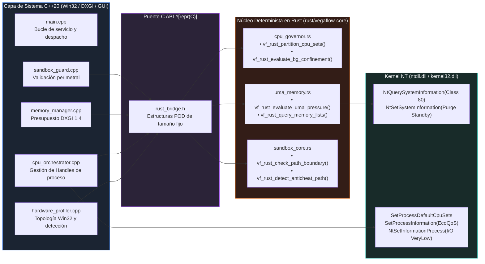
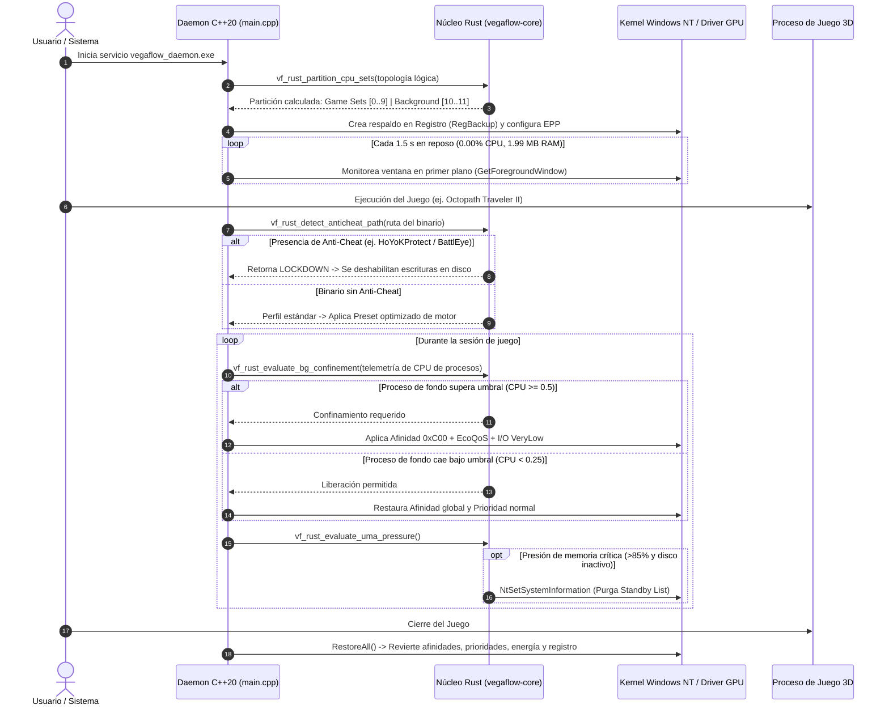

# Núcleo híbrido C++20 + Rust

## 1.3 Arquitectura del Puente Híbrido C++20 ↔ Rust (`libvegaflow_core.a`)

Para garantizar que el propio software de optimización no introduzca latencia ni compita por la memoria del sistema, toda la lógica algorítmica y de evaluación en tiempo real fue desarrollada en **Rust**, compilada como `staticlib` sin dependencia de la biblioteca estándar de C runtime (CRT) en el bucle caliente, operando exclusivamente sobre estructuras POD (*Plain Old Data*) `#[repr(C)]` ubicadas en la pila:

### Módulos del Núcleo Rust:
* **[`cpu_governor.rs`](../../rust/vegaflow-core/src/cpu_governor.rs):** Recibe la lista plana de identificadores de CPU Sets del sistema, calcula los índices de pertenencia a complejos de núcleos y determina si un proceso ruidoso debe ingresar o salir del estado de confinamiento mediante un algoritmo de histéresis sin asignaciones dinámicas.
* **[`uma_memory.rs`](../../rust/vegaflow-core/src/uma_memory.rs):** Enlaza directamente contra `ntdll.dll` invocando `NtQuerySystemInformation(SystemMemoryListInformation)`. Evalúa en microsegundos si el subsistema de memoria compartida supera el umbral crítico (`>= 85%` de presupuesto o `< 1536 MB` de RAM física disponible), gobernando la purga selectiva de la lista de espera (*Standby List*) únicamente cuando el bus de disco opera en reposo (`< 15 MB/s`).
* **[`sandbox_core.rs`](../../rust/vegaflow-core/src/sandbox_core.rs):** Escanea secuencias de caracteres UTF-16 en tiempo constante. Si identifica patrones correspondientes a sistemas anti-trampas comerciales o directorios del sistema protegidos, activa un estado de *Lockdown* inmediato, impidiendo modificaciones en el árbol de archivos.

---

## 1.4 Ciclo de Vida del Daemon y Gobernanza de Procesos

El diagrama de secuencia describe el ciclo de vida continuo del servicio desde su arranque en sesión elevada hasta la terminación de la aplicación:

---

---

## 1.6 Doble Capa: Explicación de Ingeniería Profunda vs. Explicación Sencilla

### Capa 1: Perspectiva de Ingeniería Profunda
En la prueba sintética, confinar el juego a un subconjunto de núcleos (*Core Pinning* del juego) restaba un **-18.9%** de rendimiento debido a que los hilos auxiliares de compilación y despacho D3D11 quedaban asfixiados. La arquitectura óptima es **asimétrica**: mantener el juego con acceso libre a todos los núcleos físicos y reubicar de manera forzada únicamente a los intrusos en el último complejo físico. Al confinar los 6 workers a los hilos lógicos 10 y 11, la caché L3 asociada a los núcleos 0 a 4 permanece libre de desalojos forzados, permitiendo que la tasa de aciertos (*Cache Hit Rate*) supere el 96%, reduciendo los ciclos de parada de ejecución (*Stall Cycles*) en la tubería de despacho de comandos de la GPU.

### Capa 2: Explicación Sencilla y Cotidiana (La Autopista de 6 Carriles y los Chefs de Cocina)
* **La Autopista de 6 Carriles:** Imagina una autopista de 6 carriles donde un automóvil deportivo (el juego) necesita viajar a 100 km/h sin frenar. Sin regulación, una docena de camiones de carga pesada y furgonetas de reparto (navegadores, actualizaciones, tareas del sistema) circulan zigzagueando por todos los carriles. Aunque el deportivo sea potente, se verá obligado a frenar en seco cada vez que un camión se le cruce en su carril. VegaFlow actúa como un policía de tránsito de alta velocidad: no le pone límites al vehículo prioritario, pero **obliga a todos los camiones pesados a circular exclusivamente por el carril lento de la extrema derecha**. Con los otros 5 carriles despejados, el vehículo rueda a máxima velocidad sin interrupciones.
* **El Restaurante y los Chefs:** Un procesador de 6 núcleos funciona como 6 cocineros en la misma cocina. Si los clientes de una fiesta ruidosa entran a la cocina y le piden favores a los 6 cocineros a la vez, los cocineros pierden las comandas del plato principal y la comida sale con retraso (los tirones en pantalla). VegaFlow asigna a **un solo cocinero en una barra auxiliar para atender a los invitados ruidosos**, dejando a los otros 5 cocineros dedicados por completo a servir el banquete del juego.

---

