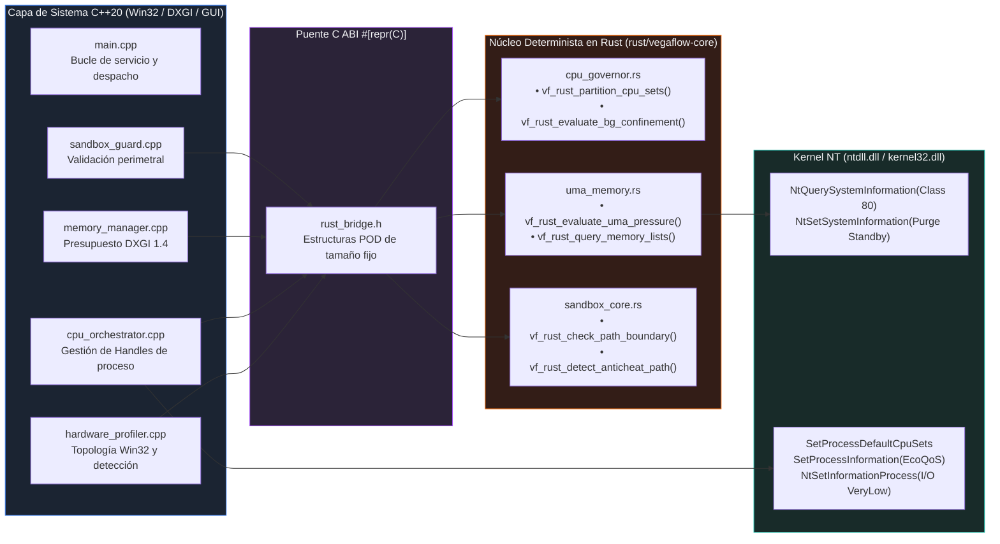
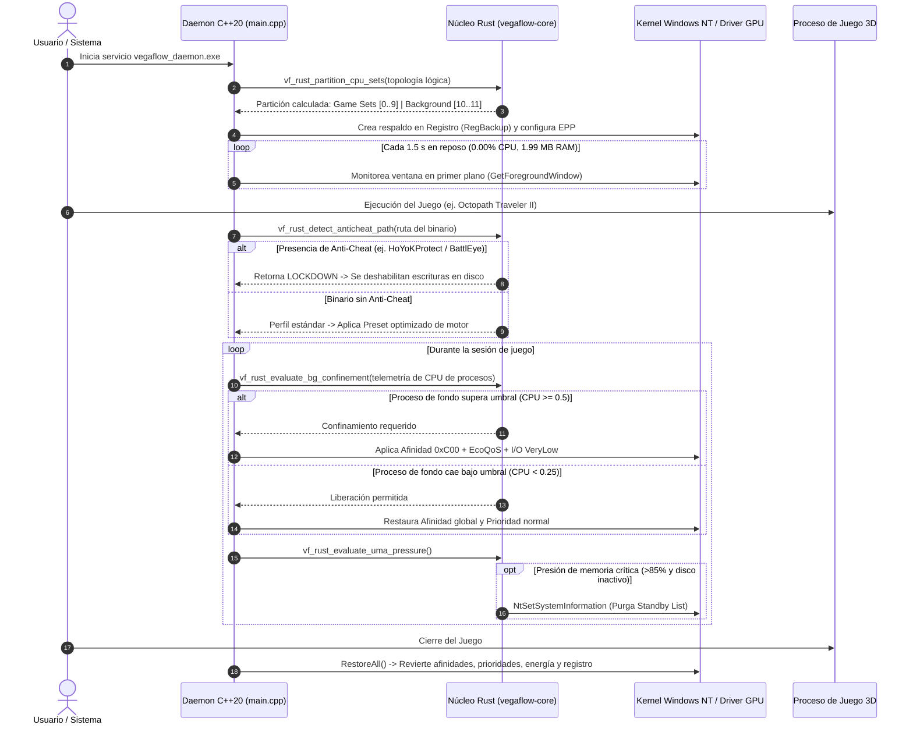

# Núcleo híbrido C++20 + Rust

## 1.3 Arquitectura del Puente Híbrido C++20 ↔ Rust (`libvegaflow_core.a`)

Para garantizar que el propio software de optimización no introduzca latencia ni compita por la memoria del sistema, toda la lógica algorítmica y de evaluación en tiempo real fue desarrollada en **Rust**, compilada como `staticlib` sin dependencia de la biblioteca estándar de C runtime (CRT) en el bucle caliente, operando exclusivamente sobre estructuras POD (*Plain Old Data*) `#[repr(C)]` ubicadas en la pila:



### Módulos del Núcleo Rust:
* **[`cpu_governor.rs`](../../rust/vegaflow-core/src/cpu_governor.rs):** Recibe la lista plana de identificadores de CPU Sets del sistema, calcula los índices de pertenencia a complejos de núcleos y determina si un proceso ruidoso debe ingresar o salir del estado de confinamiento mediante un algoritmo de histéresis sin asignaciones dinámicas.
* **[`uma_memory.rs`](../../rust/vegaflow-core/src/uma_memory.rs):** Enlaza directamente contra `ntdll.dll` invocando `NtQuerySystemInformation(SystemMemoryListInformation)`. Evalúa en microsegundos si el subsistema de memoria compartida supera el umbral crítico (`>= 85%` de presupuesto o `< 1536 MB` de RAM física disponible), gobernando la purga selectiva de la lista de espera (*Standby List*) únicamente cuando el bus de disco opera en reposo (`< 15 MB/s`).
* **[`sandbox_core.rs`](../../rust/vegaflow-core/src/sandbox_core.rs):** Escanea secuencias de caracteres UTF-16 en tiempo constante. Si identifica patrones correspondientes a sistemas anti-trampas comerciales o directorios del sistema protegidos, activa un estado de *Lockdown* inmediato, impidiendo modificaciones en el árbol de archivos.

---

## 1.4 Ciclo de Vida del Daemon y Gobernanza de Procesos

El diagrama de secuencia describe el ciclo de vida continuo del servicio desde su arranque en sesión elevada hasta la terminación de la aplicación:



---


---

## 1.6 Doble Capa: Explicación de Ingeniería Profunda vs. Explicación Sencilla

### Capa 1: Perspectiva de Ingeniería Profunda
En la prueba sintética, confinar el juego a un subconjunto de núcleos (*Core Pinning* del juego) restaba un **-18.9%** de rendimiento debido a que los hilos auxiliares de compilación y despacho D3D11 quedaban asfixiados. La arquitectura óptima es **asimétrica**: mantener el juego con acceso libre a todos los núcleos físicos y reubicar de manera forzada únicamente a los intrusos en el último complejo físico. Al confinar los 6 workers a los hilos lógicos 10 y 11, la caché L3 asociada a los núcleos 0 a 4 permanece libre de desalojos forzados, permitiendo que la tasa de aciertos (*Cache Hit Rate*) supere el 96%, reduciendo los ciclos de parada de ejecución (*Stall Cycles*) en la tubería de despacho de comandos de la GPU.

### Capa 2: Explicación Sencilla y Cotidiana (La Autopista de 6 Carriles y los Chefs de Cocina)
* **La Autopista de 6 Carriles:** Imagina una autopista de 6 carriles donde un automóvil deportivo (el juego) necesita viajar a 100 km/h sin frenar. Sin regulación, una docena de camiones de carga pesada y furgonetas de reparto (navegadores, actualizaciones, tareas del sistema) circulan zigzagueando por todos los carriles. Aunque el deportivo sea potente, se verá obligado a frenar en seco cada vez que un camión se le cruce en su carril. VegaFlow actúa como un policía de tránsito de alta velocidad: no le pone límites al vehículo prioritario, pero **obliga a todos los camiones pesados a circular exclusivamente por el carril lento de la extrema derecha**. Con los otros 5 carriles despejados, el vehículo rueda a máxima velocidad sin interrupciones.
* **El Restaurante y los Chefs:** Un procesador de 6 núcleos funciona como 6 cocineros en la misma cocina. Si los clientes de una fiesta ruidosa entran a la cocina y le piden favores a los 6 cocineros a la vez, los cocineros pierden las comandas del plato principal y la comida sale con retraso (los tirones en pantalla). VegaFlow asigna a **un solo cocinero en una barra auxiliar para atender a los invitados ruidosos**, dejando a los otros 5 cocineros dedicados por completo a servir el banquete del juego.

---


---

## Especificación de Diseño: Fusión Híbrida Rust + C++20 para Control de Memoria UMA/APU, Integración MCP `metal-gpu-trace` y Flujo TDD

**Fecha:** 2026-11-06  
**Rama Base:** `feat/ab-automation` (`ff73341`)  
**Hardware de Referencia:** AMD Ryzen 5 4600H (6C/12T Zen 2, 2x CCX de 8 MB L3) + Radeon RX Vega 6 (GCN 5.0, UMA 16 GB DDR4 Dual-Channel)  
**Estado:** Validado en Brainstorming

---

### 1. Contexto y Motivación

En arquitecturas APU con memoria unificada (UMA), la CPU y la iGPU comparten el mismo bus DDR4 de 128 bits (~38–42 GB/s). En el daemon de VegaFlow Universal, mantener una huella de memoria privada ultra-baja (`< 15.0 MB`, actualmente ~2.5 MB) y `0.0%` de uso de CPU en reposo es un requisito físico indispensable para no contaminar la caché L3 ni competir por el ancho de banda del bus Infinity Fabric.

La migración progresiva hacia una **arquitectura híbrida Rust + C++20** mediante enlace estático (`staticlib`, `x86_64-pc-windows-gnu`) permite:
1. **Cero Asignaciones en Heap (Zero-Allocation Hot Path):** Evaluar presión de memoria UMA (`EvaluateUmaPressureGuard`), histéresis de confinamiento de CPU (`CpuOrchestrator`), particionamiento topológico de islas L3/CCX (`PartitionCpuSetsFromTopology`) y validación de firmas Anti-Cheat (`SandboxGuard`) utilizando arreglos en pila (*stack arrays*), tipos escalares `#[repr(C)]` y contadores atómicos sin invocar al asignador dinámico en cada ciclo del daemon.
2. **Seguridad de Memoria y Frontera FFI Blindada:** `panic = "abort"`, validación estricta de punteros/longitudes antes de construir slices y ausencia total de excepciones a través de `extern "C"`.
3. **Telemetría y Control en Laptop Integrados:** Registrar el servidor MCP `metal-gpu-trace` (`C:\dev\metal-gpu-trace\metal_trace_mcp.py` con `PresentMon.exe`) en `~/.gemini/config/mcp_config.json` y verificar la salud del equipo con el paquete de trabajos `scripts/remote/jobs/doctor.ps1`.
4. **Desarrollo Guiado por Pruebas (TDD Estricto):** Todo módulo en Rust se construye bajo el ciclo **RED $\to$ GREEN $\to$ REFACTOR** con `cargo test` y se verifica de extremo a extremo en la suite de integración `vegaflow_tests.exe` (`31 PASSED, 0 FAILED`).

---

### 2. Arquitectura del Subsistema Híbrido (`rust/vegaflow-core`)

```
+-----------------------------------------------------------------------------------+
|                        BINARIO ÚNICO (vegaflow_daemon.exe)                        |
|                    Enlace Estático MinGW-w64 (g++ 16.2 + Rust)                    |
+-----------------------------------------------------------------------------------+
|  Capa C++20 (GUI Win32/GDI, DXGI/D3D COM, Registro Windows, Orquestación Win32)   |
|    - MemoryManager        --->  src/bridge/rust_bridge.h  --->  uma_memory.rs   |
|    - HardwareProfiler     --->  (Contrato #[repr(C)] FFI)   --->  cpu_governor.rs |
|    - CpuOrchestrator      --->  (Cero Heap / Zero-Copy)     --->  cpu_governor.rs |
|    - SandboxGuard         --->                              --->  sandbox_core.rs |
+-----------------------------------------------------------------------------------+
|  Crate Rust: rust/vegaflow-core (staticlib + rlib, panic="abort", opt-level=3)    |
|    - Llamadas nativas NTDLL (NtQuerySystemInformation / NtSetSystemInformation)   |
|    - Cálculos deterministas en pila sin std::vector / std::string en bucle activo |
+-----------------------------------------------------------------------------------+
```

#### 2.1. Configuración del Crate (`rust/vegaflow-core/Cargo.toml`)
- **Nombre del paquete:** `vegaflow-core` (`lib` name: `vegaflow_core`).
- **Tipos de crate:** `["staticlib", "rlib"]` (`rlib` para ejecutar `cargo test` nativamente y `staticlib` para generar `libvegaflow_core.a` hacia `g++`).
- **Perfil Release:**
  - `opt-level = 3`
  - `lto = true`
  - `codegen-units = 1`
  - `panic = "abort"`
  - `strip = false` (el linker de `g++` gestiona los símbolos finales sin romper el archivo `.a`).
- **Cero dependencias externas pesadas:** Interacción directa con `ntdll.dll` mediante bloques `extern "system"` en Rust puro, evitando inflar tiempos de compilación o tamaño de binario.

---

### 3. Contrato FFI (`src/bridge/rust_bridge.h`) y Módulos en Rust

#### 3.1. Módulo `uma_memory`: Presión DXGI y Listas de Memoria NT
- **Estructuras `#[repr(C)]`**:
  ```c
  typedef struct VfUmaTelemetryInput {
      uint64_t total_physical_bytes;
      uint64_t free_and_zero_bytes;
      uint64_t standby_bytes;
      uint64_t local_budget_bytes;
      uint64_t local_usage_bytes;
      uint32_t safe_vram_pool_mb;
      bool vram_valid;
  } VfUmaTelemetryInput;

  typedef struct VfUmaGuardDecision {
      double dxgi_budget_utilization;
      bool guard_triggered;
      bool should_trim_background_ws;
      bool should_purge_standby;
      uint32_t total_interventions;
  } VfUmaGuardDecision;

  typedef struct VfNtMemoryListSample {
      uint64_t zero_page_bytes;
      uint64_t free_page_bytes;
      uint64_t modified_page_bytes;
      uint64_t standby_total_bytes;
      bool valid;
  } VfNtMemoryListSample;
  ```
- **Funciones exportadas (`extern "C"`)**:
  - `VfUmaGuardDecision vf_rust_evaluate_uma_pressure(const VfUmaTelemetryInput* input, uint32_t prev_interventions);`
    - Calcula `dxgi_budget_utilization = local_usage_bytes / local_budget_bytes` (si `vram_valid && local_budget_bytes > 0`).
    - Dispara el guard si `dxgi_budget_utilization >= 0.85` o si `free_and_zero_bytes < 1536 * 1024 * 1024`.
    - Incrementa `total_interventions` en `1` cuando `guard_triggered` es verdadero.
    - Determina si debe purgarse la Standby List (`standby_bytes > 512 MB`) y recortar working sets secundarios.
  - `VfNtMemoryListSample vf_rust_query_nt_memory_lists(void);`
    - Invoca directamente `NtQuerySystemInformation(SystemMemoryListInformation /* 80 */, ...)` en Rust y convierte el conteo de páginas (4096 bytes/página) a bytes exactos sin asignar memoria en heap.
  - `bool vf_rust_purge_nt_standby_list(bool dry_run);`
    - Si `dry_run == true`, devuelve `true` sin tocar el kernel. En modo real, invoca `NtSetSystemInformation(SystemMemoryListInformation /* 80 */, &cmd /* MemoryPurgeStandbyList = 4 */, sizeof(ULONG))`.

#### 3.2. Módulo `cpu_governor`: Topología L3/CCX e Histéresis de Confinamiento
- **Estructuras `#[repr(C)]`**:
  ```c
  #define VF_MAX_LOGICAL_PROCESSORS 64

  typedef struct VfCpuCoreEntry {
      uint32_t cpu_set_id;
      uint32_t core_index;
      uint32_t logical_processor_index;
      uint8_t last_level_cache_index;
      uint8_t efficiency_class;
  } VfCpuCoreEntry;

  typedef struct VfTopologyPartitionOut {
      uint32_t game_cpu_set_ids[VF_MAX_LOGICAL_PROCESSORS];
      uint32_t game_count;
      uint32_t background_cpu_set_ids[VF_MAX_LOGICAL_PROCESSORS];
      uint32_t background_count;
      uint32_t physical_cores;
      uint32_t logical_processors;
      bool has_multiple_ccx;
      bool has_smt;
  } VfTopologyPartitionOut;
  ```
- **Funciones exportadas (`extern "C"`)**:
  - `bool vf_rust_partition_cpu_topology(const VfCpuCoreEntry* entries, uint32_t count, VfTopologyPartitionOut* out);`
    - Ejecuta en arreglos de pila de tamaño fijo (`VF_MAX_LOGICAL_PROCESSORS = 64`) las reglas exactas de `HardwareProfiler::PartitionCpuSetsFromTopology`:
      1. Conteo de núcleos físicos únicos, detección de SMT (`logical > physical`) y múltiples islas L3 (`has_multiple_ccx`).
      2. Selección de núcleos de fondo:
         - Topología híbrida (`min_eff != max_eff`): hilos con `efficiency_class < max_eff` van a fondo.
         - Islas L3 asimétricas (`has_multiple_ccx` y la isla secundaria tiene $\le 33\%$ del total de hilos): toda la isla secundaria va a fondo.
         - Islas L3 simétricas o CCX único: si `physical_cores >= 4`, el último núcleo físico completo (todos sus hilos SMT) va a fondo; si `physical_cores < 4`, solo el último procesador lógico (`1` hilo) va a fondo.
      3. Escudo DPC/ISR: si `physical_cores >= 4`, el núcleo físico más bajo (`Core 0`) se excluye de `game_cpu_set_ids` (salvo que dejaría al juego sin hilos).
      4. Ordenación de `game_cpu_set_ids` priorizando la isla L3 principal (`primary_llc`) para minimizar latencia inter-CCX.
  - `bool vf_rust_eval_bg_confinement(double logical_cores_used, bool currently_confined);`
    - Implementa la histéresis empírica de `CpuOrchestrator`:
      - Si `currently_confined`: permanece `true` mientras `logical_cores_used >= 0.25`.
      - Si `!currently_confined`: pasa a `true` cuando `logical_cores_used >= 0.50`.

#### 3.3. Módulo `sandbox_core`: Escáner Zero-Allocation de Firmas Anti-Cheat y Rutas Críticas
- **Funciones exportadas (`extern "C"`)**:
  - `bool vf_rust_has_anticheat_signature(const char* utf8_path, size_t len);`
    - Busca de forma case-insensitive en el slice de bytes `[u8]` todas las firmas prohibidas (`easyanticheat`, `battleye`, `beservice`, `vgk.sys`, `vanguard`, `hoyokprotect`, `mhyprot`, `mhypbase`, `anticheatexpert`, `randgrid.sys`, `ace-base`, `acebase`, `blackcipher`, `equ8`, `nprotect`, `gameguard`, `xigncode`, `genshinimpact`, `zenlesszonezero`, `starrail`) sin crear copias en heap.
  - `bool vf_rust_is_critical_system_filename(const char* utf8_name, size_t len);`
    - Verifica nombres críticos de arranque/paginación (`bootmgr`, `pagefile.sys`, `hiberfil.sys`, `swapfile.sys`, `ntldr`, `bootsect.bak`) en tiempo constante sin asignaciones.

---

### 4. Integración en el Pipeline de Compilación (`scripts/build.ps1`)

1. **Verificación del Target GNU en Rust:**
   - Asegurar que el target `x86_64-pc-windows-gnu` esté instalado (`rustup target add x86_64-pc-windows-gnu`).
2. **Paso de Compilación y Test de Rust en `scripts/build.ps1`:**
   - Antes de invocar `g++`, `scripts/build.ps1` compila `rust/vegaflow-core` con `cargo build --release --target x86_64-pc-windows-gnu --manifest-path rust/vegaflow-core/Cargo.toml`.
   - Si se pasa `-RunTests`, ejecuta primero `cargo test --target x86_64-pc-windows-gnu --manifest-path rust/vegaflow-core/Cargo.toml`.
   - Pasa la ruta de `rust/vegaflow-core/target/x86_64-pc-windows-gnu/release/libvegaflow_core.a` a los argumentos de enlace de `vegaflow_daemon.exe` y `vegaflow_tests.exe` antes de las librerías del sistema (`-lntdll -lws2_32 -luserenv -ladvapi32 ...`).

---

### 5. Configuración del Servidor MCP `metal-gpu-trace`

1. **Archivo:** `C:\Users\testuser\.gemini\config\mcp_config.json`
2. **Configuración a registrar:**
   ```json
   "metal-gpu-trace": {
     "command": "C:\\dev\\mgt-venv\\Scripts\\python.exe",
     "args": [
       "-I",
       "C:\\dev\\metal-gpu-trace\\metal_trace_mcp.py"
     ],
     "env": {
       "PRESENTMON_EXE": "C:\\ProgramData\\VegaFlow\\tools\\PresentMon.exe",
       "PERF_OUT": "C:\\dev\\perf-runs"
     }
   }
   ```
3. **Verificación:**
   - Prueba de humo por protocolo JSON-RPC (`initialize`, `tools/list` y llamada a herramienta de estado/reporte) verificando que `metal_trace_mcp.py` responde limpiamente en Windows con `PresentMon.exe`.

---

### 6. Criterios de Aceptación y Plan de Verificación (TDD)

1. **Suite Unitaria Rust (`cargo test`):**
   - 100% de tests pasando en `rust/vegaflow-core` (UMA pressure guard, consultas NTDLL, partición de topología 4600H / Zen4c / 4C..8C, histéresis de confinamiento y firmas Anti-Cheat).
2. **Suite Integrada C++20 + Rust (`scripts/build.ps1 -RunTests`):**
   - Los 30 tests existentes más el nuevo **Test 31 (`Hybrid Rust FFI Core: Zero-Allocation UMA Guard, L3 Topology & Anti-Cheat Scanner`)** deben pasar con resultado **`TEST RESULTS: 31 PASSED, 0 FAILED`**.
3. **Invariantes de Hardware y Sistema (`vegaflow-methodology`):**
   - Huella de memoria privada (`Private Working Set`) del daemon y los tests **$< 15.0\text{ MB}$** (objetivo $< 3.5\text{ MB}$).
   - `vegaflow_daemon.exe --status` reportando telemetría coherente.
   - `scripts/remote/jobs/doctor.ps1` limpio (`fuera de fabrica` vacío, registro y plan de energía idénticos antes y después).
