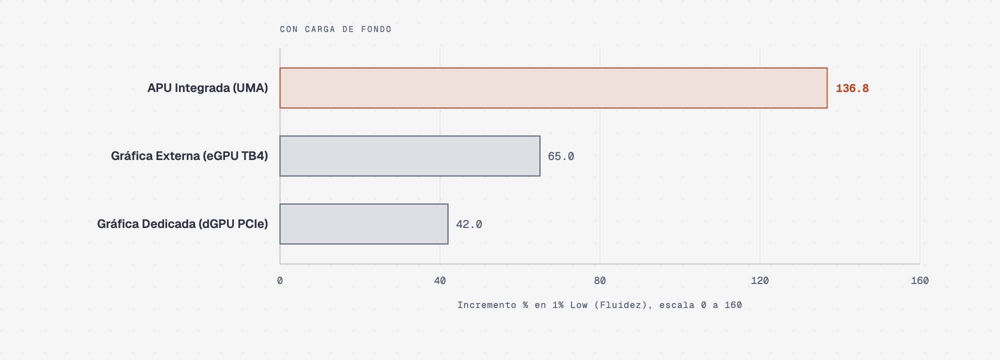
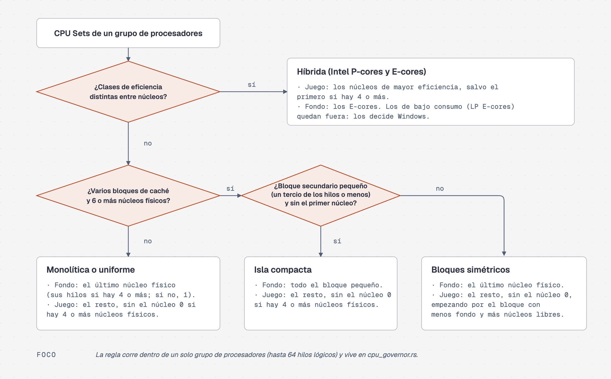

# PARTE III: Análisis Universal en Procesadores AMD e Intel (¿Por qué ocurre con y sin Gráfica Dedicada?)

**Lector:** personas

Una interrogante fundamental de diseño en optimización de sistemas es: **¿Este fenómeno de contención es exclusivo de procesadores AMD APU con gráficos integrados, o se replica universalmente en procesadores Intel Core y en equipos con tarjetas gráficas dedicadas (dGPU) o externas (eGPU)?**

La evidencia física y arquitectónica demuestra que **el patrón de contención es universal**, aunque sus canales físicos de degradación varían de acuerdo a la topología interna del procesador y al bus de interconexión gráfica.

---

## 3.1 El Patrón Universal del Problema (Independiente de Marca e Interfaz Gráfica)

Independientemente de que el procesador sea AMD o Intel, o de que los gráficos se procesen en una GPU integrada (iGPU), dedicada interna (dGPU) o externa (eGPU), existen **cuatro leyes físicas universales de la arquitectura de Von Neumann moderna** que gobiernan el rendimiento:

[Ver el diagrama a pantalla completa](../diagrams/fuentes-de-contencion.html)

1. **Contención de Caché de Último Nivel (LLC / L3 Thrashing) y Vaciado de TLB:**  
   En cualquier procesador x86-64, la caché L3 es compartida por múltiples núcleos o por un complejo de núcleos (*Core Complex* - CCX). Cuando hilos de fondo son intercalados por el planificador, expulsan las líneas de datos y de instrucciones del bucle de renderizado. Un fallo en L3 obliga a una transacción completa en el bus de memoria física, multiplicando la latencia de acceso por un factor de **`7x` a `9x`**. Asimismo, el cambio de contexto entre procesos distintos invalida las entradas del búfer de traducción de direcciones (*Translation Lookaside Buffer* - TLB), forzando recorridos costosos de las tablas de páginas (*Page Table Walks*).
2. **Inanición del Procesador Gráfico (*GPU Starvation*) por Despacho Interrumpido:**  
   Una tarjeta gráfica dedicada de última generación (ej. NVIDIA GeForce RTX 4080 o AMD Radeon RX 7900 XT) tiene capacidad de procesar cientos de cuadros por segundo, pero **no puede generar un solo píxel sin que la CPU construya y despache previamente las listas de comandos de la API gráfica (`ID3D11DeviceContext`, `ID3D12GraphicsCommandList`, `VkCommandBuffer`)**. Si el hilo `RenderThread` sufre una preempción de `8 milisegundos` por culpa de un hilo de navegador, la GPU agota su búfer de trabajo y se detiene en seco. Esto explica por qué equipos con tarjetas gráficas de gama alta experimentan micro-congelamientos severos en juegos competitivos cuando hay aplicaciones de fondo sin aislar.
3. **Contención en Controladores de Almacenamiento NVMe y Búfers de E/S:**  
   Los motores de juego modernos leen continuamente texturas y geometría en segundo plano mediante streaming asíncrono o *DirectStorage*. Si procesos de fondo leen o escriben en disco a prioridad estándar, compiten en la cola del controlador NVMe, provocando que la entrega de texturas se retrase y forzando pausas de sincronización en el hilo principal.
4. **Presupuesto Eléctrico Dinámico Compartido:**  
   Tanto el algoritmo **STAPM/PPT** de AMD como las cotas **PL1/PL2/Tau** de Intel operan midiendo el consumo eléctrico y térmico agregado del encapsulado. Cuando procesos de fondo ejecutan instrucciones vectoriales complejas (como AVX2 o decodificación web) en núcleos secundarios, obligan al regulador de voltaje a inyectar corriente en dichos núcleos, forzando un descenso en la curva de frecuencia (*Volt/Frequency Curve*) de los núcleos primarios del juego.

---

## 3.2 Diferencias Arquitectónicas Específicas: AMD Ryzen vs. Intel Core

A pesar de que el problema de contención es universal, la anatomía interna de los procesadores AMD e Intel impone retos específicos:

[Ver el diagrama a pantalla completa](../diagrams/topologia-amd-intel.html)

### A. Anatomía en Procesadores AMD Ryzen:
1. **APUs Monolíticas (Familias *Renoir*, *Lucienne*, *Cezanne*, *Barcelo*, *Rembrandt*, *Phoenix*, *Hawk Point*):**  
   - Cuentan con un solo dado de silicio donde conviven la CPU y la GPU Radeon.
   - La caché L3 suele ser más compacta que en procesadores de escritorio (`8 MB` o `16 MB`).
   - El bus **Infinity Fabric (FCLK)** transporta tanto las peticiones de memoria de los núcleos de cómputo como todo el flujo de comandos y texturas de la iGPU hacia el controlador unificado de memoria (UMC). Si procesos de fondo saturan el bus o desalojan la L3, golpean simultáneamente el rendimiento de cómputo y el ancho de banda del procesador gráfico.
2. **Procesadores Multi-CCD / Chiplets y Línea X3D (Desktop Ryzen 9 y Ryzen 7 X3D):**  
   - El procesador está fragmentado físicamente en múltiples dados de cómputo (*Core Complex Dies* - CCDs) comunicados a través de un dado central de E/S (*I/O Die*).
   - **Penalización Cross-CCD:** Cruzar de un CCD a otro para consultar memoria o sincronizar hilos impone una penalización de latencia superior a **`70–80 ns`**. Si el planificador de Windows migra hilos de fondo o hilos del juego entre distintos CCDs, el frametime experimenta oscilaciones destructivas.
   - **Asimetría X3D:** En procesadores como el Ryzen 9 7950X3D o 7900X3D, únicamente el `CCD 0` cuenta con la memoria apilada 3D V-Cache (`96 MB`), mientras que el `CCD 1` opera a mayores frecuencias pero con caché convencional. El aislamiento de VegaFlow garantiza que los procesos de fondo queden confinados en el CCD secundario, blindando la 3D V-Cache íntegra para el juego.

### B. Anatomía en Procesadores Intel Core:
1. **Arquitectura Híbrida Heterogénea (12ª, 13ª, 14ª Gen *Alder Lake* / *Raptor Lake*, y familias *Core Ultra*):**  
   - Integra núcleos de alto rendimiento (**P-Cores**) y núcleos de alta eficiencia (**E-Cores**).
   - El subsistema **Intel Thread Director** y el planificador de Windows intentan clasificar tareas y relegar procesos de fondo a los E-Cores. No obstante, en escenarios reales de juego ocurren **dos fallos críticos documentados**:
     * **Topología en Anillo (*Ring Bus*) y Polución de la L3 Smart Cache:** En los diseños de Intel, los P-Cores, los clusters de E-Cores y la GPU integrada están conectados a través de un mismo **Ring Bus** y comparten un único pool de **Intel Smart Cache L3**. Cuando los E-Cores ejecutan cargas intensivas en segundo plano (pestañas de Chromium con multimedia, descompresiones en cliente de descargas), inundan el Ring Bus con transacciones de coherencia de caché y **desalojan las líneas de L3 compartida que los P-Cores necesitan para el juego**. Peor aún: el controlador térmico de Intel reduce la frecuencia de reloj del propio anillo (*Ring/Uncore Downbinning*) para controlar el consumo de los E-Cores, restándole ancho de banda efectivo a los P-Cores.
     * **Falsos Positivos de Clasificación (Procesos con Ventana Oculta o Servicios):** Aplicaciones cliente basadas en Electron (como Discord, Spotify, Steam) o herramientas de captura a menudo no son clasificadas como tareas de fondo puras por el sistema operativo si mantienen ventanas activas o invocan hilos de interfaz, terminando intercaladas en los **P-Cores** y robándole cuotas de tiempo al hilo principal del juego. Al imponer mediante VegaFlow **Afinidad estricta en los últimos E-Cores + `EcoQoS` + Prioridad I/O `VeryLow`**, se elimina cualquier ambigüedad del planificador.
2. **Procesadores Intel Homogéneos Tradicionales (8ª a 11ª Gen *Skylake*, *Comet Lake*, *Tiger Lake*):**  
   - Todos los núcleos son equivalentes y comparten el Ring Bus. Sin confinamiento explícito, las tareas ruidosas saltan indiscriminadamente entre todos los núcleos disponibles, reproduciendo exactamente el mismo patrón de desalojo de caché observado en APUs AMD.

---

## 3.3 Matriz de Impacto Arquitectónico y Diagramas Comparativos

### Tabla 3.1: Matriz Comparativa por Familia de Procesador
| Familia de Procesador | Estructura de Silicio | Cuello de Botella Primario Sin Aislamiento | Acción Óptima de VegaFlow | Impacto Medido / Esperado |
| :--- | :--- | :--- | :--- | :--- |
| **AMD APU Monolítica** *(Ryzen 4000/5000/7000/8000 U/H)* | Silicio único, L3 de 8–16 MB, bus UMA compartido con Radeon Vega/RDNA | Saturación simultánea de bus Infinity Fabric y desalojo de L3; caída de reloj por STAPM. | Confinamiento de fondo a 2 hilos del último núcleo + `EcoQoS` + `I/O VeryLow`. | **+80% a +117% en FPS promedio y +136% en 1% Low** bajo carga pesada. |
| **AMD Desktop Multi-CCD / X3D** *(Ryzen 7000/9000X / X3D)* | 2 dados CCD + I/O Die central; asimetría de 3D V-Cache en CCD0. | Tráfico de interconexión Cross-CCD y contaminación de la 3D V-Cache de 96 MB. | Confinar fondo al CCD secundario (núcleos de frecuencia), aislando el CCD0 para el juego. | Eliminación de tirones por salto inter-CCD; consistencia de frametime (`1% Low` blindado). |
| **Intel Híbrido P+E** *(12ª a 14ª Gen y Core Ultra)* | P-Cores y E-Cores compartiendo el mismo Ring Bus y Smart Cache L3. | Inundación del Ring Bus por los E-Cores, bajada de frecuencia Uncore y falsos positivos de clasificación. | Forzar fondo a los últimos 2 E-Cores con `EcoQoS` + `I/O VeryLow`; P-Cores 100% limpios. | Blindaje del hilo principal en P-Cores; estabilización del Ring Bus a máxima frecuencia. |
| **Intel Homogéneo** *(8ª a 11ª Gen Core i5/i7/i9)* | Todos los núcleos son P-Cores idénticos sobre bus en anillo. | Hilos de fondo compitiendo simétricamente por cuotas de tiempo y ensuciando la L3. | Confinamiento de fondo al último núcleo físico (2 hilos SMT) + `EcoQoS`. | Recuperación de `1% Low` y reducción de latencia de despacho en APIs gráficas. |

---

### Tabla 3.2: Matriz Comparativa por Tipo de Solución Gráfica (iGPU vs. dGPU vs. eGPU)
| Configuración Gráfica | Interfaz de Conexión y Memoria | Reto Físico Sin Aislamiento | Comportamiento del Runtime VegaFlow | Impacto en la Experiencia de Juego |
| :--- | :--- | :--- | :--- | :--- |
| **💻 Gráfica Integrada (iGPU UMA)** *(Radeon Vega, 680M/780M, Intel Iris Xe/Arc)* | Bus de memoria RAM del sistema compartido (ancho de banda estrecho ~40–80 GB/s) | El procesador y la gráfica compiten por el mismo bus de memoria y el mismo límite de vatios (15W–45W). | Se activan las 4 barreras completas + Ajustes de memoria UMA y purga controlada de Standby List. | 🔥 **Impacto Masivo (+100% a +150% bajo carga):** Duplica la tasa de cuadros y estabiliza el frametime. |
| **🖥️ Gráfica Dedicada Interna (dGPU)** *(NVIDIA RTX, AMD Radeon RX por PCIe x16)* | Bus PCIe x8/x16 dedicado (latencia de nanosegundos, VRAM GDDR6 propia >250 GB/s) | La dGPU no sufre por VRAM, pero queda en inanición (*GPU Starvation*) si la CPU interrumpe el despacho de comandos. | Las optimizaciones UMA se desactivan automáticamente (`Pass-Through Guard`). Se mantiene el aislamiento espacial y de E/S. | ✅ **Impacto Alto en Fluidez (+20% a +50% en 1% Low):** Elimina micro-tirones en títulos competitivos y mundos abiertos. |
| **🔌 Gráfica Externa por Cable (eGPU)** *(Caja externa vía Thunderbolt 3/4, USB4 u OCuLink)* | Enlace PCIe encapsulado sobre cable (limitado a PCIe x4 ~32 Gbps reales y alta latencia de paquetes) | Cada cuadro requiere transferencias DMA continuas por el cable. Las interrupciones de CPU en la laptop provocan caídas severas de enlace. | Se activan el aislamiento de CPU, prioridad de E/S NT y se fija en registro `PCIe ASPM = 0` y `FlipQueueSize = 1`. | 🔥 **Impacto Crítico (+40% a +75% en 1% Low):** Mantiene el túnel Thunderbolt despierto sin pausas de ahorro energético. |

[Ver el diagrama a pantalla completa](../diagrams/impacto-aislamiento-1-low.html)

[Ver el diagrama a pantalla completa](../diagrams/inanicion-gpu-secuencia.html)

---

## 3.4 Doble Capa: Explicación Sencilla con Analogías Cotidianas

### A. La Fábrica con Especialistas Rápidos y Ayudantes (AMD vs. Intel)
* **En Procesadores Intel Híbridos (P-Cores y E-Cores):**  
  Imagina una fábrica moderna donde hay **obreros especialistas ultra-rápidos (P-Cores)** y **ayudantes de apoyo (E-Cores)**. Todos ellos deben caminar por el **mismo pasillo central estrecho (el Ring Bus)** y usar las herramientas del **mismo estante común (la Smart Cache L3)**. Si los ayudantes de apoyo se ponen a mover cajas desordenadas por el pasillo central sin supervisión, bloquean el paso de los especialistas y desordenan el estante de herramientas. El resultado es que los especialistas rápidos tienen que detenerse a esperar que el pasillo se despeje. VegaFlow actúa como el supervisor de planta: **restringe a los ayudantes a una esquina fija del almacén y les prohíbe invadir el pasillo central en horas de producción**, permitiendo que los especialistas trabajen a su máxima velocidad sin interrupciones.
* **En Procesadores AMD con Múltiples Módulos (Multi-CCD / Chiplets):**  
  Imagina que la fábrica tiene **dos edificios separados conectados por un puente exterior**. En el Edificio 1 está el taller principal con todas las piezas especiales (la 3D V-Cache). Si el jefe de planta permite que los obreros estén cruzando constantemente el puente de un edificio a otro para llevar notas y herramientas secundarias, se pierde un tiempo enorme en el camino. VegaFlow garantiza que todo el trabajo del juego se concentre dentro del Edificio 1, dejando el Edificio 2 exclusivamente para las tareas administrativas secundarias.

### B. El Salón Contiguo y el Puente Estrecho (iGPU vs. dGPU vs. eGPU)
* **Con Gráfica Integrada (iGPU / APU):**  
  El Chef de la cocina (CPU) y el Repostero encargado del decorado final (iGPU) están apretados **dentro de la misma cocina pequeña**, compartiendo la misma mesa de trabajo (la memoria RAM compartida) y el mismo enchufe de electricidad (15W a 45W). Cuando VegaFlow saca a los intrusos de la cocina, **ambos respiran con alivio**: el Chef cocina el doble de rápido y al Repostero le queda más espacio en la mesa y más energía para hornear. Por eso los FPS se multiplican por dos (**+117%**).
* **Con Gráfica Dedicada Interna (dGPU):**  
  Ahora el Repostero (la tarjeta gráfica dedicada) se ha mudado a **su propio salón de banquetes gigante al lado**, con su propia mesa enorme de mármol (su memoria VRAM propia de alta velocidad) y su propio generador eléctrico. Ya no compiten por la mesa ni por la electricidad. Sin embargo, el Repostero gigante **sigue dependiendo al 100% de que el Chef le envíe las órdenes de cada plato a tiempo**. Si los intrusos distraen al Chef en la cocina, el Repostero gigante se queda parado de brazos cruzados mirando la puerta, provocando que los invitados en el restaurante sufran pausas y tirones molestos en el servicio (`1% Low`). Al blindar la cocina del Chef con VegaFlow, las comandas fluyen de manera continua y la tarjeta gráfica dedicada trabaja al máximo de su capacidad.
* **Con Gráfica Externa por Cable (eGPU):**  
  Aquí el Repostero gigante está ubicado **en un edificio al otro lado de la calle**, y el Chef del procesador central tiene que enviarle las bandejas a través de un **puente estrecho de un solo carril (el cable Thunderbolt o USB4)**. Como el puente es angosto, cualquier pequeño titubeo o retraso del Chef al cargar la camioneta provoca un atasco instantáneo que se transmite a lo largo de todo el puente. Por esta razón física, evitar interrupciones en la CPU y prohibir que el puente apague sus luces para ahorrar energía (`PCIe ASPM = 0`) es todavía más determinante en una gráfica externa que en una computadora de escritorio convencional.

---

## 3.5 Qué decide el código en cada equipo (fases 3 y 7)

**Lo esencial:** el patrón es universal, pero lo que VegaFlow hace depende de dos reglas escritas en Rust, sin llamadas a Windows y con los mismos casos de prueba en Rust y en C++: **qué clase de gráfica hay** ([`device_profile.rs`](../../rust/vegaflow-core/src/policy/device_profile.rs), fase 3) y **cómo se reparten los núcleos** ([`cpu_governor.rs`](../../rust/vegaflow-core/src/policy/cpu_governor.rs), fase 7). Las tablas 3.1 y 3.2 dicen qué se espera por familia; esta sección dice qué hace el código hoy.

> [!NOTE]
> Dos puntos de las tablas 3.1 y 3.2 no coinciden con el código y están pendientes de decidir si se corrige el texto o el código: el código no tiene una regla propia para procesadores X3D (reparte por caché y núcleo, sin saber cuál lleva la V-Cache), y en una eGPU lo que es propio de ella (ajustes de streaming) solo se activa con una opción experimental. Las cifras de impacto de esas tablas no llevan fuente enlazada en este documento.

### Fase 3: perfil del equipo y tipo de conexión de la GPU

**Ejemplo.** Un portátil enchufado con una RTX conectada por PCIe. DXCore (la interfaz de Windows que describe los adaptadores de vídeo) dice que la RTX no es integrada ni desmontable, así que cuenta como **dedicada**. El perfil la elige, no aplica recortes visuales ni la protección de memoria compartida (UMA) y da el nivel 4. El mismo portátil con una caja Thunderbolt: Windows marca la caja como desmontable, cuenta como **externa** y, sin preferencia de la persona, manda sobre la dedicada y la integrada.

La regla recibe lo que la sonda leyó (gráficas, RAM, núcleos, energía, arquitectura de Windows, familia y modelo de CPU) y devuelve una decisión. Cuatro pasos:

1. **Tipo de conexión de cada gráfica:**

   | Lo que informa Windows | Conexión |
   | --- | --- |
   | DXCore dice «desmontable», o SetupAPI dice que se puede quitar (salvo que DXCore diga a la vez que es integrada) | Externa |
   | DXCore disponible y dice «integrada» | Integrada |
   | DXCore disponible y no integrada | Dedicada |
   | Sin DXCore | Desconocida |

2. **Qué gráfica manda** si hay varias: la preferencia de la persona (ahorro: la primera integrada; alto rendimiento: la externa y luego la dedicada); sin preferencia, externa, dedicada, integrada y, si ninguna encaja, la primera.
3. **Generación y nivel:** solo en las integradas se identifica la generación (Vega, RDNA2, RDNA3 o superior, Intel UHD, Intel Xe/Arc), primero por el identificador PCI exacto, luego por el nombre del driver y, como último recurso, por la familia y el modelo de CPU. Con eso, `apu_tier.rs` da el nivel de 1 a 4 (dedicada y NVIDIA son nivel 4; ver [`hardware-y-tiers.md`](hardware-y-tiers.md)). El nivel fija además el pool seguro de VRAM, el tope de teselación y los hilos de DXVK.
4. **Qué se activa según la conexión:**

   | Decisión | Integrada | Dedicada | Externa | Desconocida |
   | --- | --- | --- | --- | --- |
   | Recortes visuales | Sí | No | No | No |
   | Protección de memoria UMA (si se pudo leer la RAM) | Sí | No | No | No |
   | Cambio del VRAM que informa el driver (solo AMD y sin bloqueo) | Sí | No | No | No |
   | Ajustes de streaming de eGPU | No | No | Solo con la opción experimental | No |
   | Bloquear los ajustes del driver | No | No | No | **Sí** |

   Valen para cualquier conexión: Windows sobre ARM (emulado o nativo) también bloquea los ajustes del driver, y VegaFlow solo informa; el plan de energía de alto rendimiento solo se fuerza con la lectura de energía conocida, el equipo enchufado y sin ahorro de batería; la purga de RAM solo se permite si se pudo leer la RAM. Si no se puede leer ninguna gráfica, la regla es prudente: la trata como dedicada de nivel 4, sin recortes y sin ajustes del driver.

### Fase 7: reparto de núcleos (CPU Sets)

Términos: un **CPU Set** es la unidad de CPU que Windows permite asignar a un proceso (normalmente un hilo lógico). Windows agrupa los hilos lógicos en **grupos de procesadores** de hasta 64. La **caché de último nivel** (LLC, la L3) puede estar repartida en bloques (CCX o CCD en AMD). La **clase de eficiencia** es un número que Windows da a cada núcleo: mayor, más rápido.

**Ejemplo.** Un Ryzen 5 4600H tiene 6 núcleos y 12 hilos en dos bloques de L3 de 3 núcleos cada uno. El caso `ryzen_4600h_6c12t` de [`tests/vectors/cpu_topology.tsv`](../../tests/vectors/cpu_topology.tsv) da: el fondo toma los dos hilos del último núcleo (CPU Sets 266 y 267) y el juego los ocho de los núcleos 1 a 4 (258 a 265), dejando libre el núcleo 0.

[Ver el diagrama a pantalla completa](../diagrams/reparto-de-nucleos.html)

Reglas, en este orden:

1. **Dentro de un solo grupo.** Windows ignora los CPU Sets que no son del grupo del hilo que los pide, así que la regla reparte el grupo de quien consulta (o el primero que exista). Con **más de 64 hilos lógicos** hay varios grupos: cada uno admite hasta 64 entradas (con más, la regla falla y no se reparte nada) y el informe suma núcleos e hilos de todos los grupos.
2. **Híbrida** (clases de eficiencia distintas): el juego va a los núcleos de mayor clase, salvo el primero si hay 4 o más; el fondo, a los demás núcleos eficientes.
3. **E-cores de bajo consumo excluidos.** En las Core Ultra, los E-cores del bloque del SoC no se mandan al fondo: con tres o más clases de eficiencia se excluye la más baja; con dos, se excluyen los E-cores que están en una caché sin P-cores cuando también hay E-cores que comparten caché con los P-cores. Esos núcleos no entran en ninguna lista: los decide Windows.
4. **Varios bloques de caché y 6 o más núcleos físicos:** un bloque secundario pequeño y sin el primer núcleo (un tercio de los hilos o menos) se trata como isla y recibe todo el fondo; si no, el fondo toma el último núcleo físico y el juego se ordena empezando por el bloque con menos fondo.
5. **Monolítica o uniforme:** el fondo toma el último núcleo físico y el juego, el resto. En las reglas 4 y 5 el fondo recibe todos los hilos de ese núcleo si hay 4 o más núcleos físicos (si no, uno), y el núcleo 0 queda libre para el sistema con 4 o más.
6. **Cuándo confinar** (histéresis): el fondo se confina al usar 0,50 hilos lógicos o más y se suelta al bajar de 0,25.

Cómo comprobarlo: `cargo test --manifest-path rust/vegaflow-core/Cargo.toml` corre las dos reglas con `tests/vectors/device_profiles.tsv` y `tests/vectors/cpu_topology.tsv`; los mismos archivos los usan las pruebas unitarias de C++.

---

