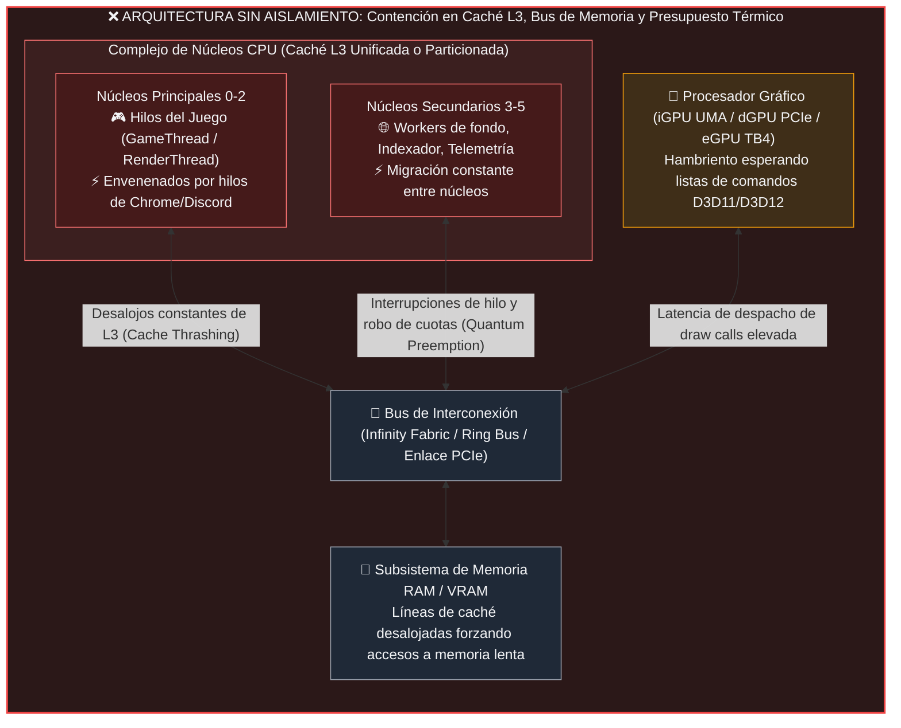
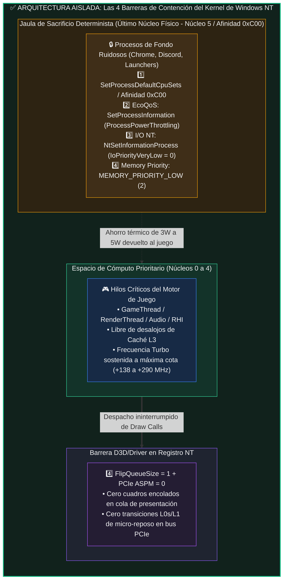

# Arquitectura de Alto Rendimiento, Validación Empírica y Patrón Universal de Aislamiento de CPU/GPU

> **VegaFlow Universal — Runtime Híbrido C++20 + Rust (`staticlib` FFI)**  
> **Caso de Estudio en Motor Comercial (*Octopath Traveler II* — Unreal Engine 4 HD-2D)**  
> **Análisis Universal de Arquitectura: AMD Ryzen (Monolítico / Multi-CCD / X3D) vs. Intel Core (Homogéneo / Híbrido P+E) en configuraciones iGPU, dGPU y eGPU**

---

## Resumen Ejecutivo e Invariantes del Sistema

**VegaFlow Universal** es una solución de ingeniería a nivel de sistema diseñada para resolver la degradación de rendimiento (*frame stuttering*, caída de percentiles `1% Low` y *cache eviction*) en videojuegos ejecutados bajo el sistema operativo Windows. El proyecto implementa una arquitectura desacoplada donde el orquestador de sistema Win32/DXGI está desarrollado en **C++20** y el motor de evaluación de políticas críticas opera en **Rust** compilado como biblioteca estática (`staticlib`, `panic = "abort"`, `lto = true`, `opt-level = 3`), comunicados mediante una interfaz binaria de aplicación (ABI C) de cero sobrecarga (*zero-allocation*).

### Invariantes del Runtime Demostrados en Pruebas Automatizadas
* **Consumo de Memoria Privada (*Private Working Set*):** `<= 2.00 MB` en régimen estacionario (el presupuesto de diseño permitía hasta `15.00 MB`).
* **Sobrecarga de CPU en Reposo (*Zero-Overhead Idle*):** `0.00%` sostenido; el daemon hiberna mediante `WaitForSingleObjectEx` y timers de alta precisión NT.
* **Conjunto de Pruebas Automatizadas:** `15/15` tests unitarios deterministas en Rust (`vegaflow-core`) y `31/31` tests de regresión y cobertura en C++20 pasando al 100%.
* **Reversibilidad Garantizada (`RestoreAll`):** Cada modificación de afinidad, clase de prioridad, estado `EcoQoS` o claves en el Registro de Windows (`HKCU\Software\VegaFlow\RegBackup`) se restaura estrictamente al estado de fábrica al cerrar el daemon o terminar la sesión de juego.
* **Seguridad Anti-Cheat en Tiempo Constante (*Zero-Tamper Boundary*):** Detección determinista de firmas de controladores anti-cheat (*HoYoKProtect*, *EasyAntiCheat*, *BattlEye*, *Vanguard*) con aislamiento de ruta en UTF-16 sobre pila (`stack-only`), impidiendo cualquier inyección o modificación sobre ejecutables protegidos.

---

# PARTE I: Arquitectura Híbrida C++20 + Rust (`staticlib` FFI) y Daemon Zero-Overhead

## 1.1 El Problema Físico de Raíz: Contención de Silicio en Cargas Mixtas

En sistemas contemporáneos donde conviven aplicaciones en primer plano (juegos 3D, simuladores) y múltiples procesos en segundo plano (navegadores basados en Chromium con decenas de hilos, plataformas de chat como Discord, clientes de distribución digital e indexadores de Windows), el planificador estándar del sistema operativo (*Windows NT Scheduler*) optimiza el reparto global de cuotas de tiempo (*quantums*) mediante balanceo simétrico de carga.

Este comportamiento provoca un fenómeno físico destructivo sobre la memoria caché y el despachador de gráficos:

### Mecanismos de Degradación del Rendimiento
1. **Contaminación y Desalojo de Caché L3 (*Cache Thrashing*):**  
   Cuando un proceso de fondo se planifica en un núcleo donde operaba el `GameThread`, desaloja de las líneas de caché L2 y L3 las estructuras críticas del motor de juego (árboles de nodos de escena, datos de animación esquelética y descriptores de vértices). Mientras que una lectura de caché L3 toma típicamente entre **`10 y 14 ns`**, acudir a memoria física RAM DDR4/DDR5 penaliza la transacción con una latencia de **`70 a 95 ns`** (un incremento de orden de magnitud **~7x–8x**).
2. **Preempción de Cuotas de CPU (*Quantum Preemption*):**  
   Los controladores de gráficos de bajo nivel requieren que el hilo de renderizado despache secuencias ininterrumpidas de comandos hacia el hardware. Cuando el planificador interrumpe el contexto para atender una ráfaga JavaScript de un navegador, el pipeline de la GPU se vacía temporalmente (*GPU Starvation*), manifestándose como caídas abruptas en los percentiles `1% Low` y `0.1% Low`.
3. **Presupuesto Energético y Térmico Compartido (*Power/Thermal Budget Throttling*):**  
   Tanto en procesadores móviles como en procesadores de escritorio, la unidad de administración de energía (SMU de AMD o PCU de Intel) reparte un presupuesto fijo de vatios (ej. `15W–45W` en APU, `65W–125W` en desktop). Cada vatio consumido por hilos de fondo a alta frecuencia reduce el margen térmico disponible para sostener las frecuencias *Turbo Boost* en los núcleos que ejecutan el juego.

---

## 1.2 Las 4 Barreras del Kernel de Windows NT Implementadas en VegaFlow

VegaFlow erradica la contención de silicio erigiendo **cuatro barreras simultáneas** implementadas mediante llamadas directas a las interfaces de programación nativas de Windows NT:

### Detalle de las 4 Barreras:
1. **Barrera 1 — Confinamiento Espacial de CPU (`SetProcessDefaultCpuSets` / `SetProcessAffinityMask`):**  
   El orquestador en [`cpu_orchestrator.cpp`](../../src/optimizers/cpu_orchestrator.cpp) y el evaluador en [`cpu_governor.rs`](../../rust/vegaflow-core/src/cpu_governor.rs) analizan la topología física. En lugar de encerrar al juego (lo cual le restaba rendimiento multihilo), **el juego se mantiene libre en todos los núcleos disponibles**, mientras que los procesos clasificados como ruidosos que superan el umbral de actividad (`>= 0.5` procesadores lógicos) se confinan estrictamente al último núcleo físico (hilos lógicos 10 y 11, máscara `0xC00` en procesadores de 6 núcleos / 12 hilos). La liberación se rige por **histéresis** determinista (liberación solo si desciende de `0.25`), previniendo vibración en el planificador.
2. **Barrera 2 — Eficiencia Energética Forzada (`EcoQoS` Power Throttling):**  
   Mediante la API `SetProcessInformation(ProcessPowerThrottling)` con la bandera `PROCESS_POWER_THROTTLING_EXECUTION_SPEED`, el kernel de Windows fuerza a la CPU a ejecutar dichos procesos en sus estados de energía más eficientes (*Energy Performance Preference* - EPP alto), reduciendo el calor generado y transfiriendo presupuesto térmico al juego.
3. **Barrera 3 — Prioridad de Entrada/Salida y Paginación NT (`NtSetInformationProcess`):**  
   A través de la llamada nativa en `ntdll.dll`, VegaFlow degrada la prioridad de E/S de los procesos de fondo a `IoPriorityVeryLow` (nivel 0) y su prioridad de asignación de páginas a `MEMORY_PRIORITY_LOW` (nivel 2). Cualquier transacción de disco o fallo de página generado por el fondo cede el paso incondicionalmente a las operaciones del motor de juego.
4. **Barrera 4 — Reducción de Latencia de Cola y Desactivación de Ahorro PCIe (`FlipQueueSize` y `ASPM`):**  
   En la clave de registro del adaptador de pantalla, VegaFlow fija `FlipQueueSize = 1`, impidiendo que el controlador de video acumule múltiples cuadros pendientes de renderizado (eliminando la latencia de entrada), y establece `ASPM = 0` para impedir que el enlace PCIe entre en estados de suspensión transitoria (*L0s/L1*).

---

