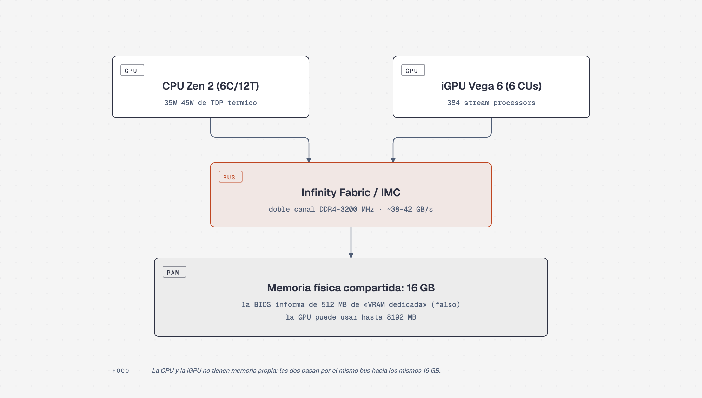

# APU hardware limits

**In short:** An APU is a processor and a graphics chip on the same piece of silicon, and the two share one pool of memory. When the processor uses a lot of that memory, the graphics chip slows down, so VegaFlow limits background work. For example, the test machine's BIOS reports 512 MB of video memory, although its graphics chip can use up to 8192 MB, so VegaFlow tells the game engine to use the real amount.

**Reader:** people

## 2. APU hardware and restrictions (AMD Ryzen 5 4600H + Radeon RX Vega 6)

VegaFlow is optimized at the microarchitecture level for AMD APUs (Accelerated Processing Units, a processor and a graphics chip on one chip), with the main test machine centered on the **AMD Ryzen 5 4600H** processor (6 cores, 12 threads, Zen 2 architecture at 3.0 GHz base / 4.0 GHz boost) paired with the built-in **AMD Radeon RX Vega 6** graphics (6 Compute Units / 384 Stream Processors at 1500 MHz, GCN 5.0 architecture).




### 2.1. The UMA (Unified Memory Architecture) memory bottleneck
Unlike a dedicated graphics card, which has its own GDDR6 bus of 128 or 256 bits (bandwidth of 200 to 500+ GB/s), the APU shares the system's RAM over a dual-channel 128-bit DDR4 bus with a theoretical bandwidth of ~42 GB/s.
- The CPU and the iGPU **compete for the same bandwidth**. If the CPU does excessive memory reads or background compression, the GPU suffers sharp drops in fill rate and framerate.
- **VegaFlow mitigation:** isolation of secondary processes through CPU Sets, GameDVR turned off, and memory purges timed only during periods of low disk I/O (at most `15 MB/s`).

### 2.2. The false 512 MB VRAM limit and texture streaming
For compatibility with legacy 32-bit software, AMD BIOSes and drivers often report only 512 MB of "Dedicated VRAM" (`DXGI_ADAPTER_DESC::DedicatedVideoMemory`).
- **The problem:** modern engines such as Unreal Engine 4 and Unreal Engine 5 read this property and automatically restrict the size of the texture pool (`r.Streaming.PoolSize`). The result is a visual disaster: blurry textures that never finish loading, constant pop-in, and continuous CPU stutters while the engine keeps unloading and reloading textures.
- **VegaFlow's technical fix:** turn off the engine's restriction and tell it to use the real physical memory:
  ```ini
  r.Streaming.LimitPoolSizeToVRAM=0
  r.Streaming.PoolSize=3000
  r.Streaming.FullyLoadUsedTextures=1
  r.Streaming.FramesForFullUpdate=1
  r.Streaming.MaxNumTexturesToStreamPerFrame=100
  r.Streaming.Boost=1.5
  ```

### 2.3. Missing GPL (`VK_EXT_graphics_pipeline_library`) in AMD GCN 5 / Vega drivers
AMD's official Adrenalin drivers for the Vega architecture do not expose the Vulkan extension `VK_EXT_graphics_pipeline_library`.
- In emulators and standard translation layers such as vanilla DXVK, the missing GPL forces shaders to be compiled on the main rendering thread at the exact moment an effect appears on screen, causing severe stutters (shader compilation stutter).
- **VegaFlow fix:** native integration of the `DXVK-GPLAsync` subsystem with multithreaded settings for Vega 6:
  ```ini
  dxvk.gpl = True
  dxvk.enableAsync = True
  dxvk.gplAsyncCache = True
  dxvk.numCompilerThreads = 6
  dxgi.maxDeviceMemory = 4096
  dxgi.maxSharedMemory = 8192
  ```
  This hands pipeline compilation to 6 CPU threads in the background, completely removing freezes during play.

### 2.4. Why `AsyncCompute` is not viable on 6 Compute Units
`AsyncCompute` lets large GPUs run compute and graphics work at the same time on separate queues. However, on an iGPU with only 6 physical Compute Units (384 ALUs), the hardware scheduler does not have enough idle resources. Forcing `AsyncCompute` saturates the CUs, adds context-switching latency and worsens the frametime.
- **VegaFlow fix:** in Unreal Engine games, VegaFlow explicitly turns off asynchronous compute so that the CUs are used exclusively for rasterization:
  ```ini
  r.RDG.AsyncCompute=0
  D3D12.AsyncCompute=0
  ```

### 2.5. CPU/GPU thermal balance (35W-45W STAPM budget)
In APU laptops, the CPU and the GPU share the same heatsink and the same power package. If the CPU climbs to 4.0 GHz at 1.35V while drawing 35W, the iGPU is throttled to 600-800 MHz.
- **VegaFlow fix:** a specialized APU power profile (`SetApuLaptopPowerProfile`):
  - Limits boost mode to *Efficient Aggressive*; the frequency ceiling comes from `policy.cpu_stapm_cap_mhz` (currently `0`, no ceiling) and the maximum throttle is left at 100%. There is no 3.2 GHz cap in the code.
  - The CPU comfortably runs at only 12-14W, leaving 20W of continuous TDP so the Radeon Vega 6 can work at its stable maximum of 1500 MHz without thermal drops.
  - Turns PCIe ASPM off in AC mode to remove latency on the Infinity Fabric bus.
