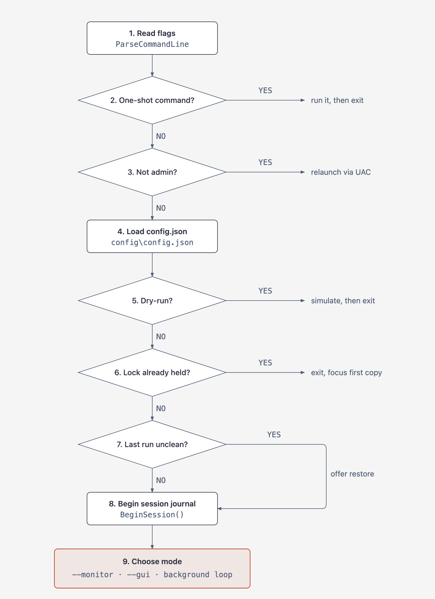

# How app/ works

**In short:** VegaFlow is one program with several jobs: a background loop, a window, a console monitor, a simulation, and small commands that change one setting and exit. `src/app/` reads what you typed and decides which job runs.

It reads the flags first, then loads the settings, then checks whether the last run ended cleanly. Only after that does it start the chosen mode.

The one thing not to forget: `--dry-run` only simulates and wins over every other mode, and a misspelled flag stops the program with exit code 2 instead of starting the background loop (both since the 2026-11-20 fix).

**Reader:** people and agents. **Last review:** 2026-11-20. **Explains:** `src/app/`. **Answers:** what happens when VegaFlow starts, and which flag sends it to which mode?

## Why it exists

VegaFlow can run in the background, show a window, print a live monitor, simulate its work, or run a command that changes one setting and exits. Something has to decide which of these runs when you start it. That is `src/app/`, the entry point (the first code that runs; in C++ it is called `main`).

It is also the only place that starts the parts in order and stops them in order. It loads the settings, checks for a bad previous run, and makes sure the changes are undone when the program ends.

A few terms used below. A **flag** is an option typed after the program name, such as `--gui`. A **daemon** is a program that runs in the background without a window. The **registry** is the Windows settings database. The **journal** is a log file where VegaFlow notes each change it makes, so it can undo them later. **Administrator** (or admin) is the Windows account level that may change system settings.

## A concrete example

This is the real output of `vegaflow_daemon.exe --dry-run --once` on the test laptop (AMD Ryzen 5 4600H with Vega 6 graphics, Windows 11 build 26300, run on 2026-11-20). The program only simulated; it changed nothing.

```text
[WARN] config.json está en una carpeta donde pueden escribir cuentas sin permisos de administrador: se usan los valores de fábrica y no se guarda nada.
VEGAFLOW DAEMON (DRY-RUN SIMULATION & EVALUATION)
[1/4] Scanning foreground processes for 3D Game / Graphics API...
  -> No foreground 3D game currently detected.
  -> Demonstrating evaluation on background processes under simulated game conditions:
[2/4] [DRY-RUN] Graphics / Registry Tweaks: Idle (applied on game launch)
[3/4] [DRY-RUN] CPU Orchestrator Evaluation:
  -> Background Processes Found: 22 PIDs
  -> Background Sets to confine: 2 core IDs (Isolated in dry-run: 22 targets)
[4/4] [DRY-RUN] Memory Manager Evaluation:
  -> Standby Purge Triggered : NO
  -> Background Trim Count   : 0
  -> Evaluation Reason       : Thresholds not met: Free/Zero=7250MB (min 1200MB), Standby=276MB (min 1500MB)
[KPI] Daemon Memory Working Set: 2.04688 MB (< 15 MB KPI passed)
```

How to read it, line by line:

- The first line is a warning from the settings step (`main.cpp:106-108`). The settings folder can be written by ordinary accounts, so VegaFlow used its factory values and saved nothing.
- `[1/4]` looks for a game in the foreground. None was open, so the simulation used the background programs as a stand-in (`reports.cpp:307-362`).
- `22 PIDs` are the process IDs (the numbers Windows gives each program) of background programs. `2 core IDs` are the CPU sets (groups of processor cores) the background work would be kept in (`reports.cpp:373-383`).
- `Standby` is memory that Windows keeps as a cache. The memory step decided not to clear it, and the reason line gives the numbers it checked (`reports.cpp:387-389`).
- The `KPI` line shows the daemon's own memory use, about 2 MB. The words "KPI passed" are printed without comparing the number (see the failures table below).
- `--once` does not change this output. The simulation branch runs before any code reads that flag (`main.cpp:110-113`).

## How it works, step by step



| Step | File:line | What to look at | Why |
| --- | --- | --- | --- |
| 1 | [`cli.cpp:29`](https://github.com/partprogramming09/vegaflow-universal/blob/main/src/app/cli.cpp#L29) | `ParseCommandLine` checks each argument and sets one `bool` in `CliOptions`. `--version` and `--help` print and return at once. | Every later decision reads these flags. |
| 2 | [`cli.cpp:120`](https://github.com/partprogramming09/vegaflow-universal/blob/main/src/app/cli.cpp#L120), [`main.cpp:99`](https://github.com/partprogramming09/vegaflow-universal/blob/main/src/app/main.cpp#L99) | `RunOneShotCommand` runs the commands that do one job and exit: `--system-info`, `--status`, `--restore-registry`, `--purge-now`, the `--mpo-*` and `--dxvk-*` pairs. A returned exit code ends `main`. | These run before the settings are loaded, so they stay quick and do not start a mode. |
| 3 | [`cli.cpp:136-155`](https://github.com/partprogramming09/vegaflow-universal/blob/main/src/app/cli.cpp#L136-L155) | If the process is not Administrator, and the run is not `--dry-run` or `--status`, it starts itself again through UAC (the Windows prompt that asks to elevate) with the same flags. With no flags it asks for `--gui`. | Changing the registry, processes and power plans needs Administrator rights. |
| 4 | [`main.cpp:104-108`](https://github.com/partprogramming09/vegaflow-universal/blob/main/src/app/main.cpp#L104-L108) | The settings are read from `config\config.json` next to the `.exe` (`config_location.cpp:60-63`). A warning is printed if that folder is not safe. | Every mode uses the settings, so they are read once here. |
| 5 | [`main.cpp:110-113`](https://github.com/partprogramming09/vegaflow-universal/blob/main/src/app/main.cpp#L110-L113) | `--dry-run` runs `ExecuteDryRun` and returns 0, also with `--monitor` (fix of 2026-11-20; before, `--monitor` skipped the simulation). It does not take the single-instance lock and does not open the journal. | A simulation must not touch the system. |
| 6 | [`main.cpp:115-130`](https://github.com/partprogramming09/vegaflow-universal/blob/main/src/app/main.cpp#L115-L130) | A named mutex (a Windows lock object) called `Local\VegaFlowUniversal_SingleInstance` allows one copy. A second GUI copy brings the first window forward. Skipped with `--once`. | Two loops or two windows would fight over the same settings. |
| 7 | [`main.cpp:138-176`](https://github.com/partprogramming09/vegaflow-universal/blob/main/src/app/main.cpp#L138-L176), [`restore.cpp:37`](https://github.com/partprogramming09/vegaflow-universal/blob/main/src/session/restore.cpp#L37) | The journal in `config\change_journal.vfj` says whether the last run ended cleanly. If it did not, the user is asked whether to undo the changes it left. | This is the only memory of a crash, so it is read before anything new starts. |
| 8 | [`main.cpp:181-213`](https://github.com/partprogramming09/vegaflow-universal/blob/main/src/app/main.cpp#L181-L213) | Computes `safe_mode` (set by `--observe`, or by two unclean ends in a row; see [`change_journal.cpp:843`](https://github.com/partprogramming09/vegaflow-universal/blob/main/src/windows/change_journal.cpp#L843)). Offers a Windows restore point before the first change, not in dry-run or safe mode. Calls `BeginSession`; a guard object marks the run as clean when `main` returns ([`main.cpp:80-88`](https://github.com/partprogramming09/vegaflow-universal/blob/main/src/app/main.cpp#L80-L88)). | The next start can tell a clean end from a crash. |
| 9 | [`main.cpp:229`](https://github.com/partprogramming09/vegaflow-universal/blob/main/src/app/main.cpp#L229), [`main.cpp:238`](https://github.com/partprogramming09/vegaflow-universal/blob/main/src/app/main.cpp#L238), [`main.cpp:242`](https://github.com/partprogramming09/vegaflow-universal/blob/main/src/app/main.cpp#L242) | `--monitor` goes to `RunMonitorDashboard`, `--gui` to `RunGuiMode`, and anything else to `RunDaemon`, the background loop. | One place chooses the mode, so every mode gets the same setup. |

## The pieces inside

| File | Responsibility |
| --- | --- |
| [`main.cpp`](https://github.com/partprogramming09/vegaflow-universal/blob/main/src/app/main.cpp) | The entry point; runs steps 1 to 9. Holds the crash handler (lines 38-41), the console questions (43-70) and the clean-exit guard (80-88). |
| [`cli.hpp`](https://github.com/partprogramming09/vegaflow-universal/blob/main/src/app/cli.hpp), [`cli.cpp`](https://github.com/partprogramming09/vegaflow-universal/blob/main/src/app/cli.cpp) | `CliOptions` (one `bool` per flag, plus two paths for DXVK), `ParseCommandLine`, `RunOneShotCommand` and the `--help` text. |
| [`daemon_loop.cpp`](https://github.com/partprogramming09/vegaflow-universal/blob/main/src/app/daemon_loop.cpp) | `RunDaemon`: the background loop, or a single tick with `--once`. |
| [`gui_mode.cpp`](https://github.com/partprogramming09/vegaflow-universal/blob/main/src/app/gui_mode.cpp) | `RunGuiMode`: builds the functions that the window's buttons call, runs the window loop (line 405), then undoes its changes (lines 406-417). |
| [`monitor.cpp`](https://github.com/partprogramming09/vegaflow-universal/blob/main/src/app/monitor.cpp) | `RunMonitorDashboard`: prints one telemetry line per poll interval. |
| [`app_state.cpp`](https://github.com/partprogramming09/vegaflow-universal/blob/main/src/app/app_state.cpp) | Three process-wide values (a run flag, a stop event and the lock handle) and the console handler. |
| [`session/reports.cpp`](https://github.com/partprogramming09/vegaflow-universal/blob/main/src/session/reports.cpp) | `PrintStatusReport` (line 86), `ExecutePurgeNow` (263) and `ExecuteDryRun` (291). |
| [`session/run_cycle.cpp`](https://github.com/partprogramming09/vegaflow-universal/blob/main/src/session/run_cycle.cpp) | `RunSingleIteration` (line 147): one evaluation tick. The loop, the window and the monitor all call it, and it hands the work to `RunGameSessionCycle` in [`game_session.cpp`](https://github.com/partprogramming09/vegaflow-universal/blob/main/src/session/game_session.cpp). |

**How they talk.** `main` creates the long-lived objects once (hardware profile, memory manager, CPU orchestrator, settings) and passes them by reference to the mode. Each mode keeps its own state, such as the ID of the game being optimized. The app layer may include everything, because its job is to assemble the pieces; the rule is on the [GUI and session](./modules/gui-and-session.md) page.

### The modes

| Mode | Flag | What it does | Changes the system? |
| --- | --- | --- | --- |
| Background loop | none (the default) | Waits for a stop request or a timer tick. Each tick runs one evaluation. On stop it undoes its changes. | Yes, unless in safe mode. |
| One tick | `--once` | The same loop with one tick, then it undoes its changes and exits. | Yes, for the length of the run; undone before exit. |
| Simulation | `--dry-run` | Prints what it would do, with the `dry_run` flag set. | No. |
| Monitor | `--monitor` | Prints one telemetry line per poll interval (free RAM, standby memory, VRAM, active game). | Yes, when a game starts: the tick applies the same per-game changes as the loop (`game_session.cpp:266-270`). The start-up settings of the loop and the window are not set. |
| Window | `--gui` | Opens the Win32 window with tray support; sets GameDVR and the power profile at start and undoes them on close. | Yes, unless in safe mode. |
| Observe / safe mode | `--observe`, or automatic after two unclean ends | No automatic change. The loop and the window skip the tick. | No, automatically. |
| Status | `--status` | Prints a report of the hardware and the system state. | No. |
| System info | `--system-info` | Prints the hardware and OS data as JSON. | No. |
| Restore | `--restore-registry` or `--recover` | Replays the journal, then restores the saved registry values. | Yes: it puts values back. |

**The loop in detail.** After the start banner (`daemon_loop.cpp:109-122`), the loop waits on two Windows handles at once: a stop event and a waitable timer (a Windows timer object that can be waited on). `WaitForMultipleObjects` (`daemon_loop.cpp:127`) puts the thread to sleep until one of them fires. The stop event ends the loop; a timer tick runs one `RunSingleIteration` unless the run is in safe mode. The default poll interval is 1500 ms ([`config.hpp:24`](https://github.com/partprogramming09/vegaflow-universal/blob/main/src/session/config.hpp#L24)). The timer asks for high resolution and falls back to a normal timer if Windows refuses (`daemon_loop.cpp:87-94`). On the way out, the loop restores the CPU sets, the power profile, GameDVR (the Windows game-recording feature) and the saved registry values (`daemon_loop.cpp:141-155`).

**One copy at a time.** `app_state.cpp` keeps three values: `g_running` (a flag the loop checks), `g_stop_event` (the event the loop waits on) and `g_single_instance_mutex` (the lock). The console handler (`app_state.cpp:9-22`) clears the flag and signals the event on Ctrl+C, when the console closes, on logoff and on shutdown. The stop event has a name, `Global\VegaFlowStop` (`daemon_loop.cpp:82`), so an elevated script can ask the loop to stop cleanly without a console.

## Why it was built this way

- **Events, not a polling loop.** The loop's comment says it avoids "aggressive polling" (`daemon_loop.cpp:77`). The thread sleeps until the timer or the stop event wakes it.
- **A named stop event.** It lets a script request a clean shutdown, which runs the restore steps, without a console window (`daemon_loop.cpp:81`).
- **One message through the security filter.** Windows blocks messages between windows of different privilege levels (UIPI, User Interface Privilege Isolation). The second-launch message is the one message the code lets through on purpose (`gui_window.cpp:298-300` and `gui_window.cpp:360`).
- **Two unclean ends, then safe mode.** The start-up message says the program then starts "without applying the system tweaks" and that `--restore-registry` reverts them (`daemon_loop.cpp:49-50`). The counter is computed in [`change_journal.cpp:843`](https://github.com/partprogramming09/vegaflow-universal/blob/main/src/windows/change_journal.cpp#L843).
- **The entry point only assembles.** Rules and Windows calls live in the layers below, as set out in [ADR 0001](../adr/0001-nucleo-que-decide-y-puertos.md).
- **Alternatives discarded:** pendiente de confirmar. The code and the docs do not record which options were discarded for the entry point, the flag parser or the single-instance lock.

## What happens when it fails

These rows come from reading the code. Only the rows listed in the evidence section were run.

| Situation | What the code does | What you see |
| --- | --- | --- |
| `--dry-run` with `--monitor` | Since the 2026-11-20 fix, `--dry-run` wins: it simulates once and exits (checked by `tests/package/package_tests.ps1`). Before, the monitor ran the real tick. | A simulation, never a live monitor. |
| A mistyped or unknown option (`--dryrun`) | Since the 2026-11-20 fix, `ParseCommandLine` prints `[ERROR] Unknown option or missing value` and exits with code 2. Before, it was ignored and the real daemon started. | The program stops; nothing changes. |
| `--dxvk-install` or `--dxvk-remove` with no path, or followed by another option | Since the 2026-11-20 fix, the next option is not taken as the path: the same error and exit code 2. A dry run of either now checks what the real run checks: it fails, instead of reporting success, when the game folder does not exist or may not be changed (anti-cheat or outside the allowed folders). | The program stops; nothing changes. |
| `--elevate --dry-run` when already running as Administrator | Since the 2026-11-20 fix, the simulation runs. Before, the program printed that it was already elevated and exited without simulating. | The simulation text. |
| `--dry-run` with `--gui` | The simulation runs and returns before the window is created. | The simulation text, and no window. |
| UAC refused on the automatic restart | `RelaunchAsAdmin` returns false and the process keeps running without Administrator rights (`cli.cpp:152-155`). | The loop prints that it runs without Administrator rights and that the standby purge needs admin (`daemon_loop.cpp:114-115`). |
| Settings folder writable by ordinary accounts | Factory values are used and nothing is saved (`main.cpp:106-108`). | The first line of the example above. |
| Last run did not end cleanly | The window shows a Yes/No box; the console asks `[S/n]`. Answering no keeps the changes and prints "Puedes recuperarlos luego con --restore-registry" (`main.cpp:147`, `main.cpp:176`). A corrupt journal only prints a warning and VegaFlow still starts (`main.cpp:143`). | The question, or the warning text in the window's status bar. |
| Two unclean ends in a row | Safe mode: the loop and the window skip every tick and change nothing automatically (`daemon_loop.cpp:48-50`, `gui_mode.cpp:75`). | "[WARN] MODO SEGURO ACTIVO..." in the console. The same text is printed for `--observe`, although the user chose it (`daemon_loop.cpp:49`). |
| Monitor closed while a game is active | It saves the session report and restores the CPU sets only (`monitor.cpp:88-91`). It does not restore GameDVR, priority or power there. Whether the game-end branch undoes them is pendiente de confirmar. | Not reproduced. |
| A second copy of the window | It finds the window by class name, sends the restore message and exits with 0 (`main.cpp:116-125`). | The first window comes to the front. |
| A second copy of the loop or the monitor | It finds no window, so the "Focusing existing instance" text is printed even though nothing is focused, and it exits with 0 (`main.cpp:123`). | A message that says the instance is focused, with no visible effect. |
| The process crashes | The crash handler (`main.cpp:38-41`) lets Windows end the process before the clean-exit mark is written, so the next start counts one unclean end. | Not reproduced. |
| Ctrl+C, close, logoff or shutdown | The handler clears the run flag and signals the stop event (`app_state.cpp:9-22`). The loop exits and undoes its changes (`daemon_loop.cpp:141-155`). | Not reproduced. |
| The waitable timer cannot be created | The loop prints the error and returns 1 (`daemon_loop.cpp:96-99`). | An error line with the Windows error code. |
| `KPI` line | The words "KPI passed" are part of the text and are not compared with the number (`reports.cpp:395`). | The check looks passed whatever the number is. |
| `--restore-registry` with a corrupt journal | The journal is skipped, the registry backups are restored directly, and the exit code is 1 (`cli.cpp:284-303`). | A warning, then "Se devolvieron X de Y." |

## Evidence that it works this way

Only lines from the real runs are shown. Indentation is trimmed.

| Step | Command or action | Real output |
| --- | --- | --- |
| 1 and 2 | `vegaflow_daemon.exe --version` | `VegaFlow Universal 0.1.0` |
| 2 (`--status`) | `vegaflow_daemon.exe --status` (two lines, trimmed) | `Process Elevated (Admin)   : YES` and `Detected APU Tier & Guard  : Tier 2: Mid Vega UMA [Sweet-Spot Guard]` |
| 1, 2, 4 and 5 (simulation path) | `vegaflow_daemon.exe --dry-run --once` (first and last lines, trimmed) | `[WARN] config.json está en una carpeta donde pueden escribir cuentas sin permisos de administrador: se usan los valores de fábrica y no se guarda nada.` and `[KPI] Daemon Memory Working Set: 2.04688 MB (< 15 MB KPI passed)` |
| 3 (elevation), 6 to 9 (lock, journal, session, modes) | Not reproduced. | Not reproduced. |
| Monitor, window, safe mode, restore, Ctrl+C, second copy, crash | Not reproduced. | Not reproduced. |

Source: `evidence-cli.txt` from the test laptop run on 2026-11-20.

## Check it yourself

```text
vegaflow_daemon.exe --version
vegaflow_daemon.exe --dry-run --once
```

The first prints the version and exits. The second only simulates and changes nothing. If a game is open, its `[1/4]` section names that game instead of the background programs (`reports.cpp:308-352`).

## Related

- [Using the daemon and the command line](./usage-and-features/daemon-and-cli.md): what each flag does, from the user's side.
- [Modules](./modules/) and [Code layers](./modules/layers.md): where `app/` sits among the other folders.
- [GUI and session](./modules/gui-and-session.md): how the window's buttons reach the session code.
- [System info](./modules/system-info.md): what `--system-info` reports.
- [Security](./security.md): the sandbox every file and process operation passes through.
- [Safety and tiers](./usage-and-features/safety-and-tiers.md): which changes apply on which hardware.
- [Verification status](../measurements/verification-status.md): what has been measured and what has not.
- [ADR 0001](../adr/0001-nucleo-que-decide-y-puertos.md): why the rules live below the entry point.
