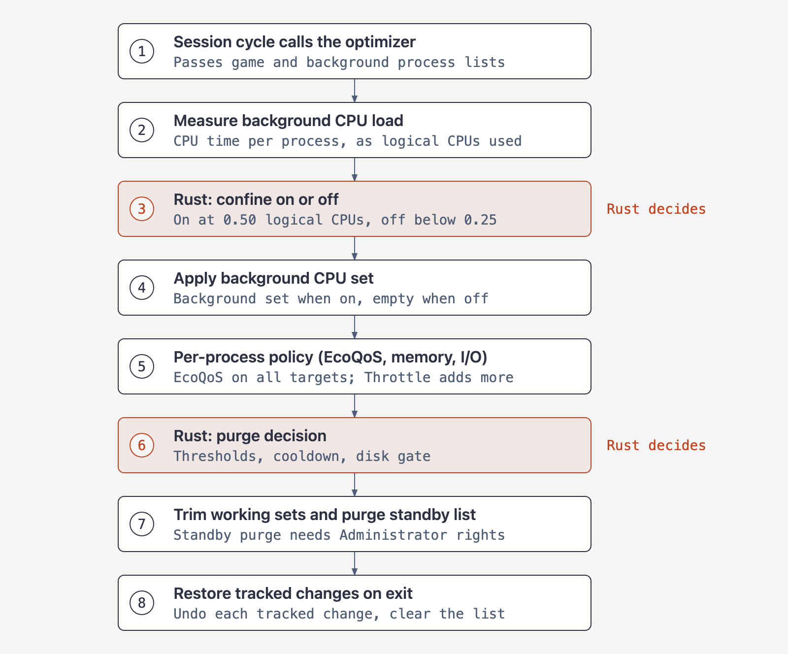

# How optimize/ works

**In short:**
- `src/optimize/` holds the levers that change how Windows runs a game on an AMD APU (a processor with the graphics on the same chip). It moves background programs onto one physical core, empties Windows' memory cache when RAM runs short, and installs or removes the DXVK graphics layer and some Windows, driver and game-engine settings.
- Each lever has a dry-run switch (it reports what it would do and changes nothing), saves a copy before it writes a file, and saves the original registry value before it changes it, so it can be put back.
- Anti-cheat games are protected: DXVK is refused, and no engine file is touched.
- Do not forget: the Rust core makes the decisions (when to confine, when to purge). This module acts on those answers and remembers what it changed.

**Reader:** people and agents. **Last review:** 2026-11-20. **Explains:** `src/optimize/`. **Answers:** which changes does VegaFlow make to a game's CPU, memory, graphics and game files, and how is each one undone?

## Why it exists

A game on an APU shares its chip, and its RAM, with Windows and with every background program. On the test laptop (AMD Ryzen 5 4600H with Radeon Vega 6 graphics, 15.4 GB of RAM) a browser or a chat can take CPU time, disk time and memory that the game needs. The graphics also take their memory from that same RAM (this is called UMA, unified memory architecture).

`optimize/` is the set of levers that push back:

- **CPU:** move background programs onto a few threads (a thread is one of the chip's logical processors).
- **Memory:** empty the standby list (memory that Windows keeps as a file cache) when free RAM is short.
- **Files and settings:** install DXVK, set a few Windows, driver and engine options, and undo them later.

Every lever must be reversible. The project rules in [CLAUDE.md](https://github.com/partprogramming09/vegaflow-universal/blob/main/CLAUDE.md) require a `dry_run` parameter on every function that changes the system, a `.vegaflow.bak` or `.original.bak` copy before a config or DLL is written, and a registry backup under `SOFTWARE\VegaFlow\RegBackup`.

Terms used below: a **CPU set** is Windows' list of the threads a process may use. A **working set** is the part of a program's memory that sits in RAM. **DXVK** is a translation layer that runs DirectX 11 games on Vulkan. **Engine.ini** is a settings file of Unreal Engine games. A **journal** is the log of changes that the daemon keeps so it can undo them.

## A concrete example

Real output from the test laptop (Windows 11 build 26300, run on 2026-11-20). No game was open, so the daemon uses the background programs as a stand-in and runs `--dry-run --once`:

```text
[3/4] [DRY-RUN] CPU Orchestrator Evaluation:
  -> Background Processes Found: 22 PIDs
  -> Background Sets to confine: 2 core IDs (Isolated in dry-run: 22 targets)
[4/4] [DRY-RUN] Memory Manager Evaluation:
  -> Standby Purge Triggered : NO
  -> Background Trim Count   : 0
  -> Evaluation Reason       : Thresholds not met: Free/Zero=7250MB (min 1200MB), Standby=276MB (min 1500MB)
```

What it means:

- **22 PIDs** (process numbers) are background programs. They are candidates for confinement.
- **2 core IDs** (266 and 267, from `--system-info`) are the background set: the two threads of one physical core. On a chip with four or more physical cores, the Rust partition gives the background set one core's threads (`rust/vegaflow-core/src/policy/cpu_governor.rs:117-118`).
- **"Isolated in dry-run: 22 targets"** means the 22 processes *would* be confined. Nothing was changed.
- **Memory:** 7250 MB of free RAM is above the 1200 MB floor, and 276 MB of standby memory is below the 1500 MB needed for a purge. So nothing is purged.

## How it works, step by step



The CPU lever and the memory lever run on each session cycle. The file and registry levers run when a game starts or when the user switches a setting (the dry-run report says "applied on game launch", `src/session/reports.cpp:370`).

| Step | File:line | What to look at | Why |
|---|---|---|---|
| 1 | [run_cycle.cpp:101](https://github.com/partprogramming09/vegaflow-universal/blob/main/src/session/run_cycle.cpp#L101) | The `ApplyOptimizations` call with the game and background lists | The session hands the optimizer the list of processes it classified |
| 2 | [cpu_orchestrator.cpp:65-100](https://github.com/partprogramming09/vegaflow-universal/blob/main/src/optimize/cpu_orchestrator.cpp#L65-L100) | `UpdateBackgroundLoad`: CPU time per process, turned into "logical CPUs used" | The decision needs a load number. Samples are taken at least 1 s apart (`cpu_orchestrator.cpp:14`, `:69`) |
| 3 | [cpu_governor.rs:354-360](https://github.com/partprogramming09/vegaflow-universal/blob/main/rust/vegaflow-core/src/policy/cpu_governor.rs#L354-L360) | `eval_bg_confinement`: on at 0.50 logical CPUs, off below 0.25 | The Rust core decides. The gap between the two numbers stops the state from flipping on every sample |
| 4 | [cpu_orchestrator.cpp:270-273](https://github.com/partprogramming09/vegaflow-universal/blob/main/src/optimize/cpu_orchestrator.cpp#L270-L273) | `bg_sets` is the background set when confinement is on, empty when off; `SetModifiedBackgroundCpuSets` applies it | A process only gets the set while the load says it is needed |
| 5 | [process_control.cpp:255-333](https://github.com/partprogramming09/vegaflow-universal/blob/main/src/windows/process_control.cpp#L255-L333) | `ApplyBackgroundPolicy`: EcoQoS (Windows' efficiency mode) for every target; `Throttle` also sets low memory priority, very low I/O priority and the CPU set | Each process gets the smallest change its policy allows. `DoNotTouch` and `BoostAsGame` are skipped (`cpu_orchestrator.cpp:288-297`) |
| 6 | [memory_manager.cpp:103-126](https://github.com/partprogramming09/vegaflow-universal/blob/main/src/optimize/memory_manager.cpp#L103-L126) | Telemetry and game disk rate packed into `VfMemoryPurgeInput`, then `vf_rust_evaluate_memory_purge` | The memory decision is in Rust (`rust/vegaflow-core/src/policy/memory_purge.rs:49-100`), so the rule is tested without Windows |
| 7 | [memory_manager.cpp:128-167](https://github.com/partprogramming09/vegaflow-universal/blob/main/src/optimize/memory_manager.cpp#L128-L167) | Cooldown and disk gates, then trim of background working sets (`:160-161`) and the standby purge (`:166-167`) | Purges are rate-limited (90 s cooldown) and held back while the game loads assets. The purge itself is `NtSetSystemInformation`, class 80, command 4 (`src/windows/memory.cpp:26-27`) |
| 8 | [cpu_orchestrator.cpp:365-384](https://github.com/partprogramming09/vegaflow-universal/blob/main/src/optimize/cpu_orchestrator.cpp#L365-L384) | `RestoreAll`: restore each tracked process, then clear the list; the destructor calls it too (`:31-33`) | Nothing stays changed after the game closes or the daemon stops |

## The pieces inside

- **[cpu_orchestrator.hpp](https://github.com/partprogramming09/vegaflow-universal/blob/main/src/optimize/cpu_orchestrator.hpp)** and **[.cpp](https://github.com/partprogramming09/vegaflow-universal/blob/main/src/optimize/cpu_orchestrator.cpp)**: `CpuOrchestrator`. It keeps a list of what it changed, each entry a process ID plus its creation time, so a reused ID is never touched. It restores the old game when another game starts.
- **[memory_manager.hpp](https://github.com/partprogramming09/vegaflow-universal/blob/main/src/optimize/memory_manager.hpp)** and **[.cpp](https://github.com/partprogramming09/vegaflow-universal/blob/main/src/optimize/memory_manager.cpp)**: `MemoryManager`. It samples RAM and graphics memory, asks Rust, and runs the trim and purge. It also holds the UMA pressure guard (`EvaluateUmaPressureGuard`, `:248`), which watches the graphics memory budget.
- **[dxvk_manager.hpp](https://github.com/partprogramming09/vegaflow-universal/blob/main/src/optimize/dxvk_manager.hpp)** and **[.cpp](https://github.com/partprogramming09/vegaflow-universal/blob/main/src/optimize/dxvk_manager.cpp)**: `DxvkManager`. It installs DXVK's `d3d11.dll` and `dxgi.dll` next to the game, writes a `dxvk.conf` profile, and removes them. Every write goes through the `FileSystem` port, whose real version is SandboxGuard.
- **[graphics/](https://github.com/partprogramming09/vegaflow-universal/tree/main/src/optimize/graphics)**: `GraphicsOptimizer` (`graphics_optimizer.hpp`) groups the switches into families and gates them by GPU vendor. The families:
  - [amd_driver_tweaks.cpp](https://github.com/partprogramming09/vegaflow-universal/blob/main/src/optimize/graphics/amd_driver_tweaks.cpp): AMD driver keys (`FlipQueueSize`, `SurfaceFormatReplacements`, tessellation cap, shader cache, VRAM report). Only the AMD adapter is written (`graphics_internal.hpp:76-79`).
  - [kernel_tweaks.cpp](https://github.com/partprogramming09/vegaflow-universal/blob/main/src/optimize/graphics/kernel_tweaks.cpp): `Win32PrioritySeparation` (the CPU quantum setting; the default is 0x2).
  - [power_mode.cpp](https://github.com/partprogramming09/vegaflow-universal/blob/main/src/optimize/graphics/power_mode.cpp): `Balanced` or `GpuPrioritySustained` power plan.
  - [display_tweaks.cpp](https://github.com/partprogramming09/vegaflow-universal/blob/main/src/optimize/graphics/display_tweaks.cpp): Multi-Plane Overlay (`SetMpoDisabled`) and game capture (`SetGameDvrAndFseOptimized`).
  - [dxgi_flip.cpp](https://github.com/partprogramming09/vegaflow-universal/blob/main/src/optimize/graphics/dxgi_flip.cpp) and [mmcss.cpp](https://github.com/partprogramming09/vegaflow-universal/blob/main/src/optimize/graphics/mmcss.cpp): per-game flip model, and the multimedia scheduler's gaming profile.
  - [tweaks_query.cpp](https://github.com/partprogramming09/vegaflow-universal/blob/main/src/optimize/graphics/tweaks_query.cpp): reads the current state for `--status`, and `RestoreAllRegistryBackups` (`:168`) for `--restore-registry`.
  - [vram_reporting.cpp](https://github.com/partprogramming09/vegaflow-universal/blob/main/src/optimize/graphics/vram_reporting.cpp) and [shader_cache.cpp](https://github.com/partprogramming09/vegaflow-universal/blob/main/src/optimize/graphics/shader_cache.cpp): the VRAM size the driver reports, and the shader cache mode.
- **[steam/](https://github.com/partprogramming09/vegaflow-universal/tree/main/src/optimize/steam)**: `SteamEngineOptimizer`.
  - [steam_library.cpp](https://github.com/partprogramming09/vegaflow-universal/blob/main/src/optimize/steam/steam_library.cpp): finds the Steam library folders and the `appmanifest_*.acf` game files (`ScanSteamLibrary`, `:58`).
  - [engine_detection.cpp](https://github.com/partprogramming09/vegaflow-universal/blob/main/src/optimize/steam/engine_detection.cpp): works out the engine, and marks a game as anti-cheat when its files carry a known name such as `easyanticheat` (`:69-78`).
  - [engine_presets.cpp](https://github.com/partprogramming09/vegaflow-universal/blob/main/src/optimize/steam/engine_presets.cpp): writes the Unreal `Engine.ini` block (`GenerateUnrealUmaBlock`, `:140`) and the Unity `boot.config` keys (`UnityBootConfigKeys`, `:128`).
  - [apu_shadow_config.cpp](https://github.com/partprogramming09/vegaflow-universal/blob/main/src/optimize/steam/apu_shadow_config.cpp): shadow settings (apply, restore, query). Not read line by line here.

How they talk: the session and the GUI call `CpuOrchestrator` and `MemoryManager`. Those ask Rust for the decision through the bridge ([rust_bridge.h](https://github.com/partprogramming09/vegaflow-universal/blob/main/src/bridge/rust_bridge.h)) and act through ports (interfaces in [src/ports/](https://github.com/partprogramming09/vegaflow-universal/tree/main/src/ports)), whose Windows versions live in [src/windows/](https://github.com/partprogramming09/vegaflow-universal/tree/main/src/windows). Tests replace those ports with fakes, which is why the same logic can run without touching the system.

## Why it was built this way

- **Rust decides, C++ acts.** This is the split recorded in [ADR 0001](../adr/0001-nucleo-que-decide-y-puertos.md). The memory thresholds have one source, the Rust file (`memory_manager.cpp:122`, "Single source of truth in Rust"). The Rust unit tests pin the CPU thresholds (`rust/vegaflow-core/src/lib.rs:391-401`).
- **Two thresholds for CPU confinement.** It turns on at 0.50 logical CPUs and off only below 0.25. Our reading: a single number would flip the state on every sample when the load hovers near it.
- **One cooldown for purges.** Standby purges and UMA trims share a 90 s cooldown (`memory_manager.cpp:163-164`, `rust/.../memory_purge.rs:122-124`), so the two paths cannot run back to back.
- **Dry run still reads pressure.** In dry run the cooldown is ignored, so the report shows the real pressure (`memory_manager.cpp:273-275`).
- **Identity before every change.** A process is changed only if its ID and creation time still match (`cpu_orchestrator.cpp:39-40`, `:248`; `process_control.cpp:292`). A recycled ID belongs to another program.
- **Refuse, do not hide.** DXVK on an anti-cheat game returns an explicit error (`dxvk_manager.cpp:191-196`), and the engine presets set `blocked_by_anticheat` (`engine_presets.cpp:215-217`).
- **Remove only what VegaFlow wrote.** A game that ships its own `d3d11.dll` with no VegaFlow marker is left alone (`dxvk_manager.cpp:352-357`).
- **Alternatives discarded:** no code comment, ADR or doc in the repo records the rejected options for these levers. Pending confirmation (see the report).

## What happens when it fails

| Situation | What the code does | What the user sees (text from the code) |
|---|---|---|
| DXVK on an anti-cheat game | Refused before any file is touched (`dxvk_manager.cpp:191-196`) | "Bloqueado: El juego utiliza Anti-Cheat (EAC/BattlEye/etc.) y no es seguro inyectar DXVK" |
| The user's `dxvk.conf` cannot be copied | Stops before any change (`dxvk_manager.cpp:223-227`) | "No se pudo guardar una copia del dxvk.conf que ya había; el juego quedó intacto" |
| `Engine.ini` backup cannot be made | No change (`engine_presets.cpp:252-256`) | "No se pudo crear la copia de seguridad .vegaflow.bak; juego intacto" |
| `Engine.ini` has a broken VegaFlow block | File left as it is (`engine_presets.cpp:276-279`) | "Marcador de bloque VegaFlow incompleto en Engine.ini; archivo intacto" |
| DXVK removal while the game is open | The DLL stays, with its backup (`dxvk_manager.cpp:386-389`) | "No se pudo quitar DXVK del todo: ¿el juego está abierto? ..." |
| Purge without administrator rights | Background working sets are trimmed; the standby purge is skipped (`memory_manager.cpp:171-174`) | "Standby List purge skipped (requires Administrator / --elevate)" |
| Purge within the cooldown | Nothing runs (`memory_manager.cpp:128-132`) | "Skipped due to cooldown (Ns remaining)" |
| Game reads faster than the limit (15 MB/s by default) | Purge is skipped (`memory_manager.cpp:134-140`) | "Skipped due to game disk I/O read peak" |
| Game or background process ended, or its ID was reused | Tracking is dropped; the new owner is not touched (`cpu_orchestrator.cpp:163-168`, `:248-253`) | None (internal) |
| Windows refuses full access to the game (anti-cheat) | The game is not tracked, so it is not restored later; the journal entry is marked reverted (`cpu_orchestrator.cpp:212-216`) | Game handle shown as "Degraded Read-Only" (`reports.cpp:346`) |
| Power plan change fails | The journal entry is marked failed (`power_mode.cpp:108`) | "PowerSetActiveScheme falló" in the journal |
| Another game starts | The old game is restored first (`cpu_orchestrator.cpp:157-162`) | None (internal) |

## Evidence that it works this way

Only lines from the evidence files are pasted here, trimmed where long. The suite lines are `[PASS]` results from `evidence-suite.txt`; "not reproduced" marks what no run covers.

| Step | Command or action | Real output |
|---|---|---|
| 1-2 | `vegaflow_daemon.exe --system-info` | `"physical_cores": 6,` / `"logical_processors": 12,` / `"active_background_cpu_sets": [266, 267],` |
| 3-5 | `vegaflow_daemon.exe --dry-run --once` (background part) | `-> Background Processes Found: 22 PIDs` / `-> Background Sets to confine: 2 core IDs (Isolated in dry-run: 22 targets)` |
| 6-7 | `vegaflow_daemon.exe --dry-run --once` (memory part) | `-> Standby Purge Triggered : NO` / `-> Background Trim Count   : 0` / `-> Evaluation Reason : Thresholds not met: Free/Zero=7250MB (min 1200MB), Standby=276MB (min 1500MB)` |
| 6 | `vegaflow_daemon.exe --status` | `Live DXGI Budget Pressure  : 0% (Threshold: 85% -> HEALTHY)` |
| 2-5 | Suite, Test 6 | `[PASS] Test 6: CpuOrchestrator dry-run optimization and state restoration (Dry-Run Target PID: 18188, Game Handle: Full Access, State Restore: OK)` |
| 2-3 | Suite, Test 27 | `[PASS] Test 27: Background confinement follows its CPU use (Busy background confined: PASS, Idle background left free: PASS)` |
| 4 | Suite, Test 28 | `[PASS] Test 28: Background CPU set is one physical core (one thread below 4 cores) (4C/4T=1: PASS, 2C/4T=1: PASS, 6C/12T=2: PASS, 8C/16T=2: PASS, 4C/8T=2: PASS, 6C/6T=1: PASS)` |
| 6-7 | Suite, Test 3 and Test 37 | `[PASS] Test 3: MemoryManager telemetry, dry-run optimization, and Zero-Overhead KPI (< 15 MB) (...)` / `[PASS] Test 37: the purge cooldown follows the injected clock (real purge: PASS, +10 s blocked (80s remaining): PASS, +91 s released: PASS, cycle purge then +30 s blocked (60s remaining): PASS)` |
| 8 | Suite, Test 29 and Test 30 | `[PASS] Test 29: Registry changes restore the original values (GameDVR applied: PASS, restored by toggle: PASS, restored by RestoreAll: PASS)` / `[PASS] Test 30: HKLM tweaks restore the original values (RestoreAllRegistryBackups: PASS, GPU Priority untouched: PASS, values identical: PASS)` |
| graphics | `vegaflow_daemon.exe --status`, section `[SYSTEM GRAPHICS TWEAKS]` | `  AMD ShaderCache Mode       : FORCED ON (0x3200, Stutter Elimination)` / `  AMD DX11/UMA Driver Boost  : ACTIVE (SurfaceFormat FP16 + FlipQueue=1)` / `  AMD VRAM Reporting Pool    : FORCED (4096 MB DXGI/AMD)` / `  MMCSS WDDM Gaming Profile  : Windows Default` / `  GameDVR & FSE Bypass       : OPTIMIZED (Background Capture Off + FSE Mode 2)` / `  APU Laptop Power & Bus     : STANDARD (Windows Default)` / `  CPU Quantum Separation     : 0x2` / `  Kernel Memory Paging Shield: DEFAULT (Paging Allowed)` |
| graphics | Suite, Test 15 | `[PASS] Test 15: DX11/DX12 FPS Boost Suite (MMCSS Profile, Win32PrioritySeparation Quantum & AMD Driver Boost Dry-Run) (MMCSS Dry-Run: PASS, PrioritySeparation (0x26/0x28): PASS, AMD Driver Boost Dry-Run: PASS, ... Win32PrioritySeparation: 2)` |
| graphics | Suite, Test 57 | `[PASS] Test 57: GraphicsOptimizer family gating, ven_1002 guard & MMCSS GPU Priority cleanup (Intel gate: PASS, NVIDIA gate: PASS, Blocked AMD: PASS, AMD ven_1002: PASS, PowerMode roundtrip: PASS, ...)` |
| DXVK | Suite, Test 16 | `[PASS] Test 16: DXVK Manager Module (Deployment, Async GPL, AntiCheat Safety, Backup & Removal) (Assets: PASS, AC Protection: PASS, Deployment & Conf: PASS, Backup & Restore: PASS, Logs & Conf Cleaned: PASS)` |
| DXVK | Suite, Test 71 and Test 72.3 | `[PASS] Test 71: a user's dxvk.conf is backed up once before DXVK writes its own, and restored on removal` / `[PASS] Test 72.3: DXVK is not deployed to an anti-cheat game` |
| Steam | Suite, Test 13 and Test 43 | `[PASS] Test 13: SteamEngineOptimizer Engine Detection, Safe Backup & Restore (UE Detection: PASS, Backup Created: PASS, Preset Applied: PASS, Restored & Bak Cleared: PASS, AntiCheat Blocking: PASS)` / `[PASS] Test 43: engine presets create no folder outside the allowed ones (Unreal detected: yes, preset applied: no, folder created: no)` |
| all | Suite total | `TEST RESULTS: 315 PASSED, 0 FAILED` |

Not reproduced:
- The `r.Streaming.PoolSize` value written to a real `Engine.ini` on the laptop. The value (4096 MB on Tier 2 with visual cuts) is read from `engine_presets.cpp:155-164`; no run on a real game folder is in the evidence.
- A DXVK install into a real game folder. Test 16 and Test 36 use test folders and a fake file system.
- Any change in frames per second. This module makes no gain claim; see [verification status](../measurements/verification-status.md).

## Check it yourself

```text
vegaflow_daemon.exe --dry-run --once
```

Read the `[3/4]` and `[4/4]` blocks. Nothing is written in dry run.

## Related

- [Windows and driver tweaks](./usage-and-features/tweaks.md): what each switch does, from the user's side.
- [How windows/ works](./how-it-works-windows.md): the registry backup, the journal and the ports that this module calls.
- [How session/ works](./how-it-works-session.md): who calls these levers, and when.
- [Rust and C++ core](./rust-cpp-core.md) and [Security](./security.md): the bridge and the anti-cheat rules.
- [Safety and tiers](./usage-and-features/safety-and-tiers.md): what each APU tier allows.
- [ADR 0001: Rust decides, C++ acts through ports](../adr/0001-nucleo-que-decide-y-puertos.md).
