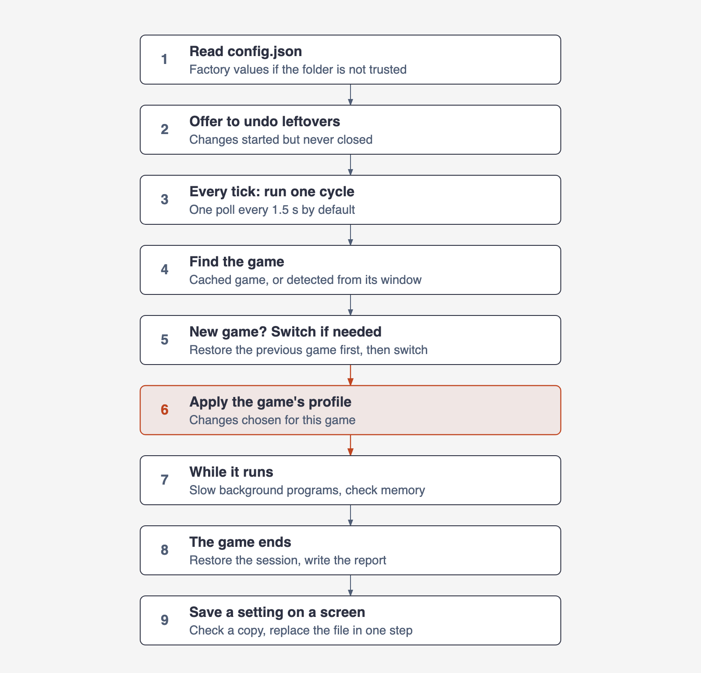

# How session/ works

**In short:** The session layer holds VegaFlow's decisions: which game is running, what to apply to it, when to put everything back, and which settings are saved to `config.json`.
It does not do the Windows work itself. It asks the parts that do, through small interfaces called ports that a test can replace with fakes.
When a game starts, the rules pick its profile. When the game process ends, the system is put back and a report is written.
The one thing not to forget: a settings change is all or nothing. If a rule fails, or someone edited the file by hand after VegaFlow read it, nothing is written and the screen keeps its old values.

**Reader:** people and agents. **Last review:** 2026-11-20. **Explains:** `src/session/`. **Answers:** What happens when a game comes to the front and leaves? How are `config.json` and the Programs list read and saved? How are recorded changes put back? How are the screens tested without Windows?

## Why it exists

VegaFlow changes Windows settings: the registry (the database where Windows keeps its settings), process priorities, the power plan and, for some games, their files. A rule such as "slow down the browser while a game runs" should be checkable without changing the PC. So the code is split into layers ([code layers](./modules/layers.md)):

- `windows/`, `detect/` and `optimize/` do the work on the PC.
- `session/` decides. It gets those parts through ports: small interfaces such as "read a file" or "change a registry value". The real Windows code behind a port is called an adapter.
- `ui/` draws the window. It only shows what `session/` prepared, so it decides nothing.

The reasons for this split are in [ADR 0001](../adr/0001-nucleo-que-decide-y-puertos.md). The layer table still lets `session/` include `windows/`, `detect/` and `optimize/` during the migration, so the split is not complete yet.

## A concrete example

Two cases, both from the code and the tests. The first is a real message; the second is a test scenario, not a measurement.

- **A name the rules refuse.** In Programs you type `explorer.exe` as an exception. `CheckName` ([programs_screen.cpp:58-59](https://github.com/partprogramming09/vegaflow-universal/blob/main/src/session/programs_screen.cpp#L58-L59)) asks the Rust rules, which list `explorer.exe` as a Windows process ([config_rules.rs:27](https://github.com/partprogramming09/vegaflow-universal/blob/main/rust/vegaflow-core/src/policy/config_rules.rs#L27)). The status bar says "Ese nombre es de un proceso de Windows o no es un nombre de archivo válido." (That name belongs to a Windows process, or it is not a valid file name.) Nothing is written and the list does not change.
- **A game in a test.** [Test 51](https://github.com/partprogramming09/vegaflow-universal/blob/main/tests/unit/device_profile_unit_tests.cpp#L312-L390) runs the cycle with a fake environment: an Unreal Engine game (`UEGame.exe`, DirectX 12) on a 32 GB machine with an integrated AMD GPU. The cycle reads the game folder's disk type (NVMe), applies the Unreal memory preset with a fixed 8192 MB pool, and the live graphics-memory figure only feeds the memory guard, which uses its 4096 MB floor.

## How it works, step by step



| Step | File:line | What to look at | Why |
|---|---|---|---|
| 1. Start: read `config.json` | [main.cpp:115-119](https://github.com/partprogramming09/vegaflow-universal/blob/main/src/app/main.cpp#L115-L119), [config.cpp:200-228](https://github.com/partprogramming09/vegaflow-universal/blob/main/src/session/config.cpp#L200-L228) | `ConfigStore::Load` returns the factory values before reading the file when the folder is not trusted (`config.cpp:204`) | An account without administrator rights could have changed the file. VegaFlow then uses its built-in defaults, prints a warning and saves nothing |
| 2. Start: offer to undo leftovers | [main.cpp:153-193](https://github.com/partprogramming09/vegaflow-universal/blob/main/src/app/main.cpp#L153-L193), [restore.cpp:37-60](https://github.com/partprogramming09/vegaflow-universal/blob/main/src/session/restore.cpp#L37-L60) | `EvaluateStartupJournal` finds changes that were started and never closed | Each change is written to the journal (a log file) before it is made. After a crash the journal says what to put back. The person is asked first, in the window or in the console |
| 3. Every tick: run one cycle | [run_cycle.cpp:147-195](https://github.com/partprogramming09/vegaflow-universal/blob/main/src/session/run_cycle.cpp#L147-L195), [daemon_loop.cpp:127-136](https://github.com/partprogramming09/vegaflow-universal/blob/main/src/app/daemon_loop.cpp#L127-L136), [gui_mode.cpp:129-136](https://github.com/partprogramming09/vegaflow-universal/blob/main/src/app/gui_mode.cpp#L129-L136) | In the daemon, a tick is one poll, 1.5 s by default ([config.hpp:24](https://github.com/partprogramming09/vegaflow-universal/blob/main/src/session/config.hpp#L24)). In the window, a tick is each refresh of its telemetry. The daemon loop and the window skip the cycle in safe mode (`daemon_loop.cpp:132`, `gui_mode.cpp:131`). The console monitor calls it too ([monitor.cpp:52](https://github.com/partprogramming09/vegaflow-universal/blob/main/src/app/monitor.cpp#L52)) | One code path for every caller. The state (game active, process id, window) is copied in and out, so it survives from one tick to the next |
| 4. Find the game | [game_session.cpp:193-212](https://github.com/partprogramming09/vegaflow-universal/blob/main/src/session/game_session.cpp#L193-L212), [process_detector.cpp:407-421](https://github.com/partprogramming09/vegaflow-universal/blob/main/src/detect/process_detector.cpp#L407-L421) | The cached game is reused only while its window and process are alive. Otherwise the detector looks at the foreground window first, then at visible windows of at least 640 × 480 (minimized ones count too: `process_detector.cpp:440-441`) | "In front" means the foreground window. The second check keeps a game found when another window is in front |
| 5. New game? Switch if needed | [game_session.cpp:216-223](https://github.com/partprogramming09/vegaflow-universal/blob/main/src/session/game_session.cpp#L216-L223) | `is_new_game` compares the process id and the creation time. If another game was active, its session is restored first | Windows reuses process ids. The creation time tells a new game from a reused id (Test 55, RecycledPidSafe) |
| 6. Apply the game's profile | [game_session.cpp:236-317](https://github.com/partprogramming09/vegaflow-universal/blob/main/src/session/game_session.cpp#L236-L317) | Hardware refresh if the graphics adapters changed (`:151-171`); the Windows foreground-priority setting ("priority separation", `:266`); Game DVR, Windows' game recording feature (`:267`); the power plan, Windows' energy profile (`:268-270`); anti-cheat check (`:281-288`); engine preset, a set of changes for one engine such as Unreal Engine (`:289-307`); other native games (`:308-313`) | The profile depends on the game. A game with anti-cheat gets only the Windows display setting (the CPU step of step 7 still applies), and none of its files are changed |
| 7. While it runs | [game_session.cpp:319-355](https://github.com/partprogramming09/vegaflow-universal/blob/main/src/session/game_session.cpp#L319-L355) | Background programs are slowed or put in Windows' efficiency mode (EcoQoS), as Programs says for each kind. The memory check runs on each tick when the policy allows it (`:350-355`) | Background programs take less processor time and memory while the game runs |
| 8. The game ends | [game_session.cpp:356-365](https://github.com/partprogramming09/vegaflow-universal/blob/main/src/session/game_session.cpp#L356-L365), [game_session.cpp:48-63](https://github.com/partprogramming09/vegaflow-universal/blob/main/src/session/game_session.cpp#L48-L63) | The session ends only when the game process is gone (`:357-361`). `RestoreEndOfSession` writes the session report, restores the CPU, sets the foreground-priority setting back to `0x02` and clears the state | Leaving the front does not end the session. A game in the background keeps its profile until its process closes. The report goes to `logs/session_reports.log` ([run_cycle.cpp:131-133](https://github.com/partprogramming09/vegaflow-universal/blob/main/src/session/run_cycle.cpp#L131-L133)) |
| 9. Save a setting on a screen | [config_actions.cpp:10-18](https://github.com/partprogramming09/vegaflow-universal/blob/main/src/session/config_actions.cpp#L10-L18), [config.cpp:230-291](https://github.com/partprogramming09/vegaflow-universal/blob/main/src/session/config.cpp#L230-L291), [config_file.rs:380](https://github.com/partprogramming09/vegaflow-universal/blob/main/rust/vegaflow-core/src/policy/config_file.rs#L380) | The edit is made on a copy. The file is re-read and compared with what VegaFlow last read (`config.cpp:238-246`). The Rust rules check the copy. Then the file is replaced in one step, and only after that does the screen's copy change | A setting is saved whole or not at all. A refused edit leaves the file and the screen as they were |

Steps 1 and 2 run once, at start. Steps 3 to 7 repeat on every tick while a game is running or the session is idle. Step 8 runs once, when the game process ends. Step 9 runs when someone saves a setting.

## The pieces inside

| File | Responsibility |
|---|---|
| [run_cycle.cpp](https://github.com/partprogramming09/vegaflow-universal/blob/main/src/session/run_cycle.cpp) | One tick. It wires the real Windows classes into the cycle (`:162-166`) and copies the state in and out (`:168-194`) |
| [game_session.cpp](https://github.com/partprogramming09/vegaflow-universal/blob/main/src/session/game_session.cpp) | The cycle itself (`:173-366`), written against the `GameSessionEnvironment` interface ([game_session.hpp:55](https://github.com/partprogramming09/vegaflow-universal/blob/main/src/session/game_session.hpp#L55)). Also the hardware refresh (`:151-171`). A game is excluded only through the Games button (`GameActions::Exclude`); the next cycle then restores it. The old `ExcludeGameAndRevert`, which nothing but a test called, was removed on 2026-11-20 |
| [config.cpp](https://github.com/partprogramming09/vegaflow-universal/blob/main/src/session/config.cpp) and [config.hpp](https://github.com/partprogramming09/vegaflow-universal/blob/main/src/session/config.hpp) | `ConfigStore` (`Load`, `Save`) and `ConfigLoadReport`, which says whether saving is allowed and what to warn about (`config.cpp:171-193`) |
| [config_actions.cpp](https://github.com/partprogramming09/vegaflow-universal/blob/main/src/session/config_actions.cpp) | The edits of Configuración and Programs. Each one changes a copy, then calls `Save`; the in-memory settings follow only when the file was written (`:14-15`) |
| [config_screen.cpp](https://github.com/partprogramming09/vegaflow-universal/blob/main/src/session/config_screen.cpp) | The rows of Configuración (`:87-108`) and the reading of what the person types (`:110-129`). The allowed ranges are not here; the Rust rules hold them |
| [programs_screen.cpp](https://github.com/partprogramming09/vegaflow-universal/blob/main/src/session/programs_screen.cpp) | Programs: the seven kinds of program (`:24-32`), exceptions and manual games, and the name check (`:46-63`). `ConfigStore::Save` stays the authority ([programs_screen.hpp:4-5](https://github.com/partprogramming09/vegaflow-universal/blob/main/src/session/programs_screen.hpp#L4-L5)) |
| [restore.cpp](https://github.com/partprogramming09/vegaflow-universal/blob/main/src/session/restore.cpp) | Reads the journal at start (`:37-60`), reverts recorded changes newest first (`:62-131`), offers the restore point once (`:155-179`) and writes the sentence after "Volver todo" (`:181-185`) |
| Other screen models: [home](https://github.com/partprogramming09/vegaflow-universal/blob/main/src/session/home_screen.cpp), [equipment](https://github.com/partprogramming09/vegaflow-universal/blob/main/src/session/equipment_screen.cpp), [requirements](https://github.com/partprogramming09/vegaflow-universal/blob/main/src/session/requirements_screen.cpp), [history](https://github.com/partprogramming09/vegaflow-universal/blob/main/src/session/history_screen.cpp), [games](https://github.com/partprogramming09/vegaflow-universal/blob/main/src/session/games_screen.cpp), [settings](https://github.com/partprogramming09/vegaflow-universal/blob/main/src/session/settings_screen.cpp) | Each one builds plain data for one window. The view in `src/ui/<name>_view.cpp` draws it. Example: `BuildHomeScreen` takes a `HomeInputs` struct ([home_screen.hpp:15](https://github.com/partprogramming09/vegaflow-universal/blob/main/src/session/home_screen.hpp#L15)) and returns the texts |
| [game_actions.cpp](https://github.com/partprogramming09/vegaflow-universal/blob/main/src/session/game_actions.cpp) and [settings_actions.cpp](https://github.com/partprogramming09/vegaflow-universal/blob/main/src/session/settings_actions.cpp) | The buttons of Games and the switches of System settings |
| Rust core: [config_file.rs](https://github.com/partprogramming09/vegaflow-universal/blob/main/rust/vegaflow-core/src/policy/config_file.rs), [config_rules.rs](https://github.com/partprogramming09/vegaflow-universal/blob/main/rust/vegaflow-core/src/policy/config_rules.rs) | The rules for loading and saving `config.json`, the number ranges, and the name rules. C++ calls them through the bridge ([ffi/config.rs:155](https://github.com/partprogramming09/vegaflow-universal/blob/main/rust/vegaflow-core/src/ffi/config.rs#L155), [ffi/config.rs:202](https://github.com/partprogramming09/vegaflow-universal/blob/main/rust/vegaflow-core/src/ffi/config.rs#L202)) |

Ports, their real adapters and the fakes the tests use:

| Port (interface) | Real code | Fake in tests |
|---|---|---|
| `FileSystem` ([file_system.hpp:10](https://github.com/partprogramming09/vegaflow-universal/blob/main/src/ports/file_system.hpp#L10)) | `SafeFileSystem` ([safe_file_system.cpp:31](https://github.com/partprogramming09/vegaflow-universal/blob/main/src/windows/safe_file_system.cpp#L31)) | `FakeFileSystem` ([fake_file_system.hpp:13](https://github.com/partprogramming09/vegaflow-universal/blob/main/tests/unit/fake_file_system.hpp#L13)) records every write, and `Changes()` counts them, so a test can assert that nothing was written |
| `ChangeJournal` and `SystemUndoPort` ([change_journal.hpp:109, 149](https://github.com/partprogramming09/vegaflow-universal/blob/main/src/ports/change_journal.hpp#L109)) | `FileChangeJournal`, `WindowsSystemUndo` ([change_journal.hpp:22, 66](https://github.com/partprogramming09/vegaflow-universal/blob/main/src/windows/change_journal.hpp#L22)) | `FakeSystemUndo` ([fake_change_journal.hpp:23](https://github.com/partprogramming09/vegaflow-universal/blob/main/tests/unit/fake_change_journal.hpp#L23)) fails on chosen targets. The journal tests use the real `FileChangeJournal` over a fake file system |
| `DeviceProbe`, `Clock`, `RegistryPort`, `PowerPort` ([device_probe.hpp:30](https://github.com/partprogramming09/vegaflow-universal/blob/main/src/ports/device_probe.hpp#L30), [clock.hpp:9](https://github.com/partprogramming09/vegaflow-universal/blob/main/src/ports/clock.hpp#L9), [registry.hpp:68](https://github.com/partprogramming09/vegaflow-universal/blob/main/src/ports/registry.hpp#L68), [power.hpp:18](https://github.com/partprogramming09/vegaflow-universal/blob/main/src/ports/power.hpp#L18)) | Windows adapters in `src/windows/` | `FakeDeviceProbe`, `FakeWallClock`, `FakeRegistryPort`, `FakePowerPort` ([fake_registry_power.hpp:24, 204](https://github.com/partprogramming09/vegaflow-universal/blob/main/tests/unit/fake_registry_power.hpp#L24)) |
| `GameSessionEnvironment` (in `session/`, not in `ports/`) | `WindowsGameSessionEnv` in `run_cycle.cpp` | `FakeGameSessionEnv` ([device_profile_unit_tests.cpp:80](https://github.com/partprogramming09/vegaflow-universal/blob/main/tests/unit/device_profile_unit_tests.cpp#L80)) |

The screen models need no fakes at all. They are functions of plain data: a test sets `ram_total_mb = 8000` and `ram_available_mb = 9000` and reads the result ([Test 77.1](https://github.com/partprogramming09/vegaflow-universal/blob/main/tests/unit/home_screen_adversarial_unit_tests.cpp#L67-L78)). The actions (`ConfigActions`, `GameActions`, the restore) take their ports in the constructor, so a test passes fakes in and checks what was written.

## Why it was built this way

- **The options that were weighed** are in [ADR 0001](../adr/0001-nucleo-que-decide-y-puertos.md#alternatives): doing nothing (tests keep touching the real registry), only moving folders (decisions stay mixed with Windows calls), a full hexagonal design with one interface per service (too much repeated code for one maintainer), and rewriting everything in Rust (15,000 lines to redo, with the measurements). The chosen option is the light one: rules in Rust, and only the Windows calls that need a test stand-in behind ports.
- **Saving whole, or refusing.** The config code never overwrites a file it could not read whole ([config.hpp:43-45](https://github.com/partprogramming09/vegaflow-universal/blob/main/src/session/config.hpp#L43-L45)). It re-reads the file before writing, and refuses if a known setting changed by hand since it was read (`config.cpp:238-246`). The file is replaced in one step, so an interrupted write leaves either the old file or the new one ([file_system.hpp:19](https://github.com/partprogramming09/vegaflow-universal/blob/main/src/ports/file_system.hpp#L19)). The code does not record which other options were weighed for this.
- **One set of name rules.** The screen checks a name early to give a plain reason, but the save is the authority, so the screen and the daemon cannot disagree about a file they both read ([programs_screen.hpp:4-5](https://github.com/partprogramming09/vegaflow-universal/blob/main/src/session/programs_screen.hpp#L4-L5)).
- **Screen models that can be tested alone.** The header of `history_screen.hpp` says it has no Windows header, so it is tested with the fake journal and fake undo port (`history_screen.hpp:3`).

## What happens when it fails

The messages are in Spanish on screen. The meaning is given after each one.

| Situation | Code | What the person sees |
|---|---|---|
| The folder can be written by accounts without administrator rights | [config.cpp:177-180](https://github.com/partprogramming09/vegaflow-universal/blob/main/src/session/config.cpp#L177-L180) | "[WARN] config.json está en una carpeta donde pueden escribir cuentas sin permisos de administrador: se usan los valores de fábrica y no se guarda nada." (The file is in a folder that non-admin accounts can write: factory values are used and nothing is saved.) |
| The file cannot be read or is larger than 1 MB | [config.cpp:181, 211-214](https://github.com/partprogramming09/vegaflow-universal/blob/main/src/session/config.cpp#L181) | "No se pudo leer config.json: se usan los valores de fábrica." plus "VegaFlow no lo sobrescribe hasta que lo corrijas y reinicies VegaFlow." (Cannot read it; VegaFlow will not overwrite it until you fix it and restart.) |
| The file is not valid JSON | [config.cpp:182](https://github.com/partprogramming09/vegaflow-universal/blob/main/src/session/config.cpp#L182) | The same kind of message, saying the file is not valid JSON |
| A value breaks its rule | [config.cpp:184-187](https://github.com/partprogramming09/vegaflow-universal/blob/main/src/session/config.cpp#L184-L187) | "config.json tiene valores no permitidos (…): esas claves usan su valor de fábrica." (Some values are not allowed; those keys use their factory value.) A name the rules reject is dropped and its key is flagged ([config_file.rs:291-299](https://github.com/partprogramming09/vegaflow-universal/blob/main/rust/vegaflow-core/src/policy/config_file.rs#L291-L299)) |
| The file was edited by hand after VegaFlow read it | [config.cpp:244-246](https://github.com/partprogramming09/vegaflow-universal/blob/main/src/session/config.cpp#L244-L246) | "config.json cambió fuera de VegaFlow después de abrirlo; reinicia VegaFlow para leer esos cambios." (Changed outside VegaFlow after it was opened; restart to read those changes.) Hand edits are read only at start (`main.cpp:116`) |
| The disk write fails | [config.cpp:288](https://github.com/partprogramming09/vegaflow-universal/blob/main/src/session/config.cpp#L288), [config_actions.cpp:14](https://github.com/partprogramming09/vegaflow-universal/blob/main/src/session/config_actions.cpp#L14) | "no se pudo escribir config.json (No se guardó.)" (Could not write it; not saved.) The screen keeps the old value |
| A Windows process name is typed as an exception or a game | [programs_screen.cpp:58-59](https://github.com/partprogramming09/vegaflow-universal/blob/main/src/session/programs_screen.cpp#L58-L59) | The sentence quoted in the example above. Nothing is written |
| The journal file is corrupt at start | [main.cpp:156-159](https://github.com/partprogramming09/vegaflow-universal/blob/main/src/app/main.cpp#L156-L159) | "[WARN] Diario de cambios corrupto (…). VegaFlow arrancó igualmente; usa --restore-registry para devolver valores." VegaFlow starts anyway; the registry backups can be put back with `--restore-registry` |
| Some changes could not be reverted automatically | [restore.cpp:121-127](https://github.com/partprogramming09/vegaflow-universal/blob/main/src/session/restore.cpp#L121-L127) | "N no se pudieron devolver (…), y así se arreglan a mano:" followed by each item and its manual fix. Failed items stay active, so a second "Volver todo" retries only them (Test 82.12) |
| Dry run of the restore | [restore.cpp:88-94](https://github.com/partprogramming09/vegaflow-universal/blob/main/src/session/restore.cpp#L88-L94) | "[DRY-RUN] Se devolverían N de N." (Would revert N of N.) Nothing is reverted or marked |
| The game window closes but its process lives on | [game_session.cpp:357-359](https://github.com/partprogramming09/vegaflow-universal/blob/main/src/session/game_session.cpp#L357-L359) | The session is kept. It is restored only when the process ends |

## Evidence that it works this way

Output from the test run of 2026-11-20 on the test laptop (Ryzen 5 4600H, Vega 6, Windows 11 build 26300). Lines are copied as printed; the one marked "trimmed" is cut after the part shown.

| Step | Command or action | Real output |
|---|---|---|
| 1, folder not trusted | `vegaflow_daemon.exe --dry-run --once` | `[WARN] config.json está en una carpeta donde pueden escribir cuentas sin permisos de administrador: se usan los valores de fábrica y no se guarda nada.` |
| 1, factory values | Test 65.1 | `[PASS] Test 65.1: the factory config shows 1,5 s, 1200 MB, 1500 MB, 90 s, 15 MB/s and both switches off` |
| 1, where the file may live | Test 46 | `[PASS] Test 46: config.json lives next to the executable and is only trusted in an administrators-only folder (administrators only, trusted: PASS, Users may modify, not trusted: PASS, inherit-only entry ignored: PASS, NULL DACL not trusted: PASS, missing path not trusted: PASS, path next to the executable: PASS)` |
| 1, folder not trusted (unit) | Test 44 (trimmed) | `[PASS] Test 44: config.json keeps what it does not know and refuses values that break the daemon (unknown key kept, replaced whole, version 1: PASS, bad values refused per key with a warning: PASS, file with bad values not overwritten: PASS, Windows process refused as a game: PASS, corrupt file kept: PASS, missing or empty file: PASS, unreadable file kept: PASS, untrusted folder ignored: PASS, …` |
| 2, journal after a crash | Test 49 | `[PASS] Test 49: Change journal atomic writes, crash recovery, Safe Mode, and corrupt handling (fresh: PASS, crash1: PASS, restore 2/2: PASS, partial msg: PASS, safe mode: PASS, corrupt: PASS, restore point: PASS, restore point No: PASS, restore point protection off: PASS)` |
| 2, real disk | Test 50 | `[PASS] Test 50: Real disk FileChangeJournal + WindowsSystemUndo restores HKCU registry and game INI after crash (setup: PASS, restored 2/2: PASS, HKCU==123: PASS, INI exact: PASS)` |
| 3 to 8, cycle with a fake environment | Test 51 | `[PASS] Test 51: Universal device profile vectors, no-cut Engine.ini, unreadable fallbacks, hot-plug & static vs live session cycle (30 vectors (0 mismatches), Engine.ini: PASS, Unreadable: PASS, StaticVsLive: PASS, HotPlug+Battery: PASS)` |
| 5 to 8, switch and exclusion | Test 55 | `[PASS] Test 55: CpuOrchestrator PID+FILETIME safety, game switch restore, and the GUI's game exclusion (Switch=OK, RecycledPidSafe=OK, EcoOnly=OK, DoNotTouch=OK, ExcludeAndReload=OK)` |
| 4, detection on the test laptop | `vegaflow_daemon.exe --dry-run --once` (scans the foreground; does not run the cycle) | `  -> No foreground 3D game currently detected.` |
| 4, a real game in front, then closed | not reproduced: no game was run on the test laptop for these files. The cycle is covered by the fake-environment tests above |  |
| 9, save to a real disk | Test 47 | `[PASS] Test 47: saving on a real disk replaces config.json whole and the next start trusts and reads the same file (missing folder and file trusted: PASS, saved twice: PASS, no temporary file left: PASS, still trusted after saving: PASS, same values on the next start: PASS, file Users may modify not trusted: PASS)` |
| 9, value outside the rules | Test 65.6 | `[PASS] Test 65.6: a value outside the daemon's rules is refused by the save check with a reason, file untouched` |
| 9, edited by hand between two saves | Test 80.10 | `[PASS] Test 80.10: config.json edited by hand between two edits: the second edit is refused, config and file are left as they are` |
| 9, failed write | Test 74.2 | `[PASS] Test 74.2: a failed write leaves the config as saved and says it was not saved` |
| Home, RAM figure (77.x) | Test 77.1 | `[PASS] Test 77.1: RAM available above the total is clamped: 0 % in use, never more free than the total` |
| Home (70.x) | Tests 70.1 and 70.6 | `[PASS] Test 70.1: with no game open the screen says it is waiting, lists no facts and no background programs` and `[PASS] Test 70.6: the machine shows processor, graphics and level, and the note lists the kinds the user set to No tocar` |
| Programs, factory values | Test 66.1 | `[PASS] Test 66.1: the factory config shows seven kinds of program with the daemon's defaults and two empty lists with their text` |
| Programs, a Windows process | Test 66.7 | `[PASS] Test 66.7: an exception for a Windows process is refused by the save check with a reason, file untouched` |
| Configuración (80.x) | Tests 80.11 and 80.16 | `[PASS] Test 80.11: category actions: only 0..2 are accepted; -1, 3 (BoostAsGame), 4, 255, 256, INT_MAX, INT_MIN and unknown ids change nothing and write nothing` and `[PASS] Test 80.16: manual games stop at 1024: the 1025th is refused, nothing written, and the file keeps 1024` |
| Programs (81.x) | Tests 81.1, 81.4, 81.7, 81.8 | `[PASS] Test 81.1: the seven categories are well formed: unique ids, filled texts, ids the editor knows, no promise of gain`; `[PASS] Test 81.4: BoostAsGame is refused for an exception just as it is for a category (the screen offers only three choices)`; `[PASS] Test 81.7: AddException refuses with a sentence the names the Rust rules refuse, never stores them, and works with a null error pointer`; `[PASS] Test 81.8: Remove and SetExceptionAction find a program in any letter case, ignore folders and blanks, and report a miss as false` |
| Restore sentence | Test 75 | `[PASS] Test 75: the Volver todo sentence names the journal summary, else the registry count, else 0 of 0` |
| Restore with failures and dry run | Tests 82.12 and 82.13 | `[PASS] Test 82.12: 'Volver todo' with failures: reverts the rest, names each failure with its fix, and a second call retries only the failures` and `[PASS] Test 82.13: 'Volver todo' as a dry run reverts and marks nothing; on an empty journal it says 0 of 0` |
| Whole suite | `build.ps1 -RunTests` | `TEST RESULTS: 328 PASSED, 0 FAILED` |

## Check it yourself

On Windows, in the repository folder:

```powershell
powershell -ExecutionPolicy Bypass -File .\scripts\build\build.ps1 -RunTests
```

The last line should read `TEST RESULTS: 328 PASSED, 0 FAILED`. The number grows as tests are added. The full procedure is in [build and test](./build-and-test.md).

## Related

- [Code layers](./modules/layers.md): which folder may use which, and the migration exceptions.
- [How ui/ works](./how-it-works-ui.md): the other side of the screens, the views that draw them, and the list of screens.
- [How optimize/ works](./how-it-works-optimize.md) and [Windows and driver tweaks](./usage-and-features/tweaks.md): what the profiles change in each game.
- [Rust and C++ core](./rust-cpp-core.md): how C++ calls the Rust rules.
- [Security](./security.md): why the files of games with anti-cheat are never touched.
- [Safety and tiers](./usage-and-features/safety-and-tiers.md) and [tweaks](./usage-and-features/tweaks.md): what the person sees and can undo.
- [ADR 0001](../adr/0001-nucleo-que-decide-y-puertos.md): why rules and Windows calls are split.
- [Verification status](../measurements/verification-status.md): what is measured and what is not.
