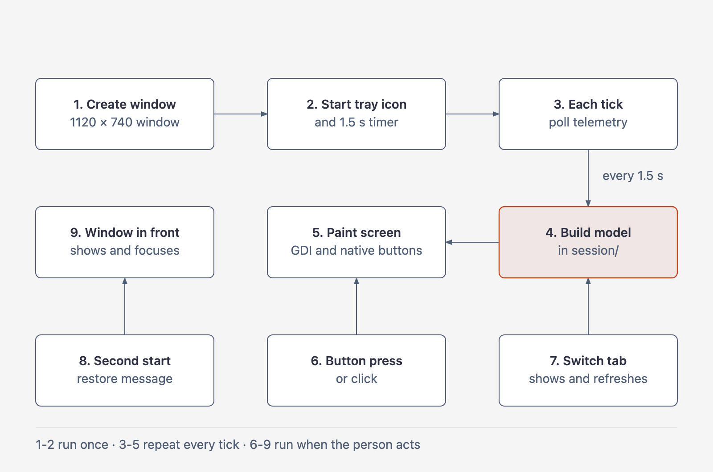

# How ui/ works

**In short:** `src/ui/` is the Windows window you see: the side menu, the screens, the buttons and the tray icon (the small icon by the clock).
It draws what it is given and decides nothing. Each screen has a model, built in `src/session/`, and a view in `src/ui/` that paints that model and sends button presses back to the app.
Every 1.5 seconds the window asks for fresh numbers, refreshes the screen in front and repaints it.
The one thing not to forget: the numbers and the rules are not in this folder. If a figure on screen looks wrong, check the model in `session/` first.

**Reader:** people and agents. **Last review:** 2026-11-20. **Explains:** `src/ui/`. **Answers:** How is a screen drawn, and where does each number come from? What happens on a button press, on a second start, or when the window is hidden?

## Why it exists

VegaFlow is a background program that changes Windows settings. Its window has to show what it found and let the person choose a few things. It must not hold any rule of its own: a rule buried in a drawing function cannot be tested without a real window and a real PC.

So the code is split in two. The layering is described in [code layers](./modules/layers.md) and in [ADR 0001](../adr/0001-nucleo-que-decide-y-puertos.md).

- `session/<name>_screen.cpp` builds a **model**: plain data, such as "53 % in use" and the sentences of the screen. It has no window code.
- `ui/<name>_view.cpp` **paints** that model and creates its buttons.

The window is a plain Win32 window. Win32 is Windows' own API for windows and buttons; GDI (Graphics Device Interface) is its basic drawing layer. No UI framework is used: the project rules in `CLAUDE.md` forbid Qt, wxWidgets and Boost, and keep the idle daemon under 15 MB.

## A concrete example

The Home screen on the test laptop (AMD Ryzen 5 4600H, 15788 MB of RAM), opened with `--gui --observe` on 2026-11-20, shows "53 % en uso" (53 % in use) and "7454 MB disponibles de 15788 MB" (7454 MB available out of 15788 MB). See the [screenshot](./img/gui-home.png).

Where the 53 % comes from, with the screenshot numbers:

- Used memory = 15788 − 7454 = 8334 MB (`session/home_screen.cpp:60-62`).
- Percent = (8334 × 100 + 15788 / 2) / 15788, using whole numbers = 841294 / 15788 = 53 (`session/home_screen.cpp:63`).
- The 7454 MB is free memory plus standby memory (the cache Windows gives back on request): `in.ram_available_mb = d.free_ram_mb + d.standby_ram_mb` (`ui/home_view.cpp:35`).
- The words "Modo seguro" (safe mode) appear because the window was opened with `--observe`. The flag is set in `cli.cpp:39-40`, turned into safe mode in `main.cpp:195`, and `gui_mode.cpp:271` sets `automatic = !safe_mode`. The view copies it (`home_view.cpp:37`), and `session/home_screen.cpp:44-47` writes "En espera" (waiting) and "Modo seguro: VegaFlow no detecta juegos" (safe mode: VegaFlow does not detect games).

Second example, tab 3 ([screenshot](./img/gui-uma-cores.png)): the 12 threads are labelled. Threads 0 and 1 say "DPC / ISR" (Windows work that runs at high priority), 2 to 9 say "JUEGO" (game), 10 and 11 say "FONDO" (background). Below the map: "Procesos en segundo plano detectados: 22" (background processes found: 22). Tab 3 is still the old drawing: `gui_tabs.cpp` reads the telemetry struct directly and has no `session/` model yet.

## How it works, step by step



| Step | File:line | What to look at | Why |
|---|---|---|---|
| 1. Create the window | [gui_window.cpp:708](https://github.com/partprogramming09/vegaflow-universal/blob/main/src/ui/gui_window.cpp#L708), [gui_window.cpp:726](https://github.com/partprogramming09/vegaflow-universal/blob/main/src/ui/gui_window.cpp#L726) | Size 1120 × 740, cut down to the work area when the screen is smaller; then each view's `Refresh` and `Show` run | The window starts with the Home screen in front and the other screens built but hidden |
| 2. Start the tray and the timer | [gui_window.cpp:319](https://github.com/partprogramming09/vegaflow-universal/blob/main/src/ui/gui_window.cpp#L319), [gui_window.cpp:360-363](https://github.com/partprogramming09/vegaflow-universal/blob/main/src/ui/gui_window.cpp#L360-L363), [gui_components.hpp:39-42](https://github.com/partprogramming09/vegaflow-universal/blob/main/src/ui/gui_components.hpp#L39-L42) | `WM_CREATE` adds the tray icon, sets a 1500 ms timer and asks for the first telemetry | The timer is the heartbeat: every tick the screen gets fresh data |
| 3. Each tick: poll and refresh | [gui_window.cpp:524-542](https://github.com/partprogramming09/vegaflow-universal/blob/main/src/ui/gui_window.cpp#L524-L542), [gui_mode.cpp:129](https://github.com/partprogramming09/vegaflow-universal/blob/main/src/app/gui_mode.cpp#L129) | `on_PollTelemetry` returns a `GuiDashboardData`; nothing is repainted while the window is hidden or minimized | The app layer does the Windows work; the window only copies the result in |
| 4. Build the model | [home_view.cpp:21-41](https://github.com/partprogramming09/vegaflow-universal/blob/main/src/ui/home_view.cpp#L21-L41), [home_screen.cpp:21](https://github.com/partprogramming09/vegaflow-universal/blob/main/src/session/home_screen.cpp#L21) | `Model(st)` copies the telemetry into `HomeInputs`; `BuildHomeScreen` returns the texts and numbers | One function holds the rules; the view only reads its result |
| 5. Paint the screen | [home_view.cpp:215](https://github.com/partprogramming09/vegaflow-universal/blob/main/src/ui/home_view.cpp#L215), [home_view.cpp:260](https://github.com/partprogramming09/vegaflow-universal/blob/main/src/ui/home_view.cpp#L260) | Cards are drawn with GDI; "% en uso" is printed from `memory_percent`, or "Sin dato" (no data) when it is unknown | The bar shows the same number as the text, so colour is never the only cue |
| 6. A press: button or click | [gui_window.cpp:570-573](https://github.com/partprogramming09/vegaflow-universal/blob/main/src/ui/gui_window.cpp#L570-L573), [gui_window.cpp:507-521](https://github.com/partprogramming09/vegaflow-universal/blob/main/src/ui/gui_window.cpp#L507-L521), [home_view.cpp:323](https://github.com/partprogramming09/vegaflow-universal/blob/main/src/ui/home_view.cpp#L323) | Native buttons send `WM_COMMAND` to their view; GDI boxes are found with a point-in-rectangle test; the action is a callback into the app | The window does not do the action; it asks the app and shows the sentence that comes back |
| 7. Change tab | [gui_window.cpp:214-221](https://github.com/partprogramming09/vegaflow-universal/blob/main/src/ui/gui_window.cpp#L214-L221), [gui_window.cpp:224-242](https://github.com/partprogramming09/vegaflow-universal/blob/main/src/ui/gui_window.cpp#L224-L242) | `current_tab` changes, the view of the old tab is hidden, the new one is shown and refreshed | Only one screen has native controls in front, so Tab never lands on a hidden button |
| 8. Second start | [main.cpp:128-137](https://github.com/partprogramming09/vegaflow-universal/blob/main/src/app/main.cpp#L128-L137), [gui_window.cpp:303-309](https://github.com/partprogramming09/vegaflow-universal/blob/main/src/ui/gui_window.cpp#L303-L309) | The second program finds the window by its class and posts the registered restore message; the window shows and focuses itself | A normal click cannot cross the privilege filter (see below), so only this one message is let through |

The step numbers match the diagram. Steps 1 and 2 run once. Steps 3 to 5 repeat every tick. Steps 6 to 8 run when the person acts.

## The pieces inside

| File | Responsibility |
|---|---|
| [gui_window.hpp](https://github.com/partprogramming09/vegaflow-universal/blob/main/src/ui/gui_window.hpp) | The public contract: `GuiDashboardData` (the telemetry in, `:32`), `GuiCallbacks` (the actions out, `:111`) and `GuiWindow::RunGuiLoop` (`:154`). The only way the window talks to the app |
| [gui_window.cpp](https://github.com/partprogramming09/vegaflow-universal/blob/main/src/ui/gui_window.cpp) | The window class, the message loop, the timer, the tray, the side menu (eight entries, `:72-80`), the tab dispatch (`:135-165`) and the keyboard shortcuts |
| [gui_components.hpp](https://github.com/partprogramming09/vegaflow-universal/blob/main/src/ui/gui_components.hpp) | Ids of the controls, the timer and tray constants, the colour palette, and `GuiWindowState` (`:115`), which keeps each screen's model and its native controls |
| [gui_components.cpp](https://github.com/partprogramming09/vegaflow-universal/blob/main/src/ui/gui_components.cpp) | The GDI drawing primitives: cards, text, badges, bars, buttons, tab buttons, switches |
| [native_controls.cpp](https://github.com/partprogramming09/vegaflow-universal/blob/main/src/ui/native_controls.cpp) | Native (owner-drawn) buttons: `MakeOwnerButton` (`:27`) creates a `BUTTON` with `WS_TABSTOP`, `PlaceClipped` (`:32`) hides the scrolled part without removing the control, `ScrollDeltaToReveal` (`:42`) scrolls a focused control into view, and the focus ring |
| [gui_tabs.cpp](https://github.com/partprogramming09/vegaflow-universal/blob/main/src/ui/gui_tabs.cpp) | Tab 3, "3. Memoria UMA & Núcleos CPU": the old GDI drawing (`RenderTabMemory`, `:15`). Its buttons are GDI boxes, not windows |
| `<name>_view.cpp` and `.hpp` (home, settings, games, history, config, programs, equipment, requirements) | One view per screen. Each has `Refresh` (creates the native buttons once), `Show`, `Paint`, `DrawItem` (draws a button), `Command` (reacts to it) and, for long screens, `Scroll`. Home is the example: [home_view.cpp](https://github.com/partprogramming09/vegaflow-universal/blob/main/src/ui/home_view.cpp) |
| [texts.hpp](https://github.com/partprogramming09/vegaflow-universal/blob/main/src/ui/texts.hpp) | The Spanish texts of the newer screens, in one file "so they can be translated without touching the drawing code" (`:2`) |
| [app_identity.hpp](https://github.com/partprogramming09/vegaflow-universal/blob/main/src/ui/app_identity.hpp) | The version (`kVersion`, `:11`), the window class (`:13`), the title, the tray command id (`:18`), the restore message (`:22`) and `FormatHardwareLine` (`:26`), which builds "CPU | GPU" and cuts a line longer than 65 bytes |
| [session/home_screen.cpp](https://github.com/partprogramming09/vegaflow-universal/blob/main/src/session/home_screen.cpp) and the other `session/*_screen.cpp` | The models. They take plain inputs and return plain data. The list of screens is just below |

**Which screen is which** (menu index; what each one is for, from the person's side, is in the [usage guide](./usage-and-features/system-info-and-gui.md)): 0 Home (`home_view`), 1 System settings (`settings_view`), 2 UMA memory & CPU cores (old GDI, `gui_tabs.cpp`), 3 Games (`games_view`), 4 History (`history_view`), 5 Settings (`config_view`), 6 Programs (`programs_view`), 7 Your machine (`equipment_view`) and 8 Requirements (`requirements_view`, opened from Settings, with no menu entry of its own). These screens arrive with phase G, planned for version 0.2.0 (not released yet: the binary still reports 0.1.0, see `--version` below). The colours of all of them are constants in [gui_components.hpp](https://github.com/partprogramming09/vegaflow-universal/blob/main/src/ui/gui_components.hpp) (`CLR_BG_MAIN` and the lines after it, `:73`).

How they talk: the window holds one `GuiWindowState` (`gui_components.hpp:115`) with the telemetry, the models and the native control handles. A view reads its model from that state, paints it, and calls the app only through `GuiCallbacks`. The app's side is wired in [gui_mode.cpp](https://github.com/partprogramming09/vegaflow-universal/blob/main/src/app/gui_mode.cpp) (`:129` for the telemetry, `:278` for the purge). Those few actions stay in `app/` on purpose: the telemetry poll returns a `ui/` structure, which `session/` may not include, and purge, isolate, restore affinity and the history poll call Windows classes that have no fake, so moving them would not make them testable.

## Why it was built this way

- **Win32 and GDI, not a framework.** The project rules allow no heavy frameworks, and the daemon must stay under 15 MB. The price: every control and every drawing is written by hand.
- **Owner-drawn native buttons, not only GDI boxes.** A native `BUTTON` has a focus, a place in the Tab order and an accessible name; a GDI box has none. So buttons, switches and fields are native (`native_controls.cpp:28`), and cards and bars stay GDI. The alternative, all GDI, is what tab 3 still does, and Tab does not reach it.
- **The views decide nothing.** The model is built in `session/` so that a test can check "in safe mode the waiting card promises nothing" without opening a window. ADR 0001 (accepted 2026-11-14) sets the same split for the whole program: the part that decides is apart from the part that acts on Windows.
- **Restore message instead of an ordinary command.** The window lets through only `RegisterWindowMessage("VegaFlowUniversal.RestoreWindow")` (`ChangeWindowMessageFilterEx`, `gui_window.cpp:365`). An ordinary click from a lower-rights program is refused by Windows' privilege filter (UIPI), and `app_identity.hpp:20-21` says so. The alternative, a plain `WM_COMMAND`, would let a less privileged program press the buttons of the administrator window.
- **Fixed pixels, Windows does the scaling.** The window declares itself DPI-unaware with GDI scaling (`gui_window.cpp:669-670`). The alternative, per-monitor awareness, "left it tiny at 125 % and 150 %", according to the comment there.
- **Ctrl+1 to Ctrl+8 instead of Tab for the side menu.** The comment at `gui_window.cpp:763` says "the sidebar is not a control yet". Making the menu native is the open step.

## What happens when it fails

- **No RAM total.** If the telemetry cannot read the memory, the model says "No se pudo leer la memoria del equipo." (could not read the machine's memory) and the card shows "Sin dato" (no data) instead of a percent (`session/home_screen.cpp:57-59`, `ui/home_view.cpp:260`). The card still draws.
- **Window hidden or minimized.** The timer still polls, but skips the repaint and the screen refresh (`gui_window.cpp:526`, `:534-536`). Nothing is drawn for a window nobody sees.
- **A notice survives the poll.** Each poll replaces the data, so the window keeps the previous status sentence when the new one is empty (`gui_window.cpp:528-532`). A result shown in the status bar is not wiped by the next tick.
- **Second start, no window found.** `main.cpp` posts the message only if `FindWindowW` finds the window; otherwise it prints "already running in the background (no window to show)" and exits with 0 (`main.cpp:130-137`).
- **Second start, low rights.** The filter lets only the restore message through; the other messages from a lower-rights program are refused by Windows (`gui_window.cpp:365`).
- **A failed action.** Each action returns a sentence, and the window puts it in the status bar (`gui_window.hpp:111-113`, for example the tray purge at `gui_window.cpp:592-595`). The person sees why nothing changed.

Known differences, checked in the code and not fixed by this page:

- `gui-home.png` was taken before the 2026-11-20 fix, so its sidebar still says "Auto-Suspensión: ACTIVA" in safe mode. The code now shows "Modo seguro: sin cambios" there in safe mode (`gui_window.cpp:118-122`), as seen on the laptop the same day.
- The status bar shows "VegaFlow Universal | Win32 GDI", a technical term, in every screen.
- The two screenshots show different free-memory numbers: Home 7454 MB (free plus standby), tab 3 "Libre: 7021 MB" with "Standby: 250 MB" (`gui_tabs.cpp:59`). Taken at different moments, or read differently: not confirmed.
- Most texts are not in `texts.hpp`. It holds 96 lines of text; `gui_window.cpp` has 30 lines with text (tab names, tray menu, badges), and `gui_tabs.cpp` has 21.

## Evidence that it works this way

| Step | Command or action | Real output |
|---|---|---|
| 1 and 5 (Home, safe-mode text) | Opened `--gui --observe` on the laptop, screenshot | [gui-home.png](./img/gui-home.png): "En espera", "Modo seguro: VegaFlow no detecta juegos", "53 % en uso", "7454 MB disponibles de 15788 MB" |
| 4 (safe mode in the model) | Suite, `[PASS]` line | `[PASS] Test 70.8: in safe mode the waiting card says VegaFlow changes nothing by itself and does not promise detection` |
| 4 (RAM share) | Suite, `[PASS]` line | `[PASS] Test 70.5: the RAM share in use is computed from total and free, an unknown total is unknown, and the last purge states both numbers` |
| 5 (hardware line) | Suite, `[PASS]` line | `[PASS] Test 58: the hardware line shows this machine, never the test laptop (normal: PASS, name over 65 chars cut, not replaced: PASS, ...)` |
| 8 (identity) | `vegaflow_daemon.exe --version` | `VegaFlow Universal 0.1.0` |
| 8 (identity) | Suite, `[PASS]` line | `[PASS] Test 59: window class, title and version are VegaFlow's own (names: PASS, version 0.1.0 is MAJOR.MINOR.PATCH: PASS)` |
| 8 (second start, mutex) | Suite, `[PASS]` line | `[PASS] Test 14: Single-Instance Guard, ... (Mutex 1: OK, Mutex 2 ERROR_ALREADY_EXISTS: PASS, ...)` |
| 6 (purge behind the Home button) | Suite, `[PASS]` line; the click itself was not run | `[PASS] Test 8: ... (Relaunch Dry-Run: OK, IsProcessAlive: OK, MPO Set Dry-Run: OK, ForcePurgeNow Dry-Run: OK)` |
| 5 (readable controls) | Suite, `[PASS]` lines | `[PASS] Test 62.4: control borders reach 3:1 on the surfaces controls sit on`; `[PASS] Test 62.5: the focus ring reaches 3:1 on every surface` |
| 3 and 5 (tab 3) | Opened tab 3 on the laptop, screenshot. How the tab was opened is not recorded | [gui-uma-cores.png](./img/gui-uma-cores.png): "Procesos en segundo plano detectados: 22 \| Procesos aislados en núcleos secundarios: 0" |
| 6 (Tab key reaches the buttons) | Keyboard run | not reproduced |
| 8 (restore message brings the window forward) | `scripts/remote/vfdev run gui-second` on the laptop, with one GUI open | `segunda salio=True (codigo 0); GUIs abiertas=1; ventana al frente es la primera=True` |
| Whole suite | Full C++ suite | `TEST RESULTS: 391 PASSED, 0 FAILED` |

## Check it yourself

On Windows, from the program folder:

```
vegaflow_daemon.exe --gui --observe
```

Compare the Home card "Memoria del equipo" with the formula above: the percent must be (used × 100 + total / 2) / total, using the numbers the card prints.

## Related

- [How session/ works](./how-it-works-session.md): where the models and the rules come from.
- [How app/ works](./how-it-works-app.md): the entry point that starts the window and wires the callbacks.
- [Code layers](./modules/layers.md): what `ui/` may include.
- [Features: system info and GUI](./usage-and-features/system-info-and-gui.md): what each screen is for, from the person's side.
- [ADR 0001](../adr/0001-nucleo-que-decide-y-puertos.md): why decisions and actions are separate.
