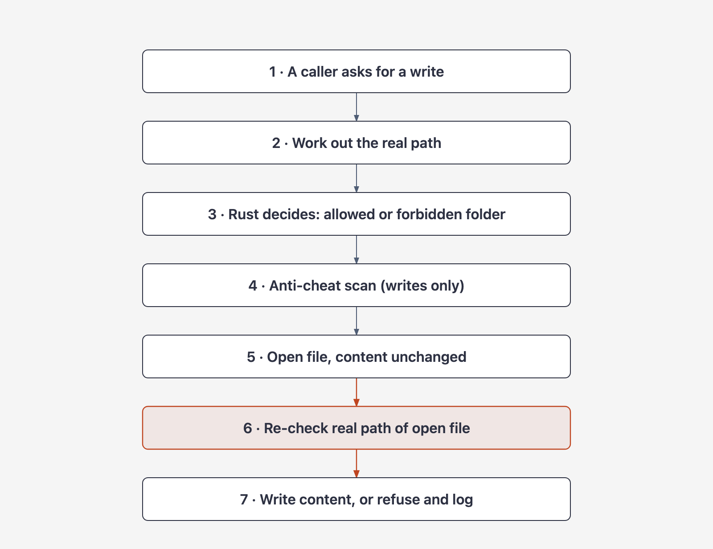

# How windows/ works

**In short:** `src/windows/` is the folder where VegaFlow talks to Windows: files, the registry, process priorities, memory, hardware and the change journal. Other folders ask it for things through small interfaces called ports.
Before any write to disk, a checker called `SandboxGuard` works out the real location of the path, applies the allowed and forbidden folder rules, and refuses anything that would touch a game with anti-cheat.
Before a registry value is changed, its original value is saved, so `--restore-registry` can put it back.

**Reader:** people and agents. **Last review:** 2026-11-20. **Explains:** `src/windows/`. **Answers:** where does VegaFlow touch Windows, how does it stay safe while doing so, and how can a test replace those calls with fakes?

## Why it exists

VegaFlow changes Windows settings: process priorities, memory, power, registry values and game files. These are the risky calls. A wrong path could write into Windows' own folders, and a registry value changed and never restored would stay changed after VegaFlow closes.

The layer rule is that calls into Windows live here. The architecture record says `session/` no longer calls Win32 directly, and `scripts/ci/check_layers.sh` checks which folders may depend on this one. Some other folders still include `windows.h` for its types, so the rule is kept by those checks, not by the compiler. Win32 is the Windows programming interface, the set of functions a C++ program uses to ask Windows for things. Before this layer was split out, the optimizers called Windows themselves, so the tests changed the real registry and power plan ([ADR 0001](../adr/0001-nucleo-que-decide-y-puertos.md)).

Terms used below. A **port** is an interface: a list of functions with no Windows code in it. A **fake** is a stand-in that a test puts in place of the real one. A **junction** is a folder shortcut that Windows follows as if it were the real folder. A **handle** is Windows' reference to an open file or process; the code wraps it so it is always closed ([unique_handle.hpp](https://github.com/partprogramming09/vegaflow-universal/blob/main/src/windows/unique_handle.hpp)).

## A concrete example

These are real lines from the test laptop (AMD Ryzen 5 4600H with Radeon Vega 6 graphics, Windows 11 build 26300, run on 2026-11-20). Each one is produced by a function in `src/windows/`. The commands only print; they change nothing.

```text
$ vegaflow_daemon.exe --system-info
  "cpu": { "brand_string": "AMD Ryzen 5 4600H with Radeon Graphics", "physical_cores": 6, "logical_processors": 12,
    "active_game_cpu_sets": [258, 259, 260, 261, 262, 263, 264, 265],
    "active_background_cpu_sets": [266, 267] },
  "gpu": { "adapter_name": "AMD Radeon(TM) Graphics (Vega / GCN 5.0)", "connection": "Integrada",
    "vendor_id": 4098, "device_id": 5686,
    "dxgi_budget": { "local_budget_bytes": 8089171456, "local_usage_bytes": 0, "valid": true } },
  "ram": { "free_real_bytes": 7620968448, "standby_cache_bytes": 285409280 }

$ vegaflow_daemon.exe --status
  Game Optimal CPU Set IDs   : [258, 259, 260, 261, 262, 263, 264, 265]
  Background CPU Set IDs     : [266, 267]
  GPU Connection             : Integrada (DXCore: YES)
  Vendor                     : AMD (PCI ID: 0x1002:0x1636)
  Local VRAM Usage / Budget  : 0 MB / 7714 MB
  Standby List RAM           : 272.36 MB (285585408 bytes)
```

How to read it:

- **CPU sets 258 to 265 and 266 to 267.** Windows numbers the logical processors as CPU sets. The device probe reads every set; the split into "game" and "background" is made later by the Rust core ([hardware_profiler.cpp](https://github.com/partprogramming09/vegaflow-universal/blob/main/src/detect/hardware_profiler.cpp), `PartitionCpuSetsFromTopology`).
- **`vendor_id` 4098 and `device_id` 5686** are the decimal forms of `0x1002` (AMD) and `0x1636` (the Vega graphics chip). The probe reads them through DXCore, the Windows graphics-adapter API that the probe tries first.
- **`dxgi_budget`** holds the budget and the current usage that DXGI reports for this adapter (read with `QueryVideoMemoryInfo`, `memory.cpp:204`). `8089171456` bytes is the `7714 MB` in the `--status` line. `valid: true` means the query worked.
- **`standby_cache_bytes`** and **`Standby List RAM`** are the standby list, the memory the code's comment calls the standby cache (`memory.cpp:128`). The two values come from two separate runs, so they differ slightly.

## How it works, step by step



The main path is a file write. The other pieces below follow the same idea: check first, then change, then check the result.

| Step | File:line | What to look at | Why |
|---|---|---|---|
| 1. A caller asks for a write | [sandbox_guard.cpp:593](https://github.com/partprogramming09/vegaflow-universal/blob/main/src/windows/sandbox_guard.cpp) (`SafeWriteFile`) | The call enters through the file port (`safe_file_system.cpp`), which calls this function | The checks run before any file is opened |
| 2. The real path is worked out | [sandbox_guard.cpp:123](https://github.com/partprogramming09/vegaflow-universal/blob/main/src/windows/sandbox_guard.cpp) (`CanonicalizePath`), called at `:444` | `.` and `..` are removed; the part that exists is replaced by its real path | A junction cannot hide where the write really lands |
| 3. Allowed and forbidden folders are decided | [sandbox_guard.cpp:295](https://github.com/partprogramming09/vegaflow-universal/blob/main/src/windows/sandbox_guard.cpp) (`Decide`), into [ffi/paths.rs:43](https://github.com/partprogramming09/vegaflow-universal/blob/main/rust/vegaflow-core/src/ffi/paths.rs#L43) | The rule itself is in Rust (`policy/file_access.rs`); C++ only passes the path | One set of rules, tested in Rust and against a shared vector file |
| 4. Anti-cheat check, writes only | [sandbox_guard.cpp:458-463](https://github.com/partprogramming09/vegaflow-universal/blob/main/src/windows/sandbox_guard.cpp) | If the file name or the folder has an anti-cheat signature, the decision runs again in lockdown mode | Reads skip this scan but still pass the folder rules |
| 5. The file is opened | [sandbox_guard.cpp:561](https://github.com/partprogramming09/vegaflow-universal/blob/main/src/windows/sandbox_guard.cpp) (`WriteVerified`) | The file is opened, but its content is not changed yet | Nothing is truncated before the check |
| 6. The real path of the open file is checked | [sandbox_guard.cpp:552](https://github.com/partprogramming09/vegaflow-universal/blob/main/src/windows/sandbox_guard.cpp) (`OpenedFileAllowed`) | If the path changed since step 2, it is checked again; if it is refused, a file this call created is deleted | Catches a folder swapped for a junction between steps 2 and 6 |
| 7. Content is written, or the write is refused | `sandbox_guard.cpp:579-584` (write); `:565-580` (refusals) | A refusal returns `false` and adds an entry to the violation log (`GetViolations()`) | The caller gets a yes or no, and the reason is kept for the report |

Read rules and the anti-cheat list in [security.md](./security.md). This page only shows where each check sits in the code.

## The pieces inside

### SandboxGuard and the file port

- [sandbox_guard.hpp](https://github.com/partprogramming09/vegaflow-universal/blob/main/src/windows/sandbox_guard.hpp) and [sandbox_guard.cpp](https://github.com/partprogramming09/vegaflow-universal/blob/main/src/windows/sandbox_guard.cpp): the checker. It has only static functions. Public ones: `SafeWriteFile`, `SafeCopyFile`, `SafeRemoveFile`, `SafeReadFile`, `SafeReplaceFile`. The last one writes `<path>.vegaflow.tmp` and renames it over the target, so the file is replaced in one step (Test 49 checks atomic writes).
- [safe_file_system.cpp](https://github.com/partprogramming09/vegaflow-universal/blob/main/src/windows/safe_file_system.cpp): the file port that the rest of the program receives. Its `Replace` calls `SafeReplaceFile`.
- The test seam: `SetBeforeOpenHookForTesting` runs a function between step 3 and step 5, so a test can swap a folder for a junction at exactly that moment (Test 42).

### The registry: backups and restore

Keys and values are changed only inside the roots listed in [reg_restore_scope.hpp](https://github.com/partprogramming09/vegaflow-universal/blob/main/src/windows/reg_restore_scope.hpp) (for example `Software\Microsoft\DirectX` and the game-bar settings).

1. **Save first.** Before the first change to a value, `RegBackupValue` ([registry.cpp:146](https://github.com/partprogramming09/vegaflow-universal/blob/main/src/windows/registry.cpp)) creates a record under `SOFTWARE\VegaFlow\RegBackup` (the root is at `registry.cpp:16`). The record holds the key, the value name, the hive (HKLM or HKCU), whether the value existed, its type and its data.
2. **Keep only the first.** If the record already exists, the function returns (`registry.cpp:155`). The original value is therefore never overwritten by a second change.
3. **Name the record by a fixed hash.** The record name is `v2-` plus an FNV-1a hash (a simple checksum that gives the same number on every compiler) of hive, key and value name in lower case (`RegBackupRecordName`, `reg_restore_scope.hpp:28`; used at `registry.cpp:103`). Records written by older builds used `std::hash`, which another compiler may compute differently; they are still looked up under their old name before a new record is written and when restoring (`registry.cpp:118`, `:475`), so the first saved original is never replaced by an already changed value. The old lookup only works while `std::hash` gives the same number as the build that wrote the record.
4. **Journal, then write.** `WriteValue` ([registry.cpp:381](https://github.com/partprogramming09/vegaflow-universal/blob/main/src/windows/registry.cpp)) calls the backup at `:405` and the journal entry at `:406` before it writes the value.
5. **Restore.** `RegRestoreRecord` (`registry.cpp:242`) reads the record and refuses it unless its key is one VegaFlow edits, in the same hive (`:263`). The record is read from HKCU, which any user can write, so its target is never trusted as stored. It then writes the saved value back, or deletes the value if it did not exist. The record is deleted only after success (`:285`).
6. **Restore everything.** `RestoreAllBackups` (`registry.cpp:482`) runs the restore for every record in both hives.

The command: `--restore-registry` is read at [cli.cpp:67](https://github.com/partprogramming09/vegaflow-universal/blob/main/src/app/cli.cpp). It runs the journal first, then `RestoreAllBackups` (`cli.cpp:284`). The exit code is 0 only if every change came back (`cli.cpp:292`).

### Process control: priorities, EcoQoS and CPU sets

[process_control.cpp](https://github.com/partprogramming09/vegaflow-universal/blob/main/src/windows/process_control.cpp) has two jobs: boost the game, and slow down the background programs.

- **Game (`BoostGameProcess`, line 139).** It raises the priority class to High, or to Above Normal for DirectX 12 and Vulkan (`:177`). It sets the power-throttling state of the game to off (`:184`), sets memory priority to Normal, makes sure its I/O priority is not below Normal (2, `:196`), and applies the game's CPU sets with `SetProcessDefaultCpuSets` (`:204`). With `dry_run` it only reports what it would do (`:171`). The I/O priority values are named once (`kIoPriorityVeryLow = 0`, `kIoPriorityNormal = 2`, `:22-23`); restoring a process puts Normal back (`:250`, `:394`), not 1, which Windows reads as Low.
- **Background (`ApplyBackgroundPolicy`, line 258).** It first checks that the process is still the one it found (creation time, so a recycled process id is never touched). Then it turns on power throttling with `EXECUTION_SPEED` (`:304`). This is the mechanism behind EcoQoS, the name the test suite uses for it (Test 19). The `Throttle` action also lowers memory priority, sets I/O priority to 0, VeryLow (`:318`) and confines the process to the background CPU sets (`:327`).
- **A Windows call declared by hand.** The I/O priority uses `NtSetInformationProcess` (class 33). The code declares its function type itself (`process_control.cpp:25`) and finds the function at run time with `GetProcAddress` on `ntdll.dll` (`:52-55`). If the function is missing, the step is skipped and the rest still runs.

### Memory: telemetry, DXGI budget and the standby purge

[memory.cpp](https://github.com/partprogramming09/vegaflow-universal/blob/main/src/windows/memory.cpp) reads memory and, when asked, empties the standby list.

- **Free and standby memory.** It asks `NtQuerySystemInformation` for memory class 80 (`memory.cpp:133`). The code uses these exact lists and not the simpler "available" number, because that number includes the standby cache (comment at `:128`).
- **Video memory budget.** It picks the graphics adapter by its LUID (a Windows identifier; the memory manager passes it in, `optimize/memory_manager.cpp:25`) (`:172-186`), then calls `QueryVideoMemoryInfo` for the local and non-local segments (`:204-212`). `valid` is set only when the query works.
- **Standby purge.** `PurgeStandbyList` (`:278`) returns a simulated result under `dry_run` (`:280`). Otherwise it enables two privileges and calls `NtSetSystemInformation`, class 80, command 4 (`:289-298`). Status `0xC0000061` is reported as a missing privilege (`privilege_missing`, `:306-308`), and the result says the program needs Administrator. The decision of when to purge is made above this layer, in [memory_manager.cpp](https://github.com/partprogramming09/vegaflow-universal/blob/main/src/optimize/memory_manager.cpp).

### Device probe: graphics, CPU sets and Windows version

[device_probe.cpp](https://github.com/partprogramming09/vegaflow-universal/blob/main/src/windows/device_probe.cpp) builds the hardware snapshot shown by `--system-info` and `--status`.

- **DXCore first.** It loads `dxcore.dll` and creates the adapter factory (`device_probe.cpp:263-272`). It keeps hardware adapters only (`:310`), skips the Microsoft software renderer (vendor `0x1414`, `:320`), and reads vendor and device id (`:337-340`), LUID (`:327`), dedicated and shared memory (`:364-368`), and whether the adapter is integrated (`:372`). An integrated adapter is shown as `Integrada` (`:380-381`).
- **DXGI as backup.** `SupplementOrFallbackWithDxgi` (`:398`) loads `dxgi.dll` (`:403`) and fills in or replaces the list, depending on whether DXCore was available.
- **Windows version.** `RtlGetVersion` gives the real build number (`:576-589`); the `os_kernel` block of `--system-info` shows it.
- **CPU sets.** `DetectCpuSetsRaw` (`:647-673`) lists every CPU set with `GetSystemCpuSetInformation`. The game and background split is done later, in Rust.

### Change journal

[change_journal.cpp](https://github.com/partprogramming09/vegaflow-universal/blob/main/src/windows/change_journal.cpp) is the log that lets VegaFlow undo its changes after a crash.

- **Where.** A file named `config\change_journal.vfj` next to the executable (`JournalFilePath`, `:626`).
- **How it is saved.** Each save writes the whole file through `Replace`, which goes through `SafeReplaceFile` and renames a temporary file over it (`PersistLocked`, `:691-712`). The file is replaced in one step, not written in place.
- **Session markers.** `BeginSession` (`:838`) marks a run as active. `EndSessionClean` (`:846`) clears it. If the last run was not closed, the streak goes up (`:830-832`). Two unclean exits in a row turn on safe mode (`:843`).
- **Undo.** `WindowsSystemUndo::RevertEntry` (`:970`) undoes each entry by its kind: registry, power plan, memory compression, process state, DXGI preference, game file or restore point. A restore point is created with `SRSetRestorePointW` from `srclient.dll` (`CreateRestorePoint`, `:1000-1011`).
- **History.** Completed entries are capped at 200 (`kMaxHistoryEntries`, `:34`).

### Smaller files

- [privileges.cpp](https://github.com/partprogramming09/vegaflow-universal/blob/main/src/windows/privileges.cpp): `PrivilegeManager` (`privileges.hpp:23-33`). It reports whether the process is elevated and enables the privileges the other files need. Its status is the `Process Elevated (Admin)` line of `--status`.
- [power.cpp](https://github.com/partprogramming09/vegaflow-universal/blob/main/src/windows/power.cpp): the power-plan adapter, through `powrprof.dll` (`power.hpp:2`).
- [system_counters.cpp](https://github.com/partprogramming09/vegaflow-universal/blob/main/src/windows/system_counters.cpp): counts for the reports and the GUI, such as the EcoQoS count (`CountEcoQoSProcesses`, `:12`).
- [steam_paths.cpp](https://github.com/partprogramming09/vegaflow-universal/blob/main/src/windows/steam_paths.cpp): finds Steam and its library file. The Rust core reads the list itself; this adapter only finds the file (`steam_paths.hpp:2-3`).
- [config_location.cpp](https://github.com/partprogramming09/vegaflow-universal/blob/main/src/windows/config_location.cpp): finds the folder of the executable and the config file. It also tells whether accounts without administrator rights could change that folder (`config_location.hpp:2`). The `--dry-run` output shows the warning: `config.json está en una carpeta donde pueden escribir cuentas sin permisos de administrador`.
- [text_convert.cpp](https://github.com/partprogramming09/vegaflow-universal/blob/main/src/windows/text_convert.cpp): UTF-8 to UTF-16 conversion, and case-insensitive name comparison (`text_convert.hpp:10`). Some conversions return `false` for bytes that are not valid UTF-8 (`text_convert.hpp:12`).
- [unique_handle.hpp](https://github.com/partprogramming09/vegaflow-universal/blob/main/src/windows/unique_handle.hpp): wrappers that close a handle when they go out of scope, also on early returns.
- [nt_defs.hpp](https://github.com/partprogramming09/vegaflow-universal/blob/main/src/windows/nt_defs.hpp): the NT structures used by the memory code, typed by hand.

### Ports and fakes: how tests replace Windows

Each Windows adapter sits behind a port in [src/ports/](https://github.com/partprogramming09/vegaflow-universal/tree/main/src/ports). The port headers are pure C++ and say so in their first line (for example [registry.hpp:2](https://github.com/partprogramming09/vegaflow-universal/blob/main/src/ports/registry.hpp)). The real classes in `src/windows/` implement them: `WindowsRegistryPort`, `WindowsProcessControl`, `WindowsMemoryProbe` and `WindowsMemoryControl`, `WindowsDeviceProbe`, `FileChangeJournal` with `WindowsSystemUndo`, and `SafeFileSystem`.

Tests put fakes in place of them:

| Port | Fake used by the unit tests | Where |
|---|---|---|
| RegistryPort, PowerPort | `FakeRegistryPort`, `FakePowerPort` | [fake_registry_power.hpp:24, :204](https://github.com/partprogramming09/vegaflow-universal/blob/main/tests/unit/fake_registry_power.hpp) |
| FileSystem | `FakeFileSystem` | [fake_file_system.hpp:13](https://github.com/partprogramming09/vegaflow-universal/blob/main/tests/unit/fake_file_system.hpp) |
| DeviceProbe | `FakeDeviceProbe` | [fake_device_probe.hpp:12](https://github.com/partprogramming09/vegaflow-universal/blob/main/tests/unit/fake_device_probe.hpp) |
| ChangeJournal, SystemUndoPort, Clock | `FakeSystemUndo`, `FakeWallClock` | [fake_change_journal.hpp:13, :23](https://github.com/partprogramming09/vegaflow-universal/blob/main/tests/unit/fake_change_journal.hpp) |
| MemoryProbe, MemoryControl | `FakeMemoryProbe`, `FakeMemoryControl` | [memory_purge_unit_tests.cpp:28, :67](https://github.com/partprogramming09/vegaflow-universal/blob/main/tests/unit/memory_purge_unit_tests.cpp) |
| ProcessControl | `FakeProcessControl` | [process_class_unit_tests.cpp:93](https://github.com/partprogramming09/vegaflow-universal/blob/main/tests/unit/process_class_unit_tests.cpp) |

The clock is injected, so the purge cooldown can be tested without waiting (Test 37). `SandboxGuard` is not behind a port; its tests run the real checks, with the test hook described above.

## Why it was built this way

| Option | Result |
|---|---|
| Call Windows from each optimizer | Rejected: tests changed the real registry and power plan ([ADR 0001](../adr/0001-nucleo-que-decide-y-puertos.md), context). |
| Move the folders only | Rejected: decisions stayed mixed with Windows calls (ADR 0001, alternatives). |
| Full dependency injection, one interface per service | Rejected as too much code for one maintainer (ADR 0001). The chosen light version has about ten small ports. |
| Resolve paths with `weakly_canonical` | Replaced: under MinGW it did not follow junctions, so a junction to `System32` passed the check ([security.md](./security.md)). |
| The WIL library for handles | Not used: [unique_handle.hpp](https://github.com/partprogramming09/vegaflow-universal/blob/main/src/windows/unique_handle.hpp) says it does not support MinGW, so the code has its own small wrappers. |
| Rules in Rust | Chosen: the blacklist and whitelist are in Rust, checked against a shared vector file (Test 33). |
| Restore any registry key a record names | Rejected: the record sits in HKCU, which any user can write, so the restore checks the key against a fixed list (`reg_restore_scope.hpp`). |

The code does not say why the NT functions are loaded by name instead of being linked, or why the record names are a hash of the key. This page describes what the code does, not the reason behind those two choices.

## What happens when it fails

- **A write into a protected game is refused.** `SandboxGuard` returns `false`. The message depends on the reason. With a signature found, it says `Firma de Anti-Cheat detectada en el directorio: Escritura abortada para salvaguardar la cuenta del usuario` (signature found in the folder, write stopped to protect the user's account). With a kernel-level anti-cheat lock, it says `Bloqueo Anti-Cheat activo: Prohibida toda modificación en juegos con protección a nivel de kernel` (anti-cheat lock active, changes forbidden). A path outside the allowed folders gets `La ruta se encuentra fuera de los límites autorizados por VegaFlow Sandbox`. The messages are in Spanish in the code.
- **The file is swapped while it is being written.** The check in step 6 fails. A new file created by that call is deleted (`sandbox_guard.cpp:575-578`). Test 42 covers this.
- **The standby purge is not allowed.** The result says `Standby List purge skipped (requires Administrator / --elevate)` and sets `privilege_missing`. The purge is skipped and reported; nothing else in the program stops.
- **An NT function is missing.** The purge reports `NtSetSystemInformation not available in ntdll.dll`. The I/O priority step is skipped without a message.
- **A registry restore points at a key VegaFlow never edits.** The restore returns `false`. The record stays in place (it is deleted only after a successful restore), so nothing is lost.
- **Some values could not be restored.** `--restore-registry` prints `Se devolvieron X de Y` (X of Y restored) and exits with code 1 (`cli.cpp:290-292`).
- **The journal is corrupt.** The command prints `Diario de cambios corrupto (...); restaurando copias de respaldo del registro directamente` and restores from the registry backups directly (`cli.cpp:273-274`). At startup the program warns and tells the user to run `--restore-registry` (`main.cpp:158`).
- **The program crashed during a session.** The next start reports `Se detectó un cierre anterior no limpio` (an unclean previous exit) and offers to undo the changes (`main.cpp:173-190`). Two unclean exits in a row start safe mode (`change_journal.cpp:834`).
- **DXCore is missing.** The probe falls back to DXGI (`device_probe.cpp:398-403`), so the hardware report still appears.

## Evidence that it works this way

All lines below were run on the test laptop on 2026-11-20 and are trimmed from the evidence files. Label: **medido** (run, not read from code).

| Step | Command or action | Real output |
|---|---|---|
| 1 to 7, write path | Suite, Test 17 (`tests/integration/safety_tests.cpp`) | `[PASS] Test 17: SandboxGuard Boundary Validation, Canonicalization, Anti-Cheat Lockdown & Safe I/O (Canonicalization: PASS, Blacklist & DriveRoot: PASS, Whitelist: PASS, Safe I/O: PASS, AntiCheat Lockdown: PASS, Audit Log: PASS)` |
| 3, Rust rules | Suite, Test 33 | `[PASS] Test 33: SandboxGuard blacklist matches the shared vector file (52 vectors, 0 mismatches)` |
| 6, junctions and swaps | Suite, Test 41 and Test 42 | `[PASS] Test 41: SandboxGuard refuses each old whitelist flaw (flaws 1-5, junctions (inside and as a root), \\?\ and UNC checked)` and `[PASS] Test 42: SandboxGuard checks the opened file, not only the path it validated (write, overwrite, copy, remove and read refused after the swap)` |
| Registry save and restore | Suite, Test 29 (`tests/integration/graphics_tests.cpp`) and Test 30 | `[PASS] Test 29: Registry changes restore the original values (GameDVR applied: PASS, restored by toggle: PASS, restored by RestoreAll: PASS)` and `[PASS] Test 30: HKLM tweaks restore the original values (RestoreAllRegistryBackups: PASS, GPU Priority untouched: PASS, values identical: PASS)` |
| Restore only own keys | Suite, Test 89 (`tests/unit/reg_restore_scope_unit_tests.cpp`) | `[PASS] Test 89: RegBackup restore is limited to VegaFlow's own keys in the record's hive (Real=OK, CrossHive=OK, Unknown=OK, Lookalike=OK, WrongHive=OK, Slash=OK, DotDot=OK, Empty=OK, StableName=OK)` |
| Records from older builds | Suite, Test 103 (`tests/integration/reg_backup_name_tests.cpp`) | `[PASS] Test 103: a RegBackup record under the older name is still found and restored (names differ: yes, second backup avoided: yes, restored: yes, value after restore: 7 (7 = original))` |
| I/O priority restored to Normal | Suite, Test 102 (`tests/integration/io_priority_tests.cpp`) | `[PASS] Test 102: restore puts I/O priority back to Normal (lowered to: 0, after background restore: 2, after game restore: 2, after crash recovery: 2 (2 = Normal, 1 = Low))` |
| Process: EcoQoS and I/O | Suite, Test 19 | `[PASS] Test 19: Modern 3D Gaming Suite (EcoQoS Background Throttling, I/O Priority Hierarchy, ...) (EcoQoS (Dry/Exec): PASS, I/O & Memory Priority NT: PASS (IoVeryLow 0, MemLow 2), ...` |
| Process: PID safety | Suite, Test 55 | `[PASS] Test 55: CpuOrchestrator PID+FILETIME safety, game switch restore, and the GUI's game exclusion (Switch=OK, RecycledPidSafe=OK, EcoOnly=OK, DoNotTouch=OK, ExcludeAndReload=OK)` |
| CPU sets | Suite, Test 2 | `[PASS] Test 2: HardwareProfiler universal hardware & CPU set detection (RAM: 15788 MB, Cores: 6P/12L, Game Sets: 8, Bg Sets: 2, Disjoint Sets: YES)` |
| Standby list purge | Suite, Test 23 (`tests/integration/memory_tests.cpp`) | `[PASS] Test 23: Memory Manager Standby List Purge & UMA Bus Prioritizer (Dry-Run: PASS, Query (Standby: 283 MiB, Free: 7210 MiB): PASS, Permissions: ELEVATED (Purge OK), Footprint: 2308 KB (Zero-Overhead KPI < 15MB: PASS))` |
| Purge cooldown (injected clock) | Suite, Test 37 | `[PASS] Test 37: the purge cooldown follows the injected clock (real purge: PASS, +10 s blocked (80s remaining): PASS, +91 s released: PASS, ...)` |
| DXGI budget valid | Suite, Test 3 | `[PASS] Test 3: MemoryManager telemetry, dry-run optimization, and Zero-Overhead KPI (< 15 MB) (RAM: 15788 MB, VRAM Valid: YES, ...)` |
| Device probe (DXCore) | Suite, Test 52 (`tests/integration/device_probe_tests.cpp`) | `[PASS] Test 52: Live WindowsDeviceProbe (DXCore, SetupAPI, Storage dwDesiredAccess=0, Power, Arch, Displays) (DXCore=YES, Conn=Integrada, Arch=AMD_GCN5_Vega, ...)` |
| Journal crash recovery | Suite, Test 49 and Test 50 | `[PASS] Test 49: Change journal atomic writes, crash recovery, Safe Mode, and corrupt handling (fresh: PASS, crash1: PASS, ..., safe mode: PASS, corrupt: PASS, ...)` and `[PASS] Test 50: Real disk FileChangeJournal + WindowsSystemUndo restores HKCU registry and game INI after crash (setup: PASS, restored 2/2: PASS, HKCU==123: PASS, INI exact: PASS)` |
| `--system-info` JSON | `vegaflow_daemon.exe --system-info` | The JSON excerpt in "A concrete example" |
| `--status` lines | `vegaflow_daemon.exe --status` | The lines in "A concrete example" |
| Whole suite | `scripts/build/build.ps1 -RunTests` | `TEST RESULTS: 328 PASSED, 0 FAILED` |
| `--restore-registry` run from the command line | not run | not reproduced |
| Standby purge without Administrator | not run | not reproduced |
| The exact refusal message of a write | not run; Test 17 shows PASS only | not reproduced |

## Check it yourself

From the folder that holds `vegaflow_daemon.exe`, in PowerShell:

```powershell
.\vegaflow_daemon.exe --system-info
```

The command prints the JSON and exits (`cli.cpp:135-138`). Look at `active_game_cpu_sets`, `dxgi_budget` and `valid`.

## Related

- [security.md](./security.md): the rules that `SandboxGuard` enforces, the anti-cheat signatures and the whitelist details.
- [rust-cpp-core.md](./rust-cpp-core.md): which decisions live in Rust and how C++ calls them.
- [modules/layers.md](./modules/layers.md): which folder may call which, and why `windows/` is the adapter layer.
- [modules/system-info.md](./modules/system-info.md): what each block of `--system-info` means.
- [how-it-works-app.md](./how-it-works-app.md): which startup mode calls these functions, and when.
- [usage-and-features/daemon-and-cli.md](./usage-and-features/daemon-and-cli.md): the flags a user sees, including `--restore-registry`.
- [ADR 0001](../adr/0001-nucleo-que-decide-y-puertos.md): why the ports exist.
- [measurements/verification-status.md](../measurements/verification-status.md): what has been measured and what has not.
