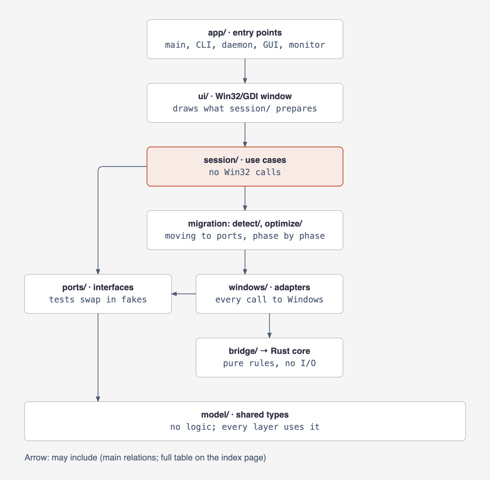

# Modules: code layers

**In short:** each folder in `src/` is a layer, and a layer may only use the layers listed for it. Since phase R3, the use-case code does not call Windows itself: it asks `windows/` for the readings. For example, `--status` counts the processes in power-saving mode through `windows/`, so the `session/` code reads without any Windows detail. The full rule table is in the [index](./index.md#layer-table).

**Reader:** people

## Code layers (state after phase R3, 2026-11-14)

**The essentials:** each folder of `src/` may only include the folders below it. Since R3, the use cases in `session/` do not call Win32 functions: they ask `windows/` for those readings.

**Example.** `--status` shows how many processes have power-saving mode (EcoQoS) on. Before, `session/` walked the process list with Windows calls itself. Now `session/reports.cpp` calls `CountEcoQoSProcesses()`, and the one that talks to Windows is [`src/windows/system_counters.cpp`](https://github.com/partprogramming09/vegaflow-universal/blob/main/src/windows/system_counters.cpp). That way the `session/` code reads without knowing anything about Win32.

Terms: a **port** is a small interface (for example, "read and write the registry") that the tests can replace with a fake version; an **adapter** is the real version, which calls Windows.

### What R3 moved

| What moved in R3 | Where it went |
| --- | --- |
| Count of processes in EcoQoS and of games with Direct Flip set | `windows/system_counters.*` |
| L3 cache size (cache topology; if that fails, CPUID, leaf `0x80000006`; 0 if none answers) | `windows/system_counters.*` |
| RAM slots used according to SMBIOS, with a bounded walk: it stops at a truncated entry instead of reading past the end | `windows/system_counters.*` (the pure part, `CountDimmsInSmbiosTable`, is tested with invented tables) |
| Check a window and its thread | `windows/system_counters.*` |
| UTF-8 ↔ UTF-16 conversion (`text_convert`) | from `session/` to `windows/text_convert.*` |
| Version (0.1.0), window class and title, tray command id and the line "processor \| graphics" | `ui/app_identity.hpp` |

### What the repository checks

- `scripts/ci/check_layers.sh` checks every `#include` in `src/` against the [layer table](./index.md#layer-table): 272 includes checked, layers respected (2026-11-14). It runs in CI.
- `session/` still includes headers from `windows/`, `detect/` and `optimize/`. The script allows them as **migration** (they are marked that way in its table) until each piece sits behind a port. What is gone from `session/` are the Win32 calls.
- The tests that touch the real registry are only in `tests/integration/`; `tests/unit/` uses fake ports. C++ suite on the test laptop, 2026-11-14: `57 PASSED, 0 FAILED`.
