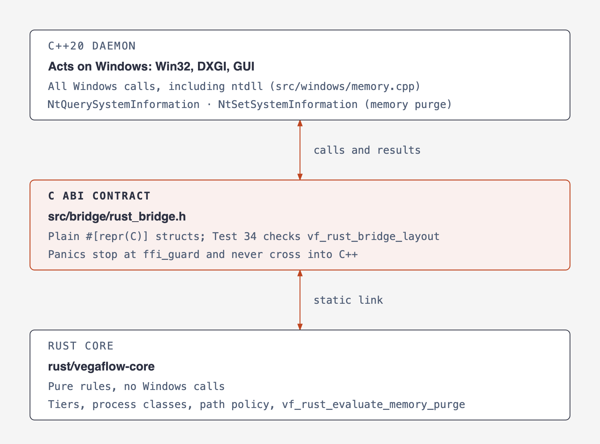
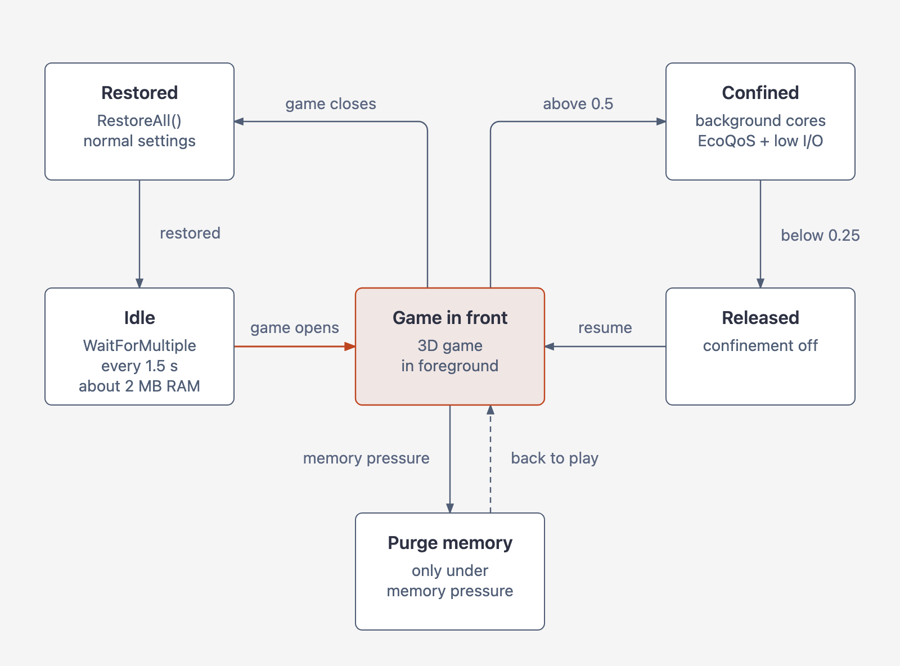
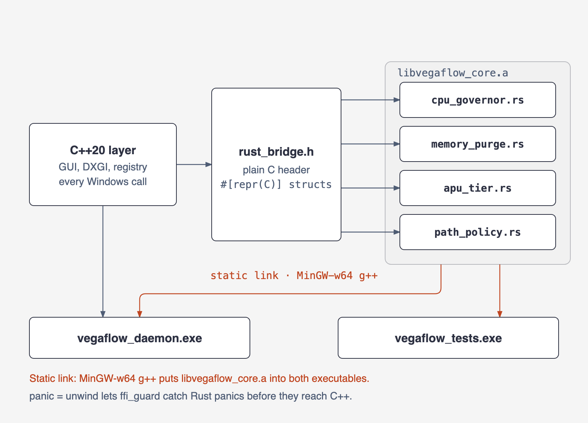

# C++20 + Rust core

**In short:** The daemon is written mostly in C++, but several of its decisions are made in Rust, a language that compiles to a library that C++ can call. C++ asks Rust simple questions through one plain C header, such as "does this process name match an anti-cheat tool?" or "should the standby memory be purged now?". Rust answers, C++ carries out the action, and a failure on the Rust side is caught at the boundary instead of crashing the daemon.

**Reader:** people

## 1.3 Architecture of the C++20 ↔ Rust hybrid bridge (`libvegaflow_core.a`)

To make sure the optimization software itself does not add latency or compete with the system for memory, all the algorithmic and real-time evaluation logic was written in **Rust**. It is compiled as a `staticlib` without dependence on the C runtime library (CRT) in the hot loop, and it works only on POD (*Plain Old Data*) `#[repr(C)]` structures placed on the stack:




### Rust core modules:
* **[`cpu_governor.rs`](https://github.com/partprogramming09/vegaflow-universal/blob/main/rust/vegaflow-core/src/policy/cpu_governor.rs):** Receives the flat list of the system's CPU Set identifiers, computes the membership indexes of the core complexes, and decides whether a noisy process must enter or leave the confinement state, using a hysteresis algorithm with no dynamic allocations.
* **[`memory_purge.rs`](https://github.com/partprogramming09/vegaflow-universal/blob/main/rust/vegaflow-core/src/policy/memory_purge.rs) (the rule) and [`memory.cpp`](https://github.com/partprogramming09/vegaflow-universal/blob/main/src/windows/memory.cpp) (the Windows calls):** `memory_purge.rs` is only the rule. In microseconds it evaluates whether the shared memory subsystem exceeds the critical threshold (`>= 85%` of the budget or `< 1536 MB` of free physical RAM), and it governs the selective purge of the *Standby List* only when the disk bus is idle (at most `15 MB/s` of game disk reads). It makes no Windows calls itself. `src/windows/memory.cpp` makes them: it resolves `NtQuerySystemInformation` and `NtSetSystemInformation` from `ntdll.dll` at run time with `GetProcAddress`, reads the memory lists with `SystemMemoryListInformation` (class `80`), and purges the standby list with command `4` (`MemoryPurgeStandbyList`).
* **[`apu_tier.rs`](https://github.com/partprogramming09/vegaflow-universal/blob/main/rust/vegaflow-core/src/policy/apu_tier.rs):** Decides the APU tier (1 to 4) from the memory architecture, the GPU generation, the RAM and the physical cores. It is a pure decision on numbers: the same vector file (`tests/vectors/apu_tier.tsv`) is checked by Rust and by C++ Test 32.
* **[`path_policy.rs`](https://github.com/partprogramming09/vegaflow-universal/blob/main/rust/vegaflow-core/src/policy/path_policy.rs):** Decides why a canonical path is forbidden (drive root, critical boot files, Windows folders, Common Files, System Volume Information) or whether it is allowed by the blacklist. It works with UTF-16 already in lowercase, as C++ has it, so it does not change case and cannot disagree with non-ASCII text. It is checked with `tests/vectors/sandbox_blacklist.tsv`.
* **[`sandbox_core.rs`](https://github.com/partprogramming09/vegaflow-universal/blob/main/rust/vegaflow-core/src/policy/sandbox_core.rs):** Walks the path as UTF-8 bytes (time proportional to its length) and answers yes or no: whether it contains the signature of a commercial anti-cheat (`vf_rust_has_anticheat_signature`), or whether the file name is a system boot file (`vf_rust_is_critical_system_filename`). `SandboxGuard` in C++ decides whether to block.

---

## 1.4 Daemon lifecycle and process governance

The sequence diagram describes the service's continuous lifecycle, from its start in an elevated session to the end of the application:



---

## 1.6 Two layers: deep engineering explanation vs. simple explanation

### Layer 1: deep engineering perspective
In the synthetic test, confining the game to a subset of cores (*Core Pinning* of the game) cost **-18.9%** of performance, because the auxiliary D3D11 compile and dispatch threads were starved. The optimal architecture is **asymmetric**: keep the game with free access to all physical cores, and forcibly relocate only the intruders to the last physical complex. By confining the 6 workers to logical threads 10 and 11, the L3 cache associated with cores 0 to 4 stays free of forced evictions, allowing the cache hit rate (*Cache Hit Rate*) to exceed 96%, which reduces the execution stall cycles (*Stall Cycles*) in the GPU command dispatch pipeline.

### Layer 2: simple everyday explanation (the six-lane highway and the kitchen chefs)
* **The six-lane highway:** Imagine a six-lane highway where a sports car (the game) needs to travel at 100 km/h without braking. Without regulation, a dozen heavy trucks and delivery vans (browsers, updates, system tasks) zigzag across all the lanes. Even if the sports car is powerful, it will be forced to brake sharply every time a truck cuts into its lane. VegaFlow acts as a high-speed traffic police officer: it does not put limits on the priority vehicle, but it **forces all the heavy trucks to drive exclusively in the slow lane on the far right**. With the other 5 lanes clear, the vehicle rolls at full speed without interruptions.
* **The restaurant and the chefs:** A 6-core processor works like 6 cooks in the same kitchen. If the guests of a noisy party come into the kitchen and ask favors from all 6 cooks at once, the cooks lose track of the main-course orders and the food comes out late (the on-screen stutters). VegaFlow assigns **one cook at an auxiliary bar to serve the noisy guests**, leaving the other 5 cooks entirely dedicated to serving the game's banquet.

---

## Design specification: Rust + C++20 hybrid for UMA/APU memory control, `metal-gpu-trace` MCP integration and TDD workflow

**Date:** 2026-11-06  
**Base branch:** `feat/ab-automation` (`ff73341`)  
**Reference hardware:** AMD Ryzen 5 4600H (6C/12T Zen 2, 2 CCX with 8 MB of L3 each) + Radeon RX Vega 6 (GCN 5.0, UMA 16 GB DDR4 dual-channel)  
**Status:** Validated in brainstorming

---

### 1. Context and motivation

In APU architectures with unified memory (UMA), the CPU and the iGPU share the same 128-bit DDR4 bus (~38–42 GB/s). In the VegaFlow Universal daemon, keeping an ultra-low private memory footprint (`< 15.0 MB`, currently ~2.5 MB) and `0.0%` CPU use at rest is a physical requirement, so as not to pollute the L3 cache or compete for bandwidth on the Infinity Fabric bus.

Progressively migrating to a **hybrid Rust + C++20 architecture** through static linking (`staticlib`, `x86_64-pc-windows-gnu`) allows:
1. **Zero heap allocations (zero-allocation hot path):** evaluate UMA memory pressure (`EvaluateUmaPressureGuard`), CPU confinement hysteresis (`CpuOrchestrator`), topological partitioning of L3/CCX islands (`PartitionCpuSetsFromTopology`) and validation of anti-cheat signatures (`SandboxGuard`) using stack arrays, scalar `#[repr(C)]` types and atomic counters, without calling the dynamic allocator in each daemon cycle.
2. **Memory safety and a hardened FFI boundary:** `panic = "unwind"` with `ffi_guard` on every exported function, strict validation of pointers and lengths before building slices, and no exceptions crossing `extern "C"`. If the body of a function fails (a programming error), `ffi_guard` catches the panic at the boundary and returns that function's cautious answer: deny the path, assume there is anti-cheat, do not confine the background, do not purge memory, Tier 1. This way a failure in Rust never crosses into C++ or kills the daemon. The crate refuses to compile with `panic = "abort"`.
   > Note: `Cargo.toml` does not set the panic strategy. Cargo's default is unwind, and `lib.rs` stops the build with `compile_error!` unless it is unwind.
3. **Telemetry and control on integrated laptops:** register the `metal-gpu-trace` MCP server (`C:\dev\metal-gpu-trace\metal_trace_mcp.py` with `PresentMon.exe`) in `~/.gemini/config/mcp_config.json`, and check the machine's health with the job package `scripts/remote/jobs/doctor.ps1`.
4. **Strict test-driven development (TDD):** every Rust module is built through the **RED $\to$ GREEN $\to$ REFACTOR** cycle with `cargo test`, and verified end to end in the integration suite `vegaflow_tests.exe` (`31 PASSED, 0 FAILED`).

---

### 2. Architecture of the hybrid subsystem (`rust/vegaflow-core`)




#### 2.1. Crate configuration (`rust/vegaflow-core/Cargo.toml`)
- **Package name:** `vegaflow-core` (`lib` name: `vegaflow_core`).
- **Crate types:** `["staticlib", "rlib"]` (`rlib` to run `cargo test` natively and `staticlib` to generate `libvegaflow_core.a` for `g++`).
- **Release profile:**
  - `opt-level = 3`
  - `lto = true`
  - `codegen-units = 1`
  - `panic`: not set in `Cargo.toml`. `lib.rs` refuses to compile unless the strategy is `unwind`, and each exported function is wrapped in `ffi_guard`.
  - `strip`: not set in `Cargo.toml`. The design wanted `strip = false`, so that the `g++` linker manages the final symbols without breaking the `.a` file.
- **No runtime dependencies:** `Cargo.toml` declares no `[dependencies]`; `proptest` appears only under `[dev-dependencies]`. The design planned direct `ntdll.dll` calls from Rust (`extern "system"` blocks) to avoid longer compile times and larger binaries. That did not happen: the `ntdll.dll` calls are in C++ (see 1.3).

---

### 3. FFI contract (`src/bridge/rust_bridge.h`) and Rust modules

The header `rust_bridge.h` is written by hand (it is not generated with cbindgen: that was decided on 2026-11-09, to avoid adding another tool). That is why the C++ **Test 34** compares, struct by struct, the size, alignment and position of each field that C++ sees (`sizeof`, `alignof`, `offsetof`) with what Rust reports (`vf_rust_bridge_layout`). It also compares the size of each field, so it detects a changed type that fits in the padding (for example, a `bool` that becomes a `uint32_t`). If someone adds, removes, reorders or changes the type of a field in the list on one side only, the suite fails instead of reading garbage at run time. When a new struct is added to the bridge, it must be added to both sides of that test.

#### 3.1. Memory purge and UMA pressure guard (`memory_purge.rs`; NT calls in C++)
- **`#[repr(C)]` structures:** `VfMemoryPurgeInput` and `VfMemoryPurgeDecision` (`src/bridge/rust_bridge.h`, lines 14–47). The structures from the design, `VfUmaTelemetryInput`, `VfUmaGuardDecision` and `VfNtMemoryListSample`, are no longer defined in the header.
- **Exported functions (`extern "C"`)**:
  - `VfMemoryPurgeDecision vf_rust_evaluate_memory_purge(const VfMemoryPurgeInput* input);` (the design called it `vf_rust_evaluate_uma_pressure`; `src/bridge/rust_bridge.h:71`, `rust/vegaflow-core/src/ffi.rs:169`)
    - Computes `dxgi_budget_utilization = local_usage_bytes / local_budget_bytes` (if `vram_valid && local_budget_bytes > 0`).
    - Triggers the guard when the GPU is UMA (`is_uma_gpu`) and either `dxgi_budget_utilization >= 0.85` (the threshold can be overridden with `pressure_threshold_override`) or `free_and_zero_bytes` is below `1536 MB`.
    - Increments `total_interventions` by `1` when `guard_triggered` is true.
    - Decides whether the Standby List should be purged: when there is low free RAM or the DXGI ceiling is exceeded, and the standby list holds at least `min_standby_mb` (1500 MB by default, `rust/vegaflow-core/src/policy/config_rules.rs:15`). It skips the purge while game disk reads exceed `max_game_disk_read_bytes_per_sec` (15 MB/s by default). It also decides whether to trim secondary working sets.
  - `VfNtMemoryListSample vf_rust_query_nt_memory_lists(void);` is not in the code. The query is in C++: `WindowsMemoryControl` in `src/windows/memory.cpp` calls `NtQuerySystemInformation(SystemMemoryListInformation /* 80 */, ...)` and converts the page counts to bytes with 4096-byte pages (`kPageSizeBytes`).
  - `bool vf_rust_purge_nt_standby_list(bool dry_run);` is not in the code. The purge is `WindowsMemoryControl::PurgeStandbyList(bool dry_run)` (`src/windows/memory.cpp:278`). With `dry_run` it returns a simulated success without touching the kernel; otherwise it calls `NtSetSystemInformation(SystemMemoryListInformation /* 80 */, &cmd /* MemoryPurgeStandbyList = 4 */, sizeof(ULONG))`.

#### 3.2. Module `cpu_governor`: L3/CCX topology and confinement hysteresis
- **`#[repr(C)]` structures:** `VfCpuCoreEntry` and `VfTopologyPartitionOut`, with `VF_MAX_LOGICAL_PROCESSORS` (`64`) (`src/bridge/rust_bridge.h`, line 12 and lines 49–67).
  > Note: the output structure has `has_hybrid_cores` where the design listed `has_smt`. `VfCpuCoreEntry` also has a `group` field that the design did not list.
- **Exported functions (`extern "C"`)**:
  - `bool vf_rust_partition_cpu_topology(const VfCpuCoreEntry* entries, uint32_t count, VfTopologyPartitionOut* out);`
    - Runs, on fixed-size stack arrays (`VF_MAX_LOGICAL_PROCESSORS = 64`), the exact rules of `HardwareProfiler::PartitionCpuSetsFromTopology`:
      1. Counts the unique physical cores, detects SMT (`logical > physical`) and multiple L3 islands (`has_multiple_ccx`).
      2. Selects the background cores:
         - Hybrid topology (`min_eff != max_eff`): threads with `efficiency_class < max_eff` go to the background.
         - Asymmetric L3 islands (`has_multiple_ccx`, and the secondary island has ≤ 33% of the total threads): the whole secondary island goes to the background.
         - Symmetric L3 islands or a single CCX: if `physical_cores >= 4`, the last complete physical core (all its SMT threads) goes to the background; if `physical_cores < 4`, only the last logical processor (`1` thread) goes to the background.
      3. DPC/ISR shield: if `physical_cores >= 4`, the lowest physical core (`Core 0`) is excluded from `game_cpu_set_ids` (unless that would leave the game with no threads).
      4. Orders `game_cpu_set_ids`, prioritizing the main L3 island (`primary_llc`) to minimize inter-CCX latency.
  - `bool vf_rust_eval_bg_confinement(double logical_cores_used, bool currently_confined);`
    - Implements the empirical hysteresis of `CpuOrchestrator`:
      - If `currently_confined`: stays `true` while `logical_cores_used >= 0.25`.
      - If `!currently_confined`: becomes `true` when `logical_cores_used >= 0.50`.

#### 3.2b. Module `apu_tier`: tier classifier
- **Exported function (`extern "C"`)**:
  - `uint8_t vf_rust_classify_apu_tier(const VfTierInput* input);`
    - Returns 1 (entry), 2 (mid), 3 (advanced) or 4 (discrete or custom). The order of the checks matters: first discrete, then entry (RAM up to 9 GB, up to 4 cores, or Intel UHD), then advanced (RDNA2/RDNA3+/Intel Xe, or 22 GB or more). A null input returns mid.
    - `VfTierInput` is a flat structure: `total_ram_mb`, `physical_cores` (0 = unknown), `arch_gen`, `dedicated_vram` and `is_nvidia`.

#### 3.2c. Module `path_policy`: blacklist path policy
- **Exported function (`extern "C"`)**:
  - `uint32_t vf_rust_classify_blacklisted_path(const uint16_t* path, size_t path_len, const uint16_t* win_dir, size_t win_dir_len, const uint16_t* sys_dir, size_t sys_dir_len);`
    - Returns `VF_PATH_ALLOWED` (0) if no rule matches, or the code of the first rule that matches, in this order: empty (1), drive root (2), critical file (3), Windows folder (4), Windows on another drive (5), Common Files (6), System Volume Information (7). If the classifier itself fails, it returns `VF_PATH_INTERNAL_ERROR` (8), which also denies the path. The order is part of the contract.
    - An empty Windows directory matches every path (empty prefix), as the earlier C++ code did; in practice it never arrives empty.

#### 3.3. Module `sandbox_core`: zero-allocation scanner for anti-cheat signatures and critical paths
- **Exported functions (`extern "C"`)**:
  - `bool vf_rust_has_anticheat_signature(const char* utf8_path, size_t len);`
    - Searches the `[u8]` byte slice, case-insensitively, for all the forbidden signatures (`easyanticheat`, `battleye`, `beservice`, `vgk.sys`, `vanguard`, `hoyokprotect`, `mhyprot`, `mhypbase`, `anticheatexpert`, `randgrid.sys`, `ace-base`, `acebase.dll`, `acebase`, `blackcipher`, `equ8`, `nprotect`, `gameguard`, `xigncode`, `genshinimpact`, `zenlesszonezero`, `starrail`) without creating heap copies.
  - `bool vf_rust_is_critical_system_filename(const char* utf8_name, size_t len);`
    - Checks the critical boot and paging names (`bootmgr`, `pagefile.sys`, `hiberfil.sys`, `swapfile.sys`, `ntldr`, `bootsect.bak`) in constant time, without allocations.

---

### 4. Integration into the build pipeline (`scripts/build.ps1`)

1. **Rust GNU target check (design step):**
   - The design asked to make sure the `x86_64-pc-windows-gnu` target is installed (`rustup target add x86_64-pc-windows-gnu`). `scripts/build.ps1` does not run `rustup`, so this step is manual.
2. **Rust build and test step in `scripts/build.ps1`:**
   - Before invoking `g++`, `scripts/build.ps1` builds `rust/vegaflow-core` with `cargo build --release --target x86_64-pc-windows-gnu --manifest-path rust/vegaflow-core/Cargo.toml`.
   - If `-RunTests` is passed, it first runs `cargo test --target x86_64-pc-windows-gnu --manifest-path rust/vegaflow-core/Cargo.toml`.
   - Passes the path of `rust/vegaflow-core/target/x86_64-pc-windows-gnu/release/libvegaflow_core.a` to the link arguments of `vegaflow_daemon.exe` and `vegaflow_tests.exe`, before the system libraries (`-lntdll -lws2_32 -luserenv -ladvapi32 ...`).

---

### 5. Configuration of the `metal-gpu-trace` MCP server

1. **File:** `C:\Users\<usuario>\.gemini\config\mcp_config.json`
2. **Configuration to register:**
   ```json
   "metal-gpu-trace": {
     "command": "C:\\dev\\mgt-venv\\Scripts\\python.exe",
     "args": [
       "-I",
       "C:\\dev\\metal-gpu-trace\\metal_trace_mcp.py"
     ],
     "env": {
       "PRESENTMON_EXE": "C:\\ProgramData\\VegaFlow\\tools\\PresentMon.exe",
       "PERF_OUT": "C:\\dev\\perf-runs"
     }
   }
   ```
3. **Verification:**
   - JSON-RPC smoke test (`initialize`, `tools/list`, and a status/report tool call) checking that `metal_trace_mcp.py` answers cleanly on Windows with `PresentMon.exe`.

---

### 6. Acceptance criteria and verification plan (TDD)

1. **Rust unit suite (`cargo test`):**
   - 100% of tests passing in `rust/vegaflow-core` (UMA pressure guard, memory purge rule, topology partitioning 4600H / Zen4c / 4C..8C, confinement hysteresis and anti-cheat signatures).
2. **Integrated C++20 + Rust suite (`scripts/build.ps1 -RunTests`):**
   - The 30 existing tests plus the new **Test 31 (`Hybrid Rust FFI Core (Zero-Allocation Memory Purge, L3 Topology, Hysteresis & Anti-Cheat Scanner)`)** must pass with the result **`TEST RESULTS: 31 PASSED, 0 FAILED`**.
3. **Hardware and system invariants (`vegaflow-methodology`):**
   - Private working set (`Private Working Set`) of the daemon and the tests **$< 15.0\text{ MB}$** (target $< 3.5\text{ MB}$).
   - `vegaflow_daemon.exe --status` reporting coherent telemetry.
   - `scripts/remote/jobs/doctor.ps1` clean (`fuera de fabrica` empty, registry and power plan identical before and after).
