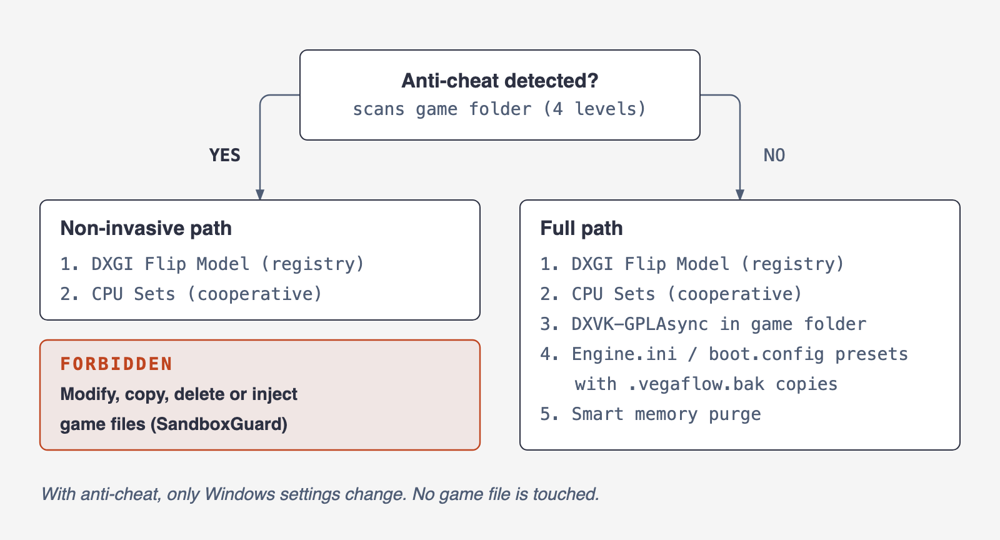

# Security: anti-cheat and SandboxGuard

**In short:** VegaFlow never injects code into games protected by anti-cheat, and it never edits their files. Every file and process action goes through one checker, `SandboxGuard`. Before a write, the checker works out the real location of the path, so a shortcut cannot send the write somewhere else. For example, before 2026-11-10 a junction (a folder shortcut) inside the temp folder that pointed to `System32` passed the check; the fix resolves the real location.

**Reader:** people

## 3. Absolute security against anti-cheat systems and the SandboxGuard subsystem

VegaFlow Universal enforces a strict, inviolable security policy: **under no circumstances will DLLs be injected or files of games protected by anti-cheat systems be modified.** Every operation on disk and on processes is governed by an isolation and containment model formalized in the [`SandboxGuard`](https://github.com/partprogramming09/vegaflow-universal/blob/main/src/windows/sandbox_guard.hpp) module.

### Signatures monitored in real time:
- **EasyAntiCheat**: `easyanticheat`, `EasyAntiCheat_EOS.dll`
- **BattlEye**: `battleye`, `beservice.exe`
- **Riot Vanguard**: `vanguard`, `vgk.sys`
- **HoYoverse Protect**: `hoyokprotect`, `mhyprot`, `mhypbase` (Zenless Zone Zero, Genshin Impact, Honkai: Star Rail)
- **Tencent AntiCheatExpert**: `anticheatexpert`, `randgrid.sys`, `acebase.dll`
- **Other integrity technologies**: `blackcipher`, `equ8`, `nprotect`, `gameguard`, `xigncode`

Any attempt to deploy DXVK or to overwrite files in a directory with these signatures is **rejected outright by the code** (`blocked_by_anticheat = true`), protecting the user's account from any risk of a ban.

### 3.1. Isolation and containment architecture: `SandboxGuard`
Implemented in [`src/windows/sandbox_guard.hpp`](https://github.com/partprogramming09/vegaflow-universal/blob/main/src/windows/sandbox_guard.hpp) and [`src/windows/sandbox_guard.cpp`](https://github.com/partprogramming09/vegaflow-universal/blob/main/src/windows/sandbox_guard.cpp), the `SandboxGuard` subsystem formalizes the **Zero-Trust File Access** security paradigm:

1. **Canonical normalization (`CanonicalizePath`)**:
   - `GetFullPathNameW` makes the path absolute and removes `.` and `..`.
   - The part of the path that already exists is opened and replaced by its real path (`GetFinalPathNameByHandleW`). This resolves junctions, symbolic links and 8.3 short names (`PROGRA~1`). Until 2026-11-10, the code used `weakly_canonical`, which under MinGW did **not** resolve junctions: a junction inside temp pointing to `System32` passed the check (measured on the laptop on 2026-11-10).
   - `\\?\C:\...` is treated as `C:\...`. Any other path starting with `\\` (network, `\\.\`, other forms of `\\?\`) is left as it is, and the decision rejects it for not being local.
   - It uppercases the drive letter and removes the trailing slash.

2. **Strict whitelist vs. system blacklist (inviolable priority)**:
   - **Blacklist (highest priority)**:
     - Categorical write block on disk roots (`C:\`, `D:\`) and on their direct child files (`C:\bootmgr`, `C:\test.txt`) (rule `drive_root`).
     - Critical operating system boot and paging files (`bootmgr`, `pagefile.sys`, `hiberfil.sys`, `swapfile.sys`, `ntldr`, `bootsect.bak`).
     - Windows and system directories (`GetWindowsDirectoryPath()`, `GetSystemDirectoryPath()`, `C:\Windows\System32`, `SysWOW64`, `WinSxS` and equivalents on any volume).
     - Shared system folders: `Program Files\Common Files` and `System Volume Information`.
   - **Where this rule lives:** the Rust core ([`path_policy.rs`](https://github.com/partprogramming09/vegaflow-universal/blob/main/rust/vegaflow-core/src/policy/path_policy.rs)) decides the blacklist classification, not C++. C++ canonicalizes the path, lowercases it with `towlower` (as it always did, so that it does not differ with non-ASCII text) and receives a verdict; the error messages stay the same. Rust and C++ are checked against the same case file, [`tests/vectors/sandbox_blacklist.tsv`](https://github.com/partprogramming09/vegaflow-universal/blob/main/tests/vectors/sandbox_blacklist.tsv) (52 cases; used by C++ Test 33 and by the Rust tests). Two behaviours that look strange are kept on purpose, because that is what the code did: `C:\WindowsApps` is blocked by the prefix `C:\Windows`, and a path `\\servidor\recurso` does not count as a disk root.
   - **Whitelist (allowed folders)**, compared folder by folder (`...\Local` does not allow `...\LocalOtraCosa`):
     - the folder of the VegaFlow executable (no longer its parent folder or the working folder);
     - `steamapps\common` of each Steam library listed in `libraryfolders.vdf` (no longer any path that contains `steamapps\common`). The Rust core ([`steam_library.rs`](https://github.com/partprogramming09/vegaflow-universal/blob/main/rust/vegaflow-core/src/policy/steam_library.rs)) reads the file once per run;
     - `%LOCALAPPDATA%`, the temp folder, `Documents\My Games` and `Saved Games`;
     - the folders registered at run time (`AddAllowedPath`) and the **read-only** ones (`AddReadOnlyPath`, for example the source DXVK DLLs: they can be read and copied, not written).
     - A folder on this list whose real path is not the path written (because it is a junction, a symbolic link or a volume mounted as a folder, or because it sits under one) **does not count**. The check uses a single resolution (`CanonicalizePath` compared with the path written with long names, case-insensitive), so changing the link midway does not help. The user who owns `Documents\My Games` or a Steam library could make it point to `C:\Program Files`, and the daemon, which runs elevated, would write there. The security review of phase 1 found this (2026-11-10); test 41 checked it in red before the fix.
     - It applies to the fixed folders, the Steam ones and the read-only ones. The `AddAllowedPath` ones (only the tests use them) are resolved when they are registered.
     - Cost: a Steam library on a disk mounted as a folder, a profile moved with a junction, or a VegaFlow installed under a link stop working (they are rejected with `NotWhitelisted`).
   - **One decision in Rust:** [`file_access.rs`](https://github.com/partprogramming09/vegaflow-universal/blob/main/rust/vegaflow-core/src/policy/file_access.rs) applies, in this order, the blacklist; "local paths only" (no device or network prefixes, no `:` streams, and only in the form that `CanonicalizePath` gives: no `/`, no double `\\` and no trailing slash, no names ending in `.` or a space, which includes `.` and `..`, and no NUL, because Windows would read those spellings as another path and the blacklist would not recognize them); the anti-cheat check (only on write); and the whitelist. An allowed folder that is a disk root, relative or on the network is ignored. C++ gathers the folders and checks the disk (anti-cheat); Rust decides. Shared cases: [`tests/vectors/file_access.tsv`](https://github.com/partprogramming09/vegaflow-universal/blob/main/tests/vectors/file_access.tsv) (C++ Test 40 and the Rust tests); Test 41 checks each whitelist flaw listed above on Windows.
   - **Remaining risk:** `libraryfolders.vdf` and the Steam path in the registry (`HKCU`) can be changed by the user. Adding a fake library only allows its `steamapps\common`, a folder that this user can already write, and never through a junction (see above). A hardlink inside an allowed folder that points to a protected file is not detected (the handle's path is the link's). It remains open, and it is not measured on the laptop whether a user without permissions on the file can create that hardlink.

3. **Quarantine and anti-cheat lockdown**:
   - If an active anti-cheat technology is detected through `DirectoryContainsAntiCheat` (a recursive scan of up to 4 levels of the folder tree) or `PathContainsAntiCheatSignature`, or if the flag `is_anticheat_protected = true` is passed explicitly, the sandbox activates an **immediate lockdown**:
   - Modify, copy and delete actions are denied unconditionally (`SandboxAction::Write`, `SandboxAction::Copy`, `SandboxAction::Delete`).
   - Only safe reading of metadata is allowed (`SandboxAction::Read`).

4. **Safe I/O wrappers** (`SafeWriteFile`, `SafeCopyFile`, `SafeRemoveFile`, `SafeReadFile`):
   - They first validate the path. Then they open the file with `CreateFileW` and **validate again the real path of the opened file** (`GetFinalPathNameByHandleW`). If that real path matches the one already validated, the decision (and the anti-cheat analysis) is not repeated; if it differs, the decision is made again with it. Only then do they change the content, through the same handle. In this way, a folder switched by a junction between the check and the opening is detected (test 42).
   - Writing does not empty the file on opening (`OPEN_ALWAYS`, not `CREATE_ALWAYS`): if the second check fails, the content stays intact, and a newly created file is deleted through its handle.
   - Copying reads the source through its handle (checked) and writes the destination the same way as `SafeWriteFile`; without `overwrite`, an existing destination is rejected (`CREATE_NEW`).
   - Deleting opens with `FILE_FLAG_OPEN_REPARSE_POINT` (a link deletes itself, never its target) and deletes through the handle.
   - What is left: missing intermediate folders are created before the second check. If someone changes a folder at that moment, empty folders may remain outside, but no file.

5. **`config.json`: safe reading and saving** (phase 1b, 2026-11-10). The daemon runs as administrator, so its configuration cannot come from a place that another account can write.
   - **One path only:** `<.exe folder>\config\config.json` ([`config_location.cpp`](https://github.com/partprogramming09/vegaflow-universal/blob/main/src/windows/config_location.cpp)), whatever folder it is started from. The installed copy is:
     - `C:\ProgramData\VegaFlow\config\config.json` when it is set up with `setup_tasks.ps1`, which copies the daemon and its config into that protected folder;
     - `C:\Program Files\VegaFlow\config\config.json` by default with the zip's `install.ps1` (its `-InstallDir` default).
   - **Only read if nobody else could have written it:** the `.exe` folder, the `config` folder and the file must be owned by SYSTEM, Administrators or TrustedInstaller, and no other account may have permission to write, delete or change permissions. C++ reads the owner and the DACL (the access list); [`folder_trust.rs`](https://github.com/partprogramming09/vegaflow-universal/blob/main/rust/vegaflow-core/src/policy/folder_trust.rs) decides. Otherwise, a warning is shown, the factory values are used, and nothing is saved. Running from a repository's `build\` folder (which the user can write to) always gives that warning. `setup_tasks.ps1` sets the owner to Administrators and, on reinstall, keeps an existing `config.json` only if its owner was already Administrators or SYSTEM before the permissions changed (one left earlier by another account is replaced with the repository's). A `config` folder or a file that does not exist yet does not count as untrusted; they are created inside the folder already checked.
   - **Own Rust reader, no dependencies** ([`json_text.rs`](https://github.com/partprogramming09/vegaflow-universal/blob/main/rust/vegaflow-core/src/policy/json_text.rs)): strict JSON (no comments, trailing commas or repeated keys, at most 64 levels), accepts the BOM that Notepad adds, and keeps the key order and the text of numbers. json.h was discarded because it fixed memory overflows on 5 and 8 November 2026.
   - **Rules** ([`config_rules.rs`](https://github.com/partprogramming09/vegaflow-universal/blob/main/rust/vegaflow-core/src/policy/config_rules.rs), cases in [`tests/vectors/config_rules.tsv`](https://github.com/partprogramming09/vegaflow-universal/blob/main/tests/vectors/config_rules.tsv)): ranges that keep the daemon working, not tuning advice (`poll_interval_ms` 250–60000, `min_free_ram_mb` and `min_standby_mb` 128–1048576, `cooldown_seconds` 10–3600, `max_game_disk_read_mb_s` 1–100000). A game name is an `.exe` with no path, which Windows reads as it is, that is not a device name (`CON`, `COM1`…) and is not a Windows process. The same rule applies to the `.exe` files that come from the Steam library.
   - **A bad value invalidates only its key** (it takes the factory value) and, like a corrupt file or one from a newer version, **blocks saving**: VegaFlow warns and does not overwrite until the person fixes it and restarts.
   - **Saving without losing anything** ([`config_file.rs`](https://github.com/partprogramming09/vegaflow-universal/blob/main/rust/vegaflow-core/src/policy/config_file.rs)): the file is re-read, unknown keys are kept at any level, `"version": 1` is written, and the file is replaced whole (`SafeReplaceFile`: temporary file, flush to disk and `MoveFileExW`), so a power cut leaves either the old file or the new one. If a known key was changed by hand since the file was opened, nothing is saved (a restart is requested). A file without `version` is in the previous format; its memory keys are also accepted at the top level, and on saving they move to `memory`.
   - Tests: 44 (fake port), 45 (vectors), 46 (real permissions) and 47 (save to disk and read back). Test 34 also checks that the constants shared with C++ (configuration keys and SID types) have the same values in Rust (`vf_rust_bridge_constants`).
   - Known limits and open items: "Pendiente heredado de la fase 1b" ("open item carried over from phase 1b") in the plan (working material, outside the repository).

6. **Audit and violation log (`SandboxViolationRecord`)**:
   - Each unauthorized access attempt records an event with a precise timestamp in milliseconds (`timestamp_ms`), the requested action (`SandboxAction`), the technical reason (`SandboxDenialReason`) and an explanatory message for forensic traceability.

7. **Safe editor for game `.ini` and `boot.config` files** (phase 2, 2026-11-12):
   - Every modification goes through [`ini_merge.rs`](https://github.com/partprogramming09/vegaflow-universal/blob/main/rust/vegaflow-core/src/policy/ini_merge.rs) in Rust and through [`FileSystem`](https://github.com/partprogramming09/vegaflow-universal/blob/main/src/ports/file_system.hpp) in C++ ([`engine_presets.cpp`](https://github.com/partprogramming09/vegaflow-universal/blob/main/src/optimize/steam/engine_presets.cpp), [`apu_shadow_config.cpp`](https://github.com/partprogramming09/vegaflow-universal/blob/main/src/optimize/steam/apu_shadow_config.cpp)).
   - A single backup, `.vegaflow.bak` (restore accepts a legacy `.bak` if `.vegaflow.bak` does not exist). If the backup fails before editing, the operation stops and the original file stays intact.
   - When restoring, the backup is copied and checked **byte for byte** before `.vegaflow.bak` is deleted.
   - It keeps UTF-8, UTF-8 with BOM, UTF-16 LE/BE with BOM and the original line endings (CRLF, LF or mixed). It only changes its own block (`; [VegaFlowUMA_Start]`..`; [VegaFlowUMA_End]`) or the keys indicated, collapses repeated keys in Unity's `boot.config`, and fails without deleting text if a closing marker is missing. Shared cases are in [`tests/vectors/ini/`](https://github.com/partprogramming09/vegaflow-universal/tree/main/tests/vectors/ini), and Test 48.

8. **Change journal and recovery after abnormal shutdowns** (phase 2b, 2026-11-12):
   - Defined in the ports [`ChangeJournal` and `SystemUndoPort`](https://github.com/partprogramming09/vegaflow-universal/blob/main/src/ports/change_journal.hpp), implemented in [`windows/change_journal.*`](https://github.com/partprogramming09/vegaflow-universal/blob/main/src/windows/change_journal.cpp) and orchestrated in [`session/restore.*`](https://github.com/partprogramming09/vegaflow-universal/blob/main/src/session/restore.cpp).
   - It is stored at `<.exe folder>\config\change_journal.vfj` through atomic replacement (`FileSystem::Replace`; TSV format with strict escaping and a full backup of the last 200 events).
   - **Before** changing a value (registry, power plan, memory compression, per-game DXGI, game configuration file, or the priority/affinity of a process, checking its creation time with `GetProcessTimes` to avoid PID reuse), a `PENDING` entry is written with its original state; **afterwards** it becomes `COMMITTED`.
   - If at startup the previous shutdown was not clean, or changes remain pending, it offers to revert them and reports exactly how many were reverted (`"Se devolvieron X de Y"`, the program's Spanish message, meaning "X of Y were reverted") and the manual steps for any that failed.
   - **Safe mode:** after two abnormal shutdowns in a row (`effective_unclean_streak_ >= 2`, computed from `consecutive_unclean_exits`), VegaFlow starts without applying new settings and warns. `--once` also restores its temporary settings when it exits.
   - A corrupt journal warns without blocking startup, and lets you use `--restore-registry` on the direct backups. Before the first registry change, it offers once to create a Windows restore point (`SRSetRestorePointW` in `srclient.dll`). Tests: 49 (fake port) and 50 (real disk and registry in `HKCU` + `Engine.ini`).
