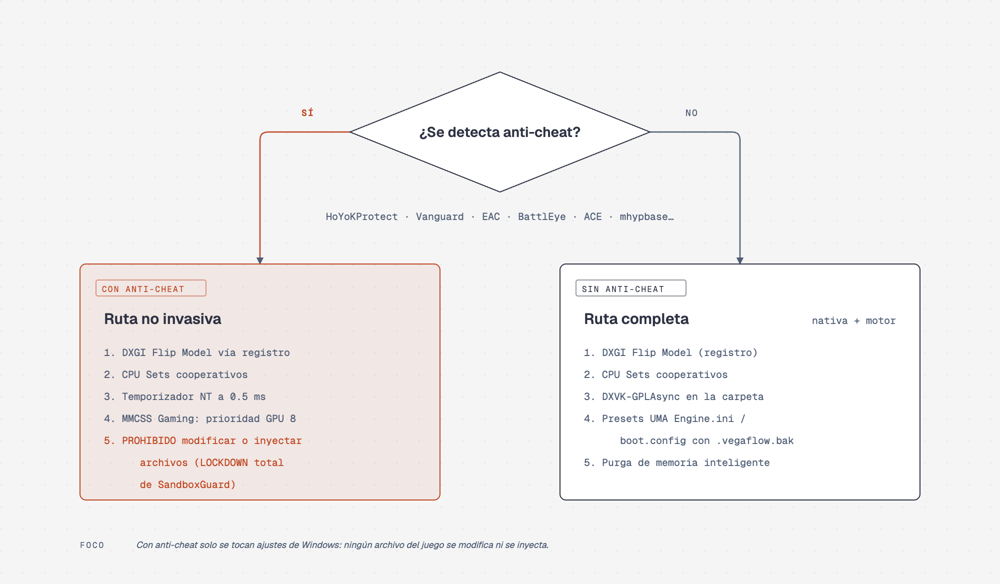

# Seguridad: anti-cheat y SandboxGuard

**Lector:** personas

## 3. Seguridad Absoluta Frente a Sistemas Anti-Cheat y Subsistema SandboxGuard

VegaFlow Universal implementa una política de seguridad estricta e inviolable: **bajo ninguna circunstancia se inyectarán DLLs ni se modificarán archivos de juegos protegidos por sistemas Anti-Cheat.** Toda operación sobre el disco y los procesos se rige por un modelo de aislamiento y contención formalizado en el módulo [`SandboxGuard`](https://github.com/partprogramming09/vegaflow-universal/blob/main/src/windows/sandbox_guard.hpp).

### Firmas Monitoreadas en Tiempo Real:
- **EasyAntiCheat**: `easyanticheat`, `EasyAntiCheat_EOS.dll`
- **BattlEye**: `battleye`, `beservice.exe`
- **Riot Vanguard**: `vanguard`, `vgk.sys`
- **HoYoverse Protect**: `hoyokprotect`, `mhyprot`, `mhypbase` (Zenless Zone Zero, Genshin Impact, Honkai: Star Rail)
- **Tencent AntiCheatExpert**: `anticheatexpert`, `randgrid.sys`, `acebase.dll`
- **Otras tecnologías de integridad**: `blackcipher`, `equ8`, `nprotect`, `gameguard`, `xigncode`

Cualquier intento de desplegar DXVK o sobreescribir archivos en un directorio con estas firmas es **rechazado en seco por el código** (`blocked_by_anticheat = true`), salvaguardando la cuenta del usuario de cualquier riesgo de baneo.

### 3.1. Arquitectura de Aislamiento y Contención: `SandboxGuard`
Implementado en [`src/windows/sandbox_guard.hpp`](https://github.com/partprogramming09/vegaflow-universal/blob/main/src/windows/sandbox_guard.hpp) y [`src/windows/sandbox_guard.cpp`](https://github.com/partprogramming09/vegaflow-universal/blob/main/src/windows/sandbox_guard.cpp), el subsistema `SandboxGuard` formaliza el paradigma de seguridad **Zero-Trust File Access**:

1. **Normalización Canónica (`CanonicalizePath`)**:
   - `GetFullPathNameW` vuelve absoluta la ruta y quita `.` y `..`.
   - La parte de la ruta que ya existe se abre y se cambia por su ruta real (`GetFinalPathNameByHandleW`): así se resuelven junctions, enlaces simbólicos y nombres cortos 8.3 (`PROGRA~1`). Hasta 2026-11-10 se usaba `weakly_canonical`, que con MinGW **no** resolvía junctions: un junction dentro de temp hacia `System32` pasaba la comprobación (medido en el laptop el 2026-11-10).
   - `\\?\C:\...` se trata como `C:\...`. Cualquier otra ruta que empiece por `\\` (red, `\\.\`, otras formas de `\\?\`) se deja igual y la decisión la rechaza por no ser local.
   - Pone la letra de unidad en mayúscula y quita la barra final.

2. **Whitelist Estricta vs Blacklist de Sistema (Prioridad Inviolable)**:
   - **Blacklist (Máxima Prioridad)**:
     - Bloqueo categórico de escritura en la raíz de unidades de disco (`C:\`, `D:\`) y archivos hijo directos (`C:\bootmgr`, `C:\test.txt`) (regla `drive_root`).
     - Archivos críticos de arranque y paginación del sistema operativo (`bootmgr`, `pagefile.sys`, `hiberfil.sys`, `swapfile.sys`, `ntldr`, `bootsect.bak`).
     - Directorios de Windows y del Sistema (`GetWindowsDirectoryPath()`, `GetSystemDirectoryPath()`, `C:\Windows\System32`, `SysWOW64`, `WinSxS` y equivalentes en cualquier volumen).
     - Carpetas de sistema compartidas: `Program Files\Common Files` y `System Volume Information`.
   - **Dónde vive esta regla:** la clasificación de la blacklist la decide el núcleo Rust ([`path_policy.rs`](https://github.com/partprogramming09/vegaflow-universal/blob/main/rust/vegaflow-core/src/policy/path_policy.rs)), no C++. C++ canonicaliza la ruta, la pasa a minúsculas con `towlower` (igual que siempre, para no diferir con texto no ASCII) y recibe un veredicto; los mensajes de error siguen siendo los mismos. Rust y C++ se comprueban con el mismo archivo de casos, [`tests/vectors/sandbox_blacklist.tsv`](https://github.com/partprogramming09/vegaflow-universal/blob/main/tests/vectors/sandbox_blacklist.tsv) (52 casos; los usan la prueba 33 de C++ y las pruebas de Rust). Dos comportamientos que parecen raros se conservan a propósito porque es lo que hacía el código: `C:\WindowsApps` se bloquea por prefijo de `C:\Windows`, y una ruta `\\servidor\recurso` no cuenta como raíz de disco.
   - **Lista blanca (carpetas permitidas)**, comparadas carpeta por carpeta (`...\Local` no permite `...\LocalOtraCosa`):
     - la carpeta del ejecutable de VegaFlow (ya no su carpeta padre ni la carpeta de trabajo);
     - `steamapps\common` de cada biblioteca de Steam listada en `libraryfolders.vdf` (ya no cualquier ruta que contenga `steamapps\common`). El archivo lo lee el núcleo Rust ([`steam_library.rs`](https://github.com/partprogramming09/vegaflow-universal/blob/main/rust/vegaflow-core/src/policy/steam_library.rs)) una vez por ejecución;
     - `%LOCALAPPDATA%`, la carpeta temporal, `Documents\My Games` y `Saved Games`;
     - las carpetas registradas en ejecución (`AddAllowedPath`) y las de **solo lectura** (`AddReadOnlyPath`, por ejemplo las DLL de origen de DXVK: se pueden leer y copiar, no escribir).
     - Una carpeta de esta lista cuya ruta real no sea la ruta escrita (por ser un junction, un enlace simbólico o un volumen montado en carpeta, o estar debajo de uno) **no cuenta**. Se decide con una sola resolución (`CanonicalizePath` comparada con la ruta escrita con nombres largos, sin distinguir mayúsculas), así que cambiar el enlace a mitad no sirve. El usuario dueño de `Documents\My Games` o de una biblioteca de Steam podría hacerla apuntar a `C:\Program Files` y el daemon, que corre elevado, escribiría allí. Lo encontró la revisión de seguridad de la fase 1 (2026-11-10); la prueba 41 lo comprobó en rojo antes del arreglo.
     - Vale para las carpetas fijas, las de Steam y las de solo lectura. Las de `AddAllowedPath` (solo las usan las pruebas) se resuelven al registrarlas.
     - Coste: una biblioteca de Steam en un disco montado como carpeta, un perfil movido con un junction o un VegaFlow instalado bajo un enlace dejan de servir (se rechaza con `NotWhitelisted`).
   - **Una sola decisión en Rust:** [`file_access.rs`](https://github.com/partprogramming09/vegaflow-universal/blob/main/rust/vegaflow-core/src/policy/file_access.rs) aplica, en este orden, la lista negra, "solo rutas locales" (sin prefijos de dispositivo o red, sin flujos `:`, y solo en la forma que da `CanonicalizePath`: sin `/`, sin `\\` doble ni barra final, sin nombres que acaben en `.` o espacio —eso incluye `.` y `..`— y sin NUL, porque Windows leería esas grafías como otra ruta y la lista negra no las reconocería), el anti-cheat (solo al escribir) y la lista blanca. Una carpeta permitida que sea la raíz de un disco, relativa o de red se ignora. C++ reúne las carpetas y mira el disco (anti-cheat); Rust decide. Casos compartidos: [`tests/vectors/file_access.tsv`](https://github.com/partprogramming09/vegaflow-universal/blob/main/tests/vectors/file_access.tsv) (prueba 40 de C++ y pruebas de Rust); la prueba 41 comprueba cada fallo de la lista blanca anterior en Windows.
   - **Riesgo que queda:** `libraryfolders.vdf` y la ruta de Steam del registro (`HKCU`) los puede cambiar el usuario. Sumar una biblioteca falsa solo permite su `steamapps\common`, una carpeta que ese usuario ya puede escribir, y nunca a través de un junction (ver arriba). Un hardlink dentro de una carpeta permitida hacia un archivo protegido no se detecta (la ruta del handle es la del enlace); queda abierto y sin medir en el laptop si un usuario sin permisos sobre el archivo puede crear ese hardlink.

3. **Cuarentena y Lockdown Anti-Cheat**:
   - Si se detecta una tecnología de anti-cheat activa a través de `DirectoryContainsAntiCheat` (escaneo recursivo de hasta 4 niveles superiores en el árbol de carpetas) o `PathContainsAntiCheatSignature`, o si se pasa explícitamente el flag `is_anticheat_protected = true`, el sandbox activa un **Lockdown Inmediato**:
   - Se deniegan incondicionalmente las acciones de modificación, copia o borrado (`SandboxAction::Write`, `SandboxAction::Copy`, `SandboxAction::Delete`).
   - Solo se permite la lectura segura de metadatos (`SandboxAction::Read`).

4. **Wrappers Seguros de I/O** (`SafeWriteFile`, `SafeCopyFile`, `SafeRemoveFile`, `SafeReadFile`):
   - Primero validan la ruta. Después abren el archivo con `CreateFileW` y **vuelven a validar la ruta real del archivo abierto** (`GetFinalPathNameByHandleW`). Si esa ruta real coincide con la ya validada no se repite la decisión (ni el análisis de anti-cheat); si difiere, se decide de nuevo con ella. Solo entonces cambian el contenido, por el mismo handle. Así, una carpeta cambiada por un junction entre la comprobación y la apertura se detecta (prueba 42).
   - Escribir no vacía el archivo al abrirlo (`OPEN_ALWAYS`, no `CREATE_ALWAYS`): si la segunda comprobación falla, el contenido queda intacto, y un archivo recién creado se borra por su handle.
   - Copiar lee el origen por su handle (comprobado) y escribe el destino igual que `SafeWriteFile`; sin `overwrite`, un destino existente se rechaza (`CREATE_NEW`).
   - Borrar abre con `FILE_FLAG_OPEN_REPARSE_POINT` (un enlace se borra a sí mismo, nunca su destino) y borra por handle.
   - Lo que queda: las carpetas intermedias que faltan se crean antes de la segunda comprobación; si alguien cambia una carpeta en ese momento, pueden quedar carpetas vacías fuera, pero ningún archivo.

5. **`config.json`: lectura y guardado seguros** (fase 1b, 2026-11-10). El daemon corre como administrador, así que su configuración no puede venir de un sitio que otra cuenta pueda escribir.
   - **Una sola ruta:** `<carpeta del .exe>\config\config.json` ([`config_location.cpp`](https://github.com/partprogramming09/vegaflow-universal/blob/main/src/windows/config_location.cpp)), dé igual desde qué carpeta se arranque. La instalada es `C:\ProgramData\VegaFlow\config\config.json`.
   - **Solo se lee si nadie más pudo escribirlo:** la carpeta del `.exe`, la de `config` y el archivo deben tener como dueño a SYSTEM, Administradores o TrustedInstaller, y ninguna otra cuenta un permiso de escribir, borrar o cambiar permisos. C++ lee el dueño y la DACL; decide [`folder_trust.rs`](https://github.com/partprogramming09/vegaflow-universal/blob/main/rust/vegaflow-core/src/policy/folder_trust.rs). Si no, se avisa, se usan los valores de fábrica y no se guarda nada. Ejecutar desde `build\` de un repositorio (que el usuario puede escribir) da siempre ese aviso. `setup_tasks.ps1` fija el dueño en Administradores y, al reinstalar, conserva un `config.json` existente solo si su dueño ya era Administradores o SYSTEM antes de cambiar los permisos (uno dejado antes por otra cuenta se reemplaza por el del repositorio). Una carpeta `config` o un archivo que aún no existen no cuentan como no confiables; se crean dentro de la carpeta ya comprobada.
   - **Lector propio en Rust, sin dependencias** ([`json_text.rs`](https://github.com/partprogramming09/vegaflow-universal/blob/main/rust/vegaflow-core/src/policy/json_text.rs)): JSON estricto (sin comentarios, comas finales ni claves repetidas, como mucho 64 niveles), acepta el BOM que añade el Bloc de notas y conserva el orden de las claves y el texto de los números. Se descartó json.h porque corrigió desbordamientos de memoria el 5 y el 8 de noviembre de 2026.
   - **Reglas** ([`config_rules.rs`](https://github.com/partprogramming09/vegaflow-universal/blob/main/rust/vegaflow-core/src/policy/config_rules.rs), casos en [`tests/vectors/config_rules.tsv`](https://github.com/partprogramming09/vegaflow-universal/blob/main/tests/vectors/config_rules.tsv)): rangos que mantienen el daemon funcionando, no consejos de ajuste (`poll_interval_ms` 250–60000, `timer_resolution_ns100` 5000–156250, `min_free_ram_mb` y `min_standby_mb` 128–1048576, `cooldown_seconds` 10–3600, `max_game_disk_read_mb_s` 1–100000). Un nombre de juego es un `.exe` sin ruta, que Windows lee tal cual, que no es un nombre de dispositivo (`CON`, `COM1`…) ni un proceso de Windows. La misma regla se aplica a los `.exe` que salen de la biblioteca de Steam.
   - **Un valor malo invalida solo su clave** (toma el valor de fábrica) y, como un archivo corrupto o de una versión más nueva, **bloquea el guardado**: VegaFlow avisa y no sobrescribe hasta que la persona lo corrija y reinicie.
   - **Guardar sin perder nada** ([`config_file.rs`](https://github.com/partprogramming09/vegaflow-universal/blob/main/rust/vegaflow-core/src/policy/config_file.rs)): se relee el archivo, se conservan las claves desconocidas en cualquier nivel, se escribe `"version": 1` y se reemplaza entero (`SafeReplaceFile`: temporal, vaciado a disco y `MoveFileExW`), así que un corte deja el archivo viejo o el nuevo. Si una clave conocida cambió a mano desde que se abrió, no se guarda (se pide reiniciar). Un archivo sin `version` es del formato anterior; sus claves de memoria se aceptan también en el nivel superior y al guardar pasan a `memory`.
   - Pruebas: 44 (puerto falso), 45 (vectores), 46 (permisos reales) y 47 (guardar en disco y releer); la 34 comprueba además que las constantes compartidas con C++ (claves de configuración y tipos de SID) valen lo mismo en Rust (`vf_rust_bridge_constants`).
   - Límites conocidos y pendientes: «Pendiente heredado de la fase 1b» del plan (material de trabajo, fuera del repo).

6. **Auditoría y Registro de Violaciones (`SandboxViolationRecord`)**:
   - Cada intento de acceso no autorizado registra un evento con marca de tiempo precisa en milisegundos (`timestamp_ms`), la acción solicitada (`SandboxAction`), el motivo técnico (`SandboxDenialReason`) y un mensaje explicativo para trazabilidad forense.

7. **Editor seguro de `.ini` y `boot.config` de juegos** (fase 2, 2026-11-12):
   - Toda modificación pasa por [`ini_merge.rs`](https://github.com/partprogramming09/vegaflow-universal/blob/main/rust/vegaflow-core/src/policy/ini_merge.rs) en Rust y por [`FileSystem`](https://github.com/partprogramming09/vegaflow-universal/blob/main/src/ports/file_system.hpp) en C++ ([`engine_presets.cpp`](https://github.com/partprogramming09/vegaflow-universal/blob/main/src/optimize/steam/engine_presets.cpp), [`apu_shadow_config.cpp`](https://github.com/partprogramming09/vegaflow-universal/blob/main/src/optimize/steam/apu_shadow_config.cpp)).
   - Copia de seguridad única `.vegaflow.bak` (la restauración acepta `.bak` heredada si no existe `.vegaflow.bak`). Si la copia falla antes de editar, la operación se detiene y el archivo original queda intacto.
   - Al restaurar se copia el respaldo y se comprueba igualdad **byte a byte** antes de borrar `.vegaflow.bak`.
   - Conserva UTF-8, UTF-8 con BOM, UTF-16 LE/BE con BOM y finales de línea originales (CRLF, LF o mezclados), solo modifica su bloque (`; [VegaFlowUMA_Start]`..`; [VegaFlowUMA_End]`) o las claves indicadas, colapsa claves repetidas en `boot.config` de Unity y falla sin borrar texto si falta un marcador de cierre. Casos compartidos en [`tests/vectors/ini/`](https://github.com/partprogramming09/vegaflow-universal/tree/main/tests/vectors/ini) y Prueba 48.

8. **Diario de cambios y recuperación ante cierres anormales** (fase 2b, 2026-11-12):
   - Definido en los puertos [`ChangeJournal` y `SystemUndoPort`](https://github.com/partprogramming09/vegaflow-universal/blob/main/src/ports/change_journal.hpp), implementado en [`windows/change_journal.*`](https://github.com/partprogramming09/vegaflow-universal/blob/main/src/windows/change_journal.cpp) y orquestado en [`session/restore.*`](https://github.com/partprogramming09/vegaflow-universal/blob/main/src/session/restore.cpp).
   - Se guarda en `<carpeta del .exe>\config\change_journal.vfj` mediante reemplazo atómico (`FileSystem::Replace`, formato TSV con escapado estricto y respaldo completo de los últimos 200 eventos).
   - **Antes** de modificar un valor (registro, plan de energía, compresión de memoria, DXGI por juego, archivo de configuración de juego o prioridad/afinidad de un proceso comprobando su hora de creación `GetProcessTimes` para evitar reutilización de PID), se escribe una entrada `PENDING` con su estado original; **después** pasa a `COMMITTED`.
   - Si al arrancar el cierre anterior no fue limpio o quedan cambios pendientes, ofrece devolverlos e informa exactamente cuántos se devolvieron (`"Se devolvieron X de Y"`) y los pasos manuales de los que fallen.
   - **Modo seguro:** tras dos cierres anormales seguidos (`consecutive_unclean_exits >= 2`), VegaFlow arranca sin aplicar ajustes nuevos y avisa. `--once` también restaura sus ajustes temporales al salir.
   - Un diario corrupto avisa sin bloquear el arranque y permite usar `--restore-registry` sobre los respaldos directos. Antes del primer cambio de registro ofrece una sola vez crear un punto de restauración de Windows (`SRSetRestorePointW` en `srclient.dll`). Pruebas: 49 (puerto falso) y 50 (disco y registro real en `HKCU` + `Engine.ini`).

