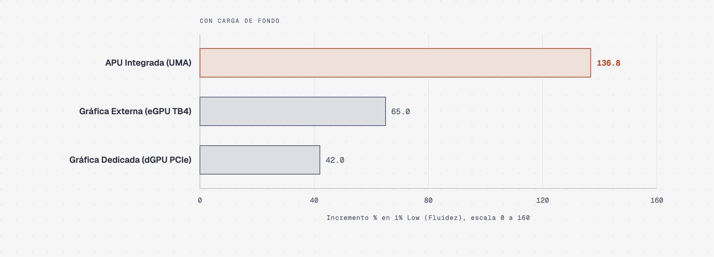
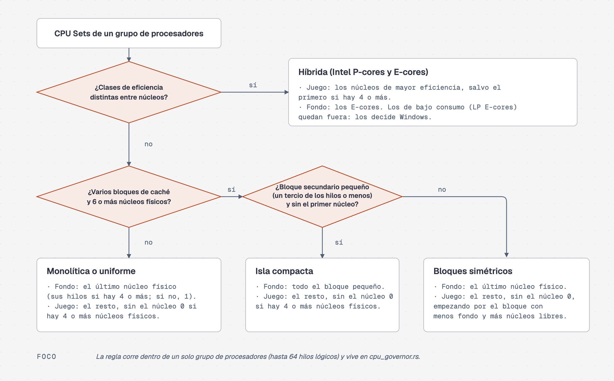

# Does the same problem happen on Intel and with a dedicated graphics card?

**In short:** the same kind of slowdown can happen on any processor brand and with any graphics setup, because the causes are shared: the processor's cache, the graphics card's waiting time, the storage queue and the shared power budget.
How it shows up depends on the chip, and on whether the graphics are built into the processor, sit inside the PC, or are external.
For example, when a browser thread pauses the game's render thread for 8 milliseconds, even a high-end graphics card runs out of work and stalls.

**Reader:** people

A basic design question in system optimization is: **does this contention phenomenon happen only on AMD APUs with integrated graphics, or does it also happen on Intel Core processors and on PCs with dedicated (dGPU) or external (eGPU) graphics cards?**

The physical and architectural evidence shows that **the contention pattern is universal**, although the physical channels through which performance degrades vary with the internal topology of the processor and with the graphics bus.

---

## 3.1 The Universal Pattern of the Problem (Independent of Brand and Graphics Setup)

Regardless of whether the processor is AMD or Intel, or whether graphics run on an integrated GPU (iGPU), an internal dedicated GPU (dGPU) or an external GPU (eGPU), there are **four universal physical laws of modern von Neumann architecture** that govern performance:

1. **Last-Level Cache Contention (LLC / L3 Thrashing) and TLB Flushing:**  
   On any x86-64 processor, the L3 cache is shared by several cores or by a group of cores (*Core Complex* - CCX). When background threads are interleaved by the scheduler, they evict the data and instruction lines of the render loop. An L3 miss forces a full transaction on the physical memory bus, multiplying access latency by a factor of **`7x` to `9x`**. Likewise, a context switch between different processes invalidates the entries of the address translation buffer (*Translation Lookaside Buffer* - TLB), forcing costly walks of the page tables (*Page Table Walks*).
2. **GPU Starvation from Interrupted Dispatch:**  
   A modern dedicated graphics card (for example an NVIDIA GeForce RTX 4080 or an AMD Radeon RX 7900 XT) can process hundreds of frames per second, but **it cannot produce a single pixel unless the CPU first builds and dispatches the command lists of the graphics API (`ID3D11DeviceContext`, `ID3D12GraphicsCommandList`, `VkCommandBuffer`)**. If the `RenderThread` suffers a preemption of `8 milliseconds` because of a browser thread, the GPU runs out of its work buffer and stops dead. This explains why systems with high-end graphics cards suffer severe micro-freezes in competitive games when background applications are not isolated.
3. **Contention in NVMe Storage Controllers and I/O Buffers:**  
   Modern game engines continuously read textures and geometry in the background, through asynchronous streaming or *DirectStorage*. If background processes read or write to disk at standard priority, they compete in the NVMe controller queue. This delays texture delivery and forces synchronization pauses on the main thread.
4. **Dynamic Shared Power Budget:**  
   Both AMD's **STAPM/PPT** algorithm and Intel's **PL1/PL2/Tau** limits work by measuring the total electrical and thermal consumption of the chip package. When background processes run complex vector instructions (such as AVX2 or web decoding) on secondary cores, they force the voltage regulator to push current into those cores. This lowers the *Volt/Frequency Curve* of the game's primary cores.

---

## 3.2 Specific Architectural Differences: AMD Ryzen vs. Intel Core

Although the contention problem is universal, the internal anatomy of AMD and Intel processors poses specific challenges:

### A. Anatomy of AMD Ryzen Processors:
1. **Monolithic APUs (*Renoir*, *Lucienne*, *Cezanne*, *Barcelo*, *Rembrandt*, *Phoenix*, *Hawk Point* families):**  
   - They have a single silicon die where the CPU and the Radeon GPU coexist.
   - The L3 cache is usually more compact than in desktop processors (`8 MB` or `16 MB`).
   - The **Infinity Fabric (FCLK)** bus carries both the memory requests of the compute cores and the whole flow of commands and textures from the iGPU to the unified memory controller (UMC). If background processes saturate the bus or evict the L3, they hit the compute performance and the graphics processor's bandwidth at the same time.
2. **Multi-CCD / Chiplet Processors and the X3D Line (Desktop Ryzen 9 and Ryzen 7 X3D):**  
   - The processor is physically split into several compute dies (*Core Complex Dies* - CCDs) connected through a central I/O die (*I/O Die*).
   - **Cross-CCD penalty:** crossing from one CCD to another to read memory or synchronize threads adds a latency penalty of more than **`70–80 ns`**. If the Windows scheduler moves background threads or game threads between different CCDs, the frametime swings destructively.
   - **X3D asymmetry:** in processors such as the Ryzen 9 7950X3D or 7900X3D, only `CCD 0` has the stacked 3D V-Cache memory (`96 MB`), while `CCD 1` runs at higher frequencies but with conventional cache. VegaFlow's isolation confines background processes to the secondary CCD, keeping the whole 3D V-Cache for the game.

### B. Anatomy of Intel Core Processors:
1. **Heterogeneous Hybrid Architecture (12th, 13th, 14th Gen *Alder Lake* / *Raptor Lake*, and *Core Ultra* families):**  
   - It integrates high-performance cores (**P-Cores**) and high-efficiency cores (**E-Cores**).
   - The **Intel Thread Director** subsystem and the Windows scheduler try to classify tasks and move background processes to the E-Cores. However, in real gaming scenarios two **documented critical failures** occur:
     * **Ring Bus Topology and L3 Smart Cache Pollution:** In Intel designs, the P-Cores, the E-Core clusters and the integrated GPU are connected through one **Ring Bus** and share a single pool of **Intel Smart Cache L3**. When the E-Cores run heavy background loads (Chromium tabs with multimedia, decompression in download clients), they flood the Ring Bus with cache-coherence transactions and **evict the shared L3 lines that the P-Cores need for the game**. Worse still, Intel's thermal controller lowers the clock of the ring itself (*Ring/Uncore Downbinning*) to limit the power draw of the E-Cores, which takes effective bandwidth away from the P-Cores.
     * **False Positives in Classification (Processes with Hidden Windows or Services):** Electron-based client applications (such as Discord, Spotify, Steam) or capture tools often are not classified as pure background tasks by the operating system if they keep active windows or invoke interface threads. They end up interleaved on the **P-Cores** and steal time slices from the game's main thread. By imposing, through VegaFlow, **strict affinity on the last E-Cores + `EcoQoS` + `I/O VeryLow` priority**, any ambiguity for the scheduler is removed.
2. **Traditional Homogeneous Intel Processors (8th to 11th Gen *Skylake*, *Comet Lake*, *Tiger Lake*):**  
   - All cores are equivalent and share the Ring Bus. Without explicit confinement, noisy tasks jump indiscriminately between all available cores, reproducing exactly the same cache-eviction pattern observed on AMD APUs.

---

## 3.3 Architectural Impact Matrix and Comparative Diagrams

### Table 3.1: Comparative Matrix by Processor Family
| Processor Family | Silicon Structure | Primary Bottleneck Without Isolation | Optimal VegaFlow Action | Measured / Expected Impact |
| :--- | :--- | :--- | :--- | :--- |
| **AMD APU Monolithic** *(Ryzen 4000/5000/7000/8000 U/H)* | Single die, L3 of 8–16 MB, UMA bus shared with Radeon Vega/RDNA | Simultaneous saturation of the Infinity Fabric bus and L3 eviction; clock drop due to STAPM. | Background confinement to 2 threads of the last core + `EcoQoS` + `I/O VeryLow`. | **+80% to +117% average FPS and +136% in 1% Low** under heavy load. |
| **AMD Desktop Multi-CCD / X3D** *(Ryzen 7000/9000X / X3D)* | 2 CCD dies + central I/O Die; 3D V-Cache asymmetry on CCD0. | Cross-CCD interconnect traffic and contamination of the 96 MB 3D V-Cache. | Confine background to the secondary CCD (frequency cores), isolating CCD0 for the game. | Elimination of stutter from inter-CCD hops; frametime consistency (`1% Low` shielded). |
| **Intel Hybrid P+E** *(12th to 14th Gen and Core Ultra)* | P-Cores and E-Cores sharing the same Ring Bus and Smart Cache L3. | Flooding of the Ring Bus by the E-Cores, Uncore frequency drop and classification false positives. | Force background onto the last 2 E-Cores with `EcoQoS` + `I/O VeryLow`; P-Cores 100% clean. | Main thread shielded on the P-Cores; Ring Bus stabilized at maximum frequency. |
| **Intel Homogeneous** *(8th to 11th Gen Core i5/i7/i9)* | All cores are identical P-Cores on a ring bus. | Background threads competing symmetrically for time slices and polluting the L3. | Background confinement to the last physical core (2 SMT threads) + `EcoQoS`. | Recovery of `1% Low` and reduced dispatch latency in graphics APIs. |

---

### Table 3.2: Comparative Matrix by Type of Graphics Solution (iGPU vs. dGPU vs. eGPU)
| Graphics Configuration | Connection Interface and Memory | Physical Challenge Without Isolation | VegaFlow Runtime Behavior | Impact on the Gaming Experience |
| :--- | :--- | :--- | :--- | :--- |
| **💻 Integrated Graphics (iGPU UMA)** *(Radeon Vega, 680M/780M, Intel Iris Xe/Arc)* | Shared system RAM bus (narrow bandwidth ~40–80 GB/s) | The processor and the graphics compete for the same memory bus and the same power limit (15W–45W). | The 4 full barriers are activated + UMA memory settings and a controlled purge of the Standby List. | 🔥 **Massive impact (+100% to +150% under load):** doubles the frame rate and stabilizes frametime. |
| **🖥️ Internal Dedicated Graphics (dGPU)** *(NVIDIA RTX, AMD Radeon RX over PCIe x16)* | Dedicated PCIe x8/x16 bus (nanosecond latency, own GDDR6 VRAM >250 GB/s) | The dGPU does not suffer from VRAM, but it starves (*GPU Starvation*) if the CPU interrupts command dispatch. | UMA optimizations are switched off automatically (`Pass-Through Guard`). Spatial and I/O isolation is kept. | ✅ **High impact on smoothness (+20% to +50% in 1% Low):** removes micro-stutter in competitive titles and open worlds. |
| **🔌 External Cable Graphics (eGPU)** *(External enclosure via Thunderbolt 3/4, USB4 or OCuLink)* | PCIe link encapsulated over cable (limited to about PCIe x4 ~32 Gbps real, with high packet latency) | Each frame requires continuous DMA transfers over the cable. CPU interrupts on the laptop cause severe link drops. | CPU isolation and NT I/O priority are activated, and the registry is set to `PCIe ASPM = 0` and `FlipQueueSize = 1`. | 🔥 **Critical impact (+40% to +75% in 1% Low):** keeps the Thunderbolt tunnel awake, without power-saving pauses. |

---

## 3.4 Two Layers: Simple Explanation with Everyday Analogies

### A. The Factory with Fast Specialists and Helpers (AMD vs. Intel)
* **In Hybrid Intel Processors (P-Cores and E-Cores):**  
  Imagine a modern factory with **ultra-fast specialist workers (P-Cores)** and **support helpers (E-Cores)**. All of them must walk down the **same narrow central corridor (the Ring Bus)** and use the tools from the **same common shelf (the Smart Cache L3)**. If the support helpers start moving messy boxes down the central corridor without supervision, they block the specialists' way and mess up the tool shelf. As a result, the fast specialists have to stop and wait for the corridor to clear. VegaFlow acts as the plant supervisor: **it confines the helpers to a fixed corner of the warehouse and forbids them from invading the central corridor during production hours**, so the specialists work at full speed without interruptions.
* **In AMD Processors with Several Modules (Multi-CCD / Chiplets):**  
  Imagine the factory has **two separate buildings connected by an outdoor bridge**. Building 1 holds the main workshop with all the special parts (the 3D V-Cache). If the plant boss lets workers keep crossing the bridge from one building to the other to carry notes and secondary tools, a huge amount of time is lost on the way. VegaFlow makes sure all the game's work stays inside Building 1, and leaves Building 2 exclusively for secondary administrative tasks.

### B. The Adjoining Kitchen and the Narrow Bridge (iGPU vs. dGPU vs. eGPU)
* **With Integrated Graphics (iGPU / APU):**  
  The head chef (CPU) and the pastry chef in charge of the final decoration (iGPU) are squeezed **inside the same small kitchen**, sharing the same work table (the shared system RAM) and the same power outlet (15W to 45W). When VegaFlow removes the intruders from the kitchen, **both breathe easier**: the head chef cooks twice as fast, and the pastry chef has more room on the table and more energy to bake. That is why the FPS doubles (**+117%**).
* **With Internal Dedicated Graphics (dGPU):**  
  Now the pastry chef (the dedicated graphics card) has moved to **its own huge banquet hall next door**, with its own enormous marble table (its own high-speed VRAM) and its own power generator. They no longer compete for the table or for the electricity. However, the giant pastry chef **still depends 100% on the head chef sending each dish's order on time**. If the intruders distract the head chef in the kitchen, the giant pastry chef stands still with arms folded, staring at the door. The guests in the restaurant then suffer pauses and annoying stutters in service (`1% Low`). By shielding the head chef's kitchen with VegaFlow, the orders flow continuously and the dedicated graphics card works at its full capacity.
* **With External Cable Graphics (eGPU):**  
  Here the giant pastry chef is **in a building across the street**, and the central processor's chef has to send the trays through a **narrow single-lane bridge (the Thunderbolt or USB4 cable)**. Because the bridge is narrow, any small hesitation or delay by the chef when loading the van causes an instant jam that spreads along the whole bridge. For this physical reason, avoiding CPU interruptions and stopping the bridge from switching off its lights to save energy (`PCIe ASPM = 0`) matters even more with an external graphics card than in an ordinary desktop computer.

---

## 3.5 What the Code Decides on Each Machine (phases 3 and 7)

**The essentials:** the pattern is universal, but what VegaFlow does depends on two rules written in Rust, with no Windows calls and with the same test cases in Rust and C++: **what kind of graphics card is present** ([`device_profile.rs`](https://github.com/partprogramming09/vegaflow-universal/blob/main/rust/vegaflow-core/src/policy/device_profile.rs), phase 3) and **how the cores are split** ([`cpu_governor.rs`](https://github.com/partprogramming09/vegaflow-universal/blob/main/rust/vegaflow-core/src/policy/cpu_governor.rs), phase 7). Tables 3.1 and 3.2 say what is expected per family; this section says what the code does today.

> [!NOTE]
> Two points in tables 3.1 and 3.2 do not match the code, and are pending a decision on whether to correct the text or the code: the code has no rule of its own for X3D processors (it splits by cache and core, without knowing which one carries the V-Cache), and on an eGPU what is specific to it (streaming settings) is only activated with an experimental option. The impact figures in those tables do not have a linked source in this document.

### Phase 3: machine profile and GPU connection type

**Example.** A laptop plugged in, with an RTX connected over PCIe. DXCore (the Windows interface that describes video adapters) says the RTX is neither integrated nor removable, so it counts as **dedicated**. The profile selects it, applies no visual cuts and no shared-memory (UMA) protection, and gives level 4. The same laptop with a Thunderbolt enclosure: Windows marks the enclosure as removable, it counts as **external** and, without a preference from the user, it takes priority over both the dedicated and the integrated card.

The rule takes what the probe read (graphics cards, RAM, cores, power, Windows architecture, CPU family and model) and returns a decision. Four steps:

1. **Connection type of each graphics card:**

   | What Windows reports | Connection |
   | --- | --- |
   | DXCore says "removable", or SetupAPI says it can be removed (unless DXCore also says it is integrated) | External |
   | DXCore available and says "integrated" | Integrated |
   | DXCore available and not integrated | Dedicated |
   | No DXCore | Unknown |

2. **Which graphics card takes priority** if there are several: the user's preference (power saving: the first integrated one; high performance: the external one, then the dedicated one). Without a preference: external, dedicated, integrated and, if none fits, the first one.
3. **Generation and level:** only integrated cards are identified by generation (Vega, RDNA2, RDNA3 or later, Intel UHD, Intel Xe/Arc), first by the exact PCI identifier, then by the driver name and, as a last resort, by CPU family and model. With that, `apu_tier.rs` gives the level from 1 to 4 (dedicated and NVIDIA are level 4; see [`hardware-and-tiers/`](./hardware-and-tiers/)). The level also sets the safe VRAM pool, the tessellation cap and the DXVK threads.
4. **What is activated depending on the connection:**

   | Decision | Integrated | Dedicated | External | Unknown |
   | --- | --- | --- | --- | --- |
   | Visual cuts | Yes | No | No | No |
   | UMA memory protection (if the RAM could be read) | Yes | No | No | No |
   | Change of the VRAM reported by the driver (AMD only, and without a block) | Yes | No | No | No |
   | eGPU streaming settings | No | No | Only with the experimental option | No |
   | Block the driver settings | No | No | No | **Yes** |

   These apply to any connection: Windows on ARM (emulated or native) also blocks the driver settings, and VegaFlow only reports them. The high-performance power plan is only forced when the power reading is known, the machine is plugged in and there is no battery saver. RAM purge is only allowed if the RAM could be read. If no graphics card can be read, the rule is cautious: it treats the machine as a dedicated level 4 card, with no cuts and no driver changes.

### Phase 7: splitting the cores (CPU Sets)

Terms: a **CPU Set** is the unit of CPU that Windows lets a process be assigned (normally one logical thread). Windows groups logical threads into **processor groups** of up to 64. The **last-level cache** (LLC, the L3) can be split into blocks (CCX or CCD on AMD). The **efficiency class** is a number Windows gives each core: higher means faster.

**Example.** A Ryzen 5 4600H has 6 cores and 12 threads, in two L3 blocks of 3 cores each. The case `ryzen_4600h_6c12t` in [`tests/vectors/cpu_topology.tsv`](https://github.com/partprogramming09/vegaflow-universal/blob/main/tests/vectors/cpu_topology.tsv) gives: the background takes the two threads of the last core (CPU Sets 266 and 267), and the game takes the eight of cores 1 to 4 (258 to 265), leaving core 0 free.

Rules, in this order:

1. **Within a single group.** Windows ignores CPU Sets that do not belong to the group of the thread that asks for them, so the rule splits the group of the caller (or the first one that exists). With **more than 64 logical threads** there are several groups: each admits up to 64 entries (with more, the rule fails and nothing is split), and the report adds up cores and threads across all groups.
2. **Hybrid** (different efficiency classes): the game goes to the cores of the highest class, except the first one if there are 4 or more. The background goes to the other efficient cores.
3. **Low-power E-cores excluded.** On Core Ultra, the E-cores of the SoC block are not sent to the background. With three or more efficiency classes the lowest is excluded; with two, the E-cores that sit in a cache without P-cores are excluded, when there are also E-cores that share cache with the P-cores. Those cores are not put in any list: Windows decides for them.
4. **Several cache blocks and 6 or more physical cores:** a small secondary block without the first core (a third of the threads or fewer) is treated as an island and receives all the background. Otherwise, the background takes the last physical core and the game is ordered starting from the block with less background.
5. **Monolithic or uniform:** the background takes the last physical core and the game gets the rest. In rules 4 and 5, the background receives all the threads of that core if there are 4 or more physical cores (otherwise one), and core 0 is left free for the system when there are 4 or more.
6. **When to confine** (hysteresis): the background is confined when using 0.50 logical threads or more, and released when it drops below 0.25.

How to check it: `cargo test --manifest-path rust/vegaflow-core/Cargo.toml` runs the two rules with `tests/vectors/device_profiles.tsv` and `tests/vectors/cpu_topology.tsv`. The same files are used by the C++ unit tests.

---
