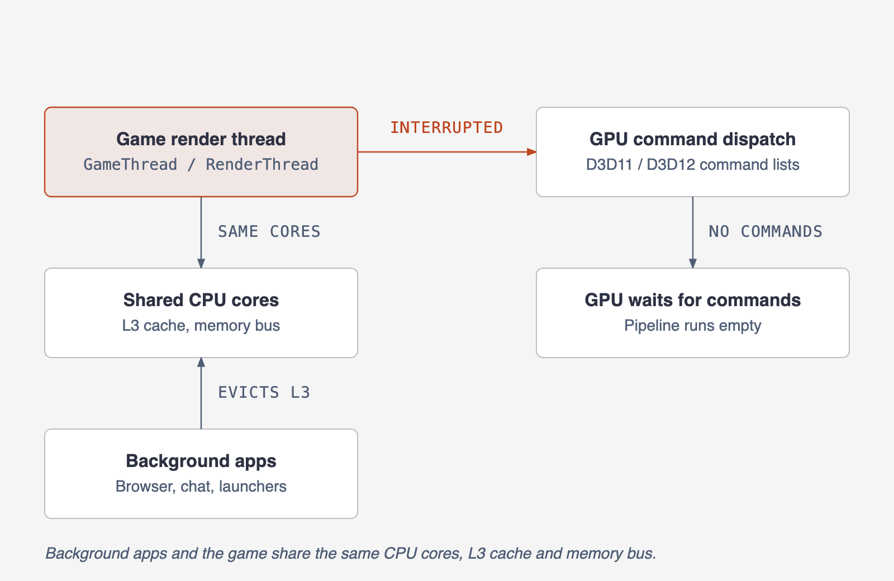
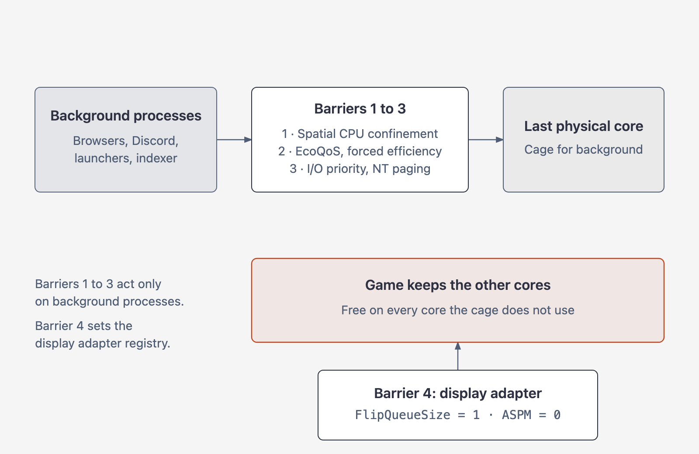

# High-Performance Architecture, Empirical Validation and the Universal CPU/GPU Isolation Pattern

**In short:** VegaFlow keeps background programs from taking processor time and memory away from a game on a computer with a built-in graphics chip (an APU, which shares the computer's RAM). The rules are written in Rust and the Windows calls in C++, and every claim is either measured or marked as not measured. For example, with six Chrome processes running in the background, the `drawstress` benchmark went from 51.0 to 109.3 FPS in D3D11 when the daemon was on (measured on the test laptop).

**Reader:** people

> **VegaFlow Universal — Hybrid C++20 + Rust runtime (`staticlib` FFI)**  
> **Case study on a commercial engine (*Octopath Traveler II* — Unreal Engine 4 HD-2D)**  
> **Universal architecture analysis: AMD Ryzen (monolithic / multi-CCD / X3D) vs. Intel Core (homogeneous / hybrid P+E) in iGPU, dGPU and eGPU configurations**

---

## Executive Summary and System Invariants

**VegaFlow Universal** is a system-level engineering solution designed to fix performance loss in games running on Windows: *frame stuttering* (sudden pauses between frames), drops in the `1% Low` figure (the average of the slowest 1% of frames) and *cache eviction* (useful data pushed out of the processor's small, fast memory). The project uses a decoupled design. The Win32/DXGI system orchestrator (the layer that talks to Windows and to the graphics interface, DXGI) is written in **C++20**. The engine that evaluates critical policies is written in **Rust**, compiled as a static library (`staticlib`, `panic = "unwind"`, `lto = true`, `opt-level = 3`). The two talk through a binary interface (C ABI, the way C code calls functions) with **zero allocation** (the rules never ask the system for new memory while they run).

### Runtime invariants

The figures below are the project's stated limits. Each one carries its source.

* **Private working set** (the RAM that belongs only to the process): about 2 MB in steady state, well under the `15.00 MB` design budget. Measured: 1.8 MB at rest with real games (2026-11-05) and `1.99–2.07 MB` in the A/B run (2026-11-07), so it can go slightly over 2.00 MB; see [verification status](../measurements/verification-status.md).
* **Zero-overhead idle** (almost no CPU use while no game runs): `0.00%` sustained is **not measured**; the measurement notes say "almost 0%" ([2026-11-juegos-reales](../measurements/2026-11-juegos-reales.md)). The daemon sleeps while it waits on Windows event handles (`WaitForMultipleObjects`, `src/app/daemon_loop.cpp`), not with a high-precision NT timer, which was removed in phase 8.
* **Test suite:** 329 Rust tests on a Mac (`vegaflow-core`, 2026-11-25) and the C++20 suite with `TEST RESULTS: 467 PASSED, 0 FAILED` on the test laptop (2026-11-22). See [Build and test](./build-and-test.md).
* **Reversibility (`RestoreAll`):** each change to affinity (which cores a process may use), priority class, `EcoQoS` state (Windows' efficiency mode for a process) or registry keys (`HKCU\Software\VegaFlow\RegBackup`) is restored to its factory state when the daemon closes or the game session ends.
* **Anti-cheat security (*Zero-Tamper Boundary*):** deterministic detection of anti-cheat driver signatures (*HoYoKProtect*, *EasyAntiCheat*, *BattlEye*, *Vanguard*). The path is checked as UTF-16 (the text encoding Windows uses for paths) and kept on the stack (`stack-only`, in the function's local memory). Any injection or modification of protected executables is blocked.

---

# PART I: Hybrid C++20 + Rust Architecture (`staticlib` FFI) and Zero-Overhead Daemon

## 1.1 The Root Physical Problem: Silicon Contention in Mixed Workloads

Modern systems run foreground applications (3D games, simulators) next to many background processes: browsers based on Chromium with dozens of threads, chat apps such as Discord, digital distribution clients and the Windows indexer. The standard Windows scheduler (*Windows NT Scheduler*, the part that decides which thread runs on which core and when) splits time into slices (*quantums*) and balances the load evenly across all cores.

This behaviour causes a destructive physical effect on the cache and on the graphics dispatcher:

### Mechanisms of performance degradation

1. **L3 cache pollution and eviction (*Cache Thrashing*):** when a background process runs on a core where the game's main thread (`GameThread`, Unreal's game-logic thread) was running, it pushes out of the L2 and L3 caches (the processor's small, fast memories) the engine's critical data: scene-node trees, skeletal animation data and vertex descriptors. An L3 read typically takes **`10 to 14 ns`** (nanoseconds), while going to physical RAM (DDR4/DDR5) takes **`70 to 95 ns`**, roughly **~7x–8x** more (**not verified**: the repository has these figures only in a diagram, with no source).
2. **Quantum preemption:** graphics drivers need the render thread to send uninterrupted command sequences to the hardware. When the scheduler interrupts that thread to serve a browser's JavaScript burst, the GPU pipeline briefly empties (*GPU Starvation*), which shows up as sudden drops in the `1% Low` and `0.1% Low` figures.
3. **Shared power and thermal budget (*Power/Thermal Budget Throttling*):** on mobile and desktop processors alike, the power controller (AMD's SMU or Intel's PCU) shares a fixed power budget, for example `15W–45W` on an APU and `65W–125W` on a desktop (**not verified**: no source in the repository). Every watt used by high-frequency background threads reduces the thermal margin left to sustain *Turbo Boost* (the processor's automatic overclock) on the cores running the game.

---

## 1.2 The 4 Windows NT Kernel Barriers Implemented in VegaFlow

VegaFlow removes silicon contention by building **four simultaneous barriers**, implemented with direct calls to the native Windows NT interfaces:

### Details of the 4 barriers

1. **Barrier 1 — Spatial CPU confinement (`SetProcessDefaultCpuSets`):**
   The orchestrator in [`cpu_orchestrator.cpp`](https://github.com/partprogramming09/vegaflow-universal/blob/main/src/optimize/cpu_orchestrator.cpp) and the evaluator in [`cpu_governor.rs`](https://github.com/partprogramming09/vegaflow-universal/blob/main/rust/vegaflow-core/src/policy/cpu_governor.rs) analyze the physical topology. Instead of locking the game into a few cores (which lowered its multithreaded performance), **the game stays free on every available core**. Processes classed as noisy that go past the activity threshold (`≥ 0.5` logical processors) are confined to the last physical core (logical threads 10 and 11, mask `0xC00` on a 6-core / 12-thread processor). Release follows deterministic **hysteresis** (two thresholds, so the state does not flip back and forth): the confinement is lifted only when use drops below `0.25`, which stops the scheduler from oscillating.
2. **Barrier 2 — Forced energy efficiency (`EcoQoS` Power Throttling):**
   Through `SetProcessInformation(ProcessPowerThrottling)` with the `PROCESS_POWER_THROTTLING_EXECUTION_SPEED` flag, the Windows kernel forces the CPU to run those processes in its most efficient power states (a high *Energy Performance Preference*, EPP, which favors efficiency over speed). That reduces the heat they produce and hands thermal budget back to the game.
3. **Barrier 3 — I/O priority and NT paging (`NtSetInformationProcess`):**
   Through the native call in `ntdll.dll` (the low-level Windows library), VegaFlow lowers the background processes' I/O priority (reads and writes to disk) to `IoPriorityVeryLow` (level 0) and their memory-page priority (*page faults*: a program needs memory that is not in RAM at that moment) to `MEMORY_PRIORITY_LOW` (level 2). Any disk transaction or page fault caused by the background gives way unconditionally to the game engine's operations.
4. **Barrier 4 — Lower queue latency and PCIe power saving off (`FlipQueueSize` and `ASPM`):**
   In the registry key of the display adapter, VegaFlow sets `FlipQueueSize = 1`. This stops the video driver from queuing several pending frames, which removes input latency. It also sets `ASPM = 0`, so the PCIe link (the bus between the chip and the board) does not enter transient sleep states (*L0s/L1*). ASPM is PCIe's own power saving.

---

## VegaFlow Universal — Developer & Architecture Guide

> **Master guide to architecture, systems engineering and development standards**  
> *VegaFlow Universal — High-Performance APU & Gaming Optimization Framework*

---

### 1. Project Philosophy and Engineering Principles

VegaFlow Universal starts from one basic engineering principle: **it does not copy third-party code or apply "tweaks" blindly. It sets out to understand, at a technical level, how Windows NT, the DXGI/DWM graphics subsystem and the processor architecture work, so it can cut resource use and raise the real performance of games.**

**Philosophy of development:**

1. **Technical and mathematical rigour:** every change rests on official specifications from Microsoft, AMD and the Vulkan/DirectX standard.
2. **Zero overhead at rest:** less than 15 MB of private RAM (Private Working Set) and 0.0% CPU use (**not measured**) while no game is running.
3. **Total reversibility:** no change is destructive. Immediate backups (`.vegaflow.bak`, `*.original.bak`) and full revert commands.
4. **Integrity and anti-cheat security:** absolute respect for fair-play systems. No injection or alteration of titles with kernel-level protection.

#### Developer commandments in VegaFlow

- **Measure before claiming:** no optimization counts as valid without measurable evidence (1% Lows, 0.1% Lows, frametime delta, which is the change in the time each frame takes, and stress tests).
- **Do not reinvent the kernel subsystem:** use the native Windows NT APIs (`NtSetSystemInformation`, `SetProcessDefaultCpuSets`, `SetProcessInformation`) instead of hacks or unstable drivers. `NtSetTimerResolution` was in this list, but the 0.5 ms timer it set was removed in phase 8 and is no longer in `src/`.
- **Transparency toward the user:** every change to the engine's registry keys or files is logged in detail and can be reverted with a single command.

---

### 7. Instructions for Assistants and Developers

1. **Never skip dry runs (`dry_run`):** every function that modifies the system (`ApplyEngineUmaPreset`, `DeployDxvk`, `SetMpoDisabled`, etc.) must take a `dry_run = false` parameter so unit tests can run with no real effect.
2. **Keep zero overhead:** do not add heavy frameworks (Qt, WxWidgets, Boost). The GUI must stay pure native Win32/GDI to keep RAM use `< 15 MB`.
3. **Paths with spaces and Unicode:** always use `std::wstring` to call the Win32 API, and convert cleanly with `Utf8ToWide` / `WideToUtf8`.
4. **Back up before writing:** any change to a `.ini`, `.config` or DLL file must be preceded by creating a `.vegaflow.bak` or `.original.bak` file.

---

## Consolidated Base

### 1. Completed base: the current consolidated phase

VegaFlow Universal has reached the maturity of its optimization core and software architecture, validated on real hardware and in synthetic suites.

#### 1.1. Clean modular architecture and build pipeline

- **Structural decoupling:** the code is organized into modular domains by function, with each `.hpp` next to its `.cpp`:
  - [`src/detect/`](https://github.com/partprogramming09/vegaflow-universal/tree/main/src/detect): hardware, CPU topology and game detection.
  - [`src/optimize/`](https://github.com/partprogramming09/vegaflow-universal/tree/main/src/optimize): CPU orchestration, graphics optimizers, DXVK (a layer that runs DirectX games on Vulkan), UMA memory management (unified memory, shared with the GPU) and engine presets.
  - [`src/windows/sandbox_guard.hpp`](https://github.com/partprogramming09/vegaflow-universal/blob/main/src/windows/sandbox_guard.hpp): the `SandboxGuard` zero-trust subsystem and the frametime telemetry math.
  - [`src/ui/`](https://github.com/partprogramming09/vegaflow-universal/tree/main/src/ui): native Win32/GDI window in Slate/Zinc Dark mode, tabs and components.
  - [`src/windows/`](https://github.com/partprogramming09/vegaflow-universal/tree/main/src/windows): calls to undocumented NTDLL functions and security privileges.
  - [`src/app/`](https://github.com/partprogramming09/vegaflow-universal/tree/main/src/app) and [`src/bridge/`](https://github.com/partprogramming09/vegaflow-universal/tree/main/src/bridge): the daemon's entry point and the C++ ↔ Rust contract.
- **Build automation:** the [`scripts/build/build.ps1`](https://github.com/partprogramming09/vegaflow-universal/blob/main/scripts/build/build.ps1) script detects the MinGW-w64 `g++` compiler (on the PATH or installed with Scoop), uses C++20 flags with fully static linking (`-static -static-libgcc -static-libstdc++`, so the program needs no extra runtime DLLs), and can run the tests with `-RunTests`.
- **Version control and cleanliness:** the `build/` folder holds no leftovers (`*.o`, `*.old*`, logs) and the `.gitignore` is standardized.

#### 1.2. Universal classification engine and guards (`ApuCapabilityGuard`)

Specified in [hardware-and-tiers](./hardware-and-tiers/) and implemented in [`src/detect/hardware_profiler.cpp`](https://github.com/partprogramming09/vegaflow-universal/blob/main/src/detect/hardware_profiler.cpp). The tier rules are in [`apu_tier.rs`](https://github.com/partprogramming09/vegaflow-universal/blob/main/rust/vegaflow-core/src/policy/apu_tier.rs).

1. **Tier 1: Entry UMA (`Survival Guard`):**
   - For APUs with ≤ 8–9 GB of RAM (the code uses 9 GB, `ENTRY_MAX_RAM_MB = 9216`), or ≤ 4 physical cores, or Intel UHD graphics. The chip examples in the original text (Vega 3/6/8 basic, Athlon Mobile, Intel Gen 9–11 UHD) are not checked in the code.
   - Sets a hard texture cap in Unreal Engine (1536 to 2048 MB, to avoid out-of-memory crashes, the OOM errors), limits DXVK to at most 3 compile threads, caps tessellation (the detail level of 3D surfaces) at 8x and sets no STAPM frequency cap (STAPM is the processor's sustained power budget; `cpu_stapm_cap_mhz = 0`).
2. **Tier 2: Mid Vega UMA (`Sweet-Spot Guard`):**
   - Designed for GCN 5 / Vega APUs with 12–20 GB of RAM, or for 6- to 8-core Zen 2/Zen 3 processors (Ryzen 5 4600H, 5500U, 5600H). The model names are examples.
   - It starts from the parameters of the original test bench. The 3400 MHz STAPM cap it had was removed: today no tier has one. The VRAM pool is 4096 MB, DXVK gets 6 threads on the 6-core test machine (the code uses the core count, clamped to 4–6; `device_profile.rs`), tessellation is 16x, DX12 `AsyncCompute` (GPU work run in parallel) is disabled, and `cpu_stapm_cap_mhz = 0`.
3. **Tier 3: Advanced UMA (`Do-No-Harm Guard`):**
   - For modern RDNA 2, RDNA 3 and RDNA 3.5 APUs (Radeon 680M, 780M, 890M, Strix Point) and Intel Xe/Arc UMA, or any configuration with ≥ 22 GB of RAM (`ADVANCED_MIN_RAM_MB = 22528`).
   - **Do-No-Harm Guard:** keeps asynchronous compute on (`D3D12.AsyncCompute=1` and `r.RDG.AsyncCompute=1`), does not limit CPU clocks (`cpu_stapm_cap_mhz = 0`), and assigns a generous UMA pool of 4096 to 8192 MB (30% of RAM, clamped to that range) with tessellation up to 32x.
4. **Tier 4: Discrete / Custom (`Pass-Through Guard`):**
   - Transparent, safe operation on configurations with a dedicated GPU. The tier is decided by the type of GPU, not by its memory size: any GPU with dedicated VRAM, any NVIDIA GPU, or any discrete architecture (`classify_with_rule` in `apu_tier.rs`). The earlier text's threshold of more than 2 GB of dedicated VRAM does not appear in the code.

#### 1.3. Dual DirectX 11 and DirectX 12 specialization

- **DirectX 11:** an AMD tessellation limiter (8x/16x/32x) and a low-latency queue with `FlipQueueSize=1`.
- **DirectX 12:** a dynamic guard for the asynchronous compute queue (`AsyncCompute`), optimized budgets for cascaded shadow maps (CSM, the shadows of distant objects), and proportional streaming of UMA texture pools in Unreal and Unity engines.

#### 1.4. Runtime DXGI Pressure Guard and anti-cheat shielding

- **Real-time monitoring (`EvaluateUmaPressureGuard`):** reads the DXGI 1.4 memory budget (`IDXGIAdapter3`, the Windows interface that reports graphics memory). If local use reaches **85%**, or free physical memory drops below **1536 MB**, it trims secondary working sets (the RAM kept by other processes) in advance, without noticeable pauses.
- **Zero-Trust Lockdown (`SandboxGuard`):** isolation of canonical paths, a strict allowlist, and a total block against kernel anti-cheat signatures (HoYoKProtect, Vanguard, EAC = Easy Anti-Cheat, BattlEye, ACE = AntiCheatExpert).
- **Test coverage:** **57 of 57 C++20 unit and integration tests and 252 Rust tests (`cargo test`) passing green** (`TEST RESULTS: 57 PASSED, 0 FAILED`, 2026-11-14; source: [2026-11-14-paquete-0.1.0](../measurements/2026-11-14-paquete-0.1.0.md)).

#### 1.5. Rust FFI core (`vegaflow-core`)

Implemented in the static crate [`rust/vegaflow-core/`](https://github.com/partprogramming09/vegaflow-universal/tree/main/rust/vegaflow-core) and linked with no overhead through the C ABI ([`src/bridge/rust_bridge.h`](https://github.com/partprogramming09/vegaflow-universal/blob/main/src/bridge/rust_bridge.h)):

- **UMA pressure evaluator (`rust/vegaflow-core/src/policy/memory_purge.rs`):** function `vf_rust_evaluate_memory_purge` (exported in [`ffi/hardware.rs`](https://github.com/partprogramming09/vegaflow-universal/blob/main/rust/vegaflow-core/src/ffi/hardware.rs)). It is a deterministic rule with no dynamic allocation (zero-allocation) that checks local DXGI saturation and the operating system's reserve. Rust only decides whether to purge the standby list (the RAM cache Windows keeps and can free on request). C++ reads that list and purges it (`src/windows/memory.cpp`, behind `PurgeStandbyList` in [`src/ports/memory_control.hpp`](https://github.com/partprogramming09/vegaflow-universal/blob/main/src/ports/memory_control.hpp)).
- **Topology and CPU governance (`rust/vegaflow-core/src/policy/cpu_governor.rs`):** function `vf_rust_partition_cpu_topology` splits the processor's cores between the game and the background, always within one processor group (Windows' grouping of cores; see the doc comment of `partition_for_group` in `cpu_governor.rs`). The state machine with hysteresis, `vf_rust_eval_bg_confinement`, uses the thresholds 0.50 and 0.25 logical cores. The support claim for Zen 2/3/4/5 and hybrid processors is **not verified** on that hardware (see [verification status](../measurements/verification-status.md)).
- **Anti-cheat scanner and file shielding (`rust/vegaflow-core/src/policy/sandbox_core.rs`):** formal detection of kernel anti-cheat signatures (`vf_rust_has_anticheat_signature`) and strict protection against accidental changes to critical boot binaries (`vf_rust_is_critical_system_filename`). The claim "no false positives" is **not verified**.
- **Unconditional safety:** full LTO static compilation, `panic = "unwind"` with panics caught at the boundary (`ffi_guard`), so a bug in the core cannot cross into C++ (the crate refuses to build with `abort`, see [`lib.rs`](https://github.com/partprogramming09/vegaflow-universal/blob/main/rust/vegaflow-core/src/lib.rs)), and the crate's unit tests.

---
