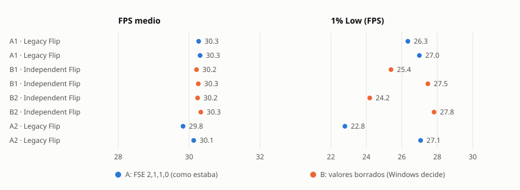

# FSE en Octopath Traveler II (2026-11-20)

**Lector:** quien decida qué hace la opción `fse_compat` de Ajustes. Etiqueta de todo lo de abajo: **medido**, salvo donde se dice.

## Pregunta
¿Cambian el modo de presentación y los FPS si los cuatro valores FSE de `HKCU\System\GameConfigStore` se borran (Windows decide) en vez de dejarlos en `2,1,1,0` («pantalla completa clásica», lo que escribe `fse_compat`)?

## Cómo
- Laptop de pruebas (Ryzen 5 4600H + Vega 6, Windows 11 build 26300), sesión 1 en el escritorio, demonio apagado.
- Octopath en pantalla completa exclusiva (`FullscreenMode=0`, 1920×1080, límite 60), autoguardado de noche («Pueblo fantasma»), personaje quieto. `Engine.ini` **sin** el preset UMA (así estaba desde el 2026-11-18), igual en las dos condiciones: por eso ~30 FPS y no los ~42 de la línea base.
- ABBA: A1, B1, B2, A2; el juego se cierra y se abre en cada bloque, porque FSE se aplica al arrancar. Cada bloque: `vfdev run pack … Captures=2 Seconds=125` (calentamiento + 2 capturas de 120 s).
- A = `GameDVR_FSEBehaviorMode=2`, `HonorUserFSEBehaviorMode=1`, `DXGIHonorFSEWindowsCompatible=1`, `EFSEFeatureFlags=0` (lo que el laptop ya tenía, sin copia en `RegBackup`). B = los cuatro valores borrados.
- Al terminar: valores de A puestos otra vez (los originales del laptop), `Engine.ini` devuelto desde la copia (SHA-256 `3EC1CB3B…`, igual que la copia).

## Resultado

| Condición | Capturas | Modo de presentación (PresentMon) | FPS medio | 1% Low agrupado (`vfdev frames`) |
|---|---|---|---|---|
| A: 2,1,1,0 | 4 | Hardware: Legacy Flip en el 100 % de los cuadros | 30,20 [29,83–30,31] | 25,34 |
| B: borrados | 4 | Hardware: Independent Flip en el 100 % de los cuadros | 30,25 [30,23–30,33] | 26,46 |

Datos por captura: `assets/2026-11-20-fse/summary.csv`; gráfica: `assets/2026-11-20-fse/make_chart.py` (lee las capturas o el resumen).

Veredicto de `vfdev frames`:
- FPS medio +0,17 %: **no cuenta** (necesita 1 %, rangos sin solape y 5 capturas por condición).
- 1% Low +4,4 %, IC95 [−2,3 %, +10,5 %]: **no cuenta** (el intervalo incluye 0).

## Qué significa
- Lo único firme: los valores `2,1,1,0` fuerzan la pantalla completa clásica (Legacy Flip); sin ellos, Windows usa Independent Flip. Es decir, `fse_compat` sí cambia el camino de presentación.
- En FPS no se vio diferencia en esta escena y a ~30 FPS limitados por la GPU. Una ventaja de latencia o de 1% Low no queda demostrada con 4 capturas por condición.
- No medido: latencia de entrada, Alt+Tab, superposiciones, y la escena con el preset UMA (~42 FPS).
