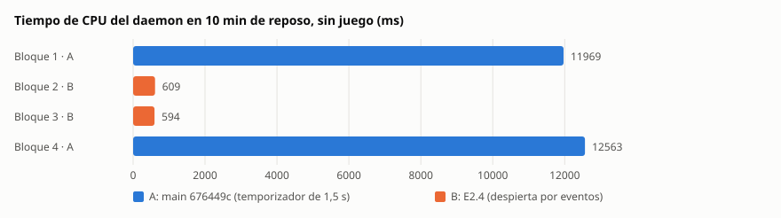

# Bucle por eventos (E2.4): CPU en reposo y detección (2026-11-21)

**Lector:** quien revise la E2.4 o quiera saber cuánto gasta el daemon sin juego. Etiqueta de todo lo de abajo: **medido**, salvo donde se dice.

## Pregunta
¿Cuánta CPU gasta el daemon en reposo (sin juego) con el bucle por eventos de la E2.4, frente al temporizador fijo de 1,5 s de antes? ¿Sigue detectando el juego a tiempo?

## Cómo
- Laptop de pruebas (Ryzen 5 4600H + Vega 6, Windows 11), sesión 1 en el escritorio, sin juego abierto, `config.json` de fábrica.
- A = `main` en `676449c` (temporizador de 1,5 s). B = rama `e2/ola-3` (PR #18, despierta por eventos con una red de seguridad de 30 s). Los dos compilados en el Mac con `scripts/build/build-cross.sh`.
- ABBA: cada bloque arranca el daemon con una tarea programada (sesión interactiva, administrador), espera 30 s y lee `TotalProcessorTime` del proceso antes y después de 600 s.
- Los datos en bruto están en [`assets/2026-11-21-bucle-eventos/idle-cpu.csv`](./assets/2026-11-21-bucle-eventos/idle-cpu.csv). La gráfica la genera `make_chart.py` a partir de ese archivo.

## Resultado

| Bloque | Versión | CPU en 600 s (ms) | Memoria de trabajo (MB) |
|---|---|---|---|
| 1 | A | 11 969 | 12,8 |
| 2 | B | 609 | 12,1 |
| 3 | B | 594 | 12,1 |
| 4 | A | 12 563 | 11,9 |
| B limpio (confirmación) | B | 547 | — |

- En reposo, B gasta unas **20 veces menos CPU** que A: de media 12 266 ms frente a 602 ms en 10 min, es decir, de un 2,0 % a un 0,1 % de un núcleo.
- La memoria es casi la misma (12-13 MB de memoria de trabajo).
- **Detección de Octopath con B** (daemon ya en reposo y juego abierto después): Steam relanza el juego. El proceso final arrancó a las 20:35:45.046 y el daemon anotó «Game process optimization» a las 20:35:48. Son unos 3 s, con la resolución de 1 s del diario, e incluyen lo que tarda el juego en crear su ventana y cargar Direct3D.

## Cuidados
- Los bloques 1 a 4 terminaron con `Stop-Process`, una salida brusca. Con 2 salidas bruscas seguidas el daemon arranca en **modo seguro**, solo observa (`change_journal.cpp:836`), y eso le quitaría trabajo. Según los diarios (**inferido**), ningún bloque arrancó con racha 2. Para confirmarlo se repitió un bloque B que arrancó con racha 0 y se paró con el evento `Global\VegaFlowStop`: dio 547 ms, en línea con 609 y 594, y su salida no muestra modo seguro.
- Una primera prueba de detección no detectó el juego: el daemon estaba en modo seguro por esas salidas bruscas. No era un fallo de la E2.4.
- La salida limpia descubrió un fallo de E2.2: al cerrar, el daemon ponía `GameDVR_Enabled=1` y `AppCaptureEnabled=1` sobre el 0 del usuario. Se arregló en `0296cea` (Test 117) y se comprobó que tras otra salida limpia los dos siguen en 0.

## Qué no se midió
- **Evento de energía (desenchufar el cargador):** hace falta hacerlo a mano en el laptop.
- **Batería:** el laptop no expone la potencia.
- **CPU con juego activo:** el tic sigue en 1500 ms, igual que antes.
