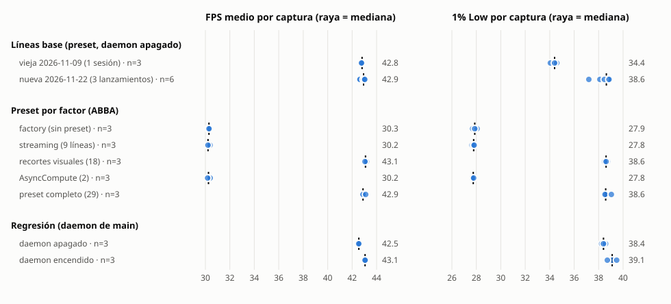

# Octopath sin intervención: línea base nueva, preset por factor y regresión (F2.4, 2026-11-22)

> **Note:** this dated report is kept in Spanish. The living summary in English is [Verification status](./verification-status.md).

**Lector:** quien decida si el preset de Unreal vuelve a estar encendido de fábrica (F2.3) y quien use la puerta de regresión de Octopath. Etiqueta de todo lo de abajo: **medido**, salvo donde se dice.

## Preguntas
1. ¿Se puede abrir Octopath Traveler II, cargar el autoguardado y medir sin nadie en el laptop?
2. ¿Cuánto vale la línea base con varios lanzamientos, frente a la vieja de una sola sesión?
3. ¿Qué parte del preset de Unreal da los FPS: el streaming, los recortes visuales o AsyncCompute?
4. ¿Sigue la caída de ≈6 % en 1 % Low con el daemon encendido y sin carga, con el daemon de `main`?

## Cómo
- Laptop de pruebas (Ryzen 5 4600H + Vega 6, Windows 11), sesión 1, juego en pantalla completa exclusiva (1920×1080, límite 60), autoguardado de noche («Pueblo fantasma»), personaje quieto. SCSKiller cerrado y su `d3d11.dll` fuera de la carpeta durante todas las tandas (como en la línea base vieja); al terminar, devueltos.
- Trabajo nuevo `vfdev octo` (`scripts/remote/jobs/octo.ps1`): por cada condición cierra el juego, escribe su `Engine.ini`, lo abre por Steam, espera el título, pulsa Enter con esperas de 4, 4, 4 y 50 s y comprueba la escena (captura `dda` no negra, juego en primer plano, 15-55 FPS en 15 s). Después mide con `bench.ps1`: un calentamiento de 120 s que no cuenta y las capturas de 120 s. Uso y reglas: [`scripts/remote/README.md`](https://github.com/partprogramming09/vegaflow-universal/blob/main/scripts/remote/README.md).
- Grupos del preset (`src/optimize/steam/engine_presets.cpp`, valores de este laptop; cada una de las 29 líneas en un solo grupo): **streaming** = `r.ShaderPipelineCache.Enabled`, los 7 `r.Streaming.*` y `r.OneFrameThreadLag` (líneas 144 y 164-171, 9 líneas, ninguna cambia la imagen); **visual** = los 18 recortes de calidad, de `r.SceneColorFringeQuality` a `r.MaxAnisotropy` (172-189); **async** = `r.RDG.AsyncCompute` y `D3D12.AsyncCompute` (190-191); **full** = las 29, como las escribió la GUI el 2026-11-15. Referencia: **fábrica + un grupo**, comparado con fábrica (sin bloque `[SystemSettings]`).
- El juego conservó las líneas escritas al reescribir `Engine.ini` al arrancar en los 20 lanzamientos (`lineas_tras_arranque` igual a `lineas_escritas`).
- Análisis con `vfdev frames` (FPS medio con rango, 1 % Low agrupado con IC95 por remuestreo de bloques de 1 s) y `vfdev regress`. Datos por captura: [`assets/2026-11-22-octopath-f2-4/summary.csv`](./assets/2026-11-22-octopath-f2-4/summary.csv); la gráfica la genera `make_chart.py` desde los JSON de `bench.ps1`.

## 1. El trabajo abre, carga y mide solo
20 lanzamientos seguidos sin fallo y sin tocar el laptop: 1 de prueba (`t1`), 3 de la línea base (`f2base`), 15 del ABBA (`f2fac`) y 1 para la regresión (`f2reg`). Cada uno dejó dos capturas de verificación (`<prefijo>-bNN-title.png` y `-loaded.png`, en `C:\ProgramData\VegaFlow\screens` del laptop y traídas a `build/octo/`, fuera de git); la escena cargada se vio a ojo en `t1-b01-loaded.png`. Brillo de las capturas: título 63,2-64,2, escena 47,7-51,2. FPS de la comprobación: 41,6-43,2 con el preset o los recortes visuales, 29,9-30,3 sin ellos.

## 2. Línea base nueva (`scripts/remote/baselines/octopath_world_f2.json`)
Preset completo, daemon apagado, sin carga, Legacy Flip; 3 lanzamientos con 2 capturas de 120 s cada uno.

| Caso | Entrada | Antes (`octopath_world.json`, 2026-11-09) | Ahora (`octopath_world_f2.json`) | Etiqueta |
|---|---|---|---|---|
| FPS medio (mediana) | preset, daemon apagado | 42,81 | 42,94 (por lanzamiento: 42,60 · 42,94 · 43,03) | medido |
| 1 % Low agrupado | ídem | 34,40 | 38,41 | medido |
| Ruido entre lanzamientos (FPS / 1 % Low) | ídem | 0,11 % / 1,55 % (3 capturas de **una** sesión) | 1,00 % / 1,84 % (3 lanzamientos) | medido |
| Límite de la puerta (FPS / 1 % Low) | `max(1 %, 4×ruido)` / `max(3 %, 4×ruido)` | −1,00 % / −6,21 % | −4,00 % / −7,35 % | medido |

- Las capturas nuevas contra la base vieja: **PASS** (FPS medio 42,94, +0,30 %; 1 % Low 38,31, +11,38 %).
- El 1 % Low de la base vieja (34,40) queda bajo: con la misma escena, el mismo preset y sin SCSKiller hoy sale 38,4 en todos los lanzamientos. No se sabe qué cambió entre el 2026-11-09 y hoy (Windows, controlador, el juego); no está aislado.
- **Con la base nueva, la puerta ya no vería la regresión vieja:** su límite del 1 % Low es −7,35 %, más ancho que el −6 % que tenía que detectar. Con la vieja el margen era de 0,04 puntos. No se cambió `vfregress.py`: decidir si el límite debe salir de otro ruido (entre capturas de un mismo lanzamiento) queda para quien mantenga la puerta.

## 3. Preset de Unreal por factor (ABBA, un lanzamiento por pasada)
Orden: fábrica, streaming, visual, async, full, full, async, visual, streaming, fábrica, fábrica, streaming, visual, async, full (`Reps=3 Seconds=120 Warmup=1 Load=none`). 3 capturas de 120 s por condición, cada una con el juego recién abierto. Todas en Legacy Flip.

| Condición (frente a fábrica) | FPS medio: mediana [rango] | Cambio FPS medio | 1 % Low agrupado | Cambio 1 % Low, IC95 | Veredicto de `vfdev frames` | Etiqueta |
|---|---|---|---|---|---|---|
| fábrica (sin preset) | 30,29 [30,22-30,35] | — | 27,84 | — | — | medido |
| streaming (9 líneas) | 30,21 [30,11-30,38] | −0,25 % | 27,70 | −0,50 % [−2,2 %, +1,2 %] | no cuenta (los dos) | medido |
| recortes visuales (18) | 43,09 [43,05-43,18] | +42,26 % | 38,59 | +38,62 % [+35,8 %, +41,4 %] | FPS medio: no cuenta (pide 5 capturas por condición; los rangos no se solapan); 1 % Low: **cuenta** | medido |
| AsyncCompute (2) | 30,25 [30,18-30,39] | −0,11 % | 27,72 | −0,44 % [−2,2 %, +1,4 %] | no cuenta (los dos) | medido |
| preset completo (29) | 42,89 [42,88-43,11] | +41,61 % | 38,68 | +38,93 % [+36,1 %, +41,5 %] | FPS medio: no cuenta (pide 5 capturas); 1 % Low: **cuenta** | medido |
| completo frente a visual | 42,89 contra 43,09 | −0,45 % | 38,68 contra 38,59 | +0,22 % [−1,8 %, +2,4 %] | no cuenta (los dos) | medido |

- **Ruido entre pasadas iguales** (rango del FPS medio dentro de cada condición): 0,30 % (visual) a 0,90 % (streaming). La diferencia de visual y completo frente a fábrica (~42 %) es unas 50 veces ese ruido; la de streaming y async (−0,1 a −0,3 %) es menor que el ruido.
- **Toda la ganancia viene de los 18 recortes visuales.** Streaming y AsyncCompute no cambian nada medible en esta escena (D3D11: AsyncCompute no tiene efecto en D3D11, como se esperaba). Visual solo y el preset completo son iguales dentro del ruido.
- Para decidir F2.3: el preset **cambia calidad por FPS** (apaga SSR, oclusión ambiental, profundidad de campo, desenfoque de movimiento y niebla volumétrica; baja sombras, bloom y anisotropía). No es una ganancia gratis. Quitar las 9 líneas de streaming y las 2 de AsyncCompute no costaría FPS en esta escena; solo hay un juego medido.

## 4. Regresión del −6 % en 1 % Low (daemon de `main`, sin carga)
Juego abierto con el preset completo por `vfdev octo … Leave=1`; después `vfdev run ab … Reps=3 Seconds=120 Warmup=1 Load=none` (daemon apagado / encendido intercalado, el mismo lanzamiento). Daemon compilado en el Mac con `scripts/build/build-cross.sh` desde `78f73af` (SHA-256 `2EEA77AD…`; `ab.log` registra ese hash en cada arranque). Las 3 pasadas «encendido» tienen `sesion_registrada=True`.

| Caso | Entrada | Antes | Ahora | Etiqueta |
|---|---|---|---|---|
| 1 % Low con el daemon encendido, sin carga | daemon apagado contra encendido, mismo lanzamiento | −6,25 % (2026-11-09; FAIL contra −6,21 %) | +1,76 % (38,40 → 39,08), IC95 [−0,1 %, +3,5 %]: no cuenta | antes: registrado ([`2026-11-09-diagnostico-laptop.md`](./2026-11-09-diagnostico-laptop.md)); ahora: medido |
| FPS medio, mismo caso | ídem | sin cambio (registrado) | +1,20 % (42,55 [42,54-42,59] → 43,06 [43,05-43,06]): no cuenta (pide 5 capturas) | medido |
| Modo de presentación | ídem | Legacy → Independent Flip (registrado) | Legacy Flip apagado, Independent Flip encendido (100 % de los cuadros) | medido |
| `regress` «encendido» contra la base vieja | 3 capturas | FAIL (registrado) | **PASS**: 43,06 (+0,58 %), 1 % Low 39,08 (+13,61 %); aviso de modo de presentación distinto | medido |
| `regress` «encendido» contra la base nueva | 3 capturas | — | **PASS**: 43,06 (+0,27 %), 1 % Low 39,08 (+1,74 %); mismo aviso | medido |
| `regress` «apagado» contra la vieja / la nueva (control) | 3 capturas | — | PASS / PASS (−0,61 % y −0,91 % FPS medio; +11,64 % y −0,03 % 1 % Low) | medido |

- **La caída del 6 % no aparece con el daemon de `main`.** Con el daemon encendido el 1 % Low no baja; sube un 1,8 %, pero el intervalo incluye 0, así que tampoco es una mejora demostrada. La causa probable es que E2.2 apagó de fábrica los ajustes sin medir (prioridad Win32, GameDVR, perfil de energía); no está aislado.
- El control «apagado» pasa contra las dos bases, así que la escena es la misma y la puerta tiene sentido.

## Fallo encontrado (no se cambió el código)
- **El daemon de `main` se queda colgado en su primer arranque desatendido.** Archivo: `src/app/main.cpp:214-216` (oferta de punto de restauración). Si no existe `config\change_journal.vfj` junto al `.exe`, pregunta «¿Crear un punto de restauración…? [s/N]» por consola. `HasInteractiveConsole()` (`main.cpp:45-50`) da verdadero en la consola oculta que crea `Start-Process -WindowStyle Hidden` (la tarea `VegaFlow-Start`), así que el daemon espera una respuesta que nadie puede dar.
  - Lo que se vio: 0,03 s de CPU, sin el evento `Global\VegaFlowStop`, y `VegaFlow-Stop` terminó con código 1 y `ab_stop.log` vacío.
  - La pregunta de recuperación (`main.cpp:181-183`) lee la consola igual y tampoco mira `HasInteractiveConsole`: le pasaría lo mismo tras un cierre forzado.
  - Cómo se siguió: se mataron los dos procesos colgados (ninguno había empezado sesión: `active=0`) y se marcó `restore_point_prompted=1` en el diario, el mismo estado que deja el código cuando alguien responde «no». Con eso, `daemon-start` y `daemon-stop` salieron con 0.
  - Al terminar, las 102 entradas del diario estaban en `REVERTED`. Se borró el diario y se devolvió el daemon anterior (`60B1B794…`).

## Cuidados al terminar
`Engine.ini` del juego con el mismo SHA-256 que la copia hecha antes de empezar (`678E18A4…`), sin `.bak` en la carpeta; SCSKiller y su `d3d11.dll` devueltos (SHA-256 igual que antes) y la tarea temporal borrada; `vfdev run kill-gui`, `restore` y `state` con salida 0 y todo en `ok`; los valores FSE (`2,1,1,0`) sin tocar.

## No medido
- Otras escenas y otros juegos: solo hay una escena de Octopath, de noche y quieta.
- Qué recorte visual concreto da los FPS: los 18 se midieron juntos.
- Calidad de imagen y latencia de entrada.
- El FPS medio con 5 capturas por condición, que `vfdev frames` pide para dar su veredicto.
