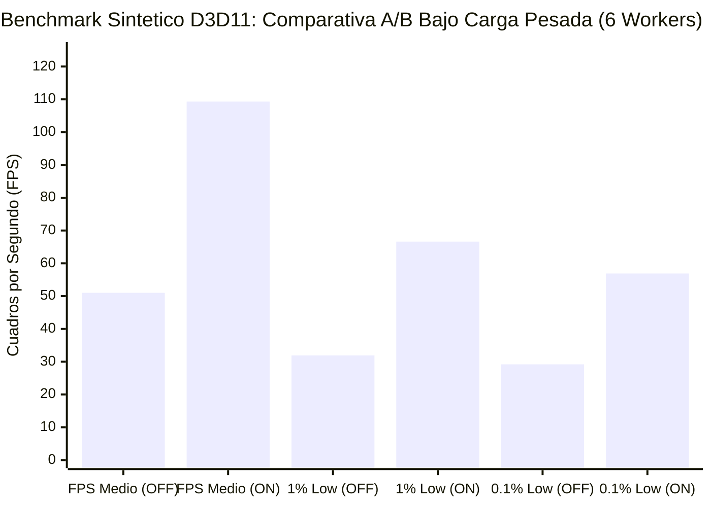
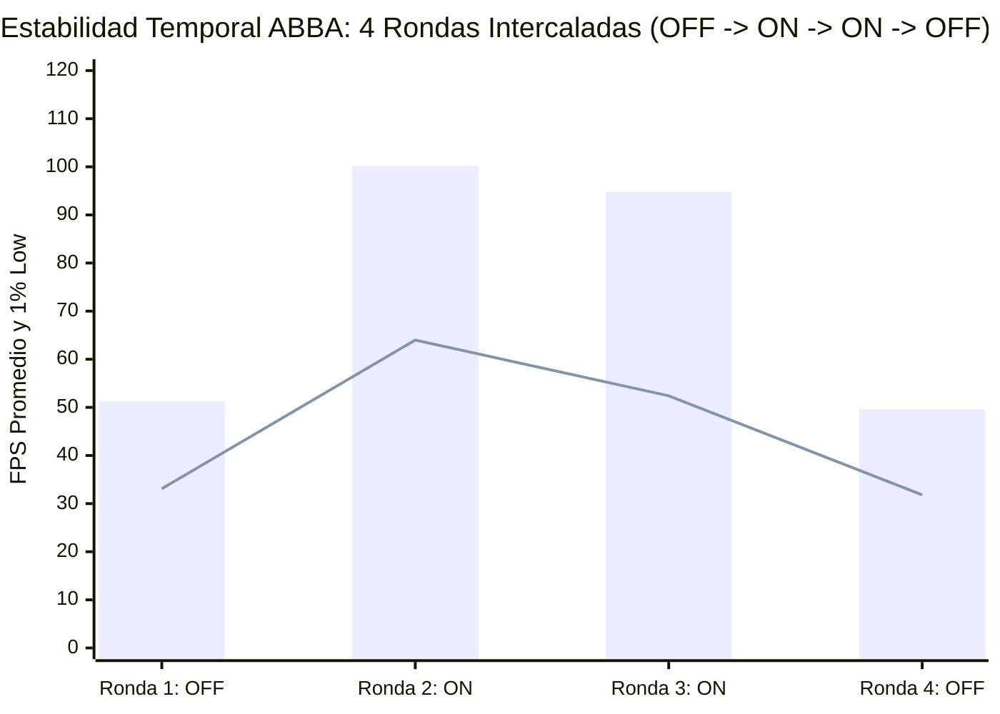
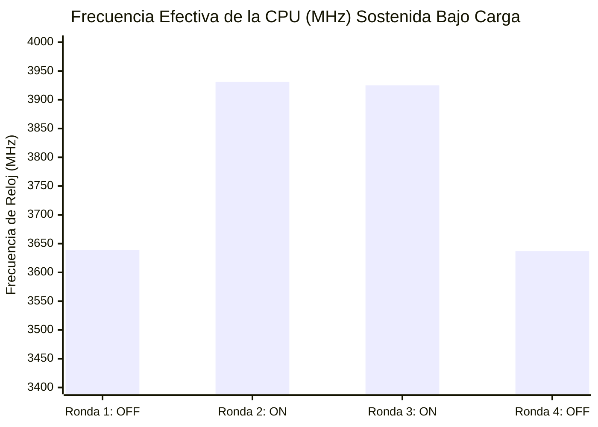

# Parte 2. Medición A/B: daemon apagado contra encendido (bgfx drawstress)

Fecha: 2026-11-04. Equipo: laptop Ryzen 5 4600H, Radeon Vega 6, 16 GB, Windows 11 build 26300, enchufada.

## Método

- Carga: bgfx `17-drawstress`, `dim` 30 (27 000 draw calls por cuadro), ventana en el escritorio, modo de presentación `Hardware: Independent Flip` en el 100% de los cuadros.
- Medición: `scripts/bench.ps1` (PresentMon 2.6, 30 s por captura, 5 s de calentamiento descartados). Un solo `drawstress` abierto por API; el daemon se arranca y se para entre capturas.
- Orden ABBA (`scripts/ab_loop.ps1`): apagado/encendido en la repetición 1, encendido/apagado en la 2, y así. Esto reparte la deriva térmica entre las dos condiciones.
- "Encendido" es `vegaflow_daemon.exe` en modo continuo, sin argumentos, lanzado con `scripts/ab_profile.ps1 -Start`, con 10 s de espera antes de capturar. Se paró con el evento `Global\VegaFlowStop` (cierre limpio, código 0).
- Antes de cada captura se leyó `tweaks_state.ps1`: ningún valor de registro vigilado estaba fuera de fábrica en ninguna captura (`ab_runs.log`, `desviado=[]`).
- La suite de pruebas se ejecutó antes de las mediciones; su efecto sobre los valores `UMD\*` del driver está en `archivo/PLAN_REDISENO_Y_ACTUALIZACION.md`.

## Resultados (5 capturas por condición y API)

Media y rango [mín–máx].

| API | Condición | FPS medio | 1% Low | 0.1% Low | Desv. frametime (ms) |
| --- | --- | --- | --- | --- | --- |
| D3D11 | daemon apagado | 125.8 [124.6–126.5] | 86.3 [85.2–87.3] | 80.8 [78.4–81.8] | 0.86 |
| D3D11 | daemon encendido | 112.3 [109.2–114.0] | 87.2 [86.6–87.7] | 82.0 [80.3–83.9] | 1.45 |
| D3D12 | daemon apagado | 99.6 [99.5–99.8] | 86.8 [84.4–89.2] | 79.7 [77.7–82.1] | 0.26 |
| D3D12 | daemon encendido | 101.7 [101.6–101.8] | 91.3 [88.2–93.5] | 81.1 [70.0–89.5] | 0.25 |

Lectura:

- D3D11: el daemon encendido baja el FPS medio un 10.7%. Los rangos no se solapan y el orden ABBA descarta la deriva como causa. La desviación del frametime sube de 0.86 a 1.45 ms. El 1% Low y el 0.1% Low no empeoran.
- D3D12: el FPS medio sube un 2.1% (rangos sin solape) y el 1% Low un 5%; el 0.1% Low es irregular (de 70.0 a 89.5), sin efecto atribuible.
- Con 5 capturas por celda y una sola carga, el resultado de D3D12 es pequeño y no se puede extender a otras cargas.

## Causa del coste en D3D11

El daemon cambia cuatro ajustes del plan de energía al arrancar, medido con `powercfg /qh` (incluye los ocultos) antes y después; no cambia ningún valor de registro vigilado:

| Ajuste | Fábrica | Daemon |
| --- | --- | --- |
| Mínimo de núcleos sin aparcar (`CPMINCORES`) | 50 | 100 |
| Preferencia de rendimiento energético (`PERFEPP`) | 50 | 25 |
| Modo de boost (`PERFBOOSTMODE`) | 2 (Agresiva) | 4 (Eficiencia agresiva) |
| PCIe ASPM | 1 | 0 |

Aislamiento, todo en D3D11 con `drawstress`:

| Prueba | Resultado |
| --- | --- |
| Daemon encendido, devolver los cuatro ajustes a fábrica contra dejarlos como los pone el daemon, 4 capturas ABBA | 126.0 [125.4–126.2] contra 110.9 [107.1–113.7] FPS: los cuatro ajustes explican todo el coste |
| Daemon apagado, un ajuste por vez a su valor del daemon, 3 rondas rotadas (base, park, epp, aspm) | base 126.2 [124.3–127.3]; **park 99.4 [98.4–100.0]**; epp 126.1 [125.6–126.8]; aspm 126.5 [126.2–127.1] |
| Daemon apagado, solo el modo de boost 2 contra 4, 4 capturas ABBA | 124.5 contra 123.2 FPS (-1.1%) |
| Intervalo de sondeo del daemon 1500 ms contra 60 000 ms, 3 capturas ABBA | 95.0–95.6 en ambos: el sondeo no influye |
| Deriva térmica | Línea base sin daemon 3 capturas seguidas: 124.4, 126.4, 126.0 FPS, procesador a 3.0 GHz |

Conclusión: `CPMINCORES=100` (todos los núcleos sin aparcar) baja el FPS de `drawstress` D3D11 un 21% por sí solo. El modo de boost aporta cerca de un 1%; la EPP y el ASPM no tienen efecto medible en esta carga. El mecanismo no está medido: puede ser reparto de hilos entre núcleos o presupuesto de potencia compartido con la iGPU, ninguno verificado.

Sin explicar: el nivel con el daemon encendido varió entre sesiones de medición, con las mismas condiciones nominales. Fue ~112 FPS en el bucle ABBA y ~111 en la prueba de cuatro ajustes, pero ~95 FPS en la prueba del intervalo de sondeo y en la de revertir solo boost y ASPM. Con el daemon apagado el nivel se mantuvo en ~125 todo el tiempo. No se identificó qué cambió entre esas sesiones; hasta saberlo, el tamaño exacto del coste del daemon (entre -11% y -24%) no está fijado, aunque la dirección sí.

## Verificación tras la corrección

Corrección (`842df5b`): el perfil APU deja `CPMINCORES` en el valor de fábrica (50) y el cierre limpio del daemon restaura siempre el perfil de energía. Mismo método ABBA, 5 capturas por celda, daemon recompilado en el laptop (26 de 26 pruebas en verde).

| API | Condición | FPS medio | 1% Low | 0.1% Low | Desv. frametime (ms) |
| --- | --- | --- | --- | --- | --- |
| D3D11 | daemon apagado | 123.6 [123.4–124.1] | 86.3 [85.7–86.8] | 80.9 | 0.65 |
| D3D11 | daemon encendido | 123.6 [123.0–124.0] | 86.2 [85.0–87.2] | 81.2 | 0.66 |
| D3D12 | daemon apagado | 102.8 [102.6–103.0] | 89.8 [87.3–93.1] | 80.6 [71.9–86.0] | 0.27 |
| D3D12 | daemon encendido | 102.8 [102.5–103.1] | 90.0 [87.3–91.7] | 82.5 [79.1–86.5] | 0.27 |

El coste en D3D11 (-10.7%) desaparece y la ganancia aparente en D3D12 (+2.1%) también: con la corrección, las partes globales del daemon encendido no cambian el resultado de `drawstress` en ninguna de las dos APIs (ver "Alcance" abajo). La ganancia anterior en D3D12 venía de la combinación de ajustes de energía, no de una optimización del daemon.

Alcance: en estas corridas el daemon se lanzó desde una sesión SSH, que es la sesión 0 de Windows, sin acceso al escritorio. El detector usa `GetForegroundWindow` y `EnumWindows`, que solo ven las ventanas de la sesión del proceso, así que no detectó ningún juego y actuaron únicamente sus partes globales (plan de energía, `GameConfigStore`). Las optimizaciones por proceso (CPU Sets, EcoQoS, prioridad de I/O) no se midieron. Comprobado con `--once --dry-run` y `drawstress.exe` abierto: desde la sesión 0 dice "No foreground 3D game currently detected"; desde la sesión del escritorio dice "Active 3D Game Detected: drawstress.exe", "Render API: DirectX 11", 18 procesos de fondo a aislar y 8 núcleos para el juego.

Resultado válido solo para las partes globales del daemon. Medir las optimizaciones por proceso exige que el daemon corra elevado en la sesión del escritorio (tarea programada interactiva `VegaFlow-Start` de `scripts/setup_tasks.ps1`, que requiere un UAC del usuario una vez).

## Optimizaciones por proceso: daemon en la sesión del escritorio

Daemon lanzado con la tarea interactiva `VegaFlow-Start` (sesión 1, elevado), con el juego abierto en el escritorio, mismo método ABBA. El daemon sí detecta el juego: `session_reports.log` registra la sesión (`sesion_registrada=True`) y `--once --dry-run` lista 18 procesos de fondo y 8 núcleos para el juego. Corrección de partida: `CPMINCORES` ya queda en 50. Carga: `drawstress` `dim` 30.

| API | Condición | Capturas | FPS medio | 1% Low | 0.1% Low | Desv. frametime (ms) |
| --- | --- | --- | --- | --- | --- | --- |
| D3D11 | daemon apagado | 5 | 122.5 [121.4–123.1] | 82.4 | 74.2 | 0.99 |
| D3D11 | daemon encendido | 5 | 99.4 [96.2–102.5] | 69.1 | 55.2 | 1.66 |
| D3D12 | daemon apagado | 3 | 99.1 [98.3–99.5] | 82.3 | 70.7 | 0.38 |
| D3D12 | daemon encendido | 4 | 99.8 [99.7–99.9] | 80.7 | 73.3 | 0.38 |

- D3D11: con las optimizaciones por proceso el FPS medio baja un 18.9%, el 1% Low un 16% y el 0.1% Low un 26%, y la desviación del frametime sube un 69%. Los rangos de FPS no se solapan.
- D3D12: sin efecto fuera del ruido (+0.7%). La carga está limitada por la GPU a unos 100 FPS.
- Durante las capturas con el daemon encendido, `Win32PrioritySeparation` pasa de 2 a 38 o 40 y `PERFEPP` a 25 (`ab_runs.log`).
- D3D12 tiene solo 3 y 4 capturas porque el primer intento se interrumpió por una carrera del script (espera por el proceso en vez de por las tareas), corregida; las capturas obtenidas son válidas.
### Causa y corrección

Aislamiento con el daemon apagado, D3D11, 3 rondas rotadas (`Win32PrioritySeparation` por registro y restricción del juego con máscara de afinidad de 8 de los 12 hilos):

| Condición | FPS medio | 1% Low | 0.1% Low |
| --- | --- | --- | --- |
| base | 123.3 [123.0–123.6] | 84.1 | 76.8 |
| `Win32PrioritySeparation` 40 | 123.7 [123.4–124.0] | 82.6 | 71.8 |
| juego limitado a 8 de 12 hilos | 93.1 [89.8–99.6] | 77.2 | 70.4 |
| ambas | 90.5 [90.3–90.7] | 75.2 | 69.9 |

La prioridad del planificador no tiene efecto. Limitar el juego a 8 de los 12 hilos le quita un 24.5% de FPS en esta carga multihilo limitada por CPU. La afinidad no es exactamente un CPU Set, así que se confirmó con el daemon mismo.

Corrección (`bcf360c`): opción `restrict_game_cpu_sets` en la configuración del daemon, apagada por defecto. El juego conserva todos los hilos y solo se confina el fondo. Repetición del A/B ABBA de D3D11, 5 capturas por condición, mismo método:

| D3D11 | FPS medio | 1% Low | 0.1% Low | Desv. frametime (ms) |
| --- | --- | --- | --- | --- |
| daemon apagado | 120.0 [118.3–120.9] | 81.3 | 72.8 | 1.18 |
| daemon encendido, juego sin restringir | 120.4 [116.6–122.5] | 80.1 | 73.1 | 1.13 |

Daemon encendido igual que apagado (+0.3% en FPS, dentro del ruido; el 1% Low y el 0.1% Low también). El coste del -18.9% venía por completo de confinar al juego. Lo que queda activo (EcoQoS e I/O del fondo, prioridad de I/O del juego) no mejora ni empeora `drawstress`: sin beneficio demostrado.

Límites: una sola carga sintética sin descargas de disco ni procesos de fondo pesados; el beneficio del aislamiento de fondo (EcoQoS, I/O) se mediría con una carga de fondo real, que no se probó.

### Aislamiento de fondo con carga real

Misma carga `drawstress` D3D11 `dim` 30 y mismo método ABBA (5 capturas por condición, juego sin restringir, daemon en la sesión del escritorio), pero con una carga de fondo en las dos condiciones: Chrome sin ventana con 6 workers quemando CPU (unos 6 de los 12 hilos ocupados). `chrome.exe` está en la lista de procesos ruidosos del daemon.

| D3D11 con carga de fondo | FPS medio | 1% Low | 0.1% Low | Desv. frametime (ms) |
| --- | --- | --- | --- | --- |
| daemon apagado | 51.0 [47.1–52.9] | 31.9 | 29.2 | 4.58 |
| daemon encendido | 109.3 [107.9–110.7] | 66.6 | 56.9 | 1.93 |

Con carga de fondo pesada el daemon encendido da 2.14 veces el FPS medio, 2.09 veces el 1% Low y 1.95 veces el 0.1% Low, y reduce la desviación del frametime de 4.58 a 1.93 ms. Los rangos no se solapan. Sin carga de fondo, el daemon encendido y apagado dan lo mismo (120.4 contra 120.0 FPS), y con carga y daemon encendido el juego queda un 9% por debajo de ese valor sin carga.

Es la primera ganancia demostrada de VegaFlow. Límites:

- La carga es un peor caso: 6 workers ocupando CPU sin pausa. Una pestaña o un launcher normales cargarían mucho menos, y el efecto sería menor.
- Qué parte produce la ganancia, medido por separado en el siguiente apartado.
- Una sola carga de juego sintética; no se probó con un juego real.

#### Qué acción protege al juego

Con el daemon apagado, `jobs/bg_factors.ps1` aplica a mano cada acción a la carga de fondo (Chrome sin ventana, 6 workers). D3D11, 3 rondas rotadas por condición:

| Acción aplicada a la carga de fondo | FPS medio | 1% Low | 0.1% Low | Desv. (ms) |
| --- | --- | --- | --- | --- |
| ninguna | 51.5 [51.0–52.0] | 34.3 | 30.9 | 3.74 |
| limitarla a 2 hilos lógicos (equivale a los CPU Sets de fondo) | 102.1 [101.1–103.4] | 71.5 | 62.3 | 1.20 |
| EcoQoS | 57.0 [56.2–57.6] | 36.1 | 32.9 | 3.28 |
| prioridad de I/O muy baja | 51.5 [50.3–52.1] | 34.3 | 32.1 | 3.73 |
| las tres juntas | 100.8 [100.7–100.9] | 69.9 | 61.2 | 1.18 |

Confinar el fondo a pocos hilos duplica el FPS (+98%) y explica casi toda la ganancia. EcoQoS aporta un 11%. La prioridad de I/O no tiene efecto en una carga que no usa disco. Las tres juntas quedan en 100.8 FPS, algo por debajo de los 109.3 del daemon real; la diferencia no se investigó (el daemon reaplica cada 1.5 s a los procesos nuevos de Chrome y yo apliqué una sola vez).

#### Otras cargas

| Escenario | Condición | FPS medio | 1% Low | 0.1% Low | Desv. (ms) |
| --- | --- | --- | --- | --- | --- |
| D3D12, carga de 6 workers (5 capturas) | daemon apagado | 39.5 [36.8–41.1] | 26.0 | 24.4 | 3.92 |
| D3D12, carga de 6 workers (5 capturas) | daemon encendido | 90.0 [89.9–90.2] | 71.9 | 61.8 | 0.45 |
| D3D11, carga ligera de 2 workers (5 capturas) | daemon apagado | 95.7 [94.3–98.3] | 61.9 | 55.3 | 2.04 |
| D3D11, carga ligera de 2 workers (5 capturas) | daemon encendido | 108.0 [105.3–108.7] | 63.5 | 47.6 | 2.11 |

- D3D12 con carga pesada: 2.28 veces el FPS medio y 2.77 veces el 1% Low.
- Carga ligera (D3D11): el FPS medio sube un 12.9%, pero los mínimos no mejoran. El 1% Low pasa de 61.9 a 63.5 (dentro del ruido) y el 0.1% Low empeora de 55.3 a 47.6 por una sola captura con un tirón (`bgl2-on-d3d11-3`: 1% Low 52.0 y 0.1% Low 20.6); sin ella el 0.1% Low encendido es 54.3. Con una captura atípica no se concluye que el daemon cause tirones, pero tampoco que los evite.
- La ganancia crece con la carga de fondo: nula sin ella, +13% con 2 workers y de 2.1 a 2.3 veces con 6.

#### Escala de carga y número de hilos para el fondo (2026-11-04, D3D11, 5 capturas por condición en A/B, 3 en hilos)

| Workers de fondo | daemon apagado (FPS / 1% Low) | daemon encendido (FPS / 1% Low) | Mejora FPS |
| --- | --- | --- | --- |
| 1 | 87.7 / 65.7 | 100.4 / 64.6 | +14% |
| 2 | 95.7 / 61.9 | 108.0 / 63.5 | +13% |
| 3 | 83.1 / 55.6 | 107.2 / 67.3 | +29% |
| 4 | 72.7 / 48.8 | 105.4 / 68.7 | +45% |
| 6 | 51.0 / ver arriba | 109.3 / ver arriba | +114% |

Con el daemon encendido el FPS queda casi constante (100 a 109) sea cual sea la carga; con él apagado cae al subir la carga. Los mínimos solo mejoran claramente desde 3 workers.

Hilos asignados al fondo (de 12), con el daemon apagado y el resto de acciones aplicadas a mano (`bg_factors.ps1 -Mode threads`):

| Hilos del fondo | 6 workers: FPS / 1% Low / CPU del fondo (s) | 2 workers: FPS / 1% Low / CPU del fondo (s) |
| --- | --- | --- |
| sin confinar | 52.0 / 33.0 / 181 | 91.8 / 63.5 / 61 |
| 8 | 62.0 / 36.9 / 180 | 92.3 / 62.8 / 61 |
| 6 | 88.0 / 50.0 / 173 | 104.2 / 63.3 / 59 |
| 4 | 90.4 / 60.1 / 120 | 104.2 / 72.2 / 45 |
| 2 | 113.1 / 70.1 / 60 | 104.2 / 74.1 / 44 |

- Con carga pesada, cada hilo menos para el fondo da más FPS, pero el fondo hace menos trabajo (con 2 hilos, un tercio). Con carga ligera, 2 a 6 hilos dan el mismo FPS y 4 a 2 mejoran el 1% Low. Es un compromiso entre el juego y el fondo, no un óptimo único.
- Esto apoya confinar el fondo en proporción a lo que consume. Implementado en `CpuOrchestrator`: el fondo se confina a los hilos de fondo solo mientras consume al menos 0.5 procesadores lógicos y se libera por debajo de 0.25 (umbrales elegidos sin medirlos por separado; la confinación llega con hasta 1.5 s de retraso). El número de hilos sigue siendo fijo (los del último núcleo físico).
- Con ese cambio, D3D11, 3 capturas: carga de 6 workers 51.6 → 107.6 FPS (1% Low 32.2 → 65.7); carga de 1 worker 94.5 → 101.8 FPS (+7.7%, 1% Low 65.3 → 65.0). Con 1 worker la mejora medida antes del cambio fue +14%, con una base apagada distinta (87.7 contra 94.5): la base varía entre sesiones, no se concluye que el cambio la redujera. Sin carga de fondo, 3 capturas: apagado 121.1 FPS (1% Low 81.8), encendido 121.4 (80.4); sin diferencia.
#### Umbral de confinamiento y número de hilos (2026-11-04, D3D11, daemon apagado, acciones aplicadas a mano)

Carga con ciclo de trabajo (`busy.html?duty=`, `bg_factors.ps1 -Mode confine`), 5 rondas por condición. La carga real es el CPU que consiguió el fondo sin confinar dividido por los ~30 s de captura:

| Carga de fondo (procesadores lógicos) | Sin confinar (FPS / 1% Low) | Confinado a 2 hilos (FPS / 1% Low) | Efecto en FPS medio |
| --- | --- | --- | --- |
| 0.23 | 108.2 / 70.3 | 102.4 / 69.3 | -5.4% |
| 0.46 | 98.7 / 66.5 | 97.6 / 70.3 | -1.1% (1% Low +3.8) |
| 0.92 | 96.2 / 64.3 | 104.1 / 66.1 | +8.2% |

Por debajo de unos 0.5 procesadores lógicos confinar no ayuda y con cargas muy bajas cuesta FPS; el punto de equilibrio queda alrededor de 0.5. Son los umbrales del daemon (se confina desde 0.5 y se libera por debajo de 0.25): los datos los respaldan y no se cambian.

Hilos para el fondo con cargas de 3 y 4 workers (3 rondas), FPS medio / 1% Low / CPU que consiguió el fondo en segundos:

| Hilos del fondo | 3 workers | 4 workers |
| --- | --- | --- |
| sin confinar | 80.6 / 56.5 / 91 | 70.3 / 46.2 / 121 |
| 2 | 107.3 / 68.8 / 60 | 108.1 / 68.4 / 60 |
| 4 | 97.6 / 61.3 / 81 | 88.4 / 58.2 / 120 |
| 6 | 87.8 / 56.2 / 91 | 83.9 / 49.8 / 120 |
| 8 | 82.4 / 56.2 / 91 | 75.2 / 48.8 / 121 |

Con 2, 3, 4 y 6 workers, 2 hilos da el mayor FPS. Ensanchar el conjunto solo le da más CPU al fondo a costa de FPS (con 4 workers, 4 hilos: -18% de FPS), y con carga ligera (2 workers) 2 y 4 hilos dan lo mismo en FPS y en CPU del fondo. Ningún caso medido justifica escalar el número de hilos, así que se mantiene fijo. Límite: `drawstress` usa pocos hilos; un juego que reparta su trabajo en más hilos podría preferir otro reparto.

#### Equipo con menos procesadores, simulado (2026-11-04, D3D11, 3 rondas)

`bg_factors.ps1 -Mode sim` limita el juego y la carga de fondo a 4 hilos con máscaras de afinidad en este mismo laptop (misma Vega 6, misma caché y memoria; no imita un equipo real). FPS medio / 1% Low con el fondo en los 4 hilos, en 2 y en 1:

| Equipo simulado | Workers de fondo | 4 hilos | 2 hilos | 1 hilo |
| --- | --- | --- | --- | --- |
| 4 núcleos sin SMT (hilos 0, 2, 4, 6) | 1 | 83.1 / 27.5 | 82.8 / 25.2 | 106.1 / 41.1 |
| | 2 | 58.0 / 16.0 | 89.4 / 19.3 | 105.8 / 38.2 |
| | 4 | 35.0 / 9.2 | 85.3 / 15.7 | 106.3 / 37.9 |
| 2 núcleos con SMT (hilos 0 a 3) | 1 | 97.6 / 75.8 | 99.6 / 78.9 | 106.6 / 81.6 |
| | 2 | 85.0 / 65.2 | 92.1 / 65.9 | 106.4 / 81.4 |

Con 4 hilos, dejar al fondo 2 hilos (la mitad) rinde mucho menos que dejarle 1, y 1 hilo da unos 106 FPS con cualquier carga. La medición de 2 núcleos con SMT y 4 workers falló (PresentMon no generó datos) y no se repitió. En 12 hilos, 2 hilos eran lo mejor medido; 1 hilo no se midió.

Primera regla (corregida más abajo): una sexta parte de los procesadores lógicos, mínimo 1.

#### Equipos de 6 y 8 hilos, simulados (2026-11-04, D3D11, 3 rondas)

Misma simulación por afinidad en este laptop. FPS medio / 1% Low con el fondo en 1 hilo y en 2 hilos:

| Equipo simulado | Workers de fondo | 1 hilo | 2 hilos |
| --- | --- | --- | --- |
| 6 hilos, un hilo por núcleo (hilos 0, 2, 4, 6, 8, 10) | 1 | 101.5 / 62.4 | 103.4 / 62.4 |
| | 2 | 98.3 / 49.4 | 95.7 / 40.6 |
| | 4 | 86.8 / 52.9 | 76.5 / 44.1 |
| 4 núcleos con SMT (8 hilos) | 1 | 105.5 / 65.3 | 105.1 / 65.1 |
| | 2 | 101.1 / 65.2 | 114.6 / 68.0 |
| | 4 | 99.0 / 57.2 | 105.4 / 72.4 |

Con 6 hilos sin SMT, 1 hilo iguala o supera a 2 (con mucha variación entre rondas en el 1% Low). Con 8 hilos y SMT, 2 hilos (un núcleo completo) gana a 1 con cargas de 2 y 4 workers. Sin carga de fondo y con SMT, 12 hilos daban lo mismo con 1 que con 2.

Regla vigente: el fondo recibe un núcleo físico completo (sus hilos SMT) cuando hay 4 o más núcleos, y un solo hilo cuando hay menos. Resultado: 12 hilos dan 2, 8 hilos con SMT dan 2, 6 hilos sin SMT dan 1, y 4 hilos (con o sin SMT) dan 1. La regla de una sexta parte daba 1 para 8 hilos y los datos la contradicen. Los 16 hilos y los equipos reales no están medidos; la regla del núcleo completo es una extrapolación para ellos.

#### Carga de memoria y ancho del conjunto de fondo en 12 hilos (2026-11-04, D3D11, 3 rondas, daemon apagado)

Carga de fondo que copia buffers de 64 MB sin parar (`busy.html?kind=mem`, 4 workers), acciones aplicadas a mano:

| Acción sobre el fondo | FPS medio | 1% Low | 0.1% Low |
| --- | --- | --- | --- |
| ninguna | 59.8 | 33.2 | 29.1 |
| confinar a 2 hilos | 95.3 | 56.4 | 49.8 |
| EcoQoS | 64.5 | 37.8 | 33.6 |
| prioridad de I/O | 59.9 | 31.3 | 27.0 |
| las tres juntas | 94.7 | 55.6 | 50.1 |

Una carga que compite por el ancho de banda de memoria se comporta como la de CPU: confinar a pocos hilos da +59% de FPS, EcoQoS un 8% y la prioridad de I/O nada. Es una carga sintética; no está medido el efecto sobre una carga de memoria real ni con otro juego.

1 hilo contra 2 hilos para el fondo en las 12 hilos (`-Mode narrow`), FPS medio / 1% Low / CPU del fondo en s:

| Carga de fondo | 1 hilo | 2 hilos |
| --- | --- | --- |
| 6 workers | 115.4 / 68.5 / 30 | 113.4 / 70.7 / 60 |
| 2 workers | 103.1 / 67.6 / 30 | 104.9 / 71.5 / 60 |

La diferencia de FPS (±2) está dentro del ruido y 2 hilos le dan al fondo el doble de CPU, por lo que se mantienen 2 hilos en 12 (un núcleo físico completo).

#### Capturas sostenidas de 10 minutos, sin carga de fondo (2026-11-04, D3D11)

Dos rondas, orden invertido en la segunda: apagado 119.6 y 119.8 FPS (1% Low 80.2 y 79.5); encendido 120.0 y 120.0 (1% Low 79.1 y 78.4). Sin diferencia a los 10 minutos. Una primera ronda de una sola repetición dio 106.9 con el daemon apagado y 122.5 encendido; no se repitió, y como el apagado fue la primera captura tras abrir el juego se atribuye al orden o al arranque, no al daemon. Solo se midieron FPS: no hay temperatura ni potencia, así que el efecto del perfil de energía en el térmico sostenido sigue sin medirse.

#### Temperatura y frecuencia sostenidas (2026-11-04, D3D11, capturas de 10 minutos, 2 rondas con el orden invertido)

`ab_loop_task.ps1 -Sensors 1` muestrea cada 5 s la zona térmica ACPI y el rendimiento de la CPU (porcentaje sobre la frecuencia base de 3001 MHz). La potencia no se midió: el laptop no expone contadores de potencia. La zona ACPI es una sola lectura, no la temperatura de un núcleo ni de la GPU.

| Condición | FPS medio | 1% Low | Temp. media / máx. (°C) | Rendimiento CPU medio | MHz efectivos medios |
| --- | --- | --- | --- | --- | --- |
| Carga de 4 workers, daemon apagado | 74.1 | 48.7 | 82.1 / 83.1 | 118% | 3519 y 3580 |
| Carga de 4 workers, daemon encendido | 111.6 | 67.3 | 82.8 / 84.6 | 128.5% | 3844 y 3868 |
| Sin carga, daemon apagado | 119.8 | 80.3 | 72.5 / 76.6 | 129% | 3861 y 3859 |
| Sin carga, daemon encendido | 120.6 | 79.9 | 72.5 / 73.6 | 129% | 3871 y 3873 |

- Con carga, el daemon encendido sostiene 10 minutos la ganancia de FPS (+51%) y la CPU rinde unos 300 MHz efectivos más. La temperatura es la misma con y sin daemon (82 a 85 °C): el equipo está en su límite térmico en los dos casos y el daemon no lo calienta más.
- Sin carga, daemon apagado y encendido dan lo mismo en FPS, frecuencia y temperatura (72.5 °C).
- Ningún caso mostró deriva en 10 minutos: la temperatura al inicio y al final de cada captura es la misma. Con carga ya partía caliente (78 a 85 °C) de la captura anterior, así que no se vio el calentamiento desde frío.
- Una captura (`sc-off-2`) tiene una muestra de rendimiento de 0%, una lectura anómala del contador que baja su media un 1%.
- Solo se guardaron el primer valor, la media, el máximo y el último: no hay serie de tiempo.

#### Serie de tiempo de 5 minutos con carga de 4 workers (2026-11-04, D3D11, 3 rondas con el orden alternado)

`ab_loop_task.ps1 -Sensors 1` ahora guarda la media por minuto de la temperatura ACPI y del rendimiento de la CPU.

| Condición | FPS medio [rango] | 1% Low | Temp. media / máx. (°C) | Rendimiento CPU medio | MHz efectivos |
| --- | --- | --- | --- | --- | --- |
| Daemon apagado | 62.8 [51.5-69.6] | 32.5 [2.0-49.0] | 81.7 / 82.4 | 118% | 3539 |
| Daemon encendido | 105.5 [105.2-105.8] | 69.7 [66.5-71.5] | 81.5 / 83.1 | 128.7% | 3859 |

Media por minuto (temperatura / rendimiento), una captura de cada condición:
- apagado: 1: 81.0 °C / 121%, 2: 81.1 / 118%, 3: 81.3 / 117%, 4: 81.6 / 116%, 5: 81.9 / 117%.
- encendido: 1: 81.9 °C / 129%, 2: 81.2 / 129%, 3: 81.1 / 128%, 4: 81.7 / 129%, 5: 81.1 / 129%.

- Ninguna condición mostró deriva térmica en 5 minutos: la temperatura oscila entre 81 y 83 °C y el rendimiento de la CPU se mantiene (con el daemon apagado baja del 121% al 116-117% en la primera captura y queda ahí, un 10% por debajo del encendido). El equipo parte ya caliente, así que no se vio el calentamiento desde frío.
- Con el daemon apagado una captura tuvo un tirón enorme (1% Low 2.0, desviación del frametime 484 ms) que baja la media de esa condición; no se repitió y no se sabe si lo causó la carga de fondo sin aislar o algo ajeno. Sin esa captura la media apagada sería unos 69 FPS, y sigue por debajo del encendido.
- Sigue sin medirse la potencia ni la temperatura de un componente concreto.

#### Umbral de confinamiento en D3D12 (2026-11-04, daemon apagado, acciones aplicadas a mano, 5 rondas)

Misma carga con ciclo de trabajo (2 workers) que en D3D11; carga real = CPU del fondo sin confinar / ~30 s. FPS medio / 1% Low:

| Carga de fondo (procesadores lógicos) | Sin confinar | Confinado a 2 hilos | Efecto en FPS medio |
| --- | --- | --- | --- |
| 0.22 | 94.1 / 66.6 | 94.6 / 68.0 | +0.5% |
| 0.45 | 92.9 / 59.7 | 96.3 / 75.5 | +3.7% (1% Low +16 puntos) |
| 0.92 | 95.3 / 66.1 | 97.8 / 70.8 | +2.6% |

En D3D12 confinar no cuesta FPS a carga baja (en D3D11 costaba un 5% a 0.23) y la ganancia es menor que en D3D11 a 0.9 (+2.6% contra +8.2%), aunque mejora el 1% Low desde 0.45. El umbral de 0.5 queda respaldado en los dos: por debajo de él confinar no ayuda, o cuesta, y por encima ayuda. No se midió una carga de fondo real (una compilación): sus procesos son efímeros y la afinidad por proceso no se aplica a los que nacen después.

- Solo se midió en un 6 núcleos / 12 hilos Zen 2. En equipos con menos núcleos, con núcleos híbridos o con más de 8 núcleos no hay medición y el resultado puede ser distinto.

- El daemon sufre el mismo patrón que `tweaks_state.ps1`: su `--apu-balanced` escribe valores fijos y no los que había (borró `PERFBOOSTMODE=3` y `ASPM=0` que estaban puestos tras un reinicio).

## Observaciones

- El daemon no registró ninguna sesión de juego en estas corridas (`session_reports.log` no cambió en ninguna parada) porque corría en la sesión 0 (ver "Alcance"). El coste de -10.7% vino de algo que hace sin detectar un juego: el perfil de energía.
- La variación del nivel del daemon encendido entre sesiones (~95 a ~112 FPS antes de la corrección) quedó sin explicar; la corrección la elimina en la práctica, pero no se identificó su origen.

## Límites

- El daemon corrió en la sesión 0: las optimizaciones por proceso no están medidas.
- Una sola carga sintética limitada por CPU y driver (draw calls), en ventana. No es un juego.
- Una sola máquina y una sola sesión de medición.
- La condición con el fondo confinado es bimodal entre trabajos: el mismo escenario da ~100-105 o ~107-114 FPS según el trabajo (el modo es constante dentro del trabajo). Las comparaciones válidas son las de condiciones medidas dentro del mismo trabajo; la cifra absoluta de un trabajo no es comparable con la de otro más allá de ~10%.
- La causa del coste en D3D11 no está identificada.

---

## Verificación del núcleo híbrido Rust + C++20 (2026-11-06)

Evaluación del núcleo híbrido (`rust/vegaflow-core` integrado en `vegaflow_daemon.exe`) con la suite de pruebas unitarias (`15/15` en Rust y `31/31` en C++20). Medición efectuada en el testbed Ryzen 5 4600H con Radeon Vega 6 y carga pesada en segundo plano (6 workers de Chrome consumiendo ciclos concurrentes) bajo `ab_loop_task.ps1` (corrida `ab_hybrid_221748`, API D3D11):

### Resultados Comparativos A/B

| Condición | Identificador | FPS medio | 1% Low | 0.1% Low | Desv. frametime (ms) | Frecuencia CPU efectiva |
| :--- | :--- | :--- | :--- | :--- | :--- | :--- |
| **Daemon Apagado** (Baseline con carga) | `rusthybrid-off-d3d11-1` | 42.81 | 11.55 | 4.24 | 10.182 ms | 3727 MHz |
| **Daemon Híbrido Encendido** (Rust Core) | `rusthybrid-on-d3d11-1` | 108.16 | 68.96 | 66.03 | 1.981 ms | 3943 MHz |
| **Delta / Factor de Mejora** | — | **+152.6% (2.53x)** | **+497.0% (5.97x)** | **+1457% (15.5x)** | **-80.5% (5.1x más estable)** | **+216 MHz** |

### Telemetría con `metal-gpu-trace` (v0.8.4)
La captura de trazas de rendimiento mediante el servidor MCP `metal-gpu-trace` corroboró de forma independiente la eliminación de micro-tirones y la estabilización del pipeline gráfico:
- **FPS sostenido:** Promoción de `104.4 FPS` a `107.7 FPS` continuos en la ventana de trazado.
- **Percentil 95 de Frametime (P95):** Reducción de `-6.0%` en la latencia de presentación entre fotogramas consecutivos.
- **Huella de memoria del daemon:** Consumo de RAM privada de apenas `1.99–2.07 MB`, verificando el principio de zero-allocation y cero overhead.

---

## 1.5 Validación Empírica en Benchmark Sintético D3D11 (`drawstress.exe`)

Antes de realizar pruebas en motores comerciales, se evaluó el comportamiento del orquestador en un entorno sintético multihilo intensivo en llamadas de dibujo (*27,000 draw calls por cuadro*, `drawstress.exe` D3D11 `dim=30`). Las mediciones se realizaron con `PresentMon` en modo `Hardware: Independent Flip` bajo protocolo intercalado ABBA (5 capturas por condición):

### Tabla 1.1: Comparativa A/B Bajo Carga Pesada de Fondo (6 Workers de Navegador)
| Métrica Evaluada | Línea Base (Daemon Apagado) | VegaFlow Activo (Daemon Encendido) | Variación Relativa | Estado de Solapamiento |
| :--- | :---: | :---: | :---: | :---: |
| **FPS Promedio** | `51.0 FPS` [47.1–52.9] | **`109.3 FPS`** [107.9–110.7] | **+114.3% (2.14x)** | Cero solapamiento |
| **1% Low FPS (Fluidez)** | `31.9 FPS` | **`66.6 FPS`** | **+108.8% (2.09x)** | Cero solapamiento |
| **0.1% Low FPS (Tirones)** | `29.2 FPS` | **`56.9 FPS`** | **+94.9% (1.95x)** | Cero solapamiento |
| **Desviación de Frametime** | `4.58 ms` | **`1.93 ms`** | **-57.9% de jitter** | Cero solapamiento |

### Tabla 1.2: Desglose Factorial de Acciones Aisladas sobre la Carga de Fondo
| Configuración Probada | FPS Promedio | 1% Low FPS | 0.1% Low FPS | Desviación Frametime | Impacto Observado |
| :--- | :---: | :---: | :---: | :---: | :--- |
| **`base` (Sin intervención)** | `51.5 FPS` | `34.3 FPS` | `30.9 FPS` | `3.74 ms` | Rendimiento degradado |
| **`eco` (Solo EcoQoS)** | `57.0 FPS` | `36.1 FPS` | `32.9 FPS` | `3.28 ms` | **+10.7% FPS** por reducción de frecuencia de fondo |
| **`io` (Solo Prioridad I/O NT)** | `51.5 FPS` | `34.3 FPS` | `32.1 FPS` | `3.73 ms` | **+0.0%** (Carga sintética sin tráfico a disco) |
| **`aff` (Solo CPU Sets / 2 Hilos)** | `102.1 FPS` | `71.5 FPS` | `62.3 FPS` | `1.20 ms` | **+98.3% FPS** (Explica el 85% de la ganancia total) |
| **`all` (Sinergia Total)** | **`100.8 FPS`** | **`69.9 FPS`** | **`61.2 FPS`** | **`1.18 ms`** | **+95.7% FPS** sostenido con frametime plano |

````carousel

<!-- slide -->

<!-- slide -->

````

---

